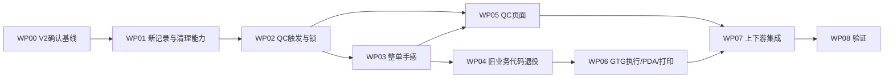

# 印花 QC 单、染厂 QC 单与定型机手感单实施计划

版本：V2，2026-10-22。阶段：U07「执行」后的本地原型技术实施及验收完成。核查基准 `6f4775510f0d2fcfe4583db0d80bfe20b60e7719`；实际分支 `codex/factory-qc-stenter-handfeel`，实现及证据以工作树 manifest 为准。

依据：[需求方案 V2](../product-requirements/2026-10-22-印花QC单染厂QC单与定型机手感单需求方案.md)、[调整方案 V2](../product-design/2026-10-22-印花QC单染厂QC单与定型机手感单调整方案.md)。追踪：[需求原子矩阵](../requirement-traceability/2026-10-22-印花QC单染厂QC单与定型机手感单需求原子矩阵.md)。验证：[验收方案 AC-001～AC-048](../acceptance-plans/2026-10-22-印花QC单染厂QC单与定型机手感单验收方案.md)。

U07 已授权执行以下代码、清理、测试及必要来源归属调整；本轮没有发布要求。U06-01～U06-10 已收口原 O01～O10；不能继续把已确认的首批/部分交出/完成锁/GTG/删除方案列为待用户决策。拟路径、按钮、结果选项和文件限制仍属实施设计。

## 1 边界与开工条件

本次实施按 T4：涉及共享事实、必要来源保存归属、旧业务删除和 Web/PDA/打印。先核对实际分支、完整 HEAD、工作树、需求 V2、已保存用户资料和任务清单。本地未提交实现不能冒充已发布版本；不覆盖无关差异。

本期范围是两类 QC、新定型机手感业务、全部旧洗水业务及直接决定结果的来源/交接/库存/技术资料。删除旧洗水资料和代码的授权明确有效，执行范围按归属和反向引用列清，不延伸为整个 PCS/印染水溶/共享收发记录或任意外部文件清空。第6项保护新流程与非旧洗水原始事实，第10项特定授权删除旧洗水资料。

新记录复用既有 `higood-pcs-records`、公共列表和测试能力，不接后端/云存储，不建通用引擎。必要来源 LS→IDB 或旧bridge→新归属仍须按记录保护、读回和失败恢复；这不是把旧洗水单迁为新手感单。旧格式、旧地址及旧洗水恢复能力不保留。

## 2 工作包与依赖

| 工作包 | 目标 | 依赖 | 完成条件及 AC |
| --- | --- | --- | --- |
| WP00 确认基线 | 把 U06 十条落入需求/设计/矩阵/预期 | 无；确认已收到 | RQ-001～RQ-060/P01～P08/原O映射一致，记录真实确认版本，不伪标产品已验证 |
| WP01 记录与定向清理 | 新事务/附件与必要来源完整，旧洗水资料删除 | WP00 | 新事实原子、完成锁、来源保护、可恢复定向删除；AC-033～AC-041 |
| WP02 QC 事实与触发 | 首次最终批次建一张，后续持续补卷 | WP01 | 各来源/非染厂/补建/三结果完成投影及不可变；AC-001～AC-012/026 |
| WP03 整单手感 | 两来源、四目标、无任何交出才建、固定 GTG | WP01/WP02 | 部分交出/并发不误建，关联唯一，无照片/QC前置；AC-015～AC-021 |
| WP04 旧代码退役与入口 | 删除旧业务全链引用，新身份可直达 | WP01/WP02/WP03 | 无旧菜单/路由/代码/恢复/种子，合法交出不阻；AC-013/014/028～AC-032 |
| WP05 QC 页面 | 单列进度、逐卷记录、完成卷只读 | WP02/WP03 | 两类列表/详情/图片/完成锁/整单区；AC-009～AC-012/015～AC-018/042～AC-044 |
| WP06 手感 Web/PDA/打印 | 两种真实来源，GTG 内部/跨厂执行 | WP03/WP04 | 实际收用产交收、来源/数量/图/打印无失真；AC-022～AC-025/030/042～AC-044 |
| WP07 上下游集成 | 全部实际入口一致，旧删除不毁共用事实 | WP02～WP06 | 数量/库存/结算保护、完成卷锁、无递归/重复；AC-013/014/019/021～AC-027/046 |
| WP08 验证闭环 | 当前版本实现与证据双向追踪 | 适用工作包完成 | 专项/固定页面/持久/清理/设备/图片/打印/性能/语义/治理；AC-045～AC-048 |

隔离开发可并行准备，但运行时需先停旧写、保证必要来源新归属可读，再删除旧专属资料/代码并切换入口。不让新旧可写业务长期并存。

## 3 分包步骤与证据

### WP00 确认基线

1. 将 U06-01～U06-10 与原 O01～O10 逐项对应；保留确认来源和版本，新增 RQ-055～RQ-060。原编号不回收。
2. 固定首批最终实物、任一部分交出整单不建、照片三结果完整、完成卷不可改、仅印花/染色发起及 GTG。旧洗水由保留/映射改全部删除，不做三到四类历史转换。
3. P01～P08 中布局、按钮、文件参数仍明确为设计选择；不能借参数不齐增加建单前置，也不把已完成卷解锁作为配置。

产物：V2 五份文档与覆盖登记。退出：十条已在可执行预期中，不继续保留原10个全局阻塞。文档同步不是产品实施或业务接受。

### WP01 记录、完成锁与定向删除

1. 登记新QC/卷/决定/手感单/Blob→集合→动作→版本和引用；列明 `runDesignRevisionFcsCommand` 未归属目标会直接 recipe、独立水溶原LS不在旧四键桥接两项缺口。
2. 在既有库按记录建新事实，使用 `commitPcsRecords` 的版本/文件引用/操作ID/complete。同步领域 recipe 不嵌异步；文件处理在事务前，完成锁和最新交出守卫在事务内。
3. 所有已完成卷拒改结果、照片、说明、来源/参考快照及完成信息。页面只读之外，直接命令、旧标签、多标签、源更新、适用导入/恢复均拒绝；相同ID重试仅幂等返回。
4. 为旧资料定向清理登记：旧主单/决定/动作/专属附件/Mock/旧格式及专属派生记录全删。旧bridge集合中的印染/共享收发原始事实先转存归属并读回；独立水溶必要源亦按记录调整，非旧洗水资料保留。
5. 停旧写，分批按稳定ID清理并留进度；旧附件仅无任何有效引用才删。失败保留原始来源/输入，恢复后继续，不全库清空、不把旧单迁成新单、不复活旧种子；完成后退役临时旧解析/业务兼容代码。
6. 旧 washing 备份格式和恢复能力删除/拒绝。新业务若复用备份能力，只校验新格式适用记录/标记/附件完整性，不新建业务维护UI，不开放旧文件导入新手感单。

主要落点 F02/F05/F07，底层IDB优先复用。验证 DB01/DB02、AC-033～AC-041。退出：隔离真库的成功/abort/quota/冲突/升级/清理中断均符合；旧资料不可读写恢复，共用原事实完整。必要归属调整与旧业务删除分别提供证据。

### WP02 首批 QC 与持续补卷

1. 按真实最终批次适配印花、染色/组合单、独立水溶、新手感来源，稳定订单/卷/批次、数量单位、现场工厂、投入要求和参考图明确。
2. 印花首次最终实物批次立即建，不等 `finishOrder`/整单结束/人工完单；热转印纸或中间阶段不触发，PDA不能仅凭 `WAIT_HANDOVER` 无实物造单。染色接最终后处理，水溶接实际完工含暂停恢复，手感接实际OUTPUT而非下游实收后的COMPLETE。
3. 一来源一QC，实际稳定卷增量去重补入，已完成卷快照不变；无卷/占位如实待补，不能计划卷数/照片数/kg数冒充应检。卷装水溶花边不按字面“面料”静默过滤。
4. 下游按组织/仓归属分类，未知不作非染厂；已完工染厂→非染厂变更与QC补建同事务，原QC/检查保留。实际写入口包括设计改款绑定/分厂、生产接印花与织带厂等，保留原草稿/实交变更限制。
5. 实现逐卷照片与三结果、完成锁、整单事实摘要和进度，无总体passfail。缺项只挡完成本卷，不挡物流/整单决定。新卷只改变整单投影，不解锁原完成卷。

主要落点 F01～F06。验证 UT01/UT02/DB01、AC-001～AC-012/026。退出：首批/中间/补建/补卷/重复/冷读与冻结快照均成立。

### WP03 两来源整单手感与 GTG

1. 新模型只用来源单级决定，不使用旧卷级WASH/NO_WASH；实际触摸/是否处理/四类目标分字段。仅印花和染色可发起，不给水溶/手感来源递归权限。
2. 固定 GTG（ID-F003），无任意选厂/改派；GTG 本厂内部领用与其他来源实际跨厂区分。目标缺失符合条件也创建，目标如实待补，不伪填、不把资料齐全变建单门槛。
3. 提交事务核对来源最新实际交出；任意部分已交出即整单不新建，不给剩余卷新单。草稿/选卷不等于已交出。构造部分交出与判断两种提交先后和同时判断去重。
4. 同来源已有单复用关联；新增批次沿用整单决定，不改相反、不删已发生实物、不重建QC前置。新增卷/目标调整的控件按真实单状态设计，不提供第二张、自动返工或自动重开已人工完结能力；已完成QC内容不可借决定变更修改。

主要 F02/F06/F09。验证 UT03/DB01/UI01、AC-015～AC-021。退出：无任何交出才建的时序和唯一关联成立，资料不齐/QC未完成不产生额外门槛。

### WP04 删除旧代码并切换全部入口

1. 按调整方案§6删除旧 `fabric-washing-*`、洗水四页、实际追加旧组件、菜单/路由/事件/字段/状态/注册/维护/备份能力。新模块承接确认规则，不能只改名旧卷级业务继续运行。清理专属Mock/测试/脚本/失效文档与素材，公共有效逻辑不误删。
2. 切换新FCS/PDA地址、路由键、渲染器、冷启动和源链接；旧地址及默认跳转不保留，不再导入旧格式。清理工具仅针对旧资料删除与原始来源保护，不能作为旧业务编辑/恢复入口。
3. 印花详情/PDA旧触摸面板、列表候选发起旁路全部删除，整单决定只在QC。所有实际HANDOUT入口取消QC/照片/未判断门槛，保留真实数量/标签/扫描/接收方/重复防错。
4. 删除旧gate的注册/导入/调用；实际USE仍保护真实实收可用量和加工阶段，不能把所有防错改成no-op。新手感投入本身使用合法原料，不把“未完成加工产出不可供下游用”误作原料不得投入。
5. 删除 `actual-washing-route.ts` 并用新实际手感展示替代；同步 `tech-pack/process-domain.ts`、`fcs-production-tech-pack-snapshot.ts`、仓库/PDA/印花打印直接消费者。实际追加不进入预定路线/初始自动分解。
6. 旧源码及失效文档删除后，更新当前消费者和文档链接；本轮源码依据指向原核查 Git 版本，不靠保留旧文件占位或旧可执行模块维持引用。历史证据按其版本身份处理，不混成当前实现。

验证 UT04/UI01/UI02/DB02、AC-013/014/028～AC-032/039/041。退出：新冷直达正确；旧不可见/不可写/不可恢复；无“只藏菜单”或旧代码旁路。

### WP05 QC 页面与只读完成卷

1. 两类列表复用标准列表/表格/分页，参照染色加工单布局；同列已检/应检可点对应全部卷，适用查询/统计/总数一致。
2. 详情显示正确参考与实拍、三结果、完成度/问题和整单决定。建议“保存未完成”“完成本卷质检”，齐全才可完成，完成后只读，无修改/换图/删图/反完成/管理员纠正按钮。
3. 局部保存仅改本卷与必要版本/投影；有质量问题仍可完成，原卷锁定后补新卷不改变原内容。完成后仍可查看原图和追溯；未完成离开提醒/保存失败保留输入，不假称刷新可恢复未保存文件。
4. 整单区明确任意部分已交出只存决定不建；关联GTG/四类目标/待补清楚。素材有来源对应，大图/关闭/遮罩/Esc和失败状态可用；缺必要图登记阻塞。

主要F09。验证UT02/UI01/DB01、AC-009～AC-012/015～AC-018/037/040/042～AC-045。退出：命名设备可执行/查看，完成锁在UI和持久层一致。

### WP06 GTG 手感执行/PDA/打印

1. 新建 `src/pages/process-factory/dyeing/stenter-handfeel/` 按列表/详情/执行弹窗/呈现拆职责；源数据从新事实读，不能染色来源写成印花方。旧四页删除，不留兼容实例。
2. GTG 实收、库位、投入、实产、交出、下游实收按实际卷分批登记；GTG来源内部转入与其他厂跨厂真实区分，不造往返/重复库存，建单不当成交出或实收。
3. PDA共用同一事实，正确原卷/产出卷扫码，保留重复、错卷、数量差异和未保存防错，不新增演示身份门槛。身份/去向/目标待补与下一动作清楚。
4. 新加工单/交接/卷标打印新名称、真实来源、固定GTG、要求、数量单位和去向；保留版本变化重印及图片加载检查，验真实PDF/纸面分页，不仅验HTML。

验证UT04/UI02、AC-022～AC-025/030/042～AC-045。退出：两来源真实GTG内/跨厂闭环、数量图片打印正确，任何QC未完成不增加物流门槛。

### WP07 直接上下游与保留的有效防错

1. 列完整实际入口：印花最终产出/派送扫码/交出、染色最终打包/交出、独立水溶Web/PDA、手感、共享交出/PDA/direct writeback；逐入口标实际路由/动作/写入/回读。
2. 合法未检/检查中/照片未齐/质量问题/未判断手感均可交出；实际数量、单位、错卷、重复、真实接收方和权限负例仍阻断。部分交出后只限制新建手感，不回头限制合法继续交出。
3. 对账实际可用、交、收、用、产、交、收；QC卷数不扣库存，删旧单不自动回补或回滚来源数量。完成卷冻结快照不得因来源/参考变更暗改。
4. 手感首批完成且下游非染厂生成本阶段QC；原QC保留，水溶/手感来源不递归发起。QC不自动推进结算、扣款或冻结，不改既有收货/结算质检。
5. 旧专属洗水契约和脚本删除。新专项以业务结果建立，继承仍有效的数量/实收/库存/历史来源/权限负例，不能为删旧模块顺手取消共享防错。
6. 新静态Mock直接可见、覆盖正常/边界/主要来源去向；不预填真实现场质检，不整批落盘。性能规模与功能状态分开，不在刷新复制旧洗水种子。

验证UT01～UT04/DB01/DB02/UI01/UI02、AC-013/014/019/021～AC-027/046。退出：每个受影响入口有证据，旧业务删除完整且共享原事实不损。

### WP08 验证与关闭

1. 数量、状态、完成锁、删除及并发先最小失败契约；构建 `npm run build` 已含engineering typecheck、npm test、Vite，不机械重复包含项。
2. 旧部分Playwright依赖 `/src/` 导入/内存夹具，仅作诊断；新专项补固定生产资产的真实页面和隔离IDB回读，不能用旧洗水测试通过冒充新规则通过。
3. 执行48个AC及适用性能家族，固定版本/服务/规模/设备，校准后每家族≥5有效样本且每个≤1000ms，保留全部原始值和失败。上传/打印/删除/来源调整无自动豁免，重型运行串行。
4. 同次有效回放可复用功能/图/持久/性能证据；实际修改或失败才补受影响项，不做无范围依据全站重测。
5. 主代理审最终完整diff，正向RQ/原子→实现/证据，反向代码/路由/Mock/存储/测试→需求，检查完成锁、旧删除和共享保护；实际符号/版本/证据绑定矩阵。
6. 文件冻结后适用治理/技术收据，真实业务接受另由用户指定人员确认，不以代理/单测/截图/收据代填。无发布要求不合并/推送/部署。

## 4 文件和测试职责登记

F编号保留，落点按V2重写。旧路径为已退役对象；本表更新为实际实现，矩阵逐条绑定文件/符号，不能只留责任编码。

| 登记 | 实际/拟定责任 | 工作包 | 验证 |
| --- | --- | --- | --- |
| F01 | `src/data/fcs/factory-qc.ts` `listFactoryQcSources/runFactoryQcProcessCommand`；`factory-qc-model.ts` `upsertFactoryQc/applyFactoryQcCommand`；`factory-qc-recipient.ts` 明确去向分类 | WP02 | UT01/UT02，AC-001～AC-012 |
| F02 | `src/data/fcs/factory-qc-records.ts` `runFactoryQcRecordCommand/stageFactoryQcState`；`pcs-record-db.ts` 完成锁、Blob与版本事务 | WP01～WP03 | DB01/UT03，AC-007/017～AC-019/033～AC-040 |
| F03 | `printing-task-domain.ts`、`printing-factory-demos.ts`：最终批次/实物卷/交出/派送；修复冷读不重放已完成实物 | WP01/02/04/07 | UT01/UT04/UI01，AC-001/002/008/013/022 |
| F04 | `dyeing-task-domain.ts` PACK/派送/真实移交；`updateDyeReceivingTarget/getDyeReceivingTargetChangeBlocker` 及 `dyeing/recipient-dialog.ts` 合法去向调整/补QC，覆盖共享交出草稿限制 | WP01/02/04/07 | UT01/UT04，AC-002～AC-006/014/023/024 |
| F05 | `water-soluble-task-domain.ts`、`water-soluble-output.ts`；工厂水溶页、管理分厂页、PDA独立water分支全部等待共同原子命令 | WP01/02/07 | UT01/DB02/UI02，AC-003/014/039 |
| F06 | 旧 model/facade 删除；实际 `factory-qc-model.ts` 承担新规则，`stenter-handfeel.ts` 导出新手感业务 | WP03/04/07 | UT03/UT04，AC-015～AC-027 |
| F07 | 旧repository/storage-bridge/maintenance及备份格式删除；`factory-process-storage.ts`、`legacy-washing-removal.ts` 与 F02 精确清理/必要原始来源保护；既有DB升级v3停止旧写 | WP01/04 | DB01/DB02，AC-033～AC-041 |
| F08 | 旧gates/views/mock删除；实际 `factory-qc-views.ts` 只读展示，`factory-receiving.ts`、工厂仓/PDA交接保留真实数量、接收和用料保护 | WP04/07 | UT04/UI02，AC-013/014/025/027/032 |
| F09 | `src/pages/process-factory/shared/factory-qc.ts` 两类标准列表/卷照片三结果/完成锁/整单决定与局部交互 | WP05 | UI01/DB01，AC-009～AC-012/037/040/044 |
| F10 | 旧washing四页删除；新 `dyeing/stenter-handfeel/{work-orders,presentation,execution-dialog}.ts`；印花events/dialogs/detail去旧面板 | WP04～WP06 | UI01/UI02，AC-013/015/022～AC-024/030 |
| F11 | routes-fcs/routes-pda/routes-pcs/routes-wls/route-renderers*/app-shell-config/main 切换新入口，移除旧路由及兼容跳转 | WP04 | UI01/UI02，AC-028/029/034 |
| F12 | printing-sheet模板/预览、PDA执行/交接/仓库、染厂仓/WLS入仓；`actual-stenter-handfeel-route.ts`及技术资料两个消费者；旧组件和旧washing-stock删除 | WP04/06/07 | UI02/UT04，AC-025/027/030/032 |
| UT01 | `tests/unit/factory-qc-triggers.test.ts`、`factory-qc-recipient.test.ts`、`dye-recipient-change.test.ts` | WP02 | 真实稳定来源/卷结果 |
| UT02 | `tests/unit/factory-qc.test.ts` 逐卷完整性/问题分离/完成锁及源数量修正 | WP02/05 | 完成后拒改、补卷不变原快照 |
| UT03 | `tests/unit/stenter-handfeel.test.ts` 新两来源/四类/GTG/部分交出/去重/明确继续后补卷 | WP03 | 不保留旧卷级和旧阻交出合同 |
| UT04 | `legacy-washing-removal.test.ts`、`retired-process-route.test.ts`、`water-soluble-command-entry.test.ts` 及直接相邻现有数量/路线/时效/接收合同 | WP04/06/07 | 有效防错保留并有新承接 |
| DB01 | 实际 `scripts/verification/factory-qc-browser.mjs`：真IDB/Blob/事务中止/两标签/底层完成锁/冷读及真实来源命令；开发资产诊断证据单列 | WP01 | 不以普通Node内存测试冒充 |
| DB02 | 同 `factory-qc-browser.mjs`：native v2历史夹具、同ID冲突拒绝、精确退役/共享引用/技术资料显式边与重试 | WP01/04 | 不是旧洗水迁移兼容测试 |
| UI01 | 实际 `scripts/verification/factory-qc-preview.mjs`：固定资产真实QC页面及照片/进度/完成锁/决定/查询 | WP05/08 | 两列表/卷/完成只读/整单/冷直达 |
| UI02 | `factory-qc-preview.mjs`：手感Web/PDA/打印；`factory-qc-source-preview.mjs`：印染水溶完工及合法去向补QC的真实固定资产UI | WP06/07/08 | 源导入诊断与固定预览验收区分 |
| PERF01 | 主页面、实际来源和故障三个固定资产collector登记 PF-01～PF-10：主73家族、来源6独立UI阶段与故障15独立UI阶段，共94家族，每家族正式≥5；完整终点/全部有效样本/版本/失败保留 | WP08 | PF-01～PF-10适用家族/完整终点/全部有效样本 |

## 5 阶段退出与版本记录

| 阶段 | 证据 | 退出条件 |
| --- | --- | --- |
| M0 基线 | V2十项确认与60条RQ覆盖、删除/保留/原始来源清单 | 已确认规则进入明确预期；设计参数不私加业务前置 |
| M1 记录与领域 | WP01～WP03专项、真IDB、故障/并发/隔离删除 | 首批、部分交出、完成锁、GTG、原子和定向清理成立 |
| M2 入口与实物 | WP04～WP07页面/冷读/图/PDA/打印/数量/共享保护 | 旧全退役、新GTG链完整、无QC物流门槛和库存失真 |
| M3 技术验收 | WP08固定资产/性能/治理/完整diff语义/当前矩阵 | 所有适用原子有实际证据，失败/素材/未实施真实登记 |
| M4 业务接受 | 实际指定人员与确认版本 | 不代填，不以文档或技术报告冒充 |
| 发布 | 另有明确要求才按T5 | 本轮不授权合并/推送/部署 |

V2变更：原O01～O10已收口；WP01由旧业务迁移改为新记录+必要来源保护+旧资料删除，WP04由简单正式更名改为旧代码全退役；首批、任意部分交出、完成锁、固定GTG进入测试硬契约；新增RQ-055～RQ-060。阶段提交/PR需声明负责的原子编号；U07 后实际实现与专项验证见§6；发布仍未执行。

## 6 U07 实际执行记录

WP00～WP08均已完成技术范围。127条产品/执行原子已验证，8条按文档阶段或无对应业务入口不适用；现场接受、提交、推送及部署未发生。

最终固定资产为asset14：index SHA256 `4cd3863a03f10909fc9d879ca6b5e32c0c7eb276159a08b4feb33b20622d89e4`，JS/CSS资产摘要 `70a4b7b8b4f35692f29f49230bb029c5225c9e3b6b4b2dd04f2d3b7ed2637892`。主页面73阶段/365、来源及GTG内部9阶段/45、故障恢复15阶段/75，合计97阶段/485有效UI样本，每阶段5次，最大884.3ms，无有效慢样本、浏览器错误或资产变化。GC API5次另列。最终完整构建1505/1505，当前70个源文件TypeScript范围0错误；全量另有19个未触及的既有错误。

真实页面覆盖1366×768、1280×720、1024×768及PDA390×844。20份实际PDF包括两卷单页、30卷加工单两页/卷标十页。旧Web/PDA洗水列表/详情四地址实际显示页面未找到、零旧写且无新单重定向。技术验收不代表实体打印/扫码硬件或工厂现场接受。

实际入口、每个阶段起止点、全部样本、文件/记录回读、图片及故障见[实施审查记录](../prototype-review-records/2026-10-22-factory-qc-stenter-handfeel.md)及[48项验收证据索引](../../output/verification/factory-qc-20261022/acceptance-evidence.json)。冻结后的技术收据生成位置为`output/verification/factory-qc-20261022/task-receipt.json`，机器状态以该文件实际内容为准，不预填发布或现场接受。

### 6.1 已实施的必要修正

- 首批最终实物建单、来源下游分类、已完成改非染厂补建、稳定QC身份与按卷追加进入真实共同命令。
- 已完成卷由UI、业务API和原生同版本写入/删除护栏共同锁定；原Blob及快照保留。未检/缺图/未判断/问题结果不阻断合法交出。
- PACK实际实报16/940保留应检16，仅登记1时明确待补15；原码编辑和CSV15条导入补同QC，未完成草稿原图/三结果/说明保持，完成检查不凭补录自动增加。
- 只读精确来源快照共用保存格式，首次有界DYE重建保留五个状态数组；静态文件身份与真实Blob引用分开，旧来源/新来源冲突拒绝覆盖，无假成功或旁支整包写入。
- 无目标仍可条件建手感单，真实START前补目标；GTG同厂内部和外厂转入各有实际页面链，收用产交收分开；新增卷沿同一决定/同一手感单，人工完单后明确CONTINUE。
- 打开失败/提交后回读失败可真实重新读取与同操作重试；旧成功提示不会覆盖失败。阶段只统计未进入下一步的卷，CONTINUE正确待来源交出。
- 新手感PDA按需加载；普通PDA准备路径保留。QC静态投影按需只读，染厂仓一次事实构建复用选项，减去重复读取而不缓存旧库存。
- 旧专属代码、数据/Mock、路由、维护恢复格式、测试和六份活跃设计退役；技术节点/BOM/成本和时效旧单按明确身份精确清理，原印染水溶/共享交接/实收/库存及仍引用附件保留。

### 6.2 失败保留及关闭依据

首轮1443、后续1465构建属于各自历史版本；26条静态退役回归、PDA AST harness依赖、读取恢复及CONTINUE状态、资产11无关AUTO附件写集、资产12首次DYE回读缺数组均已在命名合同/实际页面中修复。GTG首次新collector错误读取已关闭弹窗造成30秒等待，原记录标collector-invalid，修正采集器后校准并正式5次；不是被删除的产品慢样本。全部最终485样本对应同一14资产，最终1505完整构建与其运行资产完全一致。

冻结任务文件后由原生workflow:verify生成独立技术收据，工具对已删测试逐条退回全量测试的重复执行按真实日志保留，不额外扩大产品业务验收。详细失败版本与额外既有脚本边界见实施审查。
