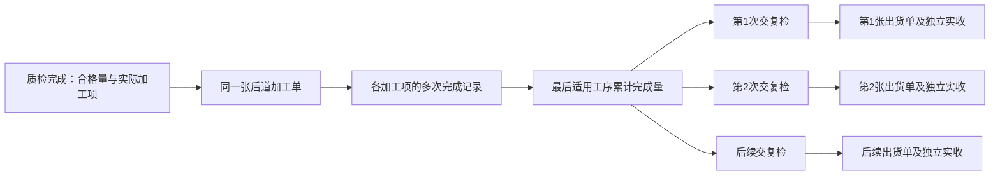

# 后道逐项加工与多次复检出货调整方案

## 1. 范围、继承关系与阶段

- 阶段：实施及业务运行验收已核对，范围治理已通过，正在最终收据与授权发布。用户已授权按本方案和计划执行；当前实现及证据由原子矩阵和本期审查记录绑定。
- 核读版本：`4a0ce9ef5a30e8dec4537de1ff59159543902a25`，工作树 `/Users/laoer/.codex/worktrees/81b7/higoods`，核读开始时为 detached HEAD 且工作区无业务差异；当前实施分支及整合版本见实施计划，核读身份不冒称最终运行版本。
- 需求来源：本会话用户逐次确认的加工项选择、各项多次登记、无需加工批次号或工序单据、列表展示各项数量、复检和出货多次记录。
- 实施性质：将涉及数量、状态、多记录关系和存量迁移，按 T4 规划；本期实施在 `codex/post-finishing-partial-flow` 本地分支进行；本文冻结时未推送或部署；全部验收后已获用户授权合并并推送main，实际发布以最终交付回执和对应GitHub Actions/HTTPS版本为准。
- 配套：[实施及验收计划](../implementation-plans/2026-10-19-后道逐项加工与多次复检出货实施及验收计划.md)、[原子需求矩阵](../requirement-traceability/2026-10-19-后道逐项加工与多次复检出货矩阵.md)。

### 1.1 继承与替代

本会话确认优先于历史方案。历史《后道烫包工序唯一化总体设计》中“内部仅三个加工项”“开扣眼或装扣子自动勾选并锁定烫包”，以及旧实现中的“整单归类后完成、唯一复检、唯一出货”，在本次后道内部执行范围由新规则替代。历史文件保留原版本身份，不批量改写为新需求。

继续沿用：回货实际确认与 PPIC 的正式回货关系、质检独立职责、逐 SKU 计数、条码异常重贴复扫、差异授权、成衣仓独立实收、已有图片与来源追溯、单浏览器本地原型存储边界。

外部任务类型“仅车缝／车缝＋烫包／裁剪＋车缝＋烫包”、合同、能力字典、技术包和履约节点并未被要求整体拆分。本方案仅拆后道内部实际加工登记；外部组合业务“烫包”与内部“熨烫、包装”分层表达，不全仓替换 `IRON_PACK`。

### 1.2 目标与非目标

目标是让同一张后道加工单中，各加工项按实际完成量逐次登记；已走完适用加工链的部分数量可以先复检、先出货，剩余数量继续加工。每次加工、复检、出货、仓库实收保留各自责任和历史。

不新增加工批次号、批次主单、拆批／并批、工序交接单、工序逐次接收确认、人员排班、计件工资、独立工序二维码、真实鉴权或后台服务。不把四个加工项拆为四张加工单。不把每次登记都强制变成一次复检或一次出货。

## 2. 已确认的业务规则

1. 质检可选择开扣眼、装扣子、熨烫、包装中的实际需要项。执行顺序为这四项固定优先顺序筛选后的结果；未勾选项不生成待办，也不占用前置条件。
2. 只选装扣子、包装时，顺序为装扣子→包装；只选熨烫时，熨烫完成量即可交复检；不隐含“包装必须存在”。
3. 加工登记按“加工单＋加工项＋SKU＋本次完成数量＋责任人”记录，可多次发生。系统累计，不用每次覆盖累计数。
4. 不要求整单或全部 SKU 同时完成。前一道已有部分完成，下一道即可在该 SKU 可用量内登记。
5. 每次保存必须保留本次责任人、录入人和时间。多人完成同一项，分别保留其实际数量，不把历史改成最后一人的责任。
6. 加工单仍一单一行，列表直接展示四项累计完成数；未勾选显示“不涉及”，已勾选未登记显示 `0`。
7. 最后一道适用工序已完成的量，扣除已交复检占用量后，才可再次交复检。复检尚未完成也占用，不可重复交同一数量。
8. 同一加工单可有多张复检单、多张出货单及对应实收记录。第 2、3 次不得覆盖第 1 次。
9. 正常待加工、工序间等待、待复检、待仓收属于不同阶段的余量，不能把暂未加工量归为次品、损耗或永久“未处理结案”。
10. 没有加工项时保留质检直达成衣仓分支；质检通过量为 0 时不创建空加工单、空复检单、空出货单。

## 3. 当前代码已确认的问题及调整对象

本节为核读基线版本的源码问题留档，未冒充最终实现、页面运行或现场事实。行号对应核读版本；最终实现和证据按矩阵绑定。

| 对象 | 当前代码已确认 | 对需求的影响 | 调整建议 |
| --- | --- | --- | --- |
| 加工项及责任 | `post-finishing-full-flow.ts:108,128,2755`：三项含烫包；仅车缝分支不可编辑并强制全部项目 | 不能按质检选择实际四项 | 内部执行四项独立定义，默认建议与实际勾选分离；所有适用任务由 QC 确认实际项目 |
| 加工事实 | `:472,2919,2958,3070`：整单已处理／未处理草稿，单一开始人，全部数量归类才整体完成 | 无法表达500／300／200／100；多人责任被整单归属限制 | 新增逐项增量完成记录和统一进度计算，退出新单的整单归类入口 |
| 复检生成 | `:2631`：按加工单查到第一个就返回，固定 ID、单数关联、固定幂等键 | 第二次仍拿第一张，不能再次占用新数量 | 一加工单多复检；每次独立意图、独立数量、独立创建时间，创建时占用 |
| 出货身份 | `:3293`：按生产单＋回货次数生成 ID | 多复检后出货 ID 会碰撞 | 出货身份依附具体复检身份，保持每次来源唯一 |
| 编号归一 | `:4004`：旧归一把子单重写为单一 `-FJ`／`-CH` | 可能把新多单号重新合并 | 版本限定旧迁移；新序号不再被旧归一覆盖 |
| 保存时序 | `post-finishing-records.ts` 的命令包装会持久保存带业务错误码的阶段事实；复检 `full-flow.ts:3485` 先写交出数量再验授权 | 若照搬，新动作可能失败却已占用／已改数 | 新动作先完成全部校验，再一次事务写入；明确允许持久化的异常日志与禁止提交的数量 |
| 加工单读模型 | `post-finishing-current-read-model.ts:665`：各加工项复用同一个已处理量，复检和待交出取第一条 | 各项数量虚同，第二张以后的记录丢失 | 分项累计；集合化关联；不再把摘要冒充单张业务记录 |
| Web/PDA 执行 | `work-order-detail.ts`、`pda-post-finishing-flow.ts` 以整单加工所有者和整体完成按钮执行 | 不支持各项独立多次登记，正常余量被迫写未处理原因 | 改为选实际加工项、填本次数量和责任人；独立交复检入口 |
| 列表 | `work-orders.ts` 只有项目标签和整体量 | 无法在列表直观看各项进度 | 增加四项数量列，并保留整单数量和后续进度摘要 |
| 回货完成 | `full-flow.ts:3638`：任一出货实收后直接把回货设为已完成 | 首100件实收导致整1000件提前完成 | 按全部适用加工量、复检占用和各出货接收情况汇总完成 |
| 追溯 | `:1731,3749`，`tasks.ts`、`audit-records.ts`，平台 `platform-process-result-view.ts:728` 取单条子单或任一已出货即推进总状态 | 输入第2张单也可能显示第1张，部分完成误作全部 | 明确当前子单上下文＋父单全部子单；数量摘要和阶段状态分别展示 |
| 仓库 | `warehouse.ts` 库位视图以库位号覆盖记录；`outbound-orders.ts` 用出货ID查询未支持该ID的待交出查询器 | 同库位多次出货丢明细、详情关联不完整 | 库位按多来源集合汇总；查询器显式支持出货ID和完整单号 |
| PDA交接／成衣仓 | `factory-mobile-warehouse.ts`、`pda-handover-events.ts:1059`、`wls-finished-inbound.ts` 已按记录／出货单列举 | 可复用集合结构，但依赖新单ID唯一、缓存刷新和父状态正确 | 保留各次交接职责，逐单重放多次场景，核对缓存及直达读取 |
| 打印双入口 | `full-flow-print.ts` 与三份打印模板同时存在；后道流转卡仍展示单一后道操作人、单一复检 | 页面改了打印仍可能旧口径；通用条码模板与页面按件标签的份数口径不同 | 按明确加工单／复检／出货身份取数；流转卡展示分项和多记录摘要；标签按当前出货数量，不串其他次 |
| 测试 | 多个现有脚本、E2E 固定三项／唯一复检／唯一出货／整单未处理归类 | 原测试不能直接当新验收标准 | 保留有效职责和数量校验，替换已被需求取代的断言，新增多次占用及存量迁移契约 |

### 3.1 核读的边界

核心文件全文逐行核读范围是 12 个数据文件、16 个后道 Web 文件、2 个专用 PDA 文件和3个后道打印模板，共33文件11,999行，逐文件指纹见文末。另读独立 `public/newpda/post-flow.js` 演示及其接入关系。对仓库、平台结果、通用操作、路由、主入口、任务流转卡等大文件，核查直接相关分支和消费者，未宣称全文阅读整个仓库。

上述表格记录核读基线时的实现。实施已通过 `npm ci` 恢复本工作树依赖，新的浏览器、持久回读、迁移及打印证据独立保存在本任务 evidence 目录。核读基线不替代本期验收证据。

## 4. 目标业务模型与数量规则

### 4.1 业务对象关系

建议每张复检单复核完成后生成一张出货单。这保留现有“单次复检对应单次出货”的简单关系，同时满足父加工单多次复检、出货。不增加复检合单、跨单合并出货、同一复检单再次拆出多张出货等用户未提出的能力。

不改变来源粒度：现有某次回货、对应 QC、对应后道加工单保持可追溯关系；不同回货或不同 QC 不自动混成一张加工单。多次加工登记从后道开始，不能顺带改上游回货、质检为任意拆分模式。

### 4.2 每个 SKU 的加工数量

设该 SKU 的质检通过、进入本加工单的数量为 `Q`；实际选择的顺序为 `P1…Pn`，各项累计完成量为 `C1…Cn`。全部数量为整数件，逐 SKU 校验后才合计。

本节公式适用于没有历史合并承接量的新单；存量单按第7节区分历史已完成供给与剩余新加工范围，不能直接把原Q再次用于新增登记。

| 数量 | 计算／约束 | 业务含义 |
| --- | --- | --- |
| 首项本次可登记量 | `Q − C1` | 该 SKU 仍未完成首道的数量 |
| 后续项本次可登记量 | `C前一适用项 − C本项` | 前一道已完成、本项尚未完成的数量 |
| 本次登记 | 正整数，且不大于本项本次可登记量 | 录入本次实际完成，不录累计数 |
| 累计约束 | `0 ≤ Cn ≤ … ≤ C2 ≤ C1 ≤ Q` | 按实际链约束，不对不存在的项计算 |
| 已完成全部后道量 `F` | `Cn` | 可供复检的总供给量；单项链直接取该项 |
| 尚未完成全部后道量 | `Q − F` | 仍在后道的正常余量 |
| 可再次交复检量 `A` | `F − 已有效占用量` | 仅未被任何复检占用的完成量 |

每次可在一个加工项下填写多个 SKU，0表示本次未登记该行，至少一行大于0；不允许重复 SKU、负数、小数、空白被静默当0、未知SKU或未选项目。不能用其他尺码富余抵消某一尺码超量。不自动替操作者补记前序数量。

本期不要求填写每道在制量、交出量或接收量；系统依据累计差计算等待量。完成数量不是扫码计件证据，原型不能保证实物确实已加工或区分同 SKU 的某一件衣服；数量管理及责任登记不宣传为逐件实体追踪。

### 4.3 复检占用与差异

1. 点击“交复检”，从可用完成量中按 SKU 选择本次交复检量，展示复核确认后生成独立复检单；不要求先把整加工单设为完成。
2. 复检单创建成功即占用。待复检、复检中、条码异常、复检完成的记录均继续约束可用量。释放领取只解除人员领取，不能释放该单数量。
3. 加工保存与交复检是两个业务动作；连续录入最后一项不会自动生成大量复检单。未保存的交复检表单不占用。
4. 同一提交意图重试只返回原复检单；新的明确提交意图才生成下一张。不用“该加工单已经有复检单”作为拒绝再次创建的依据。
5. 复检仍是数量与 SKU 条码复核，保留原差异授权、错码重贴并复扫要求；不新增第二套质量评级、返厂、报废规则。

沿用当前代码已确认的零量边界：本次实际复核总量为0时拒绝完成，即使提供授权也不生成空出货单；原占用和领取保留，输入可修改。多SKU中某行实际为0、其他行有正数时，保留逐SKU差异授权和既有条码前置要求，仅按实际正数形成出货量；零行不产生标签或库存量，原应交和差异仍可追溯。不能按应交数替代实际数出货，也不把全0阻断改成报废／结案能力。

**差异分配是实施前需要业务确认的细节。** 当前代码允许授权后实际复核数与应交数不同，包括多交。多次占用引入后，不能把“授权确认差异”解释成凭空增加完成量，也不能擅自删除已有授权多交能力。建议口径：正常相等时占用应交量；少交部分保留“复检差异待处理量”，不自动回流可再次交复检；多交额外部分须有同SKU未占用完成量且在同事务补占用，超可用时阻断并说明缺口。差异原因、授权人与原应交量均保留。若业务要求少交立即退回可用量，应另行确认退回的实物与责任动作，再调整该条。此项确认不影响对主链需求的理解，但必须在涉及差异的实施包开工前定稿。

建议差异口径下，单张复检占用为 `max(应交量, 实际复核量)`；少交差额单列待处理，不重复计算为实际出货。不能用“累计实收量与Q相等”抵消不同单、不同SKU的未接收或差异。

### 4.4 状态与闭环

| 层次 | 表达 | 判定 |
| --- | --- | --- |
| 加工项 | 待加工／部分完成／已完成／不涉及 | 对该项各SKU累计与Q比较；不涉及不显示待办 |
| 后道加工单 | 待后道／后道中／后道完成 | 无正式完成记录为待后道；已有部分完成为后道中；所有需处理SKU均完成最后适用项才后道完成 |
| 交复检进度 | 可交复检、已交复检、待复检、已复检 | 展示数量与多张记录；不覆盖加工单当前加工状态 |
| 出货进度 | 本次待仓库接收／本次已接收；父单累计已接收X／应交Y | 区分“已生成的出货单都已接收”与“本加工单全部应交量已接收”；前者不构成父单全量完成 |
| 父回货／生产总览 | 保留自身对象身份，汇总后道与下游余量 | 尚有正常加工余量、未完成复检、未接收出货或未解决差异时，不宣布整量闭环 |

后道加工完成和成衣仓接收完成是两个不同结论。全后道完成1000件、仍有900件未交复检时，加工单可为后道完成，后续履行仍未完成。100件已接收、900件仍加工时，展示已接收100、后道未完成900。质检次品与返回量继续由质检事实表达，本次不重新定义生产单终止、返工补产或永久结案条件。

### 4.5 责任与操作规则

QC决定实际加工项；后道人员登记具体项目完成量与责任人；复检员领取并复核具体复检单；成衣仓收货员独立登记具体出货单实收。保留现有原型身份选择，不宣称真实权限系统。

建议加工登记默认责任人为当前操作人，可按现有人员来源选择本次实际责任人；录入人始终另行保留。是否允许代登记及可选责任人范围需业务定稿。不同加工项不能再受整张加工单唯一开始人锁死，但同一提交、同一版本仍必须防并发重复。复检每张单独占领取和释放规则继续保留。

已保存记录不直接覆盖和删除。误录订正策略作为实施前决策：建议主管保留原记录并追加订正原因与版本；减量不能低于后序已登记、已交复检及已出货的占用。需要逆转真实下游时不提供一键强改。本期是否纳入这项有限订正，应在实施范围冻结时确认；即便暂不开放，也必须保留未保存输入修改、失败恢复和冲突提示，不把“重置数据”当订正办法。

## 5. 页面与操作调整

### 5.1 质检列表与质检工作台

- 工作台用四个独立选项；按规范顺序展示，提交后固定本加工单加工链。不自动强制选熨烫或包装，不再因仅车缝任务禁用全部选择。
- 来源责任作为建议或说明，不能覆盖QC实际确认。QC完成后不能直接改链，避免改动已经发生的数量含义；需要改链的特殊处理不在本次默认能力。
- 提交确认明确本次合格量、实际项目、是否需后道。无项目且合格大于0走现有直达出货；合格0不建空单。保留缺陷分类、颜色、尺寸、图片、权限和授权。

### 5.2 后道加工单列表

保留一张加工单一行，标准列表卡片、筛选及分页。建议列顺序：加工单／来源、商品与SKU概况、应处理量、开扣眼完成量、装扣子完成量、熨烫完成量、包装完成量、全部后道完成量、可交复检量、后续进度、加工状态、操作。

四项数量必须直接可见，不能只放悬浮提示、详情或隐藏列。单位统一件，显示如 `500 / 1000`；不涉及用明确文案，不用0混淆。复检摘要如“已交100／待复检100／共1张”，出货摘要如“待接收100／已接收0／共1张”。列较宽时容器内滚动，必要识别列和操作列冻结；页面本身不横向溢出。筛选、统计和总数同范围。

列表提供“登记加工”“交复检”“查看记录”相应入口；只有可交量大于0才允许交复检。无需新建加工批次按钮、工序单据打印或给每次登记编号。

### 5.3 Web详情／登记

详情按实际加工链展示各项累计、尚可登记、责任记录和SKU明细。登记操作选择一项，逐SKU填写本次完成量，指定责任人；保存后显示“本次＋N、累计M、可交复检K”。可用0的项显示原因，例如“前序尚未有可登记数量”，不要求填写无意义备注。

“交复检”独立表单显示各SKU已完成、已占用、当前可交及本次交出数。确认成功后给出具体复检单号，并可再次查看所有复检、出货和实收记录。

正式登记事实与页面草稿分离。普通输入、切换项目、展开弹窗不写业务记录，不整页重绘丢输入。删除新单旧“填写未处理数量”入口和“归类完整单→生成唯一复检”按钮；旧链接按迁移策略只读历史并给有效当前入口，不能继续旧写入。

### 5.4 PDA

保留扫描／输入完整后道加工单号进入，不新增加工批次码。当前任务页突出选定加工项、本次数量、可登记上限与责任人；小屏按项目和SKU卡片录入，登记后可继续当前加工单。交复检使用相同数量规则，展示实际生成的复检单号。

复检仍扫描完整具体复检单号，逐单领取、逐SKU条码校验、重贴复扫、数量授权。父加工单入口展示可选复检单，不能默认拿第一张。待交出、已交出以及员工执行详情均能列出多次记录，不把第1张已完掩盖第2张待处理。PDA仍可在已实现入口手输完整编号兜底。

独立 `public/newpda/post-flow.js` 是纯内存交互演示，含固定批次、三项、单一复检／出货的旧示例。建议同步其后道样例为同一需求口径，保留“刷新重置演示”的边界；它不作为主应用持久化验收证据，不接入新事实源，也不顺带改其他工艺演示。

### 5.5 复检、出货与仓库

- 复检列表按真实复检单一行，来源加工单可重复；增加本次创建时间／序次识别、应交、实际、责任及出货关联。加工单筛选可查全量子单。
- 出货列表按真实出货单一行，明确本次来源复检和本次数量；各张可独立待接收／已接收。详情准确指向本次待交出仓记录和本次实收，不做父单级误配。
- 成衣仓按当前出货单清点并保留本次实收。一张出货单仍沿用现有一次正式实收，父加工单通过多张出货支持多次收货；不额外扩展同一出货单任意分收。
- 待交出库存、SKU汇总和库位视图汇总全部记录，同库位也保留每次来源。出货和实收事实不倒写成加工完成数量。
- 辅料仍按现有整单实配入库，不随成衣分次加工而拆分辅料单。

### 5.6 总览、追溯、统计及打印

总览展示加工单的分项累计及后续数量；追溯从第N张复检／出货进入时优先显示该张上下文，同时列父单全部记录。操作日志细分加工项、本次数量、责任人与录入人，复检／出货／实收保留具体子单号。

统计分别计算加工单数、实际登记次数、复检单数、出货单数。后道成衣完成量只按最后适用项算一次，不能把500＋300＋200＋100当1100件成衣；若保留分项工作量则明确是各项完成件数，不冒充成衣总量。普通待加工量不进入质量缺陷、扣款或未处理损失统计。

保留已存在加工单流转卡、质检单、送检单、出货单、标签打印功能。加工单流转卡是原有父单打印，不新增每次加工单据；展示分项量及多次复检／出货摘要，不能给多人记录印一个虚假总责任人。具体出货打印、条码、吊牌严格按本张出货SKU与数量；两个现存打印入口取数和份数一致。现有通用条码模板每SKU一项与专用页面按件生成存在差异，实施时按现有出货页“按出货数量生成”的可见契约对齐，不扩展通用打印平台。保留真实对应图片、比例与标签条码。

## 6. 直接代码及数据调整建议

### 6.1 最小数据结构

| 对象 | 建议调整 | 不引入的复杂度 |
| --- | --- | --- |
| 内部加工项 | 新局部执行类型／顺序常量，四项独立；来源责任与实际选项分开 | 不拆全局合同、外部任务字典 |
| 加工单 | 保留ID、来源、SKU基数Q；记录所选链、版本；进度由记录计算 | 不创建加工批次实体 |
| 加工完成记录 | 独立按记录保存：内部ID、稳定提交意图、加工单、项目、SKU增量、责任人、录入人、时间、版本 | 内部ID不展示为加工批次号；不把无限历史塞一个主单JSON |
| 复检 | 增加独立创建信息、父加工单关系、本次预占数量；一父多子 | 不新增复检合单、跨QC组单 |
| 出货／待交出／实收 | 出货身份依据具体复检；各自保留直接来源ID和本次数量 | 不以父回货ID去重多次出货 |
| 只读摘要 | 统一分项进度、可登记量、可交复检量、下游汇总计算函数 | 不保留两套可写累计量 |
| 历史承接 | 原记录＋可核对的历史已完成供给／已占用量＋确认映射 | 不补造分项加工人员、时间、数量 |

建议在现有后道记录命名空间中新增加工完成记录集合；复用当前 PCS IndexedDB 记录事务。必要动作共同成功的记录、占用、关联、日志同库同事务；不新建服务器或通用状态机。序号分配、版本检查、提交去重必须包含在保存约束内；界面禁用按钮仅辅助防连点。

当前 `runPostFinishingCommand` 以状态快照计算记录差异并保存。需核对新增集合的主键登记、种子合并、hydration、备份恢复、迁移、revision冲突与PPIC同事务接口。只持久保存本次变化记录，不为每次保存重写整个模块；首次打开／普通读取不得复制整批种子或触发迁移。

### 6.2 命令和查询

建议新建轻量命令：追加某项完成记录、从可用量生成本次复检；轻量查询：计算各项进度、列出父加工单全部复检／出货、按具体子单追溯。名称可在实现时定稿，不把内部函数命名当业务要求。

现有整单绝对数setter和完成函数对新单退出调用；QC创建加工单、复检完成、出货生成、仓库实收、日志关联与演示生成更新为新关系。通用“人工完成后道”入口目前被阻断，继续阻断，不能借本次恢复绕过专用动作。

新复检单号建议为原加工单号加 `-FJ-001、-002…`；出货号按对应复检单加 `-CH`。序次是现有复检／出货单的识别，不是加工批次号。旧单号、条码和历史引用保持；新序号按已用序次分配，不用数组长度，不能因重试或迁移复用。最终显示格式属于方案建议，实施冻结时一并确定。

## 7. 存量与旧逻辑处理

旧记录只有“已处理／未处理”和合并“烫包”，无法可靠还原四项分别完成的时间与人员。不能把旧数平均拆分、复制到四项，或凭空给熨烫和包装各补一次实际操作。

| 存量类型 | 迁移建议 | 继续办理条件 |
| --- | --- | --- |
| 尚未创建后道加工单的QC | 保留来源及原质检事实；新提交按四项选择 | QC人员实际确认新项目 |
| 已建但无加工记录的新旧待办 | 原ID／来源保留；旧烫包需要确认实际熨烫／包装范围 | 完成一次项目核对后启用新登记，不能自动假定两项都需要 |
| 有旧已处理草稿、尚未交复检 | 保留原草稿审计；标记分项事实不充分 | 主管核对当前各项累计、责任和基数后形成明确承接记录；未核对前只读该单，其他新单正常 |
| 旧整体完成且有复检／出货 | 原结果及子单不改号，不重复生成；已完成供给与既有占用承接 | 只读历史展示“历史合并记录／未分项”，不虚构四项统计；有余量需继续时核对剩余加工链 |
| 旧“未处理”余量 | 原原因保留，不能当已完成或消失 | 确认是否仍需加工、是否已有有效处置；未确认的余量不能自动闭环 |
| 旧 schema 1 归档出货链接 | 保留现有只读历史边界 | 不进入当前库存／出货／实收，也不补造现行事实 |

历史已完成全部后道量可作为带明确“历史合并结果”来源的供给承接，与新增分项记录的最后项完成量计算剩余可交；它不是四条加工操作，不能重复计入员工／分项业绩。历史供给和新登记范围不得重叠，按SKU核对既有复检、出货、实收和剩余量。需要人员核对的业务映射没有确定前，不靠技术转换声称迁移完成。

承接的具体计算逐SKU固定为：原应加工量 `Q`；有证据的历史整套后道已完成量 `H`；剩余新加工基数 `N = Q − H`；新增各项累计 `Ci` 仅作用于这 `N` 件，满足 `0 ≤ C末项 ≤ … ≤ C首项 ≤ N`；总完成供给 `F = H + C末项`；总可交复检 `A = F − O`，其中 `O` 包含既有及新建全部有效复检占用。新单H=0，退回4.2的普通公式。无法确认整套已完成的旧草稿不得直接计入H；经核对确认的承接值保留确认人、时间及来源，不冒充原加工时间。

若旧余量已有可证实、仍有效的处置，保留原始数量Q0与处置量E及原处置依据，以仍需加工的 `Q = Q0 − E` 进入上述公式，并按已有处置规则判断其完成条件；不能把有说明的“未处理”一律当有效处置，也不能把已有效处置量无条件重开为待加工。无处置证据则E=0，待核对数量单列。当前承接核对人仅证明本次核对，不自动成为历史加工责任人。

例如原Q1000、历史已完成H400、已有复检占用400，则剩余N600；新增装扣子200、包装100（剩余链仅这两项）后，F500、可再交100，而非把旧400复制到四项或再次交400。历史分项数据不足时，四项栏应表达“历史未分项；新增已完成X／剩余应做600”，另列历史合并完成400，不能把未知显示为0或不涉及。纯历史已完单按历史身份展示，不能强行给出虚假四项完成数。若既有占用O超过有证据的供给，保留既有授权差异和原单，阻断该单自动承接并核对差异；不得补造H或删子单来凑平。后道全部完成在承接单按 `F=Q` 判断，不能要求每个新Ci都达到原Q。

执行顺序严格为登记源和版本→停止受影响旧写→显式分批迁移、稳定来源映射及可续进度→目标读回核对→仅清理已验证且有权清理的旧源→标记完成。保留共用PPIC记录和附件引用，不删库、不清空localStorage、不在普通读取中隐式迁移，不长期双写。未决记录保留原源及恢复路径，不误报全量迁移成功。

建议新增数据版本（当前业务schema为2，目标版本号开工时固定）；旧编号归一只处理旧版本。新四项数据不得被再次合成烫包；旧读入口退出新业务写入后才能切换。当前备份导出／导入需涵盖新增逐项记录及占用；未来导入未知新版本时明确拒绝，不能静默丢字段。

## 8. 主场景与边界示例

### 8.1 1000件，先发100件

同一SKU合格1000，四项均选。先登记开扣眼500、装扣子300、熨烫200、包装100，均分别记录责任人。列表显示500／300／200／100，全部后道完成100、仍需后道900、可交复检100。

第一次交复检100后，可再次交复检变0，即使复检员尚未领取也不能重复交。复检完成100生成出货单1；成衣仓实收100，父单继续加工中，不能全完成。

随后可登记包装本次100，累计200（受熨烫200约束）；再交复检100，形成复检单2及出货单2。第1张记录保持。继续余量后，第3次可交800；最终每项1000，三次复检／出货100＋100＋800，且各次独立仓收完成，正常无差异分支才全量闭环。每一步均按SKU校验，不能只核整单总数。

### 8.2 仅装扣子与包装

Q=1000，装扣子300、包装100：链为装扣子→包装，可交100。熨烫和开扣眼均显示不涉及。下一次包装最多可登记200。只选装扣子时，其完成100即可交100，不等包装。

### 8.3 多SKU不能相互抵消

M码：装扣子300、包装100；L码：装扣子50、包装50。M码包装再加201即失败，L码是否有剩余不改变M码上限。复检单可只交M100或同时交M100/L50，但不能凭总数150交M150。

### 8.4 并行、失败与异常

两个标签页都看见可交100，分别试交100：只允许一个成功，另一提示版本变化并保留输入。保存过程中中止、空间不足或授权失败，不生成孤立占用、出货或成功提示。同一意图重试不多计加工和复检；新的真实完成另用新意图登记。

复检条码错误只阻断该张出货，其他符合条件的复检可以继续；释放领取不放回数量。已有一张出货实收后另一张仍待收，列表、统计与追溯都不能标全部已收。差异规则按4.3定稿，不暗中退回未交实物或增加成衣供给。

## 9. 方案决策与确认边界

已确定：四项选择后按顺序约束、各项独立多次登记、责任人、无加工批次／工序单据、列表逐项量、多次复检与出货。

建议采用：增量录入、显式交复检创建时占用、一复检一出货、父单聚合进度、现有IndexedDB事务、局部内部四项模型。以上选择已随用户“按照调整方案、实施计划执行”的授权采用，按本期矩阵核验实现。

实施冻结前需要定稿的业务细节只有：复检差异的余量处理、允许代登记的人员范围、已保存误录的订正权限和是否纳入本期，以及旧在制单的人工核对口径。编号显示格式可同阶段确定。不能把这些建议写成用户已经逐项批准，也无需为编制本方案提前要求用户作答。

## 附录A. 全文核读文件与版本指纹

以下均覆盖文件首行至末行；指纹用于标识核读版本，不证明运行正确。行数包含空行和注释。直接外部消费者仅核读相关分支，另列于实施计划，不混入这33份全文范围。

| 全文核读文件 | 行数 | SHA256 |
| --- | --- | --- |
| `src/data/fcs/post-finishing-authorization.ts` | 264 | `5c48e7acc529722d8bd2d29cf1a5435f9470da100b117764a74ccfcfafcbd8c8` |
| `src/data/fcs/post-finishing-current-read-model.ts` | 923 | `df7a9016246f0c5ada630e527fa5fe7cf393e683262e00c7c4173be5879c44bc` |
| `src/data/fcs/post-finishing-document-numbering.ts` | 91 | `fe00b2b3e205d849805b6da25cf12af18058c8d955f178f970ac8b4552dc416e` |
| `src/data/fcs/post-finishing-full-flow.ts` | 4017 | `0d134980c7d66fdef5eb27b722d06ad77176abc2ac1c3a05cc1ed84b30ee3515` |
| `src/data/fcs/post-finishing-operation-log.ts` | 136 | `cb366feb3bfc619ba6324a8aaaef00b959037e0f3caec9cc40e8ac89117c46d8` |
| `src/data/fcs/post-finishing-production-source-fixtures.ts` | 48 | `e789f2d9e0c311c579a3bbfe10422e9a471a8f5a08fb058a5ebb4b36ffb22d8d` |
| `src/data/fcs/post-finishing-qc-reference.ts` | 125 | `5df21bde7abc2698b4c00e4864062ede578646f16360a2577ead011874d8543f` |
| `src/data/fcs/post-finishing-records.ts` | 319 | `0eeb2f7fc0686993e9cdea80f4430bcb4f15d4acc764d73fa8ca657d684f261c` |
| `src/data/fcs/post-finishing-return-source-adapter.ts` | 392 | `a3cf1c36713a4c9af072074689804ecb6f0a108080ee79fc81e76b99ad9319c2` |
| `src/data/fcs/post-finishing-return-source-fact-bridge.ts` | 32 | `3bee0b7733aef9e57baca7df3cf793741fa36b8475351aebf71009a2e8b5fd4d` |
| `src/data/fcs/post-process-route.ts` | 267 | `900eb47ec42b124d6601f533e7b2b8ac3116d4c29980e4cd759812724c02b2c5` |
| `src/data/fcs/post-stage-taxonomy.ts` | 30 | `6617f3841b1459e387d6b49baec566c83b1d56f44cae99116ee74c1e0d81efa1` |
| `src/pages/pda-post-finishing-exec-detail.ts` | 224 | `223a07b8c6385fc8435f75e30e6d1aea3ce7fae7d7e05183e88d059b2bf547d0` |
| `src/pages/pda-post-finishing-flow.ts` | 648 | `5c08b008bc4004f2113df3df0c5dcc200acbadc81fb1b718ddb810b0bca4a217` |
| `src/pages/print/templates/post-finishing-outbound-template.ts` | 179 | `43c0c8068d69ce6c808f96907b0fb50996567381a66f6f3e84d0518541a3fcf7` |
| `src/pages/print/templates/post-finishing-qc-print-template.ts` | 401 | `48838ce66660a6768f4fb5d629ef7a6a58009c59707efd1fecb9bfd532f2f5d7` |
| `src/pages/print/templates/post-finishing-route-card-template.ts` | 417 | `69fe2ea6cd2e2e7d3d0bbfc4a10443b32eb3e5b23a920b75cb5aa894f7d32dcb` |
| `src/pages/process-factory/post-finishing/audit-records.ts` | 338 | `99e3ac14a8ec52251c3b879bf596b1b0cb5d93e5f49e27f341bff35d2c4f9489` |
| `src/pages/process-factory/post-finishing/authorization-code.ts` | 51 | `a9b96ade22f5e2e3f4d7e830de23b5d324ae1bc2bd83ed7f0ddc245294582a0f` |
| `src/pages/process-factory/post-finishing/events.ts` | 90 | `8a60e08644714ca991ef961bf61838c278c4ce509e20f464302f2c374b1e9c53` |
| `src/pages/process-factory/post-finishing/full-flow-print.ts` | 224 | `47baa4778d9c432459bf35e6cfb92ff97b6c24190ed99832ad8d49248b0118e1` |
| `src/pages/process-factory/post-finishing/material-transfers.ts` | 118 | `81b18dc4fd448001d7213933ee4bb45cf7f08166aebcc9f2d3b8d9108b83962c` |
| `src/pages/process-factory/post-finishing/outbound-orders.ts` | 170 | `89aa904f086c1fe69800ba970f5a9a9faf48c9b53c26db87761297b979b63cfe` |
| `src/pages/process-factory/post-finishing/qc-orders.ts` | 198 | `46396323fc9cf7c454a5be7de14f148d3b43b9093b405ed56310dc32f4efae22` |
| `src/pages/process-factory/post-finishing/qc-workbench.ts` | 233 | `3a228380519b451fecb03c6e6277afc8dcf258d2fe7bc1d46d8e3051768126c7` |
| `src/pages/process-factory/post-finishing/recheck-orders.ts` | 316 | `56efa77edfa917fa011dde4f7ebcc35b0c1fa25eccdd1836a4014f8ef312562e` |
| `src/pages/process-factory/post-finishing/shared.ts` | 261 | `49c72a0069db84fd462c3058274f2096ca51b62610affc030a60023e6f3584b9` |
| `src/pages/process-factory/post-finishing/statistics.ts` | 94 | `cc67690fb43167b81557bd4adda815b36e4c5f450cd6e72a1a20bb8c72ba8656` |
| `src/pages/process-factory/post-finishing/storage-notice.ts` | 46 | `ae57eb46ee0d71d5ce7cab39113c08c8bb1442f616e1c27400aa0084c88aff95` |
| `src/pages/process-factory/post-finishing/tasks.ts` | 333 | `12435013da8c76712269832d907a400cb873443b94ce62fb7515ad793cd04d81` |
| `src/pages/process-factory/post-finishing/warehouse.ts` | 610 | `521b32b9a830f38a89dbadf97e13e15f9ddeef321c66d8bc267470906365c863` |
| `src/pages/process-factory/post-finishing/work-order-detail.ts` | 229 | `c34405c1e96f6b2cf3de8cb60f798201cad894ba366055e041b4793c3d26f28c` |
| `src/pages/process-factory/post-finishing/work-orders.ts` | 175 | `c314d0d55fed964096f34cec6fec3882a08fdc39032255a4b0eea2e0a91827df` |

## 附录B. 本次文档审阅记录

2026-10-19主代理完成核心源码核读、调整方案与实施/验收映射，并作写后回读。另由1名独立代理仅审阅三份草稿的业务语义与验收覆盖，未代替主代理读代码，未运行产品验收。审阅指出4项需补充：历史H/N/F/O基数闭合、全加工完成但仅部分交复检的父状态、可重放性能规模、复检实际为0边界。三份文档已逐项补充，新增A29/A30验收及D10数值基准，并在矩阵中关联。此记录证明方案经过实质审阅，不证明计划中的功能或性能已经通过。

## 10. 实施冻结与继承记录 V2

本节继承第1～9节目标，记录本期执行选择，不把技术验收写成用户业务接受。授权来源为当前会话“按照调整方案、实施计划执行，并按照原子矩阵、验收方案逐项验收”。

| 冻结项 | 本期采用口径 | 实际位置 |
| --- | --- | --- |
| 复检差异 | 占用为逐SKU `max(应交, 实际)`；少交差额继续占用且待处理，多交须有同SKU未占用完成量；全0阻断，部分SKU0须差异授权 | F复检完成与进度计算 |
| 人员 | 默认当前操作人；Web可选择现有后道操作员／主管为实际责任人；录入人另存；PDA为当前运行身份 | F追加完成；Web详情；PDA |
| 误录订正 | 本期纳入后道主管订正，须原因；原记录保留，以有符号差量登记；不能破坏后序或已占用复检量 | F订正命令；Web主管入口 |
| 历史承接 | H有原合并结果时须一致，N=Q−H；确认剩余实际项目及分项基线，保留旧单号和占用；不补造历史人员时间 | F承接命令；Web主管核对入口 |
| 历史处置 | 当前命名模块未发现具有正式有效处置身份的E事实，旧“未处理原因”不视为处置；本期可执行承接按E=0。未知外来字段进入只读归档，不能借说明自动核销或重开已有正式处置 | R旧源归档；F历史保护 |
| 单号 | 新复检追加-FJ-001等序次，出货归属于本次复检；首张内部ID保留原引用，显示单号有独立序次；旧单号不重写 | 编号函数与创建函数 |
| D10 | 固定100加工单×5SKU×每SKU200件，4000完成记录／1000复检／1000出货，900实收＋100待收；另5张独立动作夹具不减主集 | 性能脚本及fixture清单 |
| D10完整恢复时限 | 2026-10-19用户在本会话明确确认，仅27548条独立记录、约36MB的固定完整备份恢复采用≤10秒；原子性、完整读回、失败保护不变；其余加载和操作仍≤1秒 | 计划第6节；性能家族逐项门槛及原始证据 |

本期继续使用Vanilla TypeScript页面和现有记录事务引擎；未增加服务器、数据库服务、排班、加工批次或工序交接单据。外部“车缝＋烫包”等任务范围保持原义，内部实际执行项目由QC选择。

## 11. 与最新 main 的整合边界（2026-10-20）

用户追加授权：全部适用验收通过后本地合并 main，并推送 GitHub main。本期任务分支先快进到 eb1b8c92（三仓辅料流转），保留新辅料事实源和入口；不能把初始基线的旧整单辅料动作重新开放到已受管生产单。原非受管演示分支仍按现有有效规则核验，受管分支使用逐行数量、后道库位及现有仓管/交接/派单权限。

混合旧资料包可以同时包含服装加工进度与已由辅料仓接管的原辅料。纯辅料包继续走辅料专用归档入口；混合包显式转换加工、复检、出货等事实，受管原辅料仅保留只读历史，不复制为第二套可写辅料库存。完整原包、源身份和附件随非辅料事实在同一 PCS 存储边界保存并读回核对后，才清理已转换的旧源。辅料归档读取同一历史身份，先辅料后加工、先加工后辅料均不重复增加库存。辅料业务后续显式转换仍是其独立动作，不能声称跨库同事务。

后道备份恢复中的受管原辅料行进入只读历史；已有原行同内容不重写，冲突拒绝且原资料不变。后道恢复不改新辅料仓的真实余额；UI说明辅料库存使用辅料仓备份恢复。该整合沿用 PFN-053/054/058–063/068 的数据保护与边界验收，新增真实混合迁移/恢复/故障及受管 PDA 控制，证据另存 main-integration-review，不改写旧基线通过记录。

## 12. main ecc8af01 的直接展示规则对齐

本期原需求编号和数量/责任/主管订正规则继续有效。新增UI02取消详情页“原型操作身份”切换及其假门槛，正常动作直接展示；加工责任仍按本次记录保存。主管订正、历史核对通过本次表单明确选择实际核对主管和填写依据，不能把这一责任确认说成真实鉴权。已确认质检权限、PDA登录工厂责任及领域数量/角色约束保持。成衣仓依main直接展示收货动作，实际收货人姓名仍必填。前次文件与新AGENTS差异详见计划11，不扩大到无关页面改造。

最终运行证据已逐项绑定：51功能、核心100家族520样本、独立相邻25及最终实际PDF质量通过，具体版本/继承/原始值以矩阵、审查记录及evidence/final-performance-acceptance.json为准。仅固定规模完整恢复≤10秒的用户确认继续生效，其余≤1秒。本方案不以代理技术核验冒充实体工厂执行或用户业务接受，最终治理/收据及main发布按实施计划第34节实际关闭。
