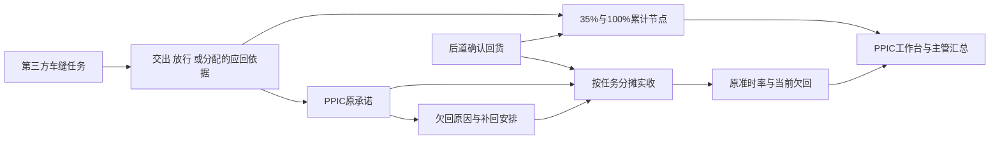

# PPIC每日回货跟进与两节点履约调整具体方案

日期：2026-10-14。版本：V1.1。阶段：本地原型技术验收完成，业务方接受待登记。

本方案面向业务方、产品与研发，覆盖第三方车缝任务的每日回货承诺、后道确认回货、欠回补回、主管汇总，以及合同和各处履约节点的同步调整。实施目标是：每笔承诺都能归到一个任务和工厂，每件实收只计一次，逾期补回保留原逾期事实，所有相关入口统一监控 35% 和 100% 两个累计回货节点。

本次将需求、实施计划和原子验收矩阵合在一份文档中。已确认业务规则见第 2 节；本轮采纳的实施口径集中在第 9 节；最终实现与证据在验证后绑定，本版本尚未完成业务验收。

## 1 范围与继承关系

### 1.1 需求来源

| 来源代号 | 内容及适用范围 |
| --- | --- |
| PDF | 《PPIC每日回货跟进模块需求》，研发需求讨论稿 V1.0，2026-10-07，3 页、10 节；原件位于 `/Users/laoer/Downloads/PPIC每日回货跟进模块需求.pdf` |
| U1 | 用户确认：无缺裁片时，应回数量等于实际交出的齐套数量 |
| U2 | 用户后续确认：缺裁片时，应回数量以裁床待交出仓裁片放行矩阵中的放行数量为准；此前关于高于下限如何计算的疑问关闭 |
| U3 | 用户确认：裁剪＋车缝＋烫包交出面辅料，应回数量等于任务分配数量 |
| U4 | 用户确认：累计回货节点按 PDF，原来的三个节点改成两个；合同模板、任务分配及其他使用位置一起调整 |
| U5 | 用户确认：PPIC 只管第三方车缝工厂；按任务填报，一个任务对应一个工厂 |
| U6 | 用户确认：回货完成以后道工厂确认回货为准 |
| U7 | 用户本轮确认：业务时区Asia/Jakarta，每日提交截止17:00 |

PDF 原件 SHA-256：`a545765aa38411f60c58b68360be253cef74da497c822cdf85df473f669e46d2`。PDF 内的建议和待定项按其原身份处理，不将其当成已经确认的用户指令。

U5 将 PDF 的“日期＋PPIC＋生产单”填报粒度细化为“业务日期＋PPIC＋任务”；生产单保留为查询与汇总维度。U6 明确了正式实收动作。U1～U3 明确了应回数量来源。U4 替代现有 30%／70%／100% 的有效监控规则。其他仍适用的 PDF 要求继续继承。

现有[车缝外发全流程业务理解](车缝外发协同（PPIC）全流程业务理解文档.md)和[任务分配及时效需求](车缝与车缝到后道任务自定义分配及履约时效产品需求文档.md)作为相邻业务背景；本方案只替代上述明确调整的部分，不改写历史审查结果。

### 1.2 实施范围

包括：任务应回数量来源、每日填报与确认、欠回原因和补回、后道实收关联与更正、PPIC 责任移交、主管看板、相关合同打印、任务分配、进度看板、PDA 提示及生产单耗时展示。

保持现有 Vite、TypeScript、Vanilla TypeScript 页面和浏览器本地原型体系。角色范围通过当前演示角色及业务处理器校验实现；30 名 PPIC 用于演示名单与规模验收，不宣称已接入 30 个真实账户。新增数据按记录存入 IndexedDB。

本次不接真实后端、登录权限、云数据库、邮件或消息平台，不建设浏览器关闭后的后台提醒，不扩展裁片退仓、补料审批、质检、结算或无关生产时效规则。



### 1.3 当前实现与证据边界

代码基线：当前工作树 HEAD `3e6412f25bd389985ca1a2045280eff2220f622b`。以下是这一版本的现状，实施前仍应核对新基线及工作区差异。

| 对象 | 已确认现状 | 本次调整 |
| --- | --- | --- |
| 车缝外发模块 | 已有工作台、任务、交出与欠片、批版建议、回货、补料、裁片退仓及责任移交等入口 | 增加每日填报和主管汇总，复用任务、交出及责任关系 |
| 累计回货 | 日历、比例类型、校验及展示均使用三个节点 | 统一为两个节点，保留旧规则版本供历史读取 |
| 应回责任 | 部分履约入口基于分配数量，裁片责任中有分配量、实际齐套量及欠片量等不同字段 | 增加本任务专用的应回来源选择，不能直接将这些字段混用 |
| 正式实收 | 回货跟进读取后道确认的有效数量与版本 | 继续使用该正式来源，补上承诺分摊和真实确认时间与录入时间的区分 |
| 每日承诺 | 当前回货页以任务及履约节点跟进为主 | 新增原承诺、补回安排、日确认及主管提交统计 |
| PPIC 名单 | 当前静态名单有 20 名启用成员、2 名组长，另有停用人员 | 30 人演示名单显式标为 Mock；组长与成员统计分开 |
| 生产单耗时 | 当前函数最终返回固定演示行 | 调整节点列并接入任务事实；固定示例继续明确标为演示 |

前序已逐行阅读车缝外发页面与数据文件，并在此工作树的本地 Mock 页面查看回货正常及逾期场景、任务详情和后道待加工仓。该运行观察用于定位现有入口，不是此方案的实施验收；原型业务时间也不能当成现场当前时间。

## 2 已确认业务规则

### 2.1 按任务确定应回数量

一个车缝任务绑定一个第三方工厂和当前负责 PPIC。任务的颜色、尺码及数量范围必须明确；同一生产单或同一工厂的另一个任务不能借用本任务的交出、放行或实收。

| 任务类型及交出情况 | 应回数量 Q | 数据定位要求 |
| --- | --- | --- |
| 独立车缝、车缝＋烫包，无缺裁片部位 | 该任务实际交出的齐套成衣数量 | 汇总该任务有效简易交出和中转袋交出；分批交出累加，相同来源只计一次 |
| 独立车缝、车缝＋烫包，有缺裁片 | 该任务对应裁片放行矩阵的放行数量 | 按生产单、任务交出范围、颜色、尺码定位有效放行数量；保留缺片部位及数量 |
| 裁剪＋车缝＋烫包，交出面辅料 | 该任务分配数量 | 读取有效任务分配版本，单位为成衣件数 |

应回数量用“件”；缺片明细用“片”。有缺片时，放行数量就是应回数量，不另外增加缺片量，不使用严格齐套量或手工估计量替代。无缺片时，不用尚未交出的计划量冒充实际交出齐套量。

源代码中须区分：放行确认数量、计划放行数量、放行后可分配余量。当前 `getCutPieceDispatchReadinessForTask()` 返回的 `releaseConfirmQty` 是需要核对的实际放行字段，`availableQty` 是扣除已占用后的余量，不能作为任务应回总量。任务共用一个放行记录时，需要有效任务分配／交出关系拆出本任务份额；关系不明确时显示“应回数量来源待核对”，阻断新承诺，不自动按工厂或生产单总量摊分。

还未形成有效交出依据的无缺片任务显示“待交出”，不能用 0 件标成履约完成。分批交出、补交及放行更正产生应回依据新版本；具体历史影响按 D04 决定。缺片状态绑定交出／放行依据版本，补交消除缺片后不得静默切换原依据或改变历史分母，版本生效方式一并按D04落实。

### 2.2 累计回货只监控两个节点

| 任务类型 | 第一节点 | 完成节点 |
| --- | --- | --- |
| 独立车缝／缝纫 | 第 4 天累计至少 35% | 第 9 天累计 100% |
| 车缝＋烫包／缝纫到包装 | 第 5 天累计至少 35% | 第 10 天累计 100% |
| 裁剪＋车缝＋烫包／裁剪到包装 | 第 6 天累计至少 35% | 第 12 天累计 100% |

节点目标件数为 `ceil(Q × 节点比例)`；100% 节点等于 Q。比例判断使用完整件数，页面百分比的显示舍入不能改变达标结果。例如 Q＝101 件时，第一节点至少需要 36 件。

累计正式实收以同一任务的后道确认回货计算。发出、运输中、车缝工厂自行填报、PDA 交接确认、QC 合格数量和成品入库数量均不能替代这个动作。

删除新规则中的 70% 中间监控、对应提醒及新合同表格行。历史三节点记录保留原版本身份，不继续写旧规则，不将旧 70% 结果显示为当前有效节点。

### 2.3 每日填报与补回

PPIC 只操作自己当前负责的第三方车缝任务。每个任务当天可以有多笔回货承诺，每笔包括承诺数量和后道预计确认回货时间。数量为正整数，不能超过可新增承诺量。

“今日无回货安排”仍需确认并填写原因。每日提交截止时间是管理配置，与每笔回货承诺的截止时间分别计算。到日提交截止仍未确认的人员属于“未提交”；承诺到期实收不足属于“到期欠回”，两者分别提醒。

到期欠回需要记录原因、补回数量和新的预计后道确认时间。原因包括：辅料不足、裁片不足或异常、二次增加裁片、工厂生产延迟、运输延迟、其他；选择“其他”必须写明情况。仓库录入延迟单独标识，不能自动记成工厂延迟。

补回安排关联原承诺和原欠回，不产生新的应回任务量。原承诺的数量、截止时间、到期欠回及变更过程保留。当前欠回归零后，仍能查看原逾期及补回时间。

## 3 页面与角色操作

### 3.1 页面入口

| 页面 | 地址及入口 | 主要操作与内容 |
| --- | --- | --- |
| 我的工作台 | 现有 `/fcs/sewing-outsourcing/workbench` | 展示当天提交状态、待补原因、待补回安排及两个节点异常；跳转到具体任务 |
| 每日回货填报 | 拟新增 `/fcs/sewing-outsourcing/daily-return-report` | 当前 PPIC、业务日期；本人任务卡片；新增承诺、无安排原因、确认今日填报 |
| 回货跟进 | 现有 `/fcs/sewing-outsourcing/returns` | 按任务展示应回、累计实收、待回、两个节点及承诺履行情况；详情追溯来源 |
| 每日回货汇总 | 拟新增 `/fcs/sewing-outsourcing/daily-return-summary`，组长工作台进入 | 人员提交、承诺、实收、到期欠回、补回及原因统计，筛选和导出 |
| 后道确认回货 | 现有后道待加工仓入口 | 后道人员确认实际回货数量和实际确认时间；保存后更新承诺分摊与履约 |
| 责任移交 | 现有入口 | 移交当前后续处理权；原承诺的填报人及历史责任不改写 |

每日填报使用任务卡片，主动作是“确认今日填报”。卡片识别信息包括真实款式图片、生产单号、任务号、工厂、生产类型、颜色尺码范围、应回／实收／待回／可新增承诺量。输入只要求数量、预计后道确认时间及必要原因，系统计算其余结果。

“确认今日填报”提交前汇总当天所有本人应填任务，明确哪些已安排回货、哪些无安排。建议每个应填任务必须覆盖一种结果，详见 D02。当天没有应填任务的成员也可确认“今日无负责任务”，主管看到已确认及原因，不与未提交混在一起。

回货详情分成任务概况、两个累计节点、原承诺与补回链、正式实收及分摊、操作记录。原承诺显示原到期欠回和当前欠回两个量，避免补回后看不到原异常。详情同时展示实际后道确认时间和系统录入时间。

主管页查询维度为业务日期、PPIC、工厂、生产单、任务、原因及状态；统计、列表、总数和导出使用相同筛选范围。日提交人数按当日启用应填成员计算，任务维度的数量统计不重复加总成员确认记录。导出全部筛选结果，不只当前页，不包含操作列。

主管列表复用 `renderStandardListPage`、`renderStandardListTable` 和适用分页组件；按染色加工单页面的卡片层级排布，声明 `@page-pattern: list`。员工卡片不强行套管理宽表。图片复用正式素材及大图预览，提供关闭、Esc、加载失败状态。

### 3.2 操作边界

| 角色 | 可操作 | 可查看及追溯 |
| --- | --- | --- |
| PPIC 成员 | 本人任务的每日承诺、无安排确认、欠回原因及补回安排 | 本人当前任务、其交出／放行依据、正式实收及相关历史 |
| PPIC 组长 | 日截止等配置、责任移交；查看全部成员，监督异常 | 全队提交、任务履约、原承诺／补回／更正及导出 |
| 后道回货人员 | 后道确认回货及该动作要求的实际时间 | 当前回货对象和差异 |
| 现有后道回货主管 | 沿用现有条件和权限的回货更正 | 更正前后数量、实际确认时间、录入时间、原因和影响 |

每个业务处理器再次校验角色和当前任务责任，不只隐藏页面按钮。PPIC 不得写正式实收。方案不新增组长随意修改实收或取消欠回的权限；沿用当前差异复点与授权条件。

责任移交后，新 PPIC 接续未完成事项，旧 PPIC 保留自己当时提交的记录。任务当前负责人、承诺创建人、到期责任人分别保存；主管按相应字段查询，不能用当前负责人覆盖所有历史。移交当天哪些任务属于谁的每日应填范围按 D08 决定。

### 3.3 承诺状态和可用动作

| 状态 | 判定 | 主要动作 |
| --- | --- | --- |
| 待履行 | 原截止未到，尚未收齐 | 查看实收；截止前修订按D06执行 |
| 按期兑现 | 原截止前正式实收已满足原承诺 | 查看明细和历史，不继续生成补回 |
| 到期欠回 | 原截止已过，当前仍有未履行量 | 填原因、安排补回或查看当前补回安排 |
| 逾期已补齐 | 曾到期欠回，后续实际确认使当前欠回为0 | 查看原逾期、补回链；建议未填原因时仅补原因，按D05确认 |

缺原因、日填报未提交和来源待核对是独立待办，不能强行塞进承诺履行状态。真实事实更正后按有效评估结果显示当前状态，先前评估留在历史中。

## 4 数量与履行计算

### 4.1 原承诺和补回共用一份欠回

定义：Q 是任务有效应回数量；R 是任务有效正式实收总量；U 是全部原承诺尚未履行量之和。每笔原承诺的尚未履行量为“原承诺数量－归属于它的有效实收分摊量”。

在来源与数量均有效时：

```text
任务待回量 = Q - R
可新增原承诺量 = Q - R - U
原到期欠回量 = max(原承诺数量 - 原截止前实际确认且分摊到该原承诺的数量, 0)
当前欠回量 = 原承诺数量 - 截至当前分摊到该原承诺的有效数量
```

新增原承诺量不超过可新增原承诺量。未分摊的历史实收已经包含在 R，不能再用于抬高新增承诺容量。补回只重新安排 U 中的未完成部分，不再占用一次容量。同一原承诺可以分批补回，但有效待补安排覆盖的数量不能超过该原承诺当前欠回。

来源更正后出现 R＞Q、U＞Q－R 或分摊数量不合法时，显示具体冲突并阻断新增承诺；不能自动压低原承诺、丢掉实收或用负数归零掩盖冲突。后道实收仍按其本身的业务校验处理，PPIC 评估异常不能伪造现场收货事实。

例：Q＝2,000 件，新建原承诺 800 件和 600 件，可再承诺 600 件。第一笔实收 600 件后，R＝600，U＝200＋600＝800，可再承诺仍为 600 件。为第一笔欠回 200 件新增补回安排，可再承诺仍为 600 件。

### 4.2 实收分摊

每笔后道实收按任务匹配承诺；一笔实收可以拆给多笔承诺，每个分摊段归到唯一原承诺，存在补回安排时再关联实际归属的一个安排版本。补回段在父原承诺中汇总，不再作为父层另一笔分摊重复计数。迟录时按实际确认时间识别当时的安排；尚未填写补回安排的逾期实收也能先计入原承诺，再补原因，不能强迫补建未来安排来容纳已收货。

约束为：同一有效实收版本的分摊总量不超过其确认数量；单笔原承诺累计分摊不超过其数量；单个补回安排不超过其有效安排数量；生产单不同任务不得互相抵扣。剩余实收列为“未分摊实收”，不为了消除异常自动塞入一个不符合条件的承诺。

建议优先满足原截止时间较早的原承诺，再按创建时间和稳定编号排序；其补回链选择对应的有效安排，见 D03。同样建议实际确认时间早于原承诺建立时间的实收不用于证明新承诺履行，避免先收货再补填承诺制造准时率；该约束及回溯冲突处理同属 D03，尚需评审。

### 4.3 到期、补回与更正

原承诺到期时，按实际后道确认时间计算准时量与欠回。后续补回实际到货，只减少当前欠回，不把原逾期改为准时。补回再次逾期则继续关联原承诺；有效待补安排只覆盖尚未完成的同一份欠回，旧待补安排转为历史，不叠加需求。安排转历史不使已经兑现的实收分摊失效，分摊的有效性由正式实收版本决定。

例如补回200件、已回120件后再约定剩余80件：120件保留在旧安排的已兑现记录和原承诺累计实收中，只有80件进入新安排。不能撤回120件的实收，不能新建200件补回，也不能将120件再分给新安排。

例如承诺 800 件当日 17:00 回货，截止实际确认 600 件，原准时率为 75%，原到期欠回为 200 件。次日 10:00 补回 200 件后，当前欠回为 0，原准时率仍为 75%，原逾期保留。

若次日才录入“前日 16:50 后道已经确认的 200 件”，则属于补录实际确认，而非次日实际补回。保存实际确认时间、录入时间和原因后，重算原截止前的数量；保留此前评估版本及更正记录。不能将工厂发出时间填作后道确认时间。

当前回货更正受“尚未送检”等既有条件约束。本次增加时间字段时仍保留这些边界，不自动开放已送检回货的任意改数。更正使原分摊失效时，撤销旧版本的有效分摊、计算新版本分摊及相关异常，均在同一保存动作中完成；无效旧版本保留审计身份。

建议已经补齐但原因未填的事项只补原因，不要求制造一条未来补回安排。补回次数建议按每次重新约定截止时间的轮次计，一次将欠回分两行安排不自动算两轮，见 D05。

### 4.4 统计口径

| 指标 | 口径 |
| --- | --- |
| 原承诺量 | 所选原承诺集合的原始承诺数量总和；补回不重复加入 |
| 原准时量 | 每笔原承诺原截止前的有效分摊量，最多计到该笔承诺数量 |
| 原承诺准时率 | 原准时量合计／原承诺量合计；无分母显示“无承诺” |
| 原到期欠回 | 原截止时的欠回，采用有效事实计算版本，并可追溯先前评估 |
| 当前欠回 | 所选已到期原承诺截至当前仍未履行的数量；未到期记录展示待回，不计入到期欠回 |
| 当日实际回货 | 实际后道确认时间落在所选业务日的有效实收量；不以录入日期替代 |
| 日提交率 | 当日已确认应填成员数／当日应填成员数；组长不默认加入成员分母 |
| 两节点达标 | 各任务分别使用截止前正式实收与本任务节点目标比较，再汇总达标任务数 |

平均准时率按件数加权，不对任务百分比简单取平均。生产单汇总保留任务明细，不能用工厂 A 的超额回货抵扣工厂 B 的不足。填报日期、原承诺截止日期、实际回货日期属于不同查询口径，主管页明确显示当前统计使用哪个日期。

## 5 数据结构与原子保存

### 5.1 最小业务对象

| 对象 | 主要字段 | 约束 |
| --- | --- | --- |
| 每日确认 `PpicDailyConfirmation` | 业务日期、PPIC、任务覆盖范围、提交时间、版本、无安排原因 | 一人一日一个有效确认版本；不重复累计提交人数 |
| 原承诺 `PpicReturnPromise` | 稳定记录ID及可识别承诺编号、任务、工厂、创建 PPIC、原数量、原截止时间、创建时间、应回依据版本、修订记录 | 一条独立应回承诺；到期后通过补回接续，不覆盖原到期事实 |
| 补回安排 `PpicReturnMakeupPlan` | 原承诺、前序安排、轮次、待补数量、新截止时间、原因、操作人时间、有效／历史版本 | 关联同一原欠回；不生成新的任务需求 |
| 实收分摊 `PpicReturnAllocation` | 回货单、确认版本、任务、原承诺、适用补回安排、分摊数量、评估版本 | 原承诺与补回共享分摊段；有效版本唯一 |
| 应回依据 `PpicReturnQuantityBasis` | 任务、类型、来源记录与版本、颜色尺码范围、件数、有效时间、变更原因、已有审批／授权记录引用 | 从权威源生成必要引用及计算依据，不复制整个上游模块，不新建审批流程 |
| 配置及操作事实 | 日截止、业务日历／时区规则版本，操作标识、操作者、时间、原因、版本引用 | 配置变化有生效范围；保存失败不能显示已完成 |

仅增加上述任务范围内的字段和记录，不创建通用状态机、事件平台或额外领域框架。原承诺的截止前修改如何保留基准按 D06；责任移交继续读取现有责任版本，不另建第二套可写负责人。

二次增加裁片或订单数量调整必须能沿来源关系追溯既有审批／授权事实，保持原记录身份。缺少已有审批记录或尚未明确的数量调整权限列入D04差异，不编造审批结果，不把来源引用改造扩大成新审批功能。

### 5.2 存储归属与保存边界

| 业务事实 | 当前归属或拟归属 | 本次读写方式 |
| --- | --- | --- |
| 任务分配、合同、裁片交出／放行、责任移交 | 现有裁床记录库 `higood-cutting-records-v1` | 复用生产上下文与裁床记录入口；只保存实际变更记录 |
| 后道回货、有效确认版本、库存及相邻 QC 结果 | 现有 `higood-pcs-records` 的后道记录命名空间 | 复用 `runPostFinishingCommand()` 及现有事务保存 |
| 每日确认、原承诺、补回、分摊、应回依据引用、相关配置和记录 | 拟增加在同一个 `higood-pcs-records` 库中的 PPIC 记录范围 | 为稳定 ID 注册记录范围；记录级读取、版本核对和命令去重 |
| 固定 Mock 与正式图片引用 | 现有静态数据及资源 | 普通打开不复制整包种子到 IndexedDB；用户修改只存必要覆盖 |
| 筛选、分页条数、列偏好 | 有界 localStorage 偏好 | 不保存业务数量、承诺、操作事实或失败后的业务后备数据 |

后道确认／更正的主记录、数量版本、必要库存和 QC 关联结果、PPIC 实收分摊与操作事实，必须在同库同事务内成功，事务 `complete` 后才更新内存与成功提示。新增承诺、补回、每日确认也分别使用带版本核对与稳定操作标识的原子保存。

上游任务与裁床库、后道及 PPIC 库是两个 IndexedDB 数据库，不能跨库假装原子提交。填报时读取上游有效版本及必要数量引用，在保存前核对来源是否变化；保存记录绑定所使用的版本。跨库核对不能宣称锁住上游：后续读取发现来源版本变化时重新评估，保留旧依据，显示影响。若实现发现某动作必须同时改两库才成立，应先统一该动作必要记录归属，不能顺序双写后声称共同成功。

来源读取失败时显示无法读取的具体依据，不当成零库存或空任务，不落种子覆盖。事务失败保留输入及原数据，明确“未保存”，通过原操作标识重试。多标签版本冲突要求重新读取；不只更新页面内存造成假成功。新记录查询应限制到日期、任务及 PPIC 范围，按需要补最小索引，不每次全量复制业务库。

### 5.3 迁移和旧规则处理

1. 登记受影响旧规则、字段、浏览器键／记录范围、合同快照及来源映射。确认有无既存每日承诺数据；没有时不虚构历史承诺。
2. 完成两节点新读写及受控旧版本读取，停止受影响旧规则写入。旧标签提示刷新，处理 `versionchange` 和升级阻塞。
3. 在独立迁移动作中按任务分批建立必要来源映射，保存进度和版本；失败可续，不重新建重复任务。普通读取不隐式迁移或重新播种。
4. 新监控启用两节点；任务原起算日期不因迁移重新开始。历史三节点与合同原件作为历史版本可查，当前监控不出现有效 70% 节点。
5. 读回核对数量、责任、原期限、合同快照及关联。对来源不明确或容量冲突的记录逐条列出，不默认转成分配量。
6. 清理只限经过核对且已有授权的退役数据；共用记录保留。本方案不授权清空用户资料或删除历史合同。

本轮未升级数据库结构或重写既有合同／快照。旧三节点通过只读映射得到当前两节点监控，原资料保持原版；无新的物理迁移或删除，独立迁移中断场景R54本轮不适用。旧有后道资料转换入口沿用，不把普通读取变成迁移。

旧已签／已生成合同保留其原版本。新生成模板使用两行。是否以及怎样重出既存合同、尚未实际交出时怎样表达应回基数，按 D07 决定；不能重新打印历史原件时静默替换成新规则。

## 6 修改文件与实施工作包

本表保留设计阶段的负责范围。新增路径现已落实；第7节逐条绑定实际文件和验证证据，未列修改的相邻消费者通过共享规则读取。

| 工作包 | 业务目标 | 负责文件及入口 | 修改与完成条件 |
| --- | --- | --- | --- |
| W1 应回依据 | 三种数量来源归到同一任务 | 现有 `src/data/fcs/sewing-cut-piece-responsibility.ts`、`src/data/fcs/cut-piece-release.ts`、`src/data/fcs/cutting/simple-cut-piece-handover.ts`、`src/data/fcs/sewing-outsourcing-return-tracking.ts`；拟新增 `src/data/fcs/ppic-return-quantity-basis.ts` | 按任务／颜色／尺码关联真实交出、实际放行或分配量，输出件数、来源、版本与异常；三种来源和共享 SKU 边界均通过契约 |
| W2 两节点共享规则 | 合同、分配及各端统一 35%／100% | `src/data/fcs/sewing-return-calendar.ts`、`task-fulfillment-policy.ts`、`sewing-delivery-sla.ts`、`production-return-fulfillment.ts`、`production-contracts.ts`；`src/pages/print/templates/production-contract-master-template.ts` | 类型、比例数组、天数、规则版本、两节点校验和打印两行一起调整；目标量接 W1，合同量阶段接 D07；旧快照受控读取 |
| W3 承诺及分摊 | 每日确认、原承诺与补回不重复占量 | 拟新增 `src/data/fcs/ppic-daily-return.ts`、`ppic-daily-return-records.ts`；现有 `src/data/fcs/post-finishing-records.ts`、`src/data/pcs-record-db.ts` | 增加必要记录范围、事务命令、角色校验、容量及版本约束、分摊／更正计算；失败和重复提交契约通过 |
| W4 后道确认衔接 | 正式实收时间与录入时间分开，关联即时一致 | `src/data/fcs/post-finishing-full-flow.ts` 的 `registerPostFinishingFactoryReturn`、`confirmPostFinishingFactoryReturn`、`correctPostFinishingFactoryReturnConfirmation`；`src/pages/process-factory/post-finishing/warehouse.ts`、`src/pages/pda-post-finishing-flow.ts` | 复用现有确认及更正边界，增加实际确认时间及补录原因；同事务保存确认版本及 PPIC 分摊，保留更正历史 |
| W5 PPIC 和主管页面 | 日填报、跟进、主管查询与角色范围可用 | 拟新增 `src/pages/sewing-outsourcing/daily-return-report.ts`、`daily-return-summary.ts`；现有 `workbench.ts`、`returns.ts`、`tasks.ts`、`responsibility-transfers.ts`、`src/data/fcs/sewing-outsourcing-workbench.ts`、`factory-onboarding-ppic.ts` | 复用当前任务身份、责任与图片；员工卡片和主管标准列表；筛选统计导出一致，事务失败及移交后续处理可用 |
| W6 消费者与迁移验收 | 各处展示和旧数据读取同步 | 下面的消费者清单、现有相关测试、拟新增专项契约及浏览器用例 | 无旧有效三节点入口，无跨任务抵扣；迁移、各端、打印与性能完成适用验收 |

W1 读取实际放行记录而非只用显示矩阵汇总。现有责任函数中分配量、齐套量与工厂归责量保持各自用途，只让本方案的应回依据决定回货分母，不连带改写补料或欠片责任。

### 6.1 两节点消费者清单

| 消费者 | 具体位置 | 必须同步的行为 |
| --- | --- | --- |
| 分配及重新分配 | `src/pages/unified-dispatch-workbench.ts`、`src/pages/dispatch-tenders.ts` | 分配、竞价中标、改派及预览均使用同一规则版本和两节点 |
| 回货与任务详情 | `src/pages/sewing-outsourcing/returns.ts`、`tasks.ts`、`src/data/fcs/sewing-outsourcing-return-tracking.ts` | 展示正式应回依据和两个节点，不能各自回退为任务分配量 |
| 合同模板及快照 | `src/data/fcs/production-contracts.ts`、`src/pages/production-contract-center.ts`、`src/pages/print/templates/production-contract-master-template.ts` | 三行渲染与固定位置调整为两行；修改期望累计量及阶段量的表达；两页其他内容保持可读 |
| 进度看板及生产单跟踪 | `src/pages/progress-board/task-domain.ts`、`src/pages/production-order-progress-tracking.ts`、`src/data/fcs/sewing-delivery-sla-view.ts` | 比例类型、节点列、状态及截止计算改为两节点，动态卡片不保留三列假设 |
| PDA | `src/pages/pda-exec-detail.ts`、`src/pages/pda-handover-detail.ts` | 展示同一履约结果，交接提示写清后道确认回货的正式依据 |
| 后道待加工仓及后道PDA | `src/pages/process-factory/post-finishing/warehouse.ts`、`src/pages/pda-post-finishing-flow.ts` | 确认输入、双时间及更正后履约一致，不另增独立入仓完成标准 |
| 生产单耗时 | `src/data/fcs/sewing-production-order-duration.ts`、`src/pages/sewing-outsourcing/production-order-duration.ts` | 返回节点列缩为两个，汇总每个任务各自达标；区分来源计算与固定示例 |
| 生产履约相关展示 | `src/pages/production-fulfillment/order-pages.ts` | 只修改引用车缝累计回货规则的字段和图示，不改变其他阶段既有时效 |
| 导航、路由及事件 | `src/data/app-shell-config.ts`、`src/router/routes-fcs.ts`、`src/router/routes.ts`、`src/router/route-renderers-fcs.ts`、`src/main.ts` | 登记两个新入口及角色分支；事件处理局部更新，不因弹窗／筛选整页重绘 |
| Mock 与专项测试 | `src/data/fcs/production-return-progress-mock.ts` 及现有车缝外发演示数据、相关契约和页面测试 | 正常、缺片、分批、拆任务、迟录、更正及历史版本示例；不生成真实业务历史 |

CodeGraph 对 `SEWING_RETURN_RULE_VERSION` 的三层影响查询还列出任务适配器、运行任务、实收事实、门店进度、任务分解及裁片退仓等间接引用。实施时核对这些消费者是否仍使用旧快照、固定长度或回退分母；只修改实际受影响逻辑，其他业务入口执行其相邻回归。批版、补料、裁片退仓和责任移交模块的既有职责继续保留。

实施前用 CodeGraph 对共享规则和类型做一次影响查询，把新增消费者补入该表；只对具体业务字符串做补充文字搜索。样式中的 30%／70% 和其他业务比例不能全局替换。测试中仍有效的历史三节点夹具标明旧版本，不为消除字符串而删除历史验证。

### 6.2 按依赖推进

| 阶段 | 依赖 | 实施内容 | 阶段完成条件 |
| --- | --- | --- | --- |
| A 口径与契约 | 第 9 节中直接影响该阶段的决定 | 将数量、时间、分摊及历史影响落实为最小业务契约，登记存储边界 | 正常与边界结果明确；未决口径不写成隐性代码规则 |
| B 共享依据和节点 | A 的 D01、D04、D07 | W1、W2；任务应回来源和两节点先统一 | 三种应回来源正确；同一依据版本下有效监控入口目标一致，三个任务类型比例及期限一致；合同预估量与正式应回量按D07分别标识和引用 |
| C 原子记录和后道 | B 的任务依据；D03、D05、D06 | W3、W4；原承诺、补回、分摊、时间和更正保存 | 不重复占量、跨任务阻断、失败无半套数据、重开读回一致 |
| D 页面和责任 | C；D02、D08 | W5 及 W6 各端消费者 | 日提交、欠回、移交、主管汇总、PDA 和打印场景通过 |
| E 切换与最终核验 | B～D | 独立迁移、最终完整 diff 审查和原子矩阵验收 | 适用条目全部有当前版本证据；历史可读，未授权资料未删除 |

需要保存、迁移或打开依赖库的实现按项目存储规则执行。用户已指示按方案执行，本轮开始业务构建、浏览器及性能验收。

## 7 原子验收矩阵

矩阵按需求逐条绑定当前实现和实际验证。代码基线 HEAD 保持不变；本轮未提交差异的源码集合身份与逐文件SHA256见最终源码清单。技术验证不能替代业务方接受。

证据目录为 `output/ppic-daily-return/`。U1～U7由本会话用户确认，D01～D08已随执行决定V1.1采纳。确认栏“Codex／V1.1”表示2026-10-14本地原型技术核验，源码集合SHA256为 `6214f7534ec6a54d226742d990f7ddb65bd400bb289031db751acdd3717d156e`；产品接受由业务方另行完成。证据代号在下表后有实际位置。

| 编号 | 来源 | 可独立判定的原子结果 | 工作包及位置 | 实际自动化验证 | 页面 PDA 打印 性能证据 | 状态 | 证据位置 | 确认人与版本 |
| --- | --- | --- | --- | --- | --- | --- | --- | --- |
| R01 | U5 | 只纳入第三方车缝任务 | `src/data/fcs/ppic-daily-return-records.ts` · `taskViews` | `tests/unit/ppic-daily-return-summary.test.ts` | 契约；人员任务范围；B1 | 已验证 | 本行契约；B1～B3、P1～P3按适用项；G1 | Codex／V1.1（技术） |
| R02 | U5 | 一个填报对象只关联一个任务及工厂 | `src/data/fcs/ppic-daily-return-records.ts` · `taskViews` | `tests/unit/ppic-daily-return-summary.test.ts` | 契约；人员任务范围；B1 | 已验证 | 本行契约；B1～B3、P1～P3按适用项；G1 | Codex／V1.1（技术） |
| R03 | U1 | 无缺片应回量等于任务实际交出齐套量 | `src/data/fcs/ppic-return-quantity-basis.ts` · `getPpicReturnQuantityBasis / derivePpicReturnQuantityBasis` | `tests/unit/ppic-return-quantity-basis.test.ts` | 来源及版本契约；回货依据追溯；B3 | 已验证 | 本行契约；B1～B3、P1～P3按适用项；G1 | Codex／V1.1（技术） |
| R04 | U1 | 相同交出来源不重复计入应回量 | `src/data/fcs/ppic-return-quantity-basis.ts` · `getPpicReturnQuantityBasis / derivePpicReturnQuantityBasis` | `tests/unit/ppic-return-quantity-basis.test.ts` | 来源及版本契约；回货依据追溯；B3 | 已验证 | 本行契约；B1～B3、P1～P3按适用项；G1 | Codex／V1.1（技术） |
| R05 | U2 | 有缺片应回量等于任务对应实际放行量 | `src/data/fcs/ppic-return-quantity-basis.ts` · `getPpicReturnQuantityBasis / derivePpicReturnQuantityBasis` | `tests/unit/ppic-return-quantity-basis.test.ts` | 来源及版本契约；回货依据追溯；B3 | 已验证 | 本行契约；B1～B3、P1～P3按适用项；G1 | Codex／V1.1（技术） |
| R06 | U2/U5 | 共用放行范围不明时阻断新承诺 | `src/data/fcs/ppic-return-quantity-basis.ts` · `getPpicReturnQuantityBasis / derivePpicReturnQuantityBasis` | `tests/unit/ppic-return-quantity-basis.test.ts` | 来源及版本契约；回货依据追溯；B3 | 已验证 | 本行契约；B1～B3、P1～P3按适用项；G1 | Codex／V1.1（技术） |
| R07 | U3 | 裁剪到包装应回量等于任务分配量 | `src/data/fcs/ppic-return-quantity-basis.ts` · `getPpicReturnQuantityBasis / derivePpicReturnQuantityBasis` | `tests/unit/ppic-return-quantity-basis.test.ts` | 来源及版本契约；回货依据追溯；B3 | 已验证 | 本行契约；B1～B3、P1～P3按适用项；G1 | Codex／V1.1（技术） |
| R08 | U1～U3 | 应回量显示件，缺片量显示片 | `src/pages/sewing-outsourcing/daily-return-report.ts` · `renderPpicDailyReturnReportPage` | `tests/ppic-daily-return-pages.spec.ts` | 应回件数及缺片片数；Web/PDA；B1、B3 | 已验证 | 本行契约；B1～B3、P1～P3按适用项；G1 | Codex／V1.1（技术） |
| R09 | U4/PDF8 | 独立车缝只监控第4天35%和第9天100% | `src/data/fcs/sewing-return-calendar.ts` · `SEWING_RETURN_COUNTING_DAYS / calculateSewingReturnDeadlineDate` | `tests/unit/sewing-return-two-nodes.test.ts` | 三类型节点与101件取整；日历专项；B3 | 已验证 | 本行契约；B1～B3、P1～P3按适用项；G1 | Codex／V1.1（技术） |
| R10 | U4/PDF8 | 车缝烫包只监控第5天35%和第10天100% | `src/data/fcs/sewing-return-calendar.ts` · `SEWING_RETURN_COUNTING_DAYS / calculateSewingReturnDeadlineDate` | `tests/unit/sewing-return-two-nodes.test.ts` | 三类型节点与101件取整；日历专项；B3 | 已验证 | 本行契约；B1～B3、P1～P3按适用项；G1 | Codex／V1.1（技术） |
| R11 | U4/PDF8 | 裁剪到包装只监控第6天35%和第12天100% | `src/data/fcs/sewing-return-calendar.ts` · `SEWING_RETURN_COUNTING_DAYS / calculateSewingReturnDeadlineDate` | `tests/unit/sewing-return-two-nodes.test.ts` | 三类型节点与101件取整；日历专项；B3 | 已验证 | 本行契约；B1～B3、P1～P3按适用项；G1 | Codex／V1.1（技术） |
| R12 | U4 | 节点件数向上取整且100%等于Q | `src/data/fcs/sewing-return-calendar.ts` · `SEWING_RETURN_COUNTING_DAYS / calculateSewingReturnDeadlineDate` | `tests/unit/sewing-return-two-nodes.test.ts` | 三类型节点与101件取整；日历专项；B3 | 已验证 | 本行契约；B1～B3、P1～P3按适用项；G1 | Codex／V1.1（技术） |
| R13 | U4 | 新合同累计回货表只有两个有效节点 | `src/pages/print/templates/production-contract-master-template.ts` · `renderProductionContractMasterTemplate` | `tests/ppic-shared-consumers.spec.ts` | 实际新合同2页图片及行数；B3；P3 | 已验证 | 本行契约；B1～B3、P1～P3按适用项；G1 | Codex／V1.1（技术） |
| R14 | U4 | 任务分配和改派均生成新的两节点版本 | `src/data/fcs/task-fulfillment-policy.ts` · `classifyTaskFulfillmentPolicy` | `tests/unit/sewing-return-two-nodes.test.ts` | 分配预览及提交合同；改派共享规则契约；B3 | 已验证 | 本行契约；B1～B3、P1～P3按适用项；G1 | Codex／V1.1（技术） |
| R15 | U4 | 进度看板读取共享两节点规则 | `src/pages/progress-board/task-domain.ts` · `renderSewingDeliverySlaDetail` | `tests/ppic-shared-consumers.spec.ts` | 正式任务详情两节点及未知来源；B3；P3 | 已验证 | 本行契约；B1～B3、P1～P3按适用项；G1 | Codex／V1.1（技术） |
| R16 | U6 | 只有后道确认回货增加正式实收 | `src/data/fcs/post-finishing-full-flow.ts` · `confirmPostFinishingFactoryReturn / correctPostFinishingFactoryReturnConfirmation` | `tests/ppic-daily-return-receipts.spec.ts` | 后道Web确认/授权订正/双时间/持久回读；B2；P2 | 已验证 | 本行契约；B1～B3、P1～P3按适用项；G1 | Codex／V1.1（技术） |
| R17 | PDF2/U5 | PPIC不能写其他成员任务的承诺 | `src/data/fcs/ppic-daily-return.ts` · `addPpicPromise / arrangePpicMakeup / syncPpicReceipts / ppicPromiseResult` | `tests/unit/ppic-daily-return.test.ts` | 数量、截止及分摊契约；新增/修订/补回/失败读回；B1、B2；P1、P2 | 已验证 | 本行契约；B1～B3、P1～P3按适用项；G1 | Codex／V1.1（技术） |
| R18 | PDF2/U6 | PPIC不能修改正式实收 | `src/data/fcs/post-finishing-full-flow.ts` · `confirmPostFinishingFactoryReturn / correctPostFinishingFactoryReturnConfirmation` | `tests/ppic-daily-return-receipts.spec.ts` | 后道Web确认/授权订正/双时间/持久回读；B2；P2 | 已验证 | 本行契约；B1～B3、P1～P3按适用项；G1 | Codex／V1.1（技术） |
| R19 | PDF3 | 同一任务同日允许多笔原承诺 | `src/data/fcs/ppic-daily-return.ts` · `addPpicPromise / arrangePpicMakeup / syncPpicReceipts / ppicPromiseResult` | `tests/unit/ppic-daily-return.test.ts` | 数量、截止及分摊契约；新增/修订/补回/失败读回；B1、B2；P1、P2 | 已验证 | 本行契约；B1～B3、P1～P3按适用项；G1 | Codex／V1.1（技术） |
| R20 | PDF3 | 原承诺数量为正整数且不超可新增量 | `src/data/fcs/ppic-daily-return.ts` · `addPpicPromise / arrangePpicMakeup / syncPpicReceipts / ppicPromiseResult` | `tests/unit/ppic-daily-return.test.ts` | 数量、截止及分摊契约；新增/修订/补回/失败读回；B1、B2；P1、P2 | 已验证 | 本行契约；B1～B3、P1～P3按适用项；G1 | Codex／V1.1（技术） |
| R21 | PDF3/5 | 补回不重复占用原承诺容量 | `src/data/fcs/ppic-daily-return.ts` · `addPpicPromise / arrangePpicMakeup / syncPpicReceipts / ppicPromiseResult` | `tests/unit/ppic-daily-return.test.ts` | 数量、截止及分摊契约；新增/修订/补回/失败读回；B1、B2；P1、P2 | 已验证 | 本行契约；B1～B3、P1～P3按适用项；G1 | Codex／V1.1（技术） |
| R22 | PDF4/D02 | 无安排须确认原因并纳入日提交状态 | `src/data/fcs/ppic-daily-return.ts` · `confirmPpicDay` | `tests/unit/ppic-daily-return.test.ts` | 任务覆盖/无任务/无安排/重新确认；B1；P1 | 已验证 | 本行契约；B1～B3、P1～P3按适用项；G1 | Codex／V1.1（技术） |
| R23 | PDF4/D02 | 日提交截止只产生未提交提醒 | `src/pages/sewing-outsourcing/workbench.ts` · `renderSewingOutsourcingWorkbenchPage` | `tests/unit/ppic-daily-return.test.ts` | 日截止与承诺截止独立；P3加载；日确认B1 | 已验证 | 本行契约；B1～B3、P1～P3按适用项；G1 | Codex／V1.1（技术） |
| R24 | PDF4 | 每笔承诺到期按自己的截止时间算欠回 | `src/data/fcs/ppic-daily-return.ts` · `addPpicPromise / arrangePpicMakeup / syncPpicReceipts / ppicPromiseResult` | `tests/unit/ppic-daily-return.test.ts` | 数量、截止及分摊契约；新增/修订/补回/失败读回；B1、B2；P1、P2 | 已验证 | 本行契约；B1～B3、P1～P3按适用项；G1 | Codex／V1.1（技术） |
| R25 | PDF3/6 | 欠回原因按原因字典记录 | `src/data/fcs/ppic-daily-return.ts` · `addPpicPromise / arrangePpicMakeup / syncPpicReceipts / ppicPromiseResult` | `tests/unit/ppic-daily-return.test.ts` | 数量、截止及分摊契约；新增/修订/补回/失败读回；B1、B2；P1、P2 | 已验证 | 本行契约；B1～B3、P1～P3按适用项；G1 | Codex／V1.1（技术） |
| R26 | PDF6 | 其他原因必须有说明 | `src/data/fcs/ppic-daily-return.ts` · `addPpicPromise / arrangePpicMakeup / syncPpicReceipts / ppicPromiseResult` | `tests/unit/ppic-daily-return.test.ts` | 数量、截止及分摊契约；新增/修订/补回/失败读回；B1、B2；P1、P2 | 已验证 | 本行契约；B1～B3、P1～P3按适用项；G1 | Codex／V1.1（技术） |
| R27 | PDF3/6 | 未补齐欠回须能登记数量和新截止 | `src/data/fcs/ppic-daily-return.ts` · `addPpicPromise / arrangePpicMakeup / syncPpicReceipts / ppicPromiseResult` | `tests/unit/ppic-daily-return.test.ts` | 数量、截止及分摊契约；新增/修订/补回/失败读回；B1、B2；P1、P2 | 已验证 | 本行契约；B1～B3、P1～P3按适用项；G1 | Codex／V1.1（技术） |
| R28 | PDF6/D05 | 补回再次逾期保留前轮并更新有效安排 | `src/data/fcs/ppic-daily-return.ts` · `addPpicPromise / arrangePpicMakeup / syncPpicReceipts / ppicPromiseResult` | `tests/unit/ppic-daily-return.test.ts` | 数量、截止及分摊契约；新增/修订/补回/失败读回；B1、B2；P1、P2 | 已验证 | 本行契约；B1～B3、P1～P3按适用项；G1 | Codex／V1.1（技术） |
| R29 | PDF5 | 一笔实收允许拆给多笔同任务承诺 | `src/data/fcs/ppic-daily-return.ts` · `addPpicPromise / arrangePpicMakeup / syncPpicReceipts / ppicPromiseResult` | `tests/unit/ppic-daily-return.test.ts` | 数量、截止及分摊契约；新增/修订/补回/失败读回；B1、B2；P1、P2 | 已验证 | 本行契约；B1～B3、P1～P3按适用项；G1 | Codex／V1.1（技术） |
| R30 | PDF5 | 同一实收版本有效分摊不超确认量 | `src/data/fcs/ppic-daily-return.ts` · `addPpicPromise / arrangePpicMakeup / syncPpicReceipts / ppicPromiseResult` | `tests/unit/ppic-daily-return.test.ts` | 数量、截止及分摊契约；新增/修订/补回/失败读回；B1、B2；P1、P2 | 已验证 | 本行契约；B1～B3、P1～P3按适用项；G1 | Codex／V1.1（技术） |
| R31 | PDF5 | 父承诺及补回不重复计同一实收段 | `src/data/fcs/ppic-daily-return.ts` · `addPpicPromise / arrangePpicMakeup / syncPpicReceipts / ppicPromiseResult` | `tests/unit/ppic-daily-return.test.ts` | 数量、截止及分摊契约；新增/修订/补回/失败读回；B1、B2；P1、P2 | 已验证 | 本行契约；B1～B3、P1～P3按适用项；G1 | Codex／V1.1（技术） |
| R32 | U5/PDF5 | 不同任务实收不能互抵 | `src/data/fcs/ppic-daily-return.ts` · `addPpicPromise / arrangePpicMakeup / syncPpicReceipts / ppicPromiseResult` | `tests/unit/ppic-daily-return.test.ts` | 数量、截止及分摊契约；新增/修订/补回/失败读回；B1、B2；P1、P2 | 已验证 | 本行契约；B1～B3、P1～P3按适用项；G1 | Codex／V1.1（技术） |
| R33 | PDF5/D03 | 分摊顺序按确认的优先规则稳定计算 | `src/data/fcs/ppic-daily-return.ts` · `addPpicPromise / arrangePpicMakeup / syncPpicReceipts / ppicPromiseResult` | `tests/unit/ppic-daily-return.test.ts` | 数量、截止及分摊契约；新增/修订/补回/失败读回；B1、B2；P1、P2 | 已验证 | 本行契约；B1～B3、P1～P3按适用项；G1 | Codex／V1.1（技术） |
| R34 | PDF5 | 实际确认与系统录入时间分别保存 | `src/data/fcs/post-finishing-full-flow.ts` · `confirmPostFinishingFactoryReturn / correctPostFinishingFactoryReturnConfirmation` | `tests/ppic-daily-return-receipts.spec.ts` | 后道Web确认/授权订正/双时间/持久回读；B2；P2 | 已验证 | 本行契约；B1～B3、P1～P3按适用项；G1 | Codex／V1.1（技术） |
| R35 | PDF5/9 | 准时实收迟录后正确重算原截止结果 | `src/data/fcs/ppic-daily-return.ts` · `addPpicPromise / arrangePpicMakeup / syncPpicReceipts / ppicPromiseResult` | `tests/unit/ppic-daily-return.test.ts` | 数量、截止及分摊契约；新增/修订/补回/失败读回；B1、B2；P1、P2 | 已验证 | 本行契约；B1～B3、P1～P3按适用项；G1 | Codex／V1.1（技术） |
| R36 | PDF6/9 | 截止后补齐不抹掉原逾期及原准时率 | `src/data/fcs/ppic-daily-return.ts` · `addPpicPromise / arrangePpicMakeup / syncPpicReceipts / ppicPromiseResult` | `tests/unit/ppic-daily-return.test.ts` | 数量、截止及分摊契约；新增/修订/补回/失败读回；B1、B2；P1、P2 | 已验证 | 本行契约；B1～B3、P1～P3按适用项；G1 | Codex／V1.1（技术） |
| R37 | PDF5 | 数量更正重算分摊并保留旧版本 | `src/data/fcs/post-finishing-full-flow.ts` · `confirmPostFinishingFactoryReturn / correctPostFinishingFactoryReturnConfirmation` | `tests/ppic-daily-return-receipts.spec.ts` | 后道Web确认/授权订正/双时间/持久回读；B2；P2 | 已验证 | 本行契约；B1～B3、P1～P3按适用项；G1 | Codex／V1.1（技术） |
| R38 | PDF6 | 仓库录入延迟单独归因 | `src/data/fcs/post-finishing-full-flow.ts` · `confirmPostFinishingFactoryReturn / correctPostFinishingFactoryReturnConfirmation` | `tests/ppic-daily-return-receipts.spec.ts` | 后道Web确认/授权订正/双时间/持久回读；B2；P2 | 已验证 | 本行契约；B1～B3、P1～P3按适用项；G1 | Codex／V1.1（技术） |
| R39 | PDF7 | 准时率按原承诺件数加权且补回不加分母 | `src/data/fcs/ppic-daily-return-records.ts` · `getPpicDailySupervisorView` | `tests/unit/ppic-daily-return-summary.test.ts` | 不等量加权/筛选/30成员分页与全量导出；B1；P1 | 已验证 | 本行契约；B1～B3、P1～P3按适用项；G1 | Codex／V1.1（技术） |
| R40 | PDF7 | 当日实收按实际确认日统计 | `src/data/fcs/ppic-daily-return-records.ts` · `getPpicDailySupervisorView` | `tests/unit/ppic-daily-return-summary.test.ts` | 不等量加权/筛选/30成员分页与全量导出；B1；P1 | 已验证 | 本行契约；B1～B3、P1～P3按适用项；G1 | Codex／V1.1（技术） |
| R41 | PDF7 | 查询统计列表及全量导出范围一致 | `src/data/fcs/ppic-daily-return-records.ts` · `getPpicDailySupervisorView` | `tests/unit/ppic-daily-return-summary.test.ts` | 不等量加权/筛选/30成员分页与全量导出；B1；P1 | 已验证 | 本行契约；B1～B3、P1～P3按适用项；G1 | Codex／V1.1（技术） |
| R42 | PDF1/7 | 30成员Mock显示已提交和未提交 | `src/data/fcs/ppic-daily-return-records.ts` · `getPpicDailySupervisorView` | `tests/unit/ppic-daily-return-summary.test.ts` | 不等量加权/筛选/30成员分页与全量导出；B1；P1 | 已验证 | 本行契约；B1～B3、P1～P3按适用项；G1 | Codex／V1.1（技术） |
| R43 | PDF2/D08 | 责任移交不改历史提交人和到期责任 | `src/data/fcs/ppic-daily-return-records.ts` · `getPpicDailyReturnView / getPpicTaskPromiseHistory` | `tests/unit/ppic-daily-return-summary.test.ts` | 真实运行任务11时/13时移交，12时到期责任不变；原填报人历史/他人阻断；B1角色及共享处理器 | 已验证 | 本行契约；B1～B3、P1～P3按适用项；G1 | Codex／V1.1（技术） |
| R44 | PDF8/D01 | 节点按确认的起算事件日历时区计算 | `src/data/fcs/sewing-return-calendar.ts` · `SEWING_RETURN_COUNTING_DAYS / calculateSewingReturnDeadlineDate` | `tests/unit/sewing-return-two-nodes.test.ts` | 三类型节点与101件取整；日历专项；B3 | 已验证 | 本行契约；B1～B3、P1～P3按适用项；G1 | Codex／V1.1（技术） |
| R45 | PDF8/D04 | 应回依据变化保留版本及历史评估影响 | `src/data/fcs/ppic-return-quantity-basis.ts` · `getPpicReturnQuantityBasis / derivePpicReturnQuantityBasis` | `tests/unit/ppic-return-quantity-basis.test.ts` | 来源及版本契约；回货依据追溯；B3 | 已验证 | 本行契约；B1～B3、P1～P3按适用项；G1 | Codex／V1.1（技术） |
| R46 | PDF6/D06 | 截止前修订留痕且截止后不能覆盖原承诺 | `src/data/fcs/ppic-daily-return.ts` · `addPpicPromise / arrangePpicMakeup / syncPpicReceipts / ppicPromiseResult` | `tests/unit/ppic-daily-return.test.ts` | 数量、截止及分摊契约；新增/修订/补回/失败读回；B1、B2；P1、P2 | 已验证 | 本行契约；B1～B3、P1～P3按适用项；G1 | Codex／V1.1（技术） |
| R47 | D07/U4 | 合同阶段数量依据按确认口径表达 | `src/data/fcs/production-contracts.ts` · `buildTemplateSnapshot / generateProductionContract` | `tests/unit/sewing-return-two-nodes.test.ts` | 合同预估与正式依据；原合同保持身份；实际2页B3；P3 | 已验证 | 本行契约；B1～B3、P1～P3按适用项；G1 | Codex／V1.1（技术） |
| R48 | STORE02 | 后道确认及PPIC分摊同事务共同成功 | `src/data/fcs/post-finishing-records.ts` · `runPostFinishingCommand / ensurePostFinishingRecordState` | `tests/ppic-daily-return-receipts.spec.ts` | 真实PCS中止/并发/重试/刷新/独立PDA/打开读取失败；B1、B2；P2 | 已验证 | 本行契约；B1～B3、P1～P3按适用项；G1 | Codex／V1.1（技术） |
| R49 | STORE02 | 重复提交不重复建承诺或分摊 | `src/data/fcs/ppic-daily-return.ts` · `addPpicPromise / arrangePpicMakeup / syncPpicReceipts / ppicPromiseResult` | `tests/unit/ppic-daily-return.test.ts` | 数量、截止及分摊契约；新增/修订/补回/失败读回；B1、B2；P1、P2 | 已验证 | 本行契约；B1～B3、P1～P3按适用项；G1 | Codex／V1.1（技术） |
| R50 | STORE02 | 多标签冲突可识别且不覆盖另一版本 | `src/data/fcs/post-finishing-records.ts` · `runPostFinishingCommand / ensurePostFinishingRecordState` | `tests/ppic-daily-return-receipts.spec.ts` | 真实PCS中止/并发/重试/刷新/独立PDA/打开读取失败；B1、B2；P2 | 已验证 | 本行契约；B1～B3、P1～P3按适用项；G1 | Codex／V1.1（技术） |
| R51 | STORE01/02 | 刷新重开及下游直达能读回一致记录 | `src/data/fcs/post-finishing-records.ts` · `runPostFinishingCommand / ensurePostFinishingRecordState` | `tests/ppic-daily-return-receipts.spec.ts` | 真实PCS中止/并发/重试/刷新/独立PDA/打开读取失败；B1、B2；P2 | 已验证 | 本行契约；B1～B3、P1～P3按适用项；G1 | Codex／V1.1（技术） |
| R52 | STORE01/02 | 普通读取不写种子或业务localStorage后备 | `src/data/fcs/post-finishing-records.ts` · `runPostFinishingCommand / ensurePostFinishingRecordState` | `tests/ppic-daily-return-receipts.spec.ts` | 真实PCS中止/并发/重试/刷新/独立PDA/打开读取失败；B1、B2；P2 | 已验证 | 本行契约；B1～B3、P1～P3按适用项；G1 | Codex／V1.1（技术） |
| R53 | STORE04/U4 | 旧三节点可读但不继续成为有效监控 | `src/data/fcs/production-return-fulfillment.ts` · `projectCurrentProductionReturnRuleSnapshot` | `tests/unit/sewing-return-two-nodes.test.ts` | 旧3节点原件只读保留，活动监控2节点；B3 | 已验证 | 本行契约；B1～B3、P1～P3按适用项；G1 | Codex／V1.1（技术） |
| R54 | STORE04 | 迁移中断可续且共用历史资料保留 | `src/data/fcs/post-finishing-records.ts` · `既有独立迁移入口未改变` | `tests/unit/sewing-return-two-nodes.test.ts` | 本轮无物理迁移/旧源删除；新增空对象仓库逐记录存储，旧规则受控读取；不适用 | 不适用 | 本行契约；B1～B3、P1～P3按适用项；G1 | Codex／V1.1（技术） |
| R55 | UI01/LIST01 | 管理页在1366及1280宽无主体横向溢出 | `src/pages/sewing-outsourcing/daily-return-summary.ts` · `renderPpicDailyReturnSummaryPage` | `tests/ppic-daily-return-pages.spec.ts` | 管理1366×768/1280×720，无主体溢出；B1、B3 | 已验证 | 本行契约；B1～B3、P1～P3按适用项；G1 | Codex／V1.1（技术） |
| R56 | UI01 | 员工Web在1024×768完成主动作 | `src/pages/sewing-outsourcing/daily-return-report.ts` · `renderPpicDailyReturnReportPage` | `tests/ppic-daily-return-pages.spec.ts` | 员工1024×768新增/失败重试/日确认；B1 | 已验证 | 本行契约；B1～B3、P1～P3按适用项；G1 | Codex／V1.1（技术） |
| R57 | IMAGE01 | 款式图片对应且可关闭高清预览 | `src/pages/sewing-outsourcing/daily-return-report.ts` · `renderPpicDailyImage / renderPpicDailyImageDialog` | `tests/ppic-daily-return-pages.spec.ts` | 正式静态图映射/高清/Esc/失败态；后道/PDA图片B2、B3 | 已验证 | 本行契约；B1～B3、P1～P3按适用项；G1 | Codex／V1.1（技术） |
| R58 | PERF01 | 适用首屏与关键操作各不超过1秒 | `output/ppic-daily-return/` · `3份performance脚本及JSON` | `本地production-preview真实时钟采样` | 每家族5样本/每值≤1000ms；加载/切换/成功/失败/导出；P1～P3 | 已验证 | 本行契约；B1～B3、P1～P3按适用项；G1 | Codex／V1.1（技术） |
| R59 | TRACE01 | 最终完整diff与需求正反向一致 | `docs/prototype-review-records/ppic-daily-return-20261014.md`、`scripts/workflow-governance/affected-checks.ts`、`tests/ppic-daily-return.config.ts` · `需求审查与专项运行器` | `最终完整diff及治理门禁` | 当前源码manifest/独立审查/任务收据；G1 | 已验证 | 本行契约；B1～B3、P1～P3按适用项；G1 | Codex／V1.1（技术） |
| R60 | PDF2/U5 | PPIC只能读取授权任务及约定可读历史 | `src/data/fcs/ppic-daily-return-records.ts` · `getPpicDailyReturnView / getPpicTaskPromiseHistory` | `tests/unit/ppic-daily-return-summary.test.ts` | 真实运行任务11时/13时移交，12时到期责任不变；原填报人历史/他人阻断；B1角色及共享处理器 | 已验证 | 本行契约；B1～B3、P1～P3按适用项；G1 | Codex／V1.1（技术） |
| R61 | PDF3 | 每笔原承诺有唯一稳定编号 | `src/data/fcs/ppic-daily-return.ts` · `addPpicPromise / arrangePpicMakeup / syncPpicReceipts / ppicPromiseResult` | `tests/unit/ppic-daily-return.test.ts` | 数量、截止及分摊契约；新增/修订/补回/失败读回；B1、B2；P1、P2 | 已验证 | 本行契约；B1～B3、P1～P3按适用项；G1 | Codex／V1.1（技术） |
| R62 | PDF3 | 日期与当前PPIC自动带出且不能越权改归属 | `src/pages/sewing-outsourcing/daily-return-report.ts` · `renderPpicDailyReturnReportPage` | `tests/ppic-daily-return-pages.spec.ts` | 业务日和演示身份自动带出/历史日只读；B1 | 已验证 | 本行契约；B1～B3、P1～P3按适用项；G1 | Codex／V1.1（技术） |
| R63 | PDF4/D02 | 只有组长角色可修改每日截止配置 | `src/data/fcs/ppic-daily-return.ts` · `changePpicConfig / ppicConfigAt` | `tests/unit/ppic-daily-return.test.ts` | 成员拒绝/生效日/17点原提交快照/不可覆盖过去日；B1；P1 | 已验证 | 本行契约；B1～B3、P1～P3按适用项；G1 | Codex／V1.1（技术） |
| R64 | PDF4/D02 | 截止配置按生效范围保留历史提交判断 | `src/data/fcs/ppic-daily-return.ts` · `changePpicConfig / ppicConfigAt` | `tests/unit/ppic-daily-return.test.ts` | 成员拒绝/生效日/17点原提交快照/不可覆盖过去日；B1；P1 | 已验证 | 本行契约；B1～B3、P1～P3按适用项；G1 | Codex／V1.1（技术） |
| R65 | PDF8 | 数量变更可追溯既有审批授权来源 | `src/data/fcs/ppic-return-quantity-basis.ts` · `getPpicReturnQuantityBasis / derivePpicReturnQuantityBasis` | `tests/unit/ppic-return-quantity-basis.test.ts` | 来源及版本契约；回货依据追溯；B3 | 已验证 | 本行契约；B1～B3、P1～P3按适用项；G1 | Codex／V1.1（技术） |
| R66 | PDF5/6 | 补回安排历史化不使已兑现实收失效 | `src/data/fcs/ppic-daily-return.ts` · `addPpicPromise / arrangePpicMakeup / syncPpicReceipts / ppicPromiseResult` | `tests/unit/ppic-daily-return.test.ts` | 数量、截止及分摊契约；新增/修订/补回/失败读回；B1、B2；P1、P2 | 已验证 | 本行契约；B1～B3、P1～P3按适用项；G1 | Codex／V1.1（技术） |
| R67 | U4 | 生产单进度跟踪显示两节点及任务分母 | `src/data/fcs/production-return-progress-mock.ts` · `ensureProductionReturnProgressMockFacts` | `tests/ppic-shared-consumers.spec.ts` | 43行独立静态Mock逐任务分母；正式任务依据另见R03～07及R15；B3；P3 | 已验证 | 本行契约；B1～B3、P1～P3按适用项；G1 | Codex／V1.1（技术） |
| R68 | U4 | 执行和交接PDA读取相同两节点结果 | `src/pages/pda-exec-detail.ts / src/pages/pda-handover-detail.ts` · `车缝履约提示` | `tests/ppic-shared-consumers.spec.ts` | 执行/交接/现场接收预览同35/100规则；390×844；B3；P3 | 已验证 | 本行契约；B1～B3、P1～P3按适用项；G1 | Codex／V1.1（技术） |
| R69 | U4/U6 | 后道仓的履约提示只使用两节点 | `src/pages/process-factory/post-finishing/warehouse.ts` · `回货确认与履约提示` | `tests/ppic-daily-return-receipts.spec.ts` | 正式双时间/同事务订正；1024×768；B2、B3；P2 | 已验证 | 本行契约；B1～B3、P1～P3按适用项；G1 | Codex／V1.1（技术） |
| R70 | U4 | 生产单耗时只列两个累计节点且逐任务达标 | `src/data/fcs/sewing-production-order-duration.ts` · `listSewingProductionOrderDurationRows` | `tests/unit/ppic-duration.test.ts` | 实际来源和明确演示数据；未知任务仍在完成分母；B3；P3 | 已验证 | 本行契约；B1～B3、P1～P3按适用项；G1 | Codex／V1.1（技术） |
| R71 | PDF5/U6 | 后道PDA确认记录双时间并原子更新分摊 | `src/pages/pda-post-finishing-flow.ts` · `后道confirm-return处理器` | `tests/ppic-daily-return-receipts.spec.ts` | PDA冷开入口即持久原子分摊；390×844；B2；P2 | 已验证 | 本行契约；B1～B3、P1～P3按适用项；G1 | Codex／V1.1（技术） |
| R72 | UI01 | 适用PDA小屏完成受影响主动作 | `src/pages/pda-post-finishing-flow.ts / src/pages/pda-handover-detail.ts` · `受影响执行与交接动作` | `tests/ppic-shared-consumers.spec.ts` | 390×844实际流程/真实图/两节点/件数；B2、B3；P2、P3 | 已验证 | 本行契约；B1～B3、P1～P3按适用项；G1 | Codex／V1.1（技术） |
| R73 | D03 | 历史实收不能制造新原承诺履行 | `src/data/fcs/ppic-daily-return.ts` · `addPpicPromise / arrangePpicMakeup / syncPpicReceipts / ppicPromiseResult` | `tests/unit/ppic-daily-return.test.ts` | 数量、截止及分摊契约；新增/修订/补回/失败读回；B1、B2；P1、P2 | 已验证 | 本行契约；B1～B3、P1～P3按适用项；G1 | Codex／V1.1（技术） |

### 7.0 实际证据索引

| 代号 | 实际证据与范围 |
| --- | --- |
| U-C | [最终边界契约](../../output/ppic-daily-return/boundary-contracts-final.log)：18项，含不等量加权、真实责任移交、读取隔离、截止快照；其他数量/节点/耗时契约由全量构建及专项日志绑定 |
| B1 | [填报及汇总末轮5项](../../output/ppic-daily-return/pages-accessible-final.log)：1024×768、1280×720、1366×768；保存失败/重试/刷新、历史日、角色、补回、分页导出、图片、焦点及站内身份 |
| B2 | [后道及消费者末轮14项](../../output/ppic-daily-return/browser-precision-final.log)（后道8项）：双时间、未来阻断、普通/主管权限、订正毫秒保留/同秒立即读取、PCS原子中止/并发/唯一重试、PDA冷开分摊、IDB失败恢复 |
| B3 | [末轮共享消费者6项](../../output/ppic-daily-return/browser-precision-final.log)及[原消费者版本记录](../../output/ppic-daily-return/consumer-browser.log)及[当前截图目录](../../output/ppic-daily-return/browser-final-artifacts/)：分配/实际新合同2页、回货追溯、正式任务看板、43行跟踪Mock、耗时、DDS、后道Web、PDA执行/交接/确认；保留原运行服务与源码哈希身份 |
| P1 | [填报及汇总性能](../../output/ppic-daily-return/performance.json)：41家族×5；95→100原承诺、5补回、30成员，全量导出95条；冷资源、刷新、切换、成功与失败分别记录 |
| P2 | [后道Web/PDA性能](../../output/ppic-daily-return/receipt-performance.json)：7家族×5，导航/刷新/确认/主管订正/中止失败；每样本真实图片及PCS持久读回 |
| P3 | [共享消费者及剩余动作性能](../../output/ppic-daily-return/consumer-performance.json)：命名消费者导航、两页打印预览、PDA、列顺序/排序/恢复/页容量、浏览器进程冷启动及空库首次初始化 |
| G1 | [完整治理记录](../prototype-review-records/ppic-daily-return-20261014.md)、[最终源码清单](../../output/ppic-daily-return/final-source-manifest.json)与[冻结后技术收据](../../output/ppic-daily-return/task-receipt.json)；不是业务方接受回执 |

### 7.0 实际证据索引

| 代号 | 实际证据与范围 |
| --- | --- |
| U-C | [最终边界契约](../../output/ppic-daily-return/boundary-contracts-final.log)：18项，含不等量加权、真实责任移交、读取隔离、截止快照；其他数量/节点/耗时契约由全量构建及专项日志绑定 |
| B1 | [填报及汇总末轮5项](../../output/ppic-daily-return/pages-accessible-final.log)：1024×768、1280×720、1366×768；保存失败/重试/刷新、历史日、角色、补回、分页导出、图片、焦点及站内身份 |
| B2 | [后道及消费者末轮14项](../../output/ppic-daily-return/browser-precision-final.log)（后道8项）：双时间、未来阻断、普通/主管权限、订正毫秒保留/同秒立即读取、PCS原子中止/并发/唯一重试、PDA冷开分摊、IDB失败恢复 |
| B3 | [末轮共享消费者6项](../../output/ppic-daily-return/browser-precision-final.log)及[原消费者版本记录](../../output/ppic-daily-return/consumer-browser.log)及[当前截图目录](../../output/ppic-daily-return/browser-final-artifacts/)：分配/实际新合同2页、回货追溯、正式任务看板、43行跟踪Mock、耗时、DDS、后道Web、PDA执行/交接/确认；保留原运行服务与源码哈希身份 |
| P1 | [填报及汇总性能](../../output/ppic-daily-return/performance.json)：41家族×5；95→100原承诺、5补回、30成员，全量导出95条；冷资源、刷新、切换、成功与失败分别记录 |
| P2 | [后道Web/PDA性能](../../output/ppic-daily-return/receipt-performance.json)：7家族×5，导航/刷新/确认/主管订正/中止失败；每样本真实图片及PCS持久读回 |
| P3 | [共享消费者及剩余动作性能](../../output/ppic-daily-return/consumer-performance.json)：命名消费者导航、两页打印预览、PDA、列顺序/排序/恢复/页容量、浏览器进程冷启动及空库首次初始化 |
| G1 | [完整治理记录](../prototype-review-records/ppic-daily-return-20261014.md)、[最终源码清单](../../output/ppic-daily-return/final-source-manifest.json)与[冻结后技术收据](../../output/ppic-daily-return/task-receipt.json)；不是业务方接受回执 |

毫秒边界专项见[12项节点契约](../../output/ppic-daily-return/millisecond-queries-final.log)，覆盖`.000`等值、`.500`晚到及秒精度操作格式保留；最终后道同秒已保存事实立即读取见B2。

### 7.1 来源覆盖核对

| 来源 | 对应结果 |
| --- | --- |
| PDF1 背景目标 | R19、R22、R39～R42 |
| PDF2 角色与责任 | R17、R18、R43、R60 |
| PDF3 填报与欠回 | R19～R21、R24～R27、R61、R62 |
| PDF4 日流程与提醒 | R22～R24、R63、R64；第 8 节提醒边界 |
| PDF5 实收关联 | R16、R29～R35、R37、R38、R66、R71；D03及R73 |
| PDF6 异常与版本 | R25～R28、R36～R38、R46、R66 |
| PDF7 查询及统计 | R39～R43 |
| PDF8 累计回货规则 | R09～R15、R44、R45、R65 |
| PDF9 示例与验收 | R17、R20、R30、R35、R36 |
| PDF10 原待确认项 | 已采纳D01～D08；R02、R34、R44～R47 |
| U1／U2／U3 | R03～R08、R45 |
| U4／U5／U6／U7 | R01、R02、R09～R18、R32、R43、R53、R60、R67～R71 |

合同、PDA、任务分配、进度与耗时消费者分别在 R13～R16、R47、R53、R67～R72 验收，不能只验每日填报页就关闭整项需求。

## 8 验证场景与交付条件

优先编写数量、时间及分摊的最小契约，再接页面和存储。浏览器用例以真实动作读取保存结果，不只断言 HTML 文案。

| 场景 | 输入与期望 |
| --- | --- |
| 正常齐套交出 | 分配1000件、已交出齐套800件，无缺片，应回800件；后续有效交出产生新依据，不提前用1000件承诺 |
| 缺片放行 | 对应实际放行900件、严格齐套700件、可分配余量200件，应回900件；缺片单独展示 |
| 面辅料任务 | 裁剪到包装分配1200件，无裁片交出也按1200件应回 |
| 同单两个工厂 | 两任务各有数量和承诺，A实收超前不能让B节点达标 |
| 容量与补回 | 重放第4.1节2000件示例，补回前后可新增量不变 |
| 到期再补齐 | 重放800件承诺、600件准时、200件次日补回，保留75%原准时率 |
| 准时实收迟录 | 原截止前真实确认、次日录入，结果按真实时间重算，保留录入延迟及评估历史 |
| 实收更正 | 数量减少后原分摊失效，重新计算欠回；事务失败时主记录、关联和分摊全都保持原值 |
| 先收货再填报 | 新原承诺不能占用已实收量；回溯修正造成容量冲突时显示冲突，不消掉旧承诺 |
| 责任移交 | 到期前后移交分别重放，旧提交与历史责任可追，新负责人接续待办 |
| 日确认 | 多笔承诺、无安排、无任务、未提交、截止后补交可区分；当日名单变更可追溯 |
| 两节点与合同 | 三种类型、101件取整、跨月周日、分配改派、旧三节点快照及两页打印 |
| 持久与升级 | 首次打开、刷新、下游直达、双标签、重复重试、库打开失败及迁移中断；不覆盖源资料 |

页面验收覆盖主管 1366×768、最低 1280×720，员工 Web 1024×768 和实际涉及的 PDA 小屏；打印验两页完整内容、节点行位置及旧合同身份。性能测试记录版本、路由、设备、数据规模和至少 5 个原始样本；适用首屏、提交、查询、详情及确认动作各不超过 1 秒，无例外授权。30 人 Mock 应包含无任务、无安排、多人多任务、逾期和迟录，不用实际账号或数据库写入制造场景。

性能按每个等价家族至少 5 个有效样本，包含首次及适用边界，保留全部原始值和最大值。冷启动、刷新、站内切换以及成功、失败分别按适用条件取证，不能合并挑快值；任何有效样本超过 1000ms 即对应条目未完成。功能覆盖登记每个受影响入口，不能用一个家族的性能样本代替其他入口的功能核验。

提醒使用原型内工作台和主管待办：打开页面以及页面保持打开时按业务时间刷新。关闭浏览器后的推送、服务器定时任务及外部消息渠道超出本次范围。此边界在产品文案中不能写成“系统已通知工厂”。

交付包含：当前需求和矩阵、最终受影响文件清单及完整 diff 审查、适用构建／专项契约／列表治理、浏览器持久回读及失败证据、PDA／打印／性能样本、迁移结果和未解决项。自动化检查通过与业务方接受分别记录；有未完成条目时不宣称完整交付。附件新建／复制／删除能力未新增时，不额外扩展附件维护工具；如实施触及附件保存，应补其适用原子验收。

## 9 实施口径与决定记录

这些决定不改变 U1～U6。用户已指示按方案执行，并明确业务时区为Asia/Jakarta、每日提交截止17:00。本轮采纳原建议；以下补充将它们落实为可验证口径。

| 决定 | 当前信息 | 方案提出时口径 | 原影响及决定时点（已由下述V1.1闭合） |
| --- | --- | --- | --- |
| D01 起算与业务日历 | 当前代码从分配业务日算第1天、按自然日含周日，截止日末；PDF未定起算事件、日历和时区 | 保持分配业务日为第1天、自然日，日末23:59:59；明确实际使用的业务时区 | 影响全部节点、合同和耗时，阶段B前确认；用户设备时区不能自动当作业务时区 |
| D02 每日确认范围和日截止 | PDF要求可配置日截止及无安排确认，没有指定具体时刻 | 每个当日应填任务覆盖“承诺”或“无安排”；无任务也确认；日截止由组长配置并注明生效日 | 影响未提交名单；用户已确认初始Asia/Jakarta 17:00；后续设置按生效日和提交快照判断 |
| D03 分摊优先级及历史实收 | PDF建议按最早承诺截止分摊，未定补回多轮排序 | 按原截止优先，创建时间和编号稳定排序；补回按实际确认时间关联对应安排版本；原承诺建立前实收不能证明新承诺履行 | 影响原准时率及更正冲突，阶段C前确认 |
| D04 数量版本对历史的影响 | PDF要求数量调整留痕及审批可追溯，未定历史考核规则；源记录可能缺既有审批关系 | 截止已过节点绑定当时有效依据；之后交出／放行／分配变化影响当前及未来；真实错误更正保留旧评估后重算；引用已有审批授权，缺失时显式核对 | 影响节点目标和容量冲突，阶段B前确认；不把正常补交和历史错误更正混为一类，不编造缺失审批 |
| D05 补回轮次和已补齐补原因 | PDF要求延期次数，未定分批行怎样计数 | 一次重新约定欠回安排算一轮，分行不重复计轮；已补齐只补原因，不建虚假未来补回 | 影响延期统计和补回版本，阶段C前确认 |
| D06 原承诺修订 | PDF要求保留原数量时间和修改原因，未定截止前修改怎样考核 | 修订留版本及原因；截止后只能补回；截止前修订仍同时展示首版及当前安排，考核基准需明确 | 影响准时率分母和原截止，阶段C前决定，不能擅自用修订洗掉延期 |
| D07 合同数量及旧合同处理 | 合同往往先于裁片实际交出生成，而正式应回量依赖交出／放行 | 加工数量继续按分配；实际应回依据未形成时，节点数量明确“按分配数量预估”，形成依据后生成必要新版本；原合同保留 | 影响模板表达及是否重出合同，阶段B前决定；不自动改变已签内容 |
| D08 移交当天的日确认责任 | 当前有任务责任移交版本，PDF要求保留历史，没有规定日确认取哪个时点 | 以明确的当日责任快照确定应填范围，移交事件更新新负责人的后续任务待办，保留原确认；名单变更说明原因 | 影响未提交和个人统计，阶段D前确定，不能只按当前名单覆盖过去日期 |

执行决定版本V1.1，2026-10-14，来源为用户本会话“按照方案执行”及“Asia/Jakarta，每日17:00”：

- D01：分配业务日为第1天、自然日包含周日、节点日末23:59:59，业务时区固定Asia/Jakarta。
- D02：初始17:00；组长可修改日截止及生效日，不通过日截止设置引入跨时区迁移。已完工且无待补原因任务不要求每日重复填报，新增任务或安排后需重新确认。
- D03：原截止优先，创建时间及稳定编号补齐排序；实收按实际确认时间识别安排版本，历史实收不制造新承诺准时率。
- D04：节点按截止时有效应回依据重建；截止前来源未知保留核对项，不伪造零目标或达标。正常后续补交不改变旧目标，正式错误更正保留评估历史再计算。
- D05：重新约定欠回安排按轮次计，分行不重复计轮；多分支到期一起重约时保留全部旧兑现量，仅接续未回部分。已补齐仅补原因。迟录／正式更正使原欠回减少时，解除相应未回安排并保存解除数量与评估身份；保留原安排数量及真实时间，重新约定不会使已解除分支复活。以后更正重新形成缺口时，登记新的明确安排。
- D06：首版数量及截止时间用于考核；截止前安排时间修订留痕，不覆盖首版。原数量不直接下调，补充数量以新原承诺并遵守容量；到期后走补回。日确认绑定原承诺、补回和修订标识。
- D07：交出前合同明确按分配量预估；正式依据形成后新版本可绑定其数量与版本，不自动重出已签原件。
- D08：当前负责人接续操作，日确认保存当时任务范围；新增责任任务触发重新确认，历史确认及原提交人保留，截止责任按责任版本的生效时间追溯。

新增“当日补回”独立汇总，按补回安排日期查询，不重复加入原承诺准时率分母。正式实收与查询时刻保留原时间精度，节点期限沿已有23:59:59时刻；`.000`等值与同一秒内的真实确认按数值时间比较，不通过字符串或截断改写结果。

以上执行细化分别纳入R21、R22、R28、R33、R43、R45、R46、R64、R66、R73的契约与页面证据。

验证入口补充（2026-10-14）：新增`tests/ppic-daily-return.config.ts`，将三份PPIC浏览器契约登记到技术收据的实际运行路由；对未知同名前缀测试仍阻断。共用列表专项的DOM夹具在导入页面前显式读取已知空部位票快照，保留真实产品的未读取阻断。本轮不改变该工具的业务断言或产品存储行为。对应R59；专项、治理契约与最终收据分别记录实际结果。
