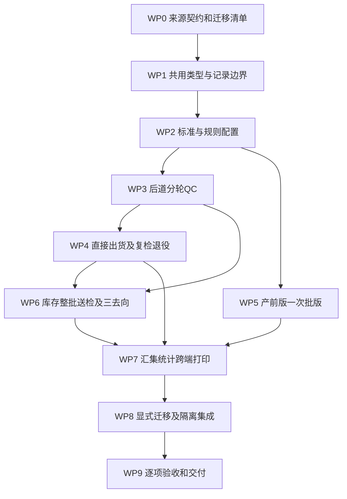

# 质检管理实施计划

> 2026-10-23 r34当前结果：产品专项技术验收已完成，376条原子逐条绑定；最后技术收据另行生成并登记。当前结果见[收口记录](后道执行与打印验收收口-2026-10-22.md)。本文原阶段的未完成/失败记录保留历史版本身份，不覆盖当前结果；业务规则未因验收整理新增。

> **2026-10-22 r34 最新补验要求**：继续补齐后道执行和打印验收，并优化《超过1秒清单》所列现行路径；这些路径采用每项至少5个有效样本均 **≤1000ms** 的完成目标，其他路径沿用前轮功能优先的 **≤2000ms** 上限。完整原负载、真实图片/图码、事务完成和独立回读终点不减；所有有效慢样本、无效尝试及旧报告原版本判定保留。全部适用验收通过后才作完成结论。本条替代前轮“不继续优化1～2秒路径”的阶段安排。

日期：2026年10月22日。阶段：实施及验收中。源码基线、业务继承关系和非范围见[调整方案](调整方案.md)；每项结果以[原子矩阵](../../requirement-traceability/质检管理需求原子矩阵-2026-10-22.md)追踪；后续证据要求见[验收方案](验收方案.md)。正文工作包保留原实施设计，实际进展和各轮变更见后续追加记录及原始证据。用户已授权按计划实现并逐项验收；隔离迁移测试不代表已迁移用户实际资料。

## 1. 分期和依赖

这是一个最终按T4验收的跨模块调整，实施按可核对工作包推进。先解决来源和共同保存边界，再做页面；不能先发布半套库存扣减或删复检后再补出货。

WP5在共用标准接口冻结后可独立推进；WP4依赖QC正常放行量，WP6依赖QC、直接出货和同库协议；WP7不能先用假数据写成已接通。迁移工具可以随WP1/WP4开发，但实际切换只在WP8完成预检后执行。每个工作包更新矩阵实际文件/符号和状态，不留“将来绑定”的空账。

### 工作包主责原子索引

每条原子仅有一个主责工作包，前置和协作按上图执行；WP9对全矩阵验收，不因此成为所有条目的实施主责。以下范围与矩阵工作包列一致。

| 工作包 | 主责原子范围 | 数量 |
| --- | --- | --- |
| WP0 | DAT-027；DAT-030至DAT-035 | 7 |
| WP1 | NAV-012；DAT-001至DAT-014；DAT-022 | 16 |
| WP2 | NAV-001至NAV-003；NAV-007；NAV-011；NAV-013；NAV-015至NAV-016；STD-001至STD-048；DAT-036 | 57 |
| WP3 | NAV-008；FULL-001至FULL-031；SMP-001至SMP-036；QC-001至QC-032 | 100 |
| WP4 | OUT-001至OUT-026；OUT-035 | 27 |
| WP5 | NAV-009；PP-001至PP-032 | 33 |
| WP6 | NAV-010；INV-001至INV-056 | 57 |
| WP7 | NAV-004至NAV-006；NAV-014；NAV-017；REC-001至REC-024；UX-001至UX-027 | 56 |
| WP8 | OUT-027至OUT-034；DAT-015至DAT-021 | 15 |
| WP9 | DAT-023至DAT-026；DAT-028至DAT-029；UX-028至UX-029 | 8 |

## 2. 工作包及完成条件

### WP0 来源契约、影响清单与基线固定

目标：把已确认业务需要的真实字段、旧源和直接消费者查清，形成可以实施的输入，不再用旧展示值替代业务事实。

| 负责文件/符号 | 修改或核对任务 | 验证与完成条件 |
| --- | --- | --- |
| `runtime-process-tasks.ts`的实际开始/自动开始、`production-context-records.ts` | 列实际车缝执行的来源身份、首次事件、工厂、时间与去重键；区分静态/克隆/真实记录；明确旧未知集合。 | 至少展示一厂第1至4任务及一任务多批；无历史→第1任务；ASSIGNED/非车缝/演示记录不计真实执行。完成D01清单，不能仅给一个count。 |
| `production-orders.ts`正式技术包、PCS style/material仓库 | 用`production-order-tech-pack-runtime.ts`的`getProductionOrderBomItems`等正式绑定接口读取定位/难度/BOM并保留缺失难度presence；输出面料SKU→根SPU精确链及旧未映射条目。 | 20项白名单逐项比对，A/A+/A++不被归B，兼容默认B不当真实登记；多面料一项外命中；旧unknown明确。完成D02。 |
| WLS seed/types/库存四页、`finished-outbound-orders.ts`、渠道可售 | 固定稳定仓/SKU/库位、排除订单行身份、独立瑕疵仓/goto、来源版本；确定销售记录精确参与交集。 | 订单占用/已拣/待出库不重复扣；不同仓名不猜合并；列需切同源的旧写入口。完成D03/D04。 |
| sample时间类型、格式器和工厂资料 | 标注旧时间语义、现有工厂时区、领取与反馈终点。 | 连续48小时可计算，旧不明时间不静默转；完成D05。 |
| 后道/库存/样衣图片与文件引用 | 列本期实物对象对应真实图片、缺失和附件引用，排除通用fallback。 | 可逐款核对对应关系；完成D06或明确阻塞素材范围。 |

产物：本任务来源映射表、旧键/库/collection/版本清单、同库共同动作表、受影响消费者清单、隔离用例夹具说明。规则/方案阶段已有源码阅读证据可复用，实施时只重核变动文件及证据冲突，不无目的全文重读。所有D缺口有明确结果；未解决的受影响范围保持阻塞，不能以mock缺省骗过。

### WP1 共用类型、各域记录和原子协调

目标：让规则复用而结果各有唯一归属，支撑库存与后道必要记录共同成功。

| 文件/符号 | 具体修改 | 完成条件 |
| --- | --- | --- |
| 拟`quality-management-types.ts` | 明确标准/规则版本、稳定项目ID、快照、来源判别、轮次、稽查、纸单版本、全检覆盖身份。 | 库存不要求PO；产前版不要求比例/三类件数；无通用工序引擎。 |
| 拟`quality-management-records.ts`、原`post-finishing-records.ts` | 注册最小配置/业务记录集合；后道准备候选变更可交共同协调器一次提交；按涉及记录差分；失败恢复。 | `readPcsRecords`定域读取，Blob按引用；不整包写seed/JSON；同库只有一次commit，complete后发布。 |
| 拟库存records/types、现有`pcs-record-db.ts`窄复用 | 稳定ID前缀、业务唯一键、expectedVersion、资格scope revision；不必新增库schema。必要错误提示业务化。 | 并发新增SKU/订单也会拒绝旧预览；不把同一记录重复放guard+put；超1000操作收据后仍防业务重复。 |
| 原production-context记录和sample类型 | 样衣快照/问题随原记录同库事务；配置只读版本取得后绑定。 | 不把sample整域搬PCS，不复制第二份可写结果；文件仍Blob，跨库读取不冒称共同事务。 |

先建立有意义的失败契约：轮次+稽查、QC完成+下游、库存申请+扣库+出库、收货/上架分别中断不会半套。复用现有node:test/IndexedDB故障模式，不建新测试平台。

### WP2 标准、附加要求和检验规则

目标：六类中心页面的配置能力可用，开检能取得唯一合成要求。

- 在拟`quality-management-rules.ts`实现项目合成、层级覆盖、同层冲突、适用性、快照和数量判断纯函数。
- 在拟`src/pages/quality-management/`增加基本/附加/检验方式的列表、详情、草稿编辑；生效/停用有明确对象、影响和操作事实，不加审批/预约。
- 在`app-shell-config.ts`、`routes.ts/routes-fcs.ts`、FCS renderer、`main.ts`对应专用handler注册真实页面，配置读取不加载整个后道辅料域。
- 规则默认生产后道四条件、30%整批/可配最低量、30/50/100、第1/2轮阈值2；配置适用环节，产前版无比例。只提供整批算法，其他计算方式无虚设选项。
- 标准更新派生新草稿/生效版本，已开检仍取旧快照，缺资料不自动阻断/全检，冲突按项目明确依据。

完成条件：A02/A03/A16/A22/A23/A24可以从配置页建立并预览；并发同层冲突不能同时生效；没有有效标准明确阻止假开检；无附加仍可基本标准开检。中心没有领取、填检查量或决定稽查按钮。

### WP3 后道分轮QC和初始全检

目标：生产回货在原入口完成真实抽检、稽查、升检和放行。

| 文件/符号 | 具体修改 | 验证/完成条件 |
| --- | --- | --- |
| 拟`quality-management-source.ts`、原正式来源读取、运行任务首次执行写入 | 四条来源精确匹配；真正执行序次按原库首次事实保存；固化两种全检覆盖，更新范围内未完单目标。 | A01/A04/A05/A06/A10；已完不追检，在检抵扣，工厂后续新任务不解除旧覆盖；unknown无伪造理由。 |
| `PostFinishingQcTask`、claim/complete命令 | 生产/库存来源类型、开检快照、当前目标、各轮与稽查；最终完成独立；删除退领接替/更正可写分支。 | 同单新轮不是新QC；提交后不改前轮；领取限制保留；所有入口一致校验。 |
| `qc-workbench.ts` | 三类直接输入、问题多选、轮次提交、稽查升级、最终完成、纸单版本/上传、已有设备文件选择；局部摘要。 | 默认不全合格；100→30/50/100仅新增30/20/50；未足/待稽查/缺适用双签不能完成，失败保留输入。 |
| `qc-orders.ts`、current-read-model及质量fact-view | 清单分开送检、应检、实检三类、未检、正常放行、稽查；去除expected/accepted fallback。 | 29合格+1瑕疵放行99，实检合格仍29；未检70不作短少，不走旧抽检差异授权。 |

完成条件：A07–A11/A20/A24–A26及关键持久化故障契约通过；全量检查从不触发抽检稽查；普通升检只能本批；纸单升级重打重传历史可查；新QC不生成质量扣费。不能用旧整批测试通过替代这些结果。

Q01已确认：在检QC遇到后台比例/最低量/阈值/档位变更仍沿开检规则版本，新单用新版、有效初始全检覆盖仍取高。各轮判断、可升档、纸单和完成校验必须实际读取固定规则版本，不可只存版本号却读取最新参数。

### WP4 直接出货、复检退役和后道实物守恒

目标：两条正常路径都有真实后道出货及实际交出，无活跃复检残留。

- 修改`post-finishing-full-flow.ts`的加工进度/可出量/占用、出货生成/交出/仓实收和校验器；替换复检子单占用，保留分项工序与合法加工订正，已有已交量不能被订正降穿。
- `work-orders.ts/work-order-detail.ts`及专用PDA直接创建/办理出货；无加工QC也生成后道出货；每张子单独立编号及来源，不重复占用、不空单。
- 通用`pda-handover-detail.ts`与`pda-handover-events`后道交出/接收改为调用同一个后道权威共同提交动作。现有`runDesignRevisionFcsCommand`对普通后道可能仅直接执行recipe，Map记录不代表持久化，不能继续以两段顺序保存代替事务。
- 删除复检菜单、两套路由/动态详情、renderer/handler/导出、标签偏好、扫码Enter、条码复核/重贴、Web/PDA按钮和当前统计/打印节点。旧已完仅历史读取，不默认保留旧地址跳转。
- 为旧未完复检实现显式候选迁移：删除活跃记录+一次创建/复用出货+数量预留+稳定映射同事务。实际切换在WP8，不能设计时就删用户数据。

完成条件：A12/A13/A27、分项加工多次直接出货、旧无加工直仓改为经出货、实际交出与仓实收先后、并发分配和失败回滚均通过；反向扫描确认旧入口不再可执行。已完历史、现有出货/仓收及辅料归属未丢。

### WP5 产前版一次批版与48小时

目标：在原样衣链增加标准化检查，清除再批和后道参照耦合。

修改`src/data/fcs/sewing-sample-approval-suggestion.ts`、`src/pages/sewing-outsourcing/sample-approval-suggestions.ts`、外发workbench/assignment直接消费者及必要production-context编解码；不搬全任务库。领取开检保存共用成衣快照，有问题关联实际项目，原照片/转交/反馈截图不删。删除再次批版的按钮、状态、下一轮生成、统计和回退链；已发生历史只读，不能为满足一次批版而毁历史记录。

明确时间点与IANA工厂时区，领取+48连续小时，时效终点沿现有首次批版意见提交，反馈按原流程后续完成；修复固定Jakarta和硬拼+08的混用，旧不明语义不静默转换。移除批版对大货开工/继续生产的任何硬门槛；各厂各样，不向后道提供参照，不添加整改回复/回执。

完成条件：A14/A15/A28/A32、两厂隔离、无资料不强补、按项问题、跨夜周末48小时和原反馈完成场景通过；无再批生成、无生产阻断、无第二份可写批版结果。保存失败照片及意见仍可恢复。

### WP6 库存送检与分类返仓

目标：真实减少原库存，后道按实收QC，三去向真实入账且申请完结条件正确。

| 工作分支 | 负责文件/修改 | 完成条件 |
| --- | --- | --- |
| 库存事实切换 | 拟inventory records/seed、原stock-realtime/location/flow、online warehouse-stock、channel WMS projection | 本仓/SKU同源，参与旧写入口切换/受控拒绝；排除不重扣，普通读取不写seed。 |
| 申请及出库 | 原即时库存、outbound-orders新增来源展示；拟inventory-quality页和命令 | 一仓一款全部资格，确认时CAS资格集合，申请+扣库+唯一出库+流水+待后道接收同事务；无冻结/部分/取消。 |
| 整批实收 | 后道原实收/待检来源分支 | 出80收79按79计算24，差异独立；收0不假完成；不要求生产来源。 |
| QC及三分流 | WP3共用规则、原QC及拟库存命令 | 不继承生产四条；同申请轮次、稽查、放行；QC完成和三去向共同成功；原仓/瑕疵仓/goto无空单。 |
| 接收上架和申请结束 | 原pre-inbound/putaway、后道出货、goto接收及拟库存命令 | 整批真实接收，正常上架后可售；瑕疵不加原仓，goto实收结束该支；差异未处理或未上架不完申请。 |

完成条件：A17/A18/A19/A29/A30/A31/A32及资格并发、出库/上架失败中断、刷新下游直达回读通过。原100占用20送80→23实检合格1瑕疵56未检，原仓最终99、瑕疵仓1；不能只返23或返80后另加瑕疵。

### WP7 汇集、统计、跨端与两条打印链

目标：所有当前消费者读取同一事实，不留旧复检/整批合格假象。

修改拟quality-read-model及新记录/稽查/统计页，原qc-records fact-view、tasks/audit/statistics、PDA摘要/仓交接记录、生产流图、任务卡；旧财务历史留原边界。三业务分别量纲，不良率分母只实检，问题条目不是坏衣件数。

专用`full-flow-print.ts`和通用`print-preview.ts`/registry/后道QC、出货、流转卡、task-print-cards均修改。生产QC双签上传，升检新纸单要求版本；库存/产前版无新增纸签。取消复检专属标签上下文，保留有效出货条码/吊牌。真实图片和码生成就绪、多页布局按验收方案留PDF及回读。

完成条件：记录从原业务操作产生、中心只读、筛选统计总数一致；同一QC在Web/PDA摘要/两打印口径一致；直接URL、刷新无需先开上游；识别图、列表层级、局部交互及命名设备可用。

### WP8 显式迁移与隔离集成

目标：在切换旧写入后转换授权范围，保留历史、附件和其他业务。

先在隔离浏览器/测试夹具运行迁移预览，覆盖后道schema2/3、已完/未完/已有出货、分项/未知合并历史、混辅料旧包、文件、覆盖/删除标记；样衣新字段向后兼容但不编造旧检查快照；只有参与库存的销售记录按精确交集迁移必要动作。所有原始旧证据保留其版本身份，不覆盖过去验收报告。

运行顺序：登记旧源与目标→停止该范围旧写入并提示旧标签刷新→分批转换及稳定进度→目标内容/数量/关系/Blob读回→只清已验证授权旧源→完成标记与普通读取复验。中断续跑不重不丢，配额/缺引用/映射冲突保留旧源。已完成复检历史不删，未完按授权退役，已有出货不重建。

完成条件：所有迁移契约、故障点和跨标签阻断通过；没有双写、读时自动迁移或全量seed副本；相关辅料/PCS/非参与销售资料哈希与引用不受损。迁移完成后新业务只写新事实，旧未完复检不会刷新复活。

### WP9 逐项验收与交付

在明确本地服务/版本/命名设备与数据规模后执行[验收方案](验收方案.md)。先规则和存储，再上下游UI，再打印/性能/迁移回归；构建按实际范围执行，不以build代替业务验收。

主代理正向核对每条需求→实际实现→证据，反向从路由/页面/命令/类型/Mock/存储/打印/测试追到矩阵；安排一轮独立实质审查，修复后复核受影响条目。状态逐条更新，失败或未完成如实列出。原型技术验收和用户业务接受分开，实体打印/真实扫码、真实用户现场未验不写通过。

完成条件：矩阵负责范围无未说明的待实施/阻塞，所有适用自动化、页面、设备、持久化、打印和性能证据绑定实际版本；无活跃冲突入口；用户业务接受另列确认，不由代理代签。推送/部署属于另行授权的T5，本计划不执行。

## 3. 迭代纪律与检查命令

每个工作包开始先列负责原子编号和文件，设计变更先同步方案/矩阵，测试按业务结果，不写镜像实现的无意义断言。新增文件路径标“拟新增”，实施落地后替换为实际符号，不能为了静态门禁保留被取消流程。

已有检查命令见验收方案；其中旧复检、旧整批、旧直仓的断言必须先依据新需求替换，保留仍有效的图片、准确输入、权限和数据保护断言。测试依赖的历史输出不得直接改成新通过结果；生成本次隔离夹具及新证据目录。

文档阶段只验证文件差异、链接、77项覆盖、矩阵字段/编号与源码阅读账本。本轮没有执行上述工作包，也没有运行产品build、页面、打印或性能测试。

## 本轮实施进度身份

2026年10月22日，用户已明确授权按本方案执行并逐项验收。本文前述设计提交的基线、目标和验收要求继续有效；实施已在分支`codex/quality-management-20261022`启动，原“待实施/本轮不改代码”描述属于此前设计提交的阶段身份。实际实现、故障与验收分别更新矩阵及`docs/prototype-review-records/2026-10-22-quality-management.md`，本段不把设计通过、单测或局部浏览器通过等同于362项全部通过。未推送或部署。

### WP1 / WP9 固定标准读取的性能整改补记（2026年10月22日）

固定构建 r11–r13 的完整负载诊断超过 1 秒，失败样本保留。CPU 证据确认后道读取先扫描原生记录的附件引用、随后再次遍历相同的固定标准树是直接耗时；整改保留全部 10,000 张质检、20,000 轮和原附件规模，不延迟保护到保存动作，也不新增持久投影或修改标准内容。

曾尝试在 `readPcsRecords` 附件扫描中合并固定树保护；r15/r16 的有效诊断分别为 1564.8/2402.1ms，均失败，原证据保留。该可选读取接口及其专用测试已撤回，不作为最终实现或通过证据。

当前保留后道完整根保护：每个固定标准根完整遍历并深冻结后才标记到内存 WeakSet；遍历中的循环/共享引用状态仅在该根内使用，数组附加自有字段及未知类型仍检查。普通后道读取和显式迁移均继续执行完整保护。共享 PCS 附件扫描仅对数组中的普通文本采用与对象属性相同的候选筛选，仍检查 Base64、Blob、pcs-file 链接和已知文件 ID。共享读取签名与持久格式不变；不信任持久标记，不把保护延迟到保存，也不减少完整历史负载。

完成条件：当前共享 PCS 原生引用/Blob/CAS/失败契约、后道固定要求深改/换根/循环/非 JSON 拒绝及迁移回滚契约通过，再冻结构建并运行完整性能与受影响业务验收。单次诊断和上述契约不等于性能或全矩阵已通过。

### WP0 / WP7 三份旧演示款素材补全（2026年10月22日用户确认）

用户明确要求本轮补齐 SPU-QC-001、SPU-QC-002、SPU-QC-003，不能只将它们保留为缺图负例。范围是原型中三份演示生产单 PO-QC-202608-001/002/003 的主面料正式Mock关系及对应物料图片，不代表实际工厂用料事实，也不把别款图作为 fallback。先核对现有物料档案和源图片，登记明确的演示BOM关系、版本及来源，再核对原技术包和生产单的绑定结果；既有已保存快照保留原始依据，不静默覆盖用户数据。

完成条件：三份旧演示款分别从正式绑定BOM读取正确物料身份和对应图片，专用/通用适用打印正常输出，图片/原始历史/版本边界有实际证据；缺图/错图防错继续以独立隔离负例验证。原40项目、5-SKU执行负载、10k/20k历史性能规模和其他已确认规则不减少。素材补全不自动代表D06、PDF或全矩阵已通过。

### WP5 / DAT 原样衣单件保存的性能整改补记（2026年10月22日）

范围：仅原批版建议页的实收、转交、领取、一次意见、反馈及明确旧记录转换/补定动作。固定 r7 的有效诊断保留：10k 质检、20k 轮次和原 211MiB/2,000 样衣规模下，新 2MiB 实收保存超过 1 秒；CPU 采样确认全 production-context 捕获、全样衣复制/恢复和前后全量读取为主要成本。整改不改变业务、数量、标准、48 小时口径和性能阈值，不删除历史或减少验收规模。

实际接口及边界：

- `production-context-actions.ts:saveSewingSampleSourceUiAction(assignmentId, commandId, intent, action)` 保留相同未保存输入的稳定操作标识，专供本页；原 `saveProductionSourceAction` / `saveProductionSourceUiAction` 继续服务原分配、开工及其他业务。
- `sewing-sample-approval-suggestion.ts:createSewingSampleActionScope` 只捕获当前真实样衣、同厂同款同单必要待收别名组、本次领域命令及原意见序次；正常动作保留其他样衣及命令的原 Map 实例和顺序，旧别名明确转换按原规则合并并保留历史。作用域内停用旧全样衣 JSON 构造，不能借此修改域外任务。
- `production-context-records.ts:saveProductionSampleContextAction` 复用原锁、原库 revision/CAS、稳定 commands 和 Blob 编解码。仅处理该作用域的样衣、命令、序次及必要初始化标记，所有必要记录和新文件同原 cutting 事务共同成功，`complete` 后才发布；事务失败恢复整组样衣、命令和序次，页面原输入保留。
- 本期没有新事实源、持久投影或长期双写。`materializedSampleRows` 是原 native 行的瞬时可读表示；原同步 `readProductionContextValue/getItem(samples)` 和旧 generic 保存复制 `serialized` 前都按需刷新同一旧序列化视图。必须实测“fast 样衣保存→未先读取旧样衣 JSON 的原 generic 非样衣动作→刷新”，确认新样衣及文件不回滚；同时单独核验旧同步 getItem 在 fast 动作后即返回当前值。该视图随完整 hydrate 重建，普通读取不写入。
- 原 source marker、旧键重现门禁、显式迁移、导出/备份及既有非样衣动作仍读同一原库。fast 动作不进入裁片放行、辅料联动、工序事件或合同保存；未选中 1,999 件、其标准/旧意见/附件和其他生产资料必须原样。

验证安排：先单件作用域单元契约，再原生 2,000 件历史下的 Blob/命令共同提交、配额回滚、稳定重试/重放、双标签同 revision 冲突、旧同步消费者与 generic 衔接、冷重开；重放原样衣旧源迁移、只读门禁、三个真实执行契约及原 PP 九例。最终由主代理统一新固定构建复测原规模各性能族，局部实现或诊断采样不提前记为≤1秒通过。实际 raw 与状态绑定在 `output/qc-implementation-20261022/sample-progress.md` 及候选证据索引，主矩阵最终语义判断仍由主代理负责。

冷开追加整改：固定r8未采样诊断为冷1,059.2ms、新2MiB实收84.2ms；CPU诊断冷910.2ms显示约304ms在原生产来源encode，其中完整raw再次parse、逐记录重复stringify比较占主要部分，原domain首次parse约55.7ms。未发现原列表反复clone2,000全树。只对 `production-context-records.ts:encodeCurrentSampleRows` 增加样衣限定路径：一次完整raw用于原seam字符串检测，普通JSON样衣复用抽出的同一 `decodeProductionContextData` schema校验，对精确row/command/meta身份及字段集单独检查、heavy value引用保持；命中旧seam仍沿原规范化/roundtrip路径，其他七来源encode不变。原列表首次载入仍获得全部已校验资料，不把水合或解析成本移到首次保存。

新增 `sample-source-encode-scope.test.ts` 验2,000件×40项全文及Blob引用不丢、普通路径一次完整raw/0 parse/0逐件深stringify、19类坏样衣/标准/问题/序次/重复身份及额外元数据仍拒、旧seam规范化保留节点/数量/文件且不改输入，以及其余七来源原编解码/身份检查。普通路径明确拒额外row字段；旧规范化fallback保留原JSON省略undefined的历史语义，不扩大其他来源或历史数据契约。相关真实原生及原PP页面重验、固定新构建性能由实际证据续记，不提前声明通过。

### WP7 三款打印物料编码修复（2026-10-22）

首次26项打印专项暴露3个失败：确认单原 `materialSku` 实为BOM行身份，不能作为纸单真实物料编号。增加可选冻结 `materialSkuCode`，三款静态BOM明确写入精确现有SKU编码，确认单纯透传；两个主单优先显示该冻结编码，原BOM关联字段不变，旧快照缺字段仍可读且不查最新档案回填。原三项浏览器SKU断言保持，15项相邻契约及同批26项打印通过，6份实际PDF的6页已文本回读/Poppler渲染/主代理逐页目视。此结果只关闭该缺口，完整性能及362项总验收继续未完。

### WP1 / WP9 空数组叶节点性能整改（2026-10-22）

r17有效诊断冷开1189.4ms、刷新1116.1ms仍超1秒，证据原样保留；同次诊断因采集器未等首次业务页准备就触发刷新、关闭前未收完资产字节而中断，仍标记部分未完成，不把有效慢样本抹去。采集器修复仅发生在刷新/SPA的非计时前置准备及关闭取证，冷开和正式起终点保持。

当前后道树保护只对length=0且没有可枚举自有字段的数组，直接完整freeze后返回，减少大量历史空叶节点的循环记账；有附加字段的零长度数组仍按原Map/类型/循环/深冻结完整检查，不信任外部已有freeze。没有延迟保护、减记录/项目/SKU/附件，原211MiB/10k/20k负载保持。10项深保护/拒绝/回滚契约、25项原生业务/存储契约已通过，独立窄审0新增问题；这些不是性能通过，新固定构建r18仍待实测。

### WP7 / WP9 完整r18诊断后的直接整改目标（2026-10-22）

完整65族诊断按固定r18继续执行，未通过样本及失败页面保留，不替代正式每族5样本。已确认两个直接代码事实：通用生产QC主单未进入按单据加载的适配分支，落入全模板注册表；库存QC通用详情冷直达因通用打印页顶部导入裁床/手动菲票功能而触发“部位票尚未读取”的错误门槛，站内先准备其他来源后才可打开。

下一修改仅限现有通用打印页：为PRODUCTION_QC_MASTER复用已有QC模板的直接适配分支，保持来源类型/原单解析/标准快照/真实码/图片就绪规则；将部位票保存、实际菲票首次打印及手动菲票记录的导入，延迟到对应菲票类型的实际检查/打印动作中。原菲票仍必须原事务complete后再打印，原重打原因与记录规则不变；库存QC不应因不相关裁床资料被要求迁移。验证包括库存QC通用打印冷直达/刷新、原两套主单/详情全部按钮、原菲票直接相关行为，以及固定负载逐族性能。未执行的修改不预填通过。

其他生产/PDA冷开超过1秒的问题，先在同一固定版本作CPU诊断确认实际热区，再选择必要的读取/序列化调整；不得减少原211MiB/10k/20k/40项目/24库存SKU/5生产SKU/100标签，也不增加无需求的通用状态机、后端或存储设施。

### r19：完整诊断后修复打印入口和重复准备（实施中）

继承既定业务范围、原始 10,000 条记录 / 20,000 轮 / 221,412,084 序列化字节负载与每族至少五次、每次不超过 1,000ms 的验收门槛，不改动业务规则。r18-r3 完整执行诊断已保留 65 次尝试：59 次有效、31 次有效样本超过门槛、6 次无效；本阶段及整体验收均未通过。

- 通用 QC 详情直接进入时误加载裁床部位票；将裁床导入限定在原菲票分支，保留保存事务完成后才打印及补打原因校验。生产单质检总单直接使用对应 QC 模板，并在入口归属上保持后道来源准备。原有 26 项打印就绪回归在该适配修复后通过，后续版式和存储改动须继续验证。
- 原生版本相同时，生产来源先核对原数据库版本再复用既有读视图；版本变化或读取失败仍走原完整读取、校验和错误路径，不减少历史资料。
- 后道已完整读取的同一命名空间，后登记的 PPIC 集合在原生版本核对一致后仅恢复新增消费者；保留原 Blob、静态基线、覆盖和删除标记，版本变化重新完整读取。新增原生失败契约先证实重复全量读取，修复后验证新增集合恢复、旧对象保持、零写入及新版本重读。
- 附件引用扫描仅对无任何自有字段且无自有 fileId 的空数组省去无用遍历；保留非枚举 fileId、静态文件、已知裸编号、Base64 / Blob 拒绝与循环终止。
- 实际 PDF 检查发现单项检查要求跨页拆行，增加逐行分页保护并重新出文件，不能以源码 CSS 或网页截图代替逐页 PDF 验收。生产单总单按原生产单范围包含同单多份 QC，不删除保留历史以缩短打印。
- 采集修复：用原文件同字节磁盘路径触发浏览器原生可信选择事件；数量弹窗实际出现五个原 SKU 数量框后再填写；隔离预装页等待真实网络结束后关闭。继续保留可信事件起点、原始文件数量 / 字节 / SHA、原生提交及独立回读、全部失败记录，不过滤异常或手动启动计时。

实际变更位置、正反向需求绑定和最终证据在本轮通过后补齐；独立审查、受影响原生回归、库存通用详情冷进入 / 刷新、所有实际打印页及完整性能验收仍是关闭条件。

r19 独立审查补充：原生读取证明须与缓存资料一并绑定，用于保持数组附加字段；已有集合换回调必须完整原生重读，不能复用可能与失败候选共享的版本缓存。两项问题已保留修复前后同一负例和原生 6 项回归，独立窄审开放必须修复项为 0；这不替代整体验收。r19 三个有效冷进入诊断为 1249.3ms / 1146.7ms / 1638ms，仍全部超过门槛。

生产单总单的附录继续汇集同一生产单全部 QC，包括原保留历史；使用既有列表查询的生产单范围，在复制对象之前限定当前生产单，避免先复制八千份无关历史标准再筛选。原始数据库夹具、全部历史、同单有标准的三份 QC、旧未知记录提示及各份 40 个项目保持，须由重新生成的多页 PDF 和完整性能采集核对。菲票相邻原UI首打／补打／原生失败重试回归单独绑定，原后道 26 项不能代替该入口。

### r20：相邻打印失败恢复与当前版输出验证（实施中）

继承原范围及362项验收，不改变数量、标准、稽查、交接规则，也不降低性能门槛。附件扫描的普通空数组优化增加原型与自有迭代器条件；特殊数组仍执行原引用/非法字节检查，新增第五个边界契约通过。

菲票延迟导入的相邻验收须区分旧目录数据缺口：原008唛架缺正式生产单，原001唛架无可建票部位，这些原始阻断保留，不补造生产事实。打印回归改用明确隔离唛架夹具，仍通过原业务建票命令并按现有正式生产单和技术部位校验，然后从通用预览页真实点击首打/补打。原生请求成功后、事务complete前注入中止，核对全部原库记录及附件指纹未变；重试只产生一条首打历史，补打必须填原因，刷新不新增记录。该测试不证明历史唛架目录可用或现场已建票。

实际发现失败反馈被外层整页刷新清掉。菲票打印分支声明本地事件处理，保留现有保存成功后打印的顺序，同时保持失败提示可见；原生首打失败/重试/补打/刷新回归r20-r9为1/1，无跳过及偶发重试。先前失败结果原样保留，不能混称全部通过。

固定构建r20保留97个业务源码文件，构建成功；索引及857个资产哈希记录于r20-source-manifest.json。实际打印输出与修复后采集动作逐项重验中，全部性能与最终矩阵仍未通过。后续若调整读取遍历，须先明确直接接口/数据影响，保留全量历史、冻结保护和附件完整校验；不能用重复微调、减少夹具或提前移动计时起点代替整改。

### r21：功能优先与2秒性能口径（实施中）

依据本轮用户确认，适用响应门槛改为≤2000ms。原1秒诊断及失败保持原始版本，不追改；原负载和逐族五样本要求保持。优先完成原业务页面及上下游验收，不为1至2秒路径新增存储模型或持续优化。

针对通用生产QC总单首次打开超过2秒的已定位问题，正式后道任务ID和生产单编号先按真实来源/原回货确定生产单，再调用既有范围投影，避免复制其他生产单完整QC快照后筛选。车缝、毛织及特殊工艺来源和上游别名保留，不改持久数据。新增回归逐条比对完整任务视图、历史及数量，并约束直达不复制无关QC。首次回归暴露毛织来源不在productionOrders数组，已改用原来源函数与原回货确定范围；失败与修复后5/5结果均保留。

当前版本全量单元1490/1490（无跳过），工程渐进类型检查通过（范围内0，原全量19条既有错误保留），原生配置/后道/共库/生产来源回读29/29通过。六个原页面套件正在同批重验，不能预填通过；r20实际5份PDF共21页已复核，原三处断行修正有效，仍按其r20构建身份保存。

### r22：功能闭环后的遗留清理及两处打印范围读取（实施中）

r21六个原页面套件58/58，无跳过/偶发重试，覆盖QC9、库存12、PP9、打印26、库存通用冷直达1及菲票相邻1。随后完整列表治理发现未用复检页面仍保留，现按OUT-020删除原执行文件；两项现行脚本检查文件实际删除，原工厂详情旧脚本中“必须生成复检”等已废规则同步替换为QC/可选加工直接出货、准备与实际发出分开、零新增复检。原历史保留及显式迁移契约不变。

通用生产总单的实际生产单号先通过既有生产单范围读取，正式任务ID仍走原任务解析；通用QC详情按原ID或单号先读取指定QC再复用原投影，避免全历史复制。返回内容、三类数量、所有同单QC历史及标准不变；真实打印build/render和原单ID/编号、三份旧素材共8项专项通过，无关QC复制为零。

中心页面原有标准列表骨架/表格/分页均保留，只将原“先赋值再返回”的分支改为直接返回的局部内容函数，使真实列表分支可由既有静态规则追踪。此为同页面内部整理，不修改治理工具、不造空调用或改基线；需重验原中心页面。最新代码的专项及最终固定构建仍待完成，r21结果不改标为r22。

### r23 / r24：功能补验、现行测试契约与2秒收口（实施及验收中）

继承既定362项范围。r23仅修正批版意见卡完成时刻的工厂当地时间显示；r24仅修正线上仓库存页逐行反复读取完整库存的问题，保持同一全量库存日期口径、资格和数量。对已在1至2秒内的路径不继续优化。

- 原配置页逐字段维护四条全检条件、草稿/明确生效/刷新，实际已通过；库存规则不采用生产四条件。
- 库存80件全检78合格2瑕疵、抽检24件得23合格1瑕疵，均通过原申请、实际接收、原QC、分类交出/原仓和瑕疵仓实际接收/上架；全部原订单排除及数量守恒核对通过。
- 列表真实筛选12条、每页10条跨页导出全部12条，必要列、隐藏/拖序/冻结、偏好刷新保留及当前页复位已通过。
- 旧有加工/无加工未完复检直接迁移出货、已有出货复用、已完成历史及实际仓收保护、重复运行幂等，原生契约已通过。抽检实检合格29件、正常实际出货99件，两套标签按逐SKU19/20/20/20/20生成99张，原生及真实渲染器契约已通过。
- r22中心26族130样本、r23产前版29族145样本、r24库存46族230样本的正式验证已通过。分别保留实际构建和原始失败，不改写历史版本；后道65族325样本及全部最终打印仍在执行。

最后的运行器核对发现，旧`post-finishing-partial-flow`和`post-finishing-consumers`仍要求新建复检及扫码完成，已被本期OUT需求取代。保留其加工链、键盘/代登记订正、配额/中止/CAS、D1三张100/100/800、实际发出/收货、真实下游/打印/恢复防伪等有效断言，改接直接出货；原基线版本与历史原始结果保留。当前改造仅通过语法核对，须实际重放，不能预填通过。

为使新增专项进入最终技术收据，`scripts/workflow-governance/affected-checks.ts`按确切文件登记原生、原页面和正式来源契约，未知同名前缀仍阻断。原生运行器仅启动独立本地Vite并运行9份确切原生测试，逐文件串行、浏览器隔离、仅关闭自建服务，产物写临时目录。58项路由契约已通过；最终真实运行及完整治理验证仍待执行。此项不更改产品、性能采集规模、必需检查或检查通过条件。

剩余可见订正文案“已交复检数量”待后道固定采集结束后改为“已准备出货数量”，只变更同一守恒阻断的业务用语；随后复验对应原UI负例和固定新构建，未变化的正式证据按EVIDENCE-01保留原身份复用。

### 本轮执行优先级补充（2026-10-22，用户确认）

用户明确“暂时先不要过分赶住性能（不超 2s 即可），优先实现功能”。本任务继续按每个有效样本不超过 2000ms 验收，不追求低于 1 秒；先完成后道旧消费者、独立追检及最终功能验收，再对未完成家族或实际超时入口补测。中断的执行端 r24 原始 125 个有效样本及实际失败保留于 `output/qc-implementation-20261022/execution-r24-formal-priority-interruption.json`，不标记性能通过。质检中心、产前版及库存已通过结果保留实际版本，未受影响部分不重复运行。

### 功能收尾及必要读取修正（r25/r26，2026-10-22）

- 原QC追加实物缺件问题及独立追检实际表单验证通过；原记录不变、对象/范围/项目缺失阻断、另记关联与刷新唯一已实办，原始结果见 `legacy-and-qc-functional-r25-results.json` 中对应通过case。该批两项旧测试失败不改写，之后分别修正旧假设再实测。
- 原后道两项旧完整链在独立新服务通过：四项独立勾选、实际纸单、键盘与代登记订正；Web/PDA分工序500/300/200/100至1000，直接100/100/800三出货、实际发出及仓收后父单完成，无新复检。见 `legacy-partial-r25-r3-results.json`。
- 查询/双打印与标签身份case在 `legacy-consumers-r25-results.json` 单独通过；18组列表/命名设备与真实位置/同SKU库存汇总、图片交互、10项基本/人员及14项关系恢复反例、合法含附件订正恢复在 `legacy-consumers-r26-r3-results.json` 两项通过。正常业务页没有维护导入控件，恢复验证通过已有维护接口执行，不冒称导入UI。旧默认位置相同的测试假设按真实三出货独立位置核验，业务位置逻辑没有更改。
- 产品r24至r26只有两项增量：订正提示去掉旧复检称呼；原HOH-POST出货交接在PCS/库存桥/后道事实成功准备后直接读取，保留邻接通用交接的完整来源准备，避免额外装载无关裁床/样衣历史。最小失败契约保留，14项原入口契约通过。固定构建见 `r26-source-manifest.json`，其余95路径哈希不变。
- 性能按用户2秒要求，仅补未完或需重测的46族230样本；r24未受增量影响且无预装错误的19族95样本保留实际版本。原超时的收货三族及出现预装页面关闭错误的库存QC三族全部重测。完整65族325样本最终组合须逐族五个有效样本、完整原始负载、固定资产及原生安装SHA一致；部分原始报告仍标诊断，原中断报告仍保持未完，不改写为单份全组通过。组合方案为 `execution-r26-reuse-plan.json`，当前仍待结束与全页PDF复核。

### r27 后道原出货收货入口必要依赖补齐（验收中）

r26 精简读取的真实冷开暴露通用交接组件仍需部位票来源，页面未呈现；未用空记录绕过。r27 在原 HOH-POST 直达分支明确等候已有部位票读取，保留其读取/迁移失败阻断和相邻通用交接的完整来源准备。新增实际失败契约后修复，14 项相关单测通过；真实冷开及后续收货重新验收。r24/r26 原始失败、超时及主动终止记录保留，362 项仍为已实现待验证；不以构建和单测代替页面通过。性能按用户 2 秒上限，仅补测受影响及未完成家族。

### r28 原收货必要资料按原库明确范围读取（验收中）

r27 真正恢复必需部位票后，五次冷开均达2秒，但刷新仍有3次超过2秒；原始值及主动终止记录保留。r28 仅原 HOH-POST 入口改用已有原库前缀读取实体、迁移标记及同一revision，避免读取无关生产历史，再交原部位票恢复函数。没有更改保存事务或迁移规则；14项源函数契约、2项实际原生契约通过，证明读取零整库读/零写、真正保存完整恢复且无关记录保留、未完迁移拒绝。当前固定构建及受影响入口重新验收，已达2秒的其他页面不再优化。

### 2026-10-22 功能优先补验（r29，主代理）

依据用户本轮指示，先完成原业务功能和保存正确性验证；不继续优化已在 1～2 秒内的路径。9 份原生存储契约 43/43 通过；8 份原业务页面专项 68/68 通过，零失败、零跳过，原始结果为 `output/qc-implementation-20261022/common-evidence/native-final-functional-r29.log` 和 `final-functional-eight-r29-results.json`，后者覆盖库存12、原后道流转卡6、菲票边界1、通用库存打印1、列表1、打印门禁26、原QC及标准规则12、产前版9。

这组结果只关闭其功能断言，不自动关闭 UX-019 性能、全部打印PDF目视或最终治理收据；原超2秒及中止采集原样保留。现行 362 原子仍保持已实现待验证，待按最终证据逐项收口。

### r30 固定构建与必要读取调整

通用生产QC主单的两个独立原库改为同时读取；正式生产来源继续使用同一完整原快照，避免第二次全量读取。任一来源失败仍阻断，库存打印及其他业务入口不改。新增实际入口最小失败契约后修正，16项入口契约和1502项全量单测通过，工程范围类型和固定生产构建通过（`r30-source-manifest.json`、`vite-build-r30.log`）。功能已先完成68项页面及43项原生契约。当前仍有真实打印打开样本超过2秒，保留未通过；按功能优先不继续扩大性能改造，先补纸面内容和证据。

### r30 打印功能结果

18份共76页实际PDF已完成文本与逐页目视核对，两套QC主/详情、正式BOM图、24 SKU分页、后道出货单、100枚条码及100张吊牌内容通过。证据：`output/qc-implementation-20261022/functional-print-r30-pdf-review/review.json`；实际原构建和PDF哈希不改标。本结果不关闭性能缺口，当前通用主单少数样本超过2秒；继续补齐尚缺的操作验收与最终治理。

### r31 功能优先阶段

仅生产QC通用主单调整完整cutting只读快照与PCS准备的先后，其他运行路径96个与r30相同；保留PCS后才读后道及正式owner前所有来源错误门禁。实际入口17/17、全量1503/1503及构建通过。当前主单仅15个有效样本，2个超过2秒，后续准备流中断；所有原始结果留存，不继续扩展产品性能改造，先进行功能及原链技术检查进度核验。矩阵当前实现绑定r31，历史UI/PDF不改标；正式剩余性能和最终收据未关闭，不宣称完成。

### r32 功能专项收尾（产品继续使用 r31）

当前97条运行路径逐一与r31固定构建清单比对一致。本阶段只修正两处测试准备：渠道上架契约通过实际收样、贴码和推进动作准备测款单，不再直接改受保护流程字段，43/43通过；库存通用详情打印的独立Vision条码工具先编译、再对冷直达及刷新各自实际图形解码，原页面操作、零写入、条码值、固定参照及打印断言完整保留，1/1通过。

r31统一检查中，后道完整跨端两份专项23/23通过（含15条业务链）；部分流6项中5项功能通过、1项PFN-067性能失败。因该性能失败而未执行的下游四份功能专项已单独补跑24/24通过，未将原失败改标。原68项页面组本轮为67通过、1次独立编译超时，后者已按同一场景专项复验通过；不冒称新的单次68/68。全量单测1503和原生存储43项沿用本轮实际检查，未修改业务代码后重复构建。阶段证据、原始失败、实际版本及哈希见 `output/qc-implementation-20261022/functional-closure-r32.json`。

剩余工作仍为后道未完成的正式操作/打印性能、超2秒路径的必要修正，以及最终362项语义收口和治理收据。整体仍未全部验收通过；本阶段未提交、推送或部署。

### r32 后道必要操作采样补记

本轮按原负载及每族5次要求，完成“提交本轮质检结果、保存双签纸单、完成生产QC、领取库存QC”4族20个有效样本，最慢763.4ms，均在2秒以内，保存及原生回读一致。记录见 `output/qc-implementation-20261022/execution-actions-r32-summary.json`。后续领取生产QC族在测试资料预装中发生真实cutting.ndjson传输中断，仅取得1个有效样本；主代理只结束该轮自有浏览器使错误和源码/资产最终哈希落盘，未改业务代码、未把该族记为通过，未盲目重跑。

功能专项结果仍按 `functional-closure-r32.json` 保留，纸面内容按相同渲染依赖复用18份76页真实已审PDF（`execution-r31-pdf-review/review.json`），不冒称重新生成。剩余19族操作及12族打印性能、超2秒样本、最终矩阵/总审查/收据仍未关闭；本期不继续优化已在1～2秒内的路径。

### 2026-10-22 本轮逐项审查补充

仍以≤2000ms作为本任务性能验收线，同时输出超过1000ms的逐样本清单；1000ms以上、2000ms以内仅登记，不因此继续优化。清单区分当前适用证据、已被替代的历史诊断、有效超时和未测/无效采样，不能用缺测冒充达标。

本轮查漏补缺范围限定为已确认的中心统计：补全尚未形成QC的库存申请、出库与实收分列、稽查触发/待办/升检次数，以及正常/瑕疵/返工实际接收和适用上架。中心继续只读；原申请、QC及交接记录仍是唯一事实，不新建另一份可写结果。

本轮补缺按依赖顺序：先修只读来源及统计，再补配置详情、稽查追溯、草稿参数/输入保护和真实读取恢复；专项回归通过后固定构建，复测本次直接影响的中心性能。超过1秒完整登记，不为1～2秒继续优化。12条原要求落实点和1条报告要求补入矩阵，现375条；原稳定编号及历史证据不变。

本轮逐项审查和功能补缺的实际结果见[审查记录](逐项审查与查漏补缺-2026-10-22.md)；超1秒实际样本见[清单](超过1秒清单-2026-10-22.md)。本轮8项页面及独立1项列表回归、1505项单测/构建、中心26项130次性能均通过；原后道性能和最终总验收仍未关闭，历史证据按版本保留。

### 2026-10-22 r34：剩余验收及超过1秒路径优化（用户最新要求）

用户在本轮明确要求补齐后道执行和打印剩余验收，并将《超过1秒清单》中的路径优化好，全部验收通过后再作完成结论。本阶段对清单中现行路径采用**每项至少5个有效样本均≤1000ms**的优化完成目标；其他未列路径仍不得超过原2000ms上限。历史有效慢样本、失败和诊断原样保留，不能追改成通过。完整原负载、真实图片/图码、事务完成和独立回读终点不减。

实施顺序：先在r33固定构建对生产QC、库存QC和通用生产主单作窄范围CPU/事务诊断；只修实测瓶颈，优先消除无关来源反复读取/处理。稳定后一次固定新构建，补齐后道65项325样本，复测清单中中心和即时库存路径；相邻功能、原生保存/失败恢复、打印版式内容、逐项矩阵和最终治理收据按实际影响验收。产前版及其他未改路径只在依赖和证据一致时复用。

直接候选范围为`src/main.ts`必要来源准备、原生产来源/后道记录读取和对应原页面；具体修改以诊断和最小失败契约为准，不删除来源校验、不增加可写事实源或新基础设施。测试前置传输错误先单独修正，不把它算成业务失败或0ms样本。不推送或部署。

### r34 单张执行及打印的实际读取边界

目标：单张QC、加工/出货详情、已交出PDA和已知打印，保留所需完整对象、同生产单全部批次、全部在检QC及直接引用关系；不把无关已完成QC标准全文恢复到可写执行状态。原生历史及附件不删，完整清单、统计、迁移和备份仍采用完整来源。

实际文件与修改：`src/data/pcs-record-db.ts`在同一只读事务内先读取原身份/关系，再按原ID补齐实际消费的完整QC及Blob；所有集合首批读取并行排队，仍按原集合顺序处理。`post-finishing-records.ts`区分完整与执行范围准备，完整缓存可服务单张，单张缓存不能冒充完整；真实保存仍以原对象/版本/namespace版本原子提交，未读取历史不进入删除集合。`src/main.ts`仅指定执行入口采用范围准备，非QC入口保留原PCS准备；只读打印和辅料读取复用已准备范围，数量变更入口保留原关联责任。

原生证据：`output/qc-closure-20261022-r34/native-record-scope-full.log`的45项基础回归通过；新增范围专项进一步保留原操作CAS失败、回滚、重读后同操作重试/去重及未读取原历史不变，见`scoped-qc-native-cas-r2.log`；未读取历史及Blob完整导出、坏格式/冲突拒绝、另一隔离上下文恢复及重复恢复不重复实体，见`scoped-qc-native-backup.log`。这些为原型原生契约，不是现场质检或纸面签字回执。最终页面、打印、性能及收据仍待完整收口。

不增加新业务规则、持久索引、存储格式、维护页面或新后端，不通过删历史/缩小原验收负载提速。读取边界设计及失败历史保存在`output/qc-closure-20261022-r34/record-scope-design.md`。

### r34k 隐藏重复准备整改及已完成契约

生产QC身份识别由`post-finishing-qc-entry.ts`直接读取原QC事实，仅识别为库存QC时才准备原库存；不再在生产执行入口读取两遍库存。通用打印内层沿用当前已准备的原QC范围，避免重新恢复全部历史。现有后道加工页必要辅料只读依赖使用同版本七类生产来源，变更后重新读取；实际操作仍完整准备，原齐套及错误门禁保留。未新增辅料需求。

当前原生专项45项通过（`native-final-read-mode.log`），新增只读/实际操作范围与失败阻断专项通过，入口契约22项通过；工程检查、1512项单元检查与固定构建r34k通过（`build-r34k.log`）。源码/资产身份见`runtime-source-r34k.json`。这些不替代尚未完成的最终页面、打印、逐族五次性能及整体收据。

### r34 原记录查询索引及连续扫码补验

前期无索引候选仍存在库存QC打印超过1秒，分批大小诊断不能关闭。采用原PCS库v2→v3原生查询索引（原状态、完整QC号、生产单ID/号），不新增业务字段/快照、不改变共同事务；原记录和Blob完整保留。单张执行按原主键/索引读取所有未完、当前、同生产单、静态覆盖/删除及必要关联QC；全量入口、迁移、备份仍完整。连续扫码在领取前补读输入的精确原单，避免上一单范围缓存导致新原单无法领取。详见`output/qc-closure-20261022-r34/native-index-design.md`。绑定UX-029、DAT原库升级/冲突/附件/备份及QC领取相关原子；索引、升级、协议、原生与页面/打印/性能尚须实际重验，总体未通过。此节明确替代前期“不增加持久索引”的候选实现限制，不增加业务流程。

#### r34 单组合索引与升级验证修订

四索引候选在完整原负载旧v2升级诊断为4918.8ms，保留失败原值。改为单个原生组合查询索引，结构v4兼容原v2及中间v3，只调整原生索引、不改变记录/Blob/业务规则。逐原键游标取得状态、完整QC号和生产单身份，同事务复用；缺键字段的原记录仍完整读取。原47项原生、73项UI及1512项构建为前候选实际结果，不改写成单索引新结果。新的原生升级、正式原负载页面/打印与性能结果需重新绑定。一次性旧资料升级列为新增补验及超过1秒报告，沿其他项≤2秒；既有清单业务路径仍逐族五次≤1秒。具体候选/替代依据见`output/qc-closure-20261022-r34/native-index-design.md`。

#### r34 旧库已交出入口的最后局部修正（2026-10-23）

完整旧v2资料的补验发现：已交出PDA在没有任何已保存分配产物时，仍首次导入全部生产处理模块；实际运行资源与原入口分支均确认，五次补验中的有效慢值继续保留。范围仅为`hydrateProductionSourceEffectsForEntry`里`/fcs/pda/handover?tab=shipped`的只读空来源分支：没有已保存产物时采用现有各来源默认值；存在原产物仍完整恢复，后续真实生产入口也仍加载原完整处理器，不能把跳过空来源记为完整写入就绪。不改变分配规则、PDA责任、数量、保存、迁移或附件。先以原函数实际执行契约证明空来源、已有产物及随后生产入口，再固定新构建；仅补受影响已交出三种入口各5次、原旧库两种重入口各5次。中心、库存、样衣与其余后道/打印保留实际旧版本身份并按精确差异证明复用，完整矩阵和最终收据仍未关闭。

上述“空分配产物”候选在完整旧库夹具中不适用：该夹具确实有已保存的分配产物，必须恢复。v候选实测1252ms，没有改善该场景，已撤回候选代码及仅属于候选的单测；当前106条运行路径逐字节恢复为u固定构建。失败及诊断、候选源码和单测原文保留，见`empty-effects-candidate-withdrawal.json`。既有清单中166族830样本均按≤1秒完成；额外新增的旧库首次页和两种旧库执行边界按本阶段已登记的其他路径≤2秒验证，15次全部通过、最高1306ms。超过1秒的真实旧库边界值必须在清单独立保留，不能宣称所有额外旧库场景也≤1秒。

#### REC-015 最终反查补缺（2026-10-23）

实际渲染契约确认：即时成衣库存按SKU筛选后，明细已筛选，但三项统计还用全量，违反同筛选范围要求。仅把成衣/在途变体的商品总数、现货充足、低库存改为本次分页前的筛选结果；仓库候选项继续来自同次全量来源，原料变体及原导出/查询操作不扩改。原单次读取优化保留。先复现“明细仅SKU-B、统计仍3条”失败，再补实际渲染筛选断言；固定新构建只重验受影响库存46族230样本，其他域按精确单页差异复用原版本，不重新命名旧证据。绑定REC-015、UX-029及原列表/查询要求，不新增业务规则。

### 2026-10-23 r34 最终产品专项绑定

当前固定x及106条运行路径见`output/qc-closure-20261022-r34/runtime-source-r34x.json`。常规166族830次均≤1秒；额外旧库兼容3族15次按原其他路径≤2秒通过，其中6次仍超1秒如实披露。18份76页PDF与200枚标签逐枚解码通过；原生47项、工程及1521项单元检查通过；原PFN-067十次及固定预览库存SKU筛选/统计/重置通过。完整结果和版本复用依据见收口记录及`final-atom-acceptance-r34.json`，没有新业务待确认项。最后技术收据路径为`output/qc-closure-20261022-r34/final-task-receipt-r2.json`；未生成不视为通过，任务文件固定后运行，实际状态另登记。

### 2026-10-23 r34x 旧资料边界补验

首轮最终收据未通过，原失败及日志已保留为`first-final-task-receipt-failed.json`、`final-workflow-first-failed.log`。实际修正仅允许缺少显示单号的旧QC按原稳定身份读取，仍严格校验记录位置，不补写旧值；原生回归核对旧值/版本未变。恢复记录逐字段按稳定编号比较，Web/PDA旧连接的升级前后断言同步当前版本4。下游24个场景的22项原通过与2项修正后回放逐案列于`downstream-acceptance-x.json`，当前原生47项及构建1521项通过。常规166族830次按原身份保留，x相对w仅移除一个已知旧资料不应具备的显示字段校验，精确反向还原源码及性能复用依据见`w-to-x-source-reuse-proof.json`。较晚开发服务PFN回放5次仍超1秒、最高1413.4ms，但全部≤2秒；不会隐去或用较早快值替代。最终整体验收仍以待生成的r2收据实际状态为准。
