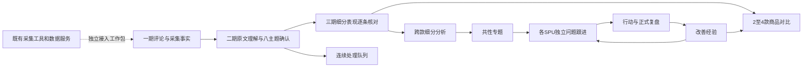
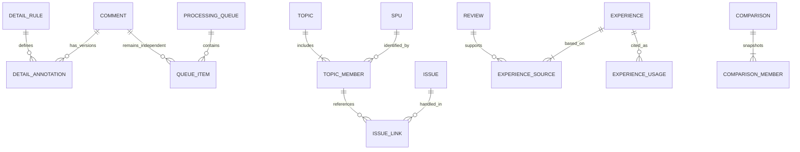

# 商品反馈管理三期完整产品设计方案

版本：V1.1，D31～D40业务规则确认稿

日期：2026-10-24（Asia/Shanghai）；业务日期统一使用 Asia/Jakarta

所属系统：商品中心系统（PCS）／商品反馈管理

主题：评论连续处理、细分表现分析、跨商品共性问题、改善经验复用与商品对比

状态：业务与产品对抗式审查及修订复核已通过，R31～R37全部关闭。用户于2026-10-24回复“1～10全部采用”，D31～D40已逐项确认为采用并纳入本版设计基准，见第26节。本次仅更新确认结果，不修改产品代码、Mock、存储或线上页面，不发布。

审查附件：[三期业务与产品对抗式审查记录](商品反馈管理三期业务与产品对抗式审查-2026-10-24.md)。最终审查结论以附件实际记录为准，不以本方案的验收目标冒充已实现能力。

## 1. 设计依据、现状与授权边界

### 1.1 依据及版本身份

| 依据 | 本方案采用的内容 | 证据边界 |
| --- | --- | --- |
| [一期V1.3方案](商品反馈管理一期完整方案-2026-10-23.md) | 九店日常采集、人员考核、全星级、评论身份、八主题、日期与去重 | 继承用户已确认规则；原文中的未实施状态属于当时。 |
| [二期V1.1方案](商品反馈管理二期完整方案-2026-10-24.md) | 单SPU问题、行动、正式复盘、关注候选、译文与建议、选品参考 | D21～D28已经用户确认；本方案不改变这些规则。 |
| 二期第二轮审查（历史验收产物已清理） | 保存草稿的后续日期必须可刷新恢复；操作与统计分别核对 | 复用失败场景，不能只设计成功终态。 |
| 二期已发布版本 | main，`297cdf4ffb83a4b174a37221e5aafcc7774d5c6d` | 此版本含六个业务页面及本地Mock。历史发布证据见发布记录（历史验收产物已清理），该本地产物不作为唯一需求依据。 |
| V1.0设计时的现状核对 | 阅读既有方案、当前评论及二期类型结构；只读查看线上评论明细、问题跟进 | 仅核对继承入口，没有进行新的业务写入、全站验收或真实数据库研究；本次确认更新不重复页面核验。 |
| 用户认可的三期方向 | 评论处理提效、跨款共性问题、改善经验、商品比较；真实接入独立确定 | 新增业务规则现已按下一行确认；尚未授权代码实施。 |
| 用户确认三期规则（2026-10-24） | 用户回复“1～10全部采用，把确认结果更新到三期方案中，暂时不要改代码。” | D31～D40全部采用；仅更新文档，不构成实施或发布授权。 |
| 项目规则 | 直接展示功能、复用公共列表、本地Mock默认两页、必要提示、原子保存 | 不新增权限演示、业务维护页或预备后台。 |

原始九店截图、商品评论截图、采集统计截图、表结构截图及旧系统网页的事实和限制继承一期第2节。本轮不把截图中的商品发布时间、入库时间、普通索引或“过滤量”解释成已经核验的评论时间、唯一约束或采集完成证据。

### 1.2 一、二期现状与三期增量

| 已有能力 | 三期增量 | 避免重复建设 |
| --- | --- | --- |
| 全部评论、同SPU相似表达、逐条标注 | 固定处理队列、连续上一条/下一条、细分表现草稿、跨款候选阅读 | 不新增一套评论主档或分类完成率。 |
| 原文/译文、辅助建议与人工确认 | 增加细分表现建议及分类差异回查 | 真实翻译/生成服务仍未因原型发布而接通。 |
| 八主题与单款诊断 | 保留八主题，增加受控的“具体表现”补充标注和跨款分析 | “面料问题”不自动等同“偏薄”。 |
| 每款独立问题、行动和复盘 | 共性专题引用多个款的跟进与证据 | 专题不是跨款问题总单，不直接拥有行动和复盘。 |
| 单款选品参考 | 2～4款对比、保存对比记录、引用改善经验 | 不建设选品审批、自动排名或综合评分。 |

### 1.3 保持有效的业务规则

- 首批仅九家TikTok，每天执行；默认负责人均为一个完整姓名“小羊.高阳.kiko”。Shopee暂不加入任务与考核分母。
- 采集以昨日为核心，合计最近7个完整自然日，每日雅加达18:00交付截止；不加入免采、临时改派和缺评论者流程。
- 采集所有评分及仅评分评论；1～2星差评、3星中评、4～5星好评；评分未知单列。
- 评论唯一性继续由一期确定的来源作用域与原生ID/组合指纹处理；相似表达、细分标签、专题引用均不合并评论身份。
- 一条问题仍对应一个SPU、一个主主题和固定规格/店铺/链接范围。至少一条当前有效、人工确认的具体问题评论可正式建单。
- 人工确认、正式复盘、当前轮行动与证据依赖继续有效；小样本不阻止查看、建单和真实处理。
- 采集完成、按时交付、人工分类、问题处理和效果观察分别统计，不相互替代，不新增分析人员绩效分或处罚。

### 1.4 本轮与未来实施边界

V1.0已交付设计主体和审查记录两份Markdown，本次V1.1仅更新这两份文档的业务确认结果。以下所有新增页面、字段、状态、Mock与接口仍为后续实施目标。本轮不做数据库连接、不调用真实采集工具、不修改原型数据、不提交/推送/部署。

已确认三期产品实施范围为本地原型的P3-A～P3-E；真实接入P3-R的既有工具/服务能力与实际接入范围单独确定，见第25节。本次尚不启动实施。仍不纳入退货、自动回复、外部通知、Shopee首批安排、工厂责任认定、自动改款、采购或生产写入。

## 2. 业务目标、岗位与完成标准

### 2.1 业务目标

1. 分析人员连续处理一组评论，原文、译文、旧分类与新草稿同时可见，减少重复打开和重复填项。
2. 商品人员区分偏薄/偏厚、腰围偏小/偏大等具体表现，查到每一项背后的独立评论。
3. 共性问题负责人发现多个SPU的同类反馈，分别落实各款跟进，看到遗漏款与证据变化。
4. 商品人员从已经正式复盘的记录提炼可追溯经验，区分采取过措施与观察到变化。
5. 选品人员在相同查询条件下比较2～4款的优点、问题、样本和既往措施，保存人工参考。

### 2.2 岗位责任

| 责任 | 承担的工作 | 不代表什么 |
| --- | --- | --- |
| 评论分析责任 | 阅读、补细分、核对建议、修正分类 | 没有处理量绩效或自动确认权限。 |
| 专题负责人 | 维护专题范围、关联各款跟进、记录共性观察 | 不替代各款问题负责人和行动负责人。 |
| 问题/行动/复盘责任 | 沿用二期 | 专题负责人不能通过归档批量关闭这些事实。 |
| 经验整理人 | 选择正式来源、填写适用条件、核对来源更新 | 不是审批角色，所有人均能使用完整功能。 |
| 对比记录人 | 选择商品、阅读样本、填写参考与限制 | 不形成选品审批或采购决定。 |

人员引用现有人员选项；初始Mock继续使用“小羊.高阳.kiko”。不虚构登录身份、主管开关或新员工名单。

### 2.3 成功判据

产品验收首先验证连续处理能恢复、细分计数可下钻、跨款不重计、专题不越权联动、经验可追溯、对比可回读。是否提高真实效率需要实际使用前后记录，不能用Mock点击耗时声明“人工效率提高50%”。

## 3. 产品架构



| 层 | 职责 | 事实所有者与写入边界 |
| --- | --- | --- |
| 来源层 | 评论、身份、店铺、链接、购买规格、采集与处理回执 | 继续由一期/已有主档拥有；三期只引用。 |
| 理解层 | 译文、八主题、细分表现、对应依据 | 八主题继续原事实；细分为独立补充记录，不回写原文/评分。 |
| 聚合层 | 相似阅读、细分排行、对比预览 | 动态计算；查询本身不制造已确认分类或新问题。 |
| 协调层 | 共性专题及固定的每款范围与引用 | 只管理跨款观察和关联关系；执行仍在二期问题。 |
| 经验层 | 正式复盘来源、整理结论、适用条件和引用记录 | 保存版本与来源快照；不改写已存复盘。 |
| 参考层 | 商品对比、人工参考、保存时样本 | 形成研究参考记录，不写选品、库存或生产系统。 |

不建设通用工单、知识图谱、向量数据库、AI管理平台或第二套商品/人员/面料档案。真实接入只复用已经确认可用的工具和服务，未确认前不选供应商或拟造接口成功结果。

## 4. 功能架构与实施包

| 编号 | 功能 | 入口 | 具体交付 |
| --- | --- | --- | --- |
| P3-A / F41 | 连续评论处理 | 评论明细→开始处理 | 固定队列、跳过、保存草稿、逐条确认、返回和恢复。 |
| F42 | 分组阅读与批量草稿 | 评论明细→相似表达 | 跨款候选、可解释匹配、逐条依据、显式选中集合。 |
| F43 | 细分表现标注 | 评论详情/连续处理 | 受控字典、同条多表现、原句/图片依据、修订历史。 |
| F44 | 分类质量回查 | 评论明细→分类回查 | 已修订、已撤回、一级与细分不一致、来源更新、候选表达差异。 |
| P3-B / F45 | 跨款细分分析 | 反馈分析→细分表现 | 每款分子/分母、构成、小样本、同范围下钻。 |
| F46 | 共性专题 | 新增共性问题 | 跨款固定范围、证据、负责人、各款跟进、归档与重开。 |
| P3-C / F47 | 改善经验 | 共性问题→改善经验 | 从正式复盘整理、启用/修订/停用、来源变化、引用历史。 |
| P3-D / F48 | 商品对比 | 商品汇总→加入对比 | 2～4款并排、统一日期与店铺条件、参考结论、快照与导出。 |
| F49 | 经验引用 | 商品诊断/问题/对比 | 阅读条件、记录引用理由、可选带入行动草稿，不自动完成行动。 |
| P3-E / F50 | 全链路一致性 | 七页和详情 | 评分/分类/细分/专题/经验计数独立；版本变化、保存回读与可用UI。 |
| P3-R | 真实工具接入 | 现有六页内 | 独立工作包，仅定义输入/回执/验收清单，第25节。 |

推荐顺序：A → B → C+D → E整体验证。A的逐条确认与B的每款独立跟进先成立，再接经验和对比；真实接入单独排期，实际投入考核前必须完成。

## 5. 信息架构与导航

### 5.1 菜单

```text
商品中心系统
  商品&物料档案
  商品反馈管理
    采集工作台      沿用
    采集记录        沿用
    评论明细        全部评论 / 相似表达 / 分类回查；连续处理为工作区
    商品评价汇总    原五维 / 商品对比 / 对比记录；诊断仍为抽屉
    反馈分析        原页签 + 细分表现
    问题跟进        原列表与单款详情
    共性问题        新增：共性专题 / 改善经验
  系统设置
```

三期已确认只新增一个二级菜单“共性问题”（D39），不新增“AI中心”“知识库管理”“数据维护”等菜单。一级菜单与商品&物料档案均可收起，当前子页面不强制把用户手动关闭的分组重新展开。

### 5.2 页面、地址与上下文

| 页面/对象 | 建议地址 | 进入与返回 |
| --- | --- | --- |
| 原六页 | 保留当前地址 `/pcs/product-feedback/{collection,batches,comments,products,analysis,issues}` | 保留已有深链接和页签语义。 |
| 连续处理 | `/comments?view=processing&queueId=...&commentId=...` | 刷新读取已保存队列；关闭回评论列表原条件/页码/滚动。 |
| 相似/回查 | `/comments?view=similar`、`view=quality` | 与全部评论共享已提交查询；选中项不静默改成新筛选集合。 |
| 商品对比 | `/products?view=compare&spuIds=...` | 最多4款；全量对象范围保存于对比草稿，地址不承载整段原文。 |
| 对比记录 | `/products?view=comparisons&comparisonId=...` | 打开保存时结果；重新计算明确生成新修订。 |
| 跨款细分分析 | `/analysis?tab=details` | 从计数进入评论时保留基础集合与表现条件；返回不丢查询。 |
| 共性专题列表/详情 | `/topics?tab=topics`、`/topics/:topicId` | 详情独立回读，返回保留列表。 |
| 改善经验列表/详情 | `/topics?tab=experience`、`/topics/experience/:experienceId` | 从问题/对比打开后回原对象，源单据可另开。 |
| 细分规则 | 页内只读抽屉 | 当前规则、解释、正反例、来源与引用，不设字典编辑页。 |

地址均为三期建议，不表示已注册。失效/不存在对象显示“未找到这条记录”和返回入口，不跳入另一条记录。切换视图前有未保存输入时提供保存草稿、放弃修改、继续编辑；跨页跳转同样适用。

### 5.3 对象关系



专题成员身份为“专题+SPU”，同SPU不重复加入；每成员保存自己的固定范围，不将不同SPU的SKU放进同一问题。引用关系按来源ID唯一，解除引用保留历史。相似组是查询结果，不增加上述任何事实身份。

## 6. 核心字段字典

以下为业务字段要求，不是本轮数据库迁移。ID/修订号用于内部追踪，正常界面显示正式单号、业务名称、日期和必要状态。

### 6.1 细分规则与补充标注

| 对象 | 字段 | 必填和约束 |
| --- | --- | --- |
| 规则项 | 稳定ID、规则版本、一级主题、具体表现、倾向、适用解释、排除例、正反例、启用状态 | 每个可选/可统计表现一个独立稳定ID；界面分组不合并身份；同一版本不可改含义，停用不删历史。 |
| 标注头 | 标注ID、评论ID、原文版本、依据一级分类ID/版本、规则版本、修订序号 | 正式确认必填；必须对应当前有效一级分类。 |
| 核对结果 | 明确表现／未见明确表现／信息不足；草稿可暂未选择 | 三者可为终态；“待核对”由缺有效记录推导，不伪装确认结果。 |
| 表现明细 | 规则项ID、倾向、对应一级主题、原文片段或图片引用、说明 | 明确表现至少1项；每项独立依据；同评论同规则项只计1次。 |
| 实际依赖 | 判断依据为原文/图片/中文译文；使用译文时记录译文ID和修订 | 能直接读懂原文可不依赖译文；不能隐含使用后不登记。 |
| 流程 | 草稿/待复核/已确认/已撤回、操作人/时间、修订原因 | 初次可无原因，改正式结果或撤回必填；草稿不改变当前有效细分。 |

“未见明确表现”表示已读但没有可标注的具体表现；“信息不足”表示有表达但无法确定。都不等同没有问题。仅评分可在阅读后确认“未见明确表现”，不强迫构造标签，也不自动批量标完。

### 6.2 连续处理队列

| 字段 | 要求 |
| --- | --- |
| 队列ID、创建人/时点、版本 | 保存后可恢复；人员是责任事实，不是访问权限。 |
| 来源查询和用途 | 完整日期类型、区间、对象条件；用途为分类、补细分或回查。 |
| 明确成员清单及稳定顺序 | 保存评论ID和当时内容/分类/关联依据；不能只存动态筛选URL。 |
| 当前项、已处理、跳过及原因 | 当前项草稿与当前位置共同保存；跳过不视为已确认。 |
| 状态 | 处理中/已结束；结束仅指队列处理，不是所有评论分类完成。 |
| 结束结果 | 当前已完成A条、仅存草稿B条、跳过Cq条、依据变化Dq条、未处理E条；集合关系见第19节 |

队列选择可跨正常分页，没有人为产品容量上限。常规Mock仅两页；大量真实队列的服务端分批等方案须在真实接入时确定，不预建离线队列。

回查需要保存最小核对记录：评论/回查原因、原文/关联/一级/细分及实际依赖译文版本、处理结论（修订、撤回、核对后保留或仍信息不足）、核对说明、操作人/时间、对应正式动作或记录ID。仅打开详情不生成此记录。旧原因或依据已变化时不得复用旧核对结果；不存在合法一级/细分结果时，不能用“保留”绕过其确认前置条件。

### 6.3 共性专题及成员

| 对象/字段 | 草稿 | 正式/动作时要求 |
| --- | --- | --- |
| 单号、标题、主主题、主细分表现 | 标题可暂填 | 正式必填且主主题/主表现身份固定；更换表现另建专题，保留来源关系。 |
| 本次共性判定说明及修订 | 可未完成 | 明确“什么表达支持本专题”；同表现下澄清说明生成新修订，证据、问题关联和覆盖声明需重核；不得写成未经证实根因。 |
| 专题负责人、目标复核日 | 可缺 | 正式必填；是协调复核目标，不替代子问题期限。 |
| 发现期间、渠道/店铺条件 | 保存已有 | 正式保存明确日期类型与完整范围。 |
| 成员SPU与每款范围 | 可1款 | 正式至少2个不同SPU，每款至少1条当前有效、人工确认的本表现问题评论。 |
| 每款范围 | 保存草稿输入 | 固定SKU集合、店铺、链接及实际对象元组清单，记录映射/关联来源与修订；是否含SKU未知项及具体未知桶；与二期范围语义一致，不用集合笛卡尔积。 |
| 每款证据 | 评论ID及标注版本、引用片段、实际依赖译文、引用人/时间、解除/重核历史 | 正式证据必须落在该款范围，细分与一级分类均有效。 |
| 每款问题链接 | 可无 | 问题ID、问题范围修订、具体判定修订、匹配元组、关联证据、声明覆盖及依据修订；详见第15节。 |
| 状态、当前轮、修订、历史 | 系统 | 草稿/跟进中/已归档/已作废；归档与重开独立留痕。 |
| 归档记录 | 无 | 类型、各款现状、尚未结束事项安排、总结、记录人/时间。 |

### 6.4 改善经验

| 字段 | 要求 |
| --- | --- |
| 经验ID/编号、修订、标题 | 保存草稿必有标题；启用时完整。 |
| 类型 | 措施参考／风险提醒／核查记录；不是“成功/失败绩效”。 |
| 来源 | 至少一条已关闭问题当前轮实际关单依据的正式复盘；保存关单事件、问题/轮次/复盘ID及版本、当前依赖、原范围/完整匹配评论集合和结果快照。同轮其他正式记录只作历史背景。 |
| 问题与实际措施摘要 | 引用正式事实，人工摘要不改原措施；无执行事实不能写已实施。 |
| 观察结果 | 评论变化下降/未下降/数据条件不足/仅核查，由来源事实支撑，具体展示见第17节。 |
| 适用条件、限制、待验证事项 | 启用必填；商品/规格/材料关联仅引用可靠来源。 |
| 正反证据 | 对应评论、行动和复盘；原始图片引用复用，不复制陌生图片。 |
| 来源状态 | 当前可参考／来源有更新，由依赖检查推导；不替代启用状态。 |
| 启用状态 | 草稿／已启用／已停用；修订启用新版本，旧版只读。 |
| 整理人/时间、修订原因 | 自动记录；修订/停用必填原因。 |
| 引用记录 | 经验修订、目标问题/行动草稿/对比ID、引用理由、操作人/时间 |

### 6.5 商品对比与引用

| 字段 | 要求 |
| --- | --- |
| 对比记录ID、标题、修订、记录人/时点 | 正式保存时完整。 |
| 2～4个不同SPU | 固定所选集合；同款不同链接仍合在一个商品列，不冒充两款。 |
| 共同查询 | 日期类型、起止、渠道、店铺集合、规则版本；正式比较用可信评论发生时间。 |
| 各款对象范围 | 分别保存SKU/链接集合及未知项纳入规则，不将A款SKU用于B款。 |
| 各款快照 | C/V/L/K/G、评分总和、表现命中、原始分子分母、覆盖/样本限制、证据ID及版本 |
| 人工参考 | 保留优点、规避问题、适用情境、待核实事项；未填可存草稿。 |
| 经验引用 | 精确到经验修订，阅读适用条件后填写引用理由，不自动添加经验结论。 |
| 状态 | 草稿／已保存；保存后只读，新观察生成新修订，旧记录不随实时数据变化。 |

## 7. 交互架构与共用约束

### 7.1 四种工作模式

| 模式 | 用户动作 | 状态何时生效 |
| --- | --- | --- |
| 查询 | 输入条件→查询→查看/下钻 | 提交查询后列表、统计、图和导出一起更新。 |
| 阅读与草稿 | 获取建议、选入草稿、编写专题/经验/对比 | 仅保存草稿，不改变正式分类或执行状态。 |
| 业务确认 | 逐条确认、正式建专题、归档、启用经验、保存对比 | 持久保存成功且回读后生效。 |
| 历史阅读 | 打开旧分类/复盘/经验/对比 | 展示保存时版本；实时查看使用另一个明确入口。 |

### 7.2 保存与跳转

编辑、Tab、展开、选中、下一条采用局部更新，保留焦点和滚动。保存失败保留输入；冲突指出发生变化的评论/对象，提供“查看更新”，不自动覆盖、不静默跳下一条。相同操作重复点击只产生一次结果。

“确认并下一条”是本条确认的最后一步，表单内已能看清原文、旧新分类、影响，不再叠加同义确认弹窗。撤回、作废、归档含未结束事项等需要解释后果的动作在一个明确表单内完成。

### 7.3 下钻与选择

基础对象/期间集合与表现、星级观察子集分开保存。点击“偏薄5条”进入这5条评论，仍能从简短范围入口看到原分母；返回恢复原分析。评论列表显示实际5条，不把差评率重新算成下钻子集的差评率再冒称原指标。

当前页全选只选择当前页；跨页选择明确显示数量。筛选变更时已有选择不自动替换，新操作前展示所选集合与是否含筛选外项。批量草稿失败按明确批次原子处理；逐条确认成功X条、失败Y条不被包装成“一键全部确认”。

### 7.4 键盘、关闭和深链接

Tab可到达所有输入/按钮；可选快捷键需在控件附近简短说明，输入框编辑不触发下一条。Esc优先关闭最上层，存在未保存输入先处理草稿；焦点返回触发按钮。刷新从持久记录恢复，不依赖上一页面内存。

## 8. UI设计规范与页面骨架

### 8.1 布局与视觉

- 管理页面按1366×768设计，最低1280×720；本期不新增PDA界面。
- 页面内边距20px，模块间16px，卡片内16px，表单控件高36px；复用当前公共样式，不重建主题。
- 标题20px，区块标题16px，正文/表格14px，辅助信息12px；主内容深色，次要信息灰色，长商品编号和关键结果可换行。
- 查询区采用自适应等宽网格：常规可用宽度四列，收侧栏或低宽时三列；每列最小约180px。操作区另起一行右对齐，可自然换行，按钮间8px。
- 标题左侧标题，右侧一个主动作及至多两个常用次动作；不使用把按钮平均撑满整行的布局。导出放查询操作区，列设置放列表卡右侧。
- 指标卡采用自适应网格，常规四列、低宽两列；第五张按同列宽换行，不拉成一整行。必要指标优先，剩余放表格/详情。
- 蓝色为当前与主操作，橙色为待核对/逾期，绿色为完成事实，红色为阻断/作废；每个状态有文字，绿色不表示改善有因果证据。

### 8.2 公共列表与详情

标题及主动作→查询卡→必要统计卡→独立列表卡（标题/总数、批量动作/列设置、表格、分页）。新列表沿用标准列表组件和分页；默认20条/页，可选10/20，Mock最多两页。列宽不足只在表格容器横滚，页面主体不溢出；冻结身份列和右侧必要操作，关键列不可隐藏。

连续处理和专题详情采用完整工作区。评论详情、规则和经验速览复用现有抽屉：常规宽960～1120px、不超过可用视口，低宽铺满内容区；内部内容滚动，底部操作固定但不遮字段。查看评论时保留后台表单，关闭后回到原位置，不堆叠多个编辑抽屉。

### 8.3 文案与异常

默认直接显示评论、主题、统计和已保存结果；不让用户先“加载Mock”“导入示例”“重新读取资料”才能看正常页面。真实读取失败才在失败区域显示简短原因与可执行重读，其他已取得区域继续可用。

不在页头展示本地Mock、技术版本、内部复合键、长时间戳或大段统计解释。业务日期在查询标签体现，公式放指标说明/导出，版本放历史。需要保留的提示包括“已选X条”“3条待核对”“样本较少”“来源有更新”“保存失败，输入已保留”。

| 场景 | 推荐提示/交互 |
| --- | --- |
| 日期倒置 | 字段下“结束日期不能早于开始日期”，保留旧结果；不占满屏幕横幅。 |
| 细分依据变化 | 本条“原文已有更新，请重新核对”，原输入仍可查看。 |
| 无查询结果 | “没有符合条件的记录”及重置条件。 |
| 尚未建专题 | “暂无共性专题”及新建；不能用无结果提示宣称没有商品问题。 |
| 专题证据不足 | 提交区列出具体哪款缺少有效证据，可存草稿。 |
| 无比较样本 | 对应商品列显示“暂无评论”，比例为“—”，保留其他款。 |
| 正常已读取 | 直接呈现结果；刷新为普通次操作，不显示黄色失败页。 |

### 8.4 四个关键布局

```text
评论明细                                      [开始处理] [刷新]
[全部评论] [相似表达] [分类回查]
查询卡：日期类型/日期/店铺/关键词；更多条件；查询/重置/导出
列表：商品+原文+评分+一级分类+细分摘要+操作；页码

连续处理 · 3/12                         [保存草稿并退出] [关闭]
左：队列、每项结果     中：商品/原文/图片/译文     右：一级分类+细分草稿
                      当前有效结果与草稿差异     各项原句/图片依据
底部：[上一条] [跳过] [保存草稿]                    [确认并下一条]

共性专题 · 浅色款透感反馈                       [关联跟进] [更多]
范围/负责人/复核日；待建跟进2款 / 处理中1款 / 证据变化1条
[概况] [商品与证据] [各款跟进] [总结与历史]
每款：商品图/规格范围/原句/有效数/跟进与处理进度；不一屏铺所有行动表单

商品对比                        已选2/4款 [添加商品] [保存对比]
共同查询卡：期间/渠道/店铺；查询/重置
固定指标列          商品A                   商品B
样本与分类          20 / 14 / 10            16 / 10 / 8
具体问题            分子/分母+证据          分子/分母+证据
优点/措施/经验      来源入口                 来源入口
人工参考与局限（可保存草稿）
```

### 8.5 交互面板清单

| 面板及入口 | 必填/主体 | 主动作与取消/失败 |
| --- | --- | --- |
| 队列范围预览：开始处理 | 用途、明确成员数/来源条件、排序 | 建立队列；取消回列表，失败保留选择。 |
| 退出编辑：关闭/跳转 | 显示当前未保存对象 | 保存草稿并退出／放弃修改／继续编辑；保存失败留在编辑处。 |
| 分类与细分：查看/标注或连续处理 | 原文/图片、译文、当前结果、草稿、逐项依据 | 保存草稿／逐条确认；缺项定位字段，冲突不跳下一条。 |
| 批量草稿：选中X条 | 对象列表、旧新值、每条缺依据项、已有草稿处理 | 保存草稿；整批冲突不写，取消不改变旧正式结果。 |
| 撤回分类/细分：历史或更多 | 对象、当前版本、撤回原因及受影响引用数量 | 撤回；取消保留当前，失败保留原因。 |
| 回查核对：分类回查详情 | 本次原因、依据版本、结论、核对说明 | 保存核对；不能以“已看过”解除失效分类。 |
| 细分规则：查看分类规则 | 定义、适用/排除、原句例、来源、版本、引用 | 只读关闭，无维护动作。 |
| 新建/修改专题：列表或分析 | 主表现、判定说明、每款固定范围与证据、负责人/复核日 | 保存草稿／正式保存；失败不丢成员和输入。 |
| 关联问题与覆盖：专题成员 | 同SPU合法问题、共同证据、交集内元组及待覆盖项 | 保存关联；缺依据不得关联，取消不创建问题。 |
| 归档/作废/重开：专题更多 | 相应原因、归档类型与逐款安排，重开目标/日期 | 对应明确动作；不叠加同义确认，不改子问题。 |
| 整理/修订经验：复盘或经验列表 | 当前关单依据、适用条件、限制、摘要、原因 | 保存草稿／保存并启用；来源变化保留草稿。 |
| 停用/引用经验：经验详情 | 停用原因；引用目标/理由、来源可用性 | 停用／保存引用；已停用或来源有更新阻断所有新引用入口。 |
| 保存对比：对比工作区 | 2～4款、共同条件、每款数值、人工参考/局限 | 保存；条件变化重新预览，失败保留输入；草稿可取消并留取消历史。 |
| 历史/来源差异：更新提示 | 保存时与当前的增减对象、证据、结果和变化原因 | 查看旧版／基于当前新建修订；不直接覆盖旧快照。 |

通用表单底部只保留本面板主动作与取消。详情只读区域直接展示，必要说明就近显示，不把整个页面置于“资料暂时无法读取”的伪失败状态。

## 9. 页面一：采集工作台

### 9.1 沿用的页面与字段

| 区域 | 必须继续展示 | 三期关联 |
| --- | --- | --- |
| 店铺任务 | 日期、店铺、主责、日常/补采、原始范围、执行/处理/完成、交付和完成时间、缺口 | 查看本任务评论进入评论明细，可自行选择“开始处理”。 |
| 人员考核 | 应采、按时交付、完成、按时完成、逾期完成、未完成、实际执行、新增/更新/重复/异常 | 不增加细分确认量、专题数、经验数、关单数等绩效列。 |
| 采集安排 | 九店主责、生效日、启用状态及原有操作 | 不新增三期免采、身份或权限设置。 |
| 分析快捷入口 | 待分类、低星待复核、行动逾期、到期复盘等既有入口 | 可增加“细分待核对”入口，表示分析积压，不是采集缺口。 |

快捷卡统计使用该卡明确的期间与对象；不能在“今日九家任务”旁放全历史细分积压却不标范围。点击携带实际条件。详细任务完成判定和人员口径继续引用一期第12、14节。

### 9.2 操作流程

查看任务→阅读执行和处理回执→查看对应评论→按需开始分类/细分。分类、专题和经验保存后，任务完成、人员应采分母与新增数不变。若真实接入暴露来源缺口，仍进入已有覆盖核查流程，不由三期专题修补回执。

## 10. 页面二：采集记录

| 区域 | 设计 |
| --- | --- |
| 筛选 | 原批次、日期、店铺、执行人、处理结果等继续有效。 |
| 列表与详情 | 原始上报、新增、更新、重复、排除、失败、待处理及持久回执；实际执行人与提交人分开。 |
| 查看评论 | 带批次条件进入评论明细；说明是该批关联的独立评论，不用原始行数当评论数。 |
| 三期引用 | 评论被几个专题引用，不改变该批次新增/重复/失败数；不新增“分类批次”混入采集批次。 |
| 真实接入 | 实际接入后的执行终结、数量守恒和回执可在原详情展示；字段来源未核对前不显示虚构成功。 |

某条原始评论重复抓取十次仍是一条评论；它可以被不同业务对象引用，但采集记录只按一期真实处理结果计数。辅助建议失败不属于采集失败。

## 11. 页面三：评论明细与连续处理

### 11.1 三个视图

| 视图 | 用途与默认条件 | 列与动作 |
| --- | --- | --- |
| 全部评论 | 保留近30天首次入库的普通查询；从分析进入时继承来源时间条件 | 商品/购买规格、店铺/链接、评论者、原文摘要、评分、有效一级分类、细分摘要、关联跟进、查看/标注。 |
| 相似表达 | 当前查询内先按语言及可解释表达分组；可切同款/跨款阅读 | 组名、明确/候选、不同评论数、SPU构成、原文成员；选中生成草稿，逐条确认。 |
| 分类回查 | 按回查类型查看评论，不先计算“错误率” | 当前分类、旧新差异、变化原因、涉及表现、来源更新、查看历史/重新核对。 |

新增高频条件为“待处理类型”：未分类、已分类待细分、细分需重核、人工修订记录。其余渠道、SPU、SKU、链接、主题、表现、语言、译文状态、批次等放更多条件。列表默认只加一列“细分表现”，不把十个状态都加到表头。

### 11.2 开始处理与队列范围

1. 有选中项时点击“处理选中X条”；无选中项时点击“开始处理”，预览本次查询的唯一评论数量和用途，再建立明确ID队列。
2. 不自动扩大到其他期间/店铺。相似组勾选先展开为当前成员ID，结果数量可核对。
3. 默认未分类队列按1～2星在前、其余全星级随后，再按可信评论时间倒序、评论ID稳定排序；缺可信时间排在该优先组最后，不伪造时间。用户可改用列表当前排序。
4. 队列创建时固定成员与顺序，新入库评论不自动插队；“更新队列”先展示增减，保存新修订后使用。
5. 进入后直接展示第一条当前原文与既有结果，无需再次加载示例或切换身份。

### 11.3 当前项的操作

| 动作 | 行为与校验 | 对统计的影响 |
| --- | --- | --- |
| 获取/编辑译文 | 复用二期；仅评分不生成空译文 | 不改一级/细分完成数。 |
| 采用建议 | 逐项选入草稿，保留旧正式结果与差异 | 不改变正式计数。 |
| 保存草稿 | 保存本条输入、实际依赖和队列位置 | 不改K/G和表现命中。 |
| 确认并下一条 | 检查当前原文/关联/规则/分类/实际依赖译文；有一级修订时与细分同事务保存；成功回读再移动 | 只改变这一条对应的有效集合。 |
| 上一条/下一条 | 无修改直接切换；有输入先保存草稿或放弃 | 不自动确认、不因浏览过而记完成。 |
| 跳过 | 原因可选：需核对译文、需核对商品、暂不处理；保存跳过记录后前进 | 不代表N、不改变正式分类、不移出评论分母。 |
| 结束处理 | 展示当前已完成A、草稿B、跳过Cq、依据变化Dq、未处理E；之后可继续处理 | 不显示“全部分类完成”，除非每条用途均满足。 |

当前原文发生更新时保留原输入作为旧依据草稿，当前提示重核；不可确认后直接跳走。队列中评论不再匹配原查询、关联改到其他款或已由别的操作确认，也保留队列项并指出变化，用户选择查看最新/跳过；不静默改成另一个评论。

### 11.4 批量草稿

批量只帮助填入候选内容：规则项、说明、逐条证据待填列表。相同句子不能替代每条证据；某条没有匹配片段时留空并提示，不复制别人的片段。已有正式分类继续有效；已存在的个人草稿显示差异，选择保留原草稿或按预览替换，默认不覆盖。

批量预览列出明确ID、商品、旧值、新草稿和缺项；保存按本次选中批次原子完成，任一依据冲突整批不写并保留输入。随后逐条人工确认，不新增“整组正式确认”“按同一句话自动确认”。

### 11.5 相似表达的边界

保留原同SPU分组，跨SPU作为显式开关；默认使用同一原文语言、明确词组和当前建议形成候选，不以不同语言译文相同就自动合组。否定、转折、比较对象与规格差异必须在阅读时可见。

例：“tipis tapi tidak menerawang”（薄但不透）不能仅命中词根便确认“透”；“大小合适”和“尺码偏小”也不能同组自动标成问题。规则不能明确解释的记录留在“其他评论”。相似组可重叠，成员始终保留独立身份、原星级和具体语境。

## 12. 细分表现、规则与分类回查

### 12.1 定义与首批规则项

“具体表现”描述评论说了什么，不是原因、责任或产品缺陷鉴定。一级主题和倾向沿用已确认分类；细分是其补充，不把旧主题自动回填成任意具体表现。

以下为D31已确认的三期首批规则，作为后续实施基准，本次不启用产品功能。每一个由顿号分隔的表现分别有独立ID和例句，不能将一行全部合为一个选项。表中的适用倾向是允许选择范围；每条仍须有原句/图片依据。

| 一级主题 | 具体表现项 | 适用倾向与边界 |
| --- | --- | --- |
| 面料与穿着 | 厚度偏薄、厚度偏厚、透感不符、透气性差、手感不适、洗后缩水、起球 | 问题；单说“薄”但未表达不符时，不自动套“偏薄问题”。 |
| 面料与穿着 | 手感柔软、穿着舒适、透气性好 | 正向；不自动推成面料成分或工艺结论。 |
| 做工与质量 | 拉链卡顿、缝线脱线、纽扣松脱、破损、污渍、做工整齐 | 前五为问题，最后为正向；物流造成的损坏不能擅认工厂质量责任。 |
| 尺码与版型 | 胸围偏小、胸围偏大、腰围偏小、腰围偏大、衣长偏短、衣长偏长、裤长偏短、裤长偏长、整体合身 | 除合身为正向外其余为问题；具体部位无依据时只保留一级，不猜胸腰。 |
| 颜色与外观 | 色差、褪色、颜色好看、图案好看 | 前两为问题、后两为正向；色差与洗后褪色分开。 |
| 展示与预期 | 与图片不符、与材质描述不符、与尺寸说明不符、与展示一致 | 前三为问题、最后为正向；不把“不喜欢”直接标成描述错误。 |
| 发货与物流 | 错款、错色、错码、少件、到货损坏、到货慢、配送及时 | 前六为问题、最后为正向；错码与尺码偏小分别标，不能混为一项。 |
| 使用与价值 | 价格不符预期、适合特定场景、搭配方便、愿意复购 | 第一为问题，后三为正向；场景须保存原文场景词。 |
| 原因不明 | 不设具体表现项 | 保留一级及信息量，不制造“未知根因”明细标签。 |

规则只读展示定义、正反例、版本、来源及引用数量；不提供随手新增同义词、批量改历史分类或字典维护工具。新增规则先在文档中确认，旧记录保持原ID/含义，不按名称强行并项。

“手感不适”本期仅表达买家明确不舒适但未给出更具体材质触感的原句，不自动推成扎肤、粗糙或过敏；这些更细粒度需另外确认规则。确实无法判断不适含义时使用信息不足，不套该项。

### 12.2 确认前置条件

- 当前评论和评论者存在，原文/关联合法；本期不设计缺评论者身份流程。
- 当前有有效人工一级分类。若同次需要修订一级，可以在同一个逐条确认中提交，旧新值一起展示并共同保存。
- 明确表现的每项主题和倾向都在一级标签中存在；不一致时阻断并定位具体项，不静默补一级标签。
- 对“未见明确表现”或“信息不足”说明已阅读范围；可无细分项，不能用空列表默认等同没有问题。
- 同评论可以同时有舒适正向和缩水问题，也可有多个不同表现。相反表现并存需要两处不同语境/规格的原句及说明，不能随意互斥或自动选择一边。
- 正式修改和撤回保留原因；依赖版本冲突不覆盖。补细分不会直接重写二期每条问题的Y/N/U/R。

### 12.3 回查类型与处置

| 类型 | 触发依据 | 用户可做什么 |
| --- | --- | --- |
| 人工修订/撤回 | 已发生的有效历史事件 | 看旧新结果与原因，必要时再次修订；不能把全部修订算错误。 |
| 一级与细分不一致 | 上游分类已更新，当前补充依赖不再匹配 | 重新核对；正式保存前不计当前细分命中。 |
| 原文/关联/实际依赖译文更新 | 实际版本差异 | 查看变化，重新确认或撤回旧依据。 |
| 相似表达分类差异 | 当前同语言候选组中，人工结果不同 | 仅提示检查；合理差异可保留，不强制统一。 |
| 信息不足 | 已读后仍不能判断 | 查询、补译文或补证据；不要求编造结论。 |

回查数量按不同评论ID计，多种原因可同时命中但合计不重复。未建立标准答案集时不提供分类准确率、模型准确率、员工错误率或自动排名。

## 13. 页面四：商品汇总、诊断与对比

### 13.1 商品评价汇总与诊断增量

原店铺链接、SPU、内部SKU、店铺、渠道五维继续有效。新增“具体表现”“细分核对状态”观察条件及可选细分列，评分分母不随表现子筛选缩小。

商品诊断仍为五个Tab：反馈概况显示八主题及细分摘要；规格分布增加表现分子/本桶全部评论数；店铺与链接显示构成；跟进与复盘增加所属专题和经验来源；选品参考增加“加入对比”“查看相关经验”。

店铺/渠道汇总先选SPU，不能把一个跨款集合直接作为一款加入对比。可靠SKU/链接可进入所属SPU并保留指定范围；SKU未知单列，不猜规格。

### 13.2 加入对比

在SPU行勾选或在诊断中“加入对比”，底部显示所选商品缩略图、编号及2/4数量。重复加入同SPU只保留一列并提示“已加入”；少于2款可保存选择草稿，不能生成正式对比；第5款阻断并要求先移除一款。

仅把商品身份带入对比；商品页上不同来源的星级/主题子筛选不悄悄成为每列不同分母。进入对比后用共同查询卡明确期间、渠道、店铺条件，默认最近30个完整雅加达日、可信评论发生时间、全部星级。

### 13.3 对比内容与可比性

| 区域 | 字段与行为 |
| --- | --- |
| 共同条件 | 开始/结束、渠道、店铺集合；各商品SKU/链接可在“查看范围”独立展开。 |
| 样本 | C、V、K/C、G/C、评分未知、SKU未知、来源覆盖；任何一项为0都不隐藏商品。 |
| 评分 | 原均分、差评L/V、星级分布；不做简单平均、不显示统一优胜排名。 |
| 反馈 | 一级主题、具体表现问题/正向分别展示命中数及M/C；全部明细可下钻。 |
| 已有处理 | 各商品进行中跟进、实际措施、正式复盘、相关专题。 |
| 经验 | 已启用且来源当前有效的经验可引用；来源有更新可主动查看旧版，但不可新加入对比。 |
| 人工参考 | 保留优点、规避问题、适用情境、尚待核实、已知构成差异。 |

相同条件不保证可比：某款只在两家店铺销售，另一款三家；保存实际对象集合与缺少情况，不自动取交集或补0。可以查看各款店铺/规格构成，也可以人工改成确实共同的条件后重新查询，保留修改原因。样本较少、时间未结束或覆盖不足显示在对应列，不弹整页长解释。

默认不提供“按问题率从好到坏”排名。人工仍可做参考选择，必须能查看分子、分母、分类进度和局限；不生成系统推荐款或淘汰款。

### 13.4 保存、历史与导出

预览显示所选2～4款、共同条件、每款范围和关键数值；保存时重新核验完整匹配评论集合及有效依赖，新增匹配评论也使旧预览需更新。保存结果含足够的评论/分类/细分事实和人工备注，不只存动态URL。

“对比记录”列表字段：标题、商品数、期间、渠道/店铺摘要、记录人、保存时间、来源变化、查看。默认全部已保存记录，草稿用可选条件；可按标题/SPU/时间查询。保存后只读，重新计算生成新修订并展示差异；默认打开保存时版本。导出为全部当前对比商品，不导操作列。

## 14. 页面五：反馈分析与跨款细分分析

### 14.1 原视图继承

评分概览、问题反馈、正向反馈、重点关注、数据待完善保留。细分表现与一级主题并列，一级统计不会因为新增字典改变历史身份。原自动关注D26规则不静默换成三期规则。

### 14.2 新增“细分表现”视图

| 区域 | 字段与默认值 |
| --- | --- |
| 查询 | 最近30个完整自然日、平台评论时间、全评分；渠道、店铺、SPU/商品关键词；更多条件含具体表现、SKU、链接。 |
| 倾向 | 问题/正向切换，默认问题；这是观察条件，不改变C/V。 |
| 指标卡 | 全部评论C、细分已核对G/C、命中所选表现的唯一评论数、涉及SPU数；不超过四张。 |
| 表现表 | 一级主题、具体表现、命中评论M、M/C、涉及SPU、店铺数、已有关联专题、查看。 |
| 按商品展开 | 每SPU C/V/K/G、表现命中及比例、SKU/店铺构成、小样本、已有跟进/专题。 |
| 操作 | 看评论、查看诊断、选款对比、创建共性专题；创建前仍核对每款证据。 |

点击“查看评论”展示当次实际命中集合；点击比例说明展示原C与G，保持简短。全主题总计按评论取并集，不能把每行表现命中直接相加称问题总数。

### 14.3 共性候选

已确认规则（D33）：同一主细分表现、同倾向为问题，在本次共同查询内至少2个SPU、合计至少3条当前有效人工细分评论，形成“可查看共性反馈”候选。候选是阅读入口，不能称同根因、质量事故或自动专题。

人工正式专题只需2款各1条合法证据，不受3条自动候选门槛限制。小样本与分类覆盖低仍显示真实分子分母，不能借候选门槛隐藏商品。新增候选键为“表现项+当前明确期间/对象集合”，不和二期同款一级主题候选合并计数。

## 15. 新增页面七：共性问题／共性专题

### 15.1 列表

| 区域 | 设计 |
| --- | --- |
| 页头/Tab | 共性问题；共性专题/改善经验；专题Tab主操作“新建专题”。 |
| 查询 | 状态、负责人、标题/单号/SPU、主表现；更多条件含目标复核日、主主题、证据待核对、待建跟进。 |
| 默认范围 | 全部正式未作废专题，包含已归档；草稿/作废可查。 |
| 指标 | 跟进中专题、待建跟进商品、已到复核日专题、证据变化专题；分别标注“个专题/款商品”。 |
| 默认列 | 单号/标题、主表现、涉及款数、协调负责人、目标复核日、各款进展、状态、最近更新、查看。 |
| 主操作/行操作 | 新建；行内只“查看”；作废/归档/重开在详情“更多”。 |
| 导出 | 全部筛选专题；成员/跟进明细另选导出类型，不混淆记录单位。 |

目标复核日到了表示协调应回看，不代表各款行动逾期，也不计采集人员扣分。

### 15.2 新建流程

1. 从细分分析选择至少两款，或手工选款；系统仅带入当前候选、范围和证据，不自动正式建单。
2. 填主表现、共性判定说明、标题、负责人、目标复核日。
3. 每款检查固定范围、未知SKU纳入规则、来源评论；勾选符合当前问题的原句，至少一条有效证据。
4. 预览现有同表现且范围相交的专题与各款问题。可直接打开已有专题；另建须说明不同目标/对象范围，不能一键重复创建。
5. 原子保存专题、成员、证据和历史；之后进入详情，状态为跟进中。任一款证据失效则不正式保存，输入可存草稿。

### 15.3 专题详情四个Tab

| Tab | 内容与动作 |
| --- | --- |
| 概况 | 共性描述、发现期间、负责人、目标日、每款进展、当前证据和局限；修改正式字段说明原因。 |
| 商品与证据 | 商品真实图、编号、固定SKU/链接范围、证据片段/星级/细分、来源变化；补充、解除、重核。 |
| 各款跟进 | 每款关联问题、当前轮、状态、行动进度、复盘与范围覆盖；打开已有问题或预填单款新建抽屉。 |
| 总结与历史 | 归档总结、成员/范围/证据变化、重开轮次、各款来源快照及操作记录。 |

增加/移除成员或变更每款范围要预览差异并填原因，保存新专题修订；不更改已关联单款问题的范围。正式专题原则上维持至少两款；修正后只剩一款时保留历史，标“当前仅1款，需调整”，不可继续作为当前共性候选或无提示归档。

正式专题主主题和主表现固定；更换主表现另建专题并引用原单。只澄清同一表现下的判定说明时，新修订使此前证据、关联问题的相关性与声明覆盖进入待重核；旧版本只读，不能直接沿用原有效证据数和已结束资格。用户完成逐项重核后才重新进入当前进度。

### 15.4 关联单款问题与范围覆盖

- 一个专题成员可关联多条同SPU问题；一个问题也可被多个专题引用，实际行动仍只属于原问题。
- 可关联的正式问题必须同SPU、同主主题、范围有交集，且有人确认其具体判定与专题主表现相关；至少一条有效共同评论作为关联依据。相同一级主题不够。
- 用户声明该问题覆盖专题成员哪一部分：明确SKU/店铺/链接子集和具体处理事项。所有声明必须包含在问题固定范围与成员固定范围的交集中，不能凭“已关联”声称整款已处理。
- “本款已覆盖跟进”要求被声明覆盖范围的并集覆盖该成员当前固定对象范围，并核对未知SKU纳入规则；未覆盖部分列出“仍有范围未安排”。商品不存在的SKU×链接组合不制造缺口，范围按真实映射元组求覆盖。
- 每款处理进度按实际关联问题展示：未建、部分范围已跟进、跟进中、待复盘、已结束；“已结束”要求覆盖齐、全部有效关联问题均已关闭且当前证据无未核对变化。不能拿一个已关闭窄范围问题覆盖整款。
- 预填“新建跟进”只产生该SPU草稿，仍走二期证据、负责人、期限和重单检查；正式保存成功才关联专题，失败不能出现空壳关联。
- 专题可以记录“共同措施建议”说明，不能直接写出跨SPU行动、一次完成所有行动或跨款复盘。各款选择后另存自己的行动草稿。

实际对象元组保存为“SPU、内部SKU或明确未知桶、渠道/店铺、链接、所用映射/关联来源及修订”。新建/修订专题时从可靠档案与评论历史关联核对，不凭SKU集合×链接集合展开。未知桶按具体店铺/链接分别固定，问题需明确包含该未知桶且范围匹配才算覆盖；仅一个includeUnknown布尔值不够。

关联覆盖声明同样保存具体元组和依据修订。后续映射改变、问题范围/判定说明修正、共同证据变化时标待核对；未重核前不计覆盖齐或已结束，不用当前档案静默改原元组。新SKU/链接要显式修订专题范围后才进入；旧归档按保存时范围阅读。

### 15.5 状态与操作矩阵

| 当前状态 | 可做 | 条件与结果 |
| --- | --- | --- |
| 草稿 | 编辑、保存、正式创建、取消草稿 | 正式时满足两款各有效证据；取消仅保留取消事实，不入正式统计。 |
| 跟进中 | 维护成员/引用、改负责人/日期、归档、作废 | 作废须说明建错/目标取消等原因，保留引用历史，不作废单款问题。 |
| 已归档 | 看快照、看当前来源、重开 | 历史归档只读；重开说明目标/负责人/复核日，进入新专题轮次。 |
| 已作废 | 只读 | 终态，不重开；必要时另建并引用原专题。 |

归档分两种：①各款均已结束，保存各款正式复盘和总结；②本专题不再继续，逐款登记尚未结束事项、承接的已有问题或不继续协调原因。第二种不关闭任何子问题，不记“完成改善”。两种都仅使协调专题归档，不是证明同一根因已消除。

归档预览显示未结束款数、有效问题状态、待核对证据、范围缺口与处理安排；存在未说明项阻断。归档后子问题仍在原待办，专题列表保留“尚有X款跟进中”。重开专题不重开子问题；子问题后来重开仅提示专题“关联跟进有更新”，由人决定是否重开协调。

## 16. 页面六：问题跟进的三期增量

原列表、问题、行动、计划、核查型/反馈变化型复盘、关闭/重开全部沿用二期。

| 增量 | 字段/入口 | 必须遵守 |
| --- | --- | --- |
| 关联专题 | 详情概况展示专题单号、主表现、声明覆盖范围、查看 | 不自动修改问题范围、主主题或责任。 |
| 细分证据 | 评论证据中显示当前有效表现及来源片段 | 只作筛选与阅读；具体问题Y/N/U/R仍须独立逐条判断。 |
| 经验入口 | 详情“参考经验”或已关闭复盘“整理经验” | 只带入来源与草稿，不能把旧经验当本轮完成/生效事实。 |
| 引用经验 | 选择版本、阅读条件、填理由；可选复制措施文本为行动草稿 | 正式行动有负责人/期限，完成时填实际结果；需反馈观察才登记真实生效事实和计划；核查型按二期记录无需观察原因及核查结果，不填造生效日。 |
| 来源变化 | 关联经验/专题有更新时小标签及详情入口 | 不自动重开/关闭问题，不改一期采集。 |

已确认细分“偏薄”不自动将观察期所有面料问题设为Y。二期复盘仍满足C=Y+N+U+R、全C为分母、前后等长完整窗口、当前轮依据一致；三期不增加“经验有效所以直接关单”的捷径。

## 17. 改善经验：列表、详情与引用

### 17.1 入口与列表

入口为共性问题页面的“改善经验”Tab；单款正式复盘也可整理经验，不要求先建立跨款专题。

| 区域 | 设计 |
| --- | --- |
| 常用条件 | 主题/表现、关键词、经验类型、启用状态；更多含来源SPU、来源更新、整理人。 |
| 默认结果 | 已启用；来源有更新单独提示并可查；草稿和停用通过筛选查看。 |
| 列 | 标题/类型、适用表现、实际措施摘要、来源复盘数、观察结果、适用条件摘要、来源状态、更新时间、查看。 |
| 操作 | “整理经验”打开选择来源；行内查看，详情编辑新修订/停用/查看引用。 |
| 排序 | 最近更新倒序+编号；不按成功率或引用量自动排“最佳措施”。 |

### 17.2 形成与启用

1. 从已关闭问题当前轮实际关单依据的正式复盘进入，或在列表选择该合格来源。记录关单事件、复盘ID/版本及关单依据；核对问题当前仍关闭、依据有效、完整匹配评论集合与覆盖判断是否变化。草稿、未结束问题、旧轮次和同轮非关单依据的旧复盘不能独立作为新启用经验来源，可作为有明确历史身份的背景引用。
2. 显示来源原问题、实际措施、复盘类型、范围、原数值、影响因素和结束原因；用户整理标题、类型、适用条件、限制与待验证。
3. 核查型可形成核查记录；数据不足也可形成风险提醒或“做过何种措施”的参考，但不能标“观察到改善”。
4. 一项经验可以引多款正式复盘。每款独立列结果与分母；默认不合并出一个改善率，也不把有的下降有的上升写成一致有效。
5. 预览来源与草稿，保存并启用。启用是模块内可引用，不发布到独立站或其他系统；当前文档任务不会执行该动作。

### 17.3 观察结果的显示规则

| 来源事实 | 显示 | 禁止表达 |
| --- | --- | --- |
| 反馈变化型，二期比较条件满足、具体Y/C下降 | “观察到问题占比下降”，并展示两期Y/C、分类/核对进度与影响因素 | “措施有效率”“已证明根因”。 |
| 反馈变化型、Y/C未下降或不一致 | “未观察到一致下降”，分别列各来源 | “失败商品/失败人员”或挑掉上升样本。 |
| 二期数据条件不足、待核对或样本不足以支持结论 | “效果待验证”并显示缺口 | “问题已解决”。 |
| 仅核查 | “已完成核查”，实际核查结论可读 | 虚构前后窗、效果百分比。 |

小于20的来源仍可整理；若原复盘明确只允许记录数据不足，三期不能绕过原限制生成方向性结论。经验整理人可以补说明，不能手工篡改来源数值和约束。

### 17.4 修订、停用与来源变化

已启用版本只读，编辑生成新草稿；启用新修订时保留旧版和原因，当前引用建议使用新版本，历史引用仍指向原版。停用需原因，阻断新引用，旧问题/对比保留引用记录。

原问题重开、源复盘被新正式复盘替代、源评论/关联/实际依赖分类译文变化、原判断或覆盖依据变化、来源被作废时，当前经验标“来源有更新”。依照原保存范围重新核对完整匹配集合，迟到新评论进入、旧评论因映射修正移出同样触发；不能只检查旧评论ID版本。纯备注/未使用译文变化不使无关经验失效。

“来源有更新”和已停用均阻断所有新引用、向新行动草稿复制及新对比主动加入，所有列表、详情直达和提交事务都校验，不只是退出推荐。旧引用与保存时版本仍可阅读；已有目标正在编辑时来源失效，阻断新提交并保留输入。重新核对合格关单来源、启用新经验修订后才恢复新引用，不能用一个重读按钮改写旧快照。

### 17.5 引用流程

打开当前已启用且来源有效的经验→阅读适用条件及局限→选择目标单款问题、行动草稿或对比→填写为何适用→保存引用。原经验已停用/来源有更新，或与目标存在依据冲突时不新建引用，历史引用保留，当前输入保留；存储失败不能先显示已引用。

复制措施只预填文本和原经验链接，不复制完成时间、生效时间、旧照片为新完成照片或旧复盘指标。引用量按不同目标ID和经验修订统计；同一目标反复打开/点击不累计。它表达参考使用，不代表改善效果。

## 18. 端到端操作流程

### 18.1 日常连续处理

采集工作台查看昨日任务→采集记录核对真实新增/重复/失败→查看本批评论→选择待分类/待细分队列→逐条读原文与图片→取得/核对译文→选入建议草稿→人工确认→进入下一条→退出后刷新恢复。处理结束可看到确认、草稿、跳过、来源变化和未处理的真实数量，任务完成和采集成绩不随分类动作变化。

### 18.2 从具体表现到跨款跟进

反馈分析选择偏薄→查看涉及两款、各自M/C和原句→选择成员与固定范围→建立专题→优先关联已有同款问题→没有的款创建单款问题→各款登记措施与行动→各自复盘→专题对照各款结果→逐款记录安排并归档。不能在专题点击一次“处理完成”替代整条链路。

### 18.3 共性并不等于同根因

两款都提“透”，一款可能是买家对薄面料预期不同，另一款可能是浅色搭配或描述问题。专题先保存“透感不符”的共同表达；核查行动分别记录实际事实。未经可靠关联与核查，专题不自动按面料ID或工厂分派责任，不把“有共同表达”显示为“已找到共同根因”。

### 18.4 从复盘到经验再到新问题

打开已关闭问题当前轮正式复盘→整理措施参考/风险提醒/核查记录→核对来源及条件→启用→另一商品人员阅读经验→说明适用理由→引用到行动草稿→重新填本款负责人/期限→实际执行→自己的生效与复盘。经验只缩短寻找已有方法的过程，不替代本次事实。

### 18.5 商品对比

商品汇总选2款→共同条件查询→查看评分、问题、细分、分类进度及店铺/规格构成→查看证据和相关经验→填写参考与局限→保存→刷新打开保存时结果。后续新评论到来仅提示来源变化；重新计算生成新修订，不改旧参考。

### 18.6 来源发生变化

一条“偏薄”评论原文改为“厚度合适”→一期当前分类按原规则需重核→当前细分退出命中并提示→专题引用显示需核对，不自动删除成员/子问题→已保存经验/对比显示来源有更新并保留原快照→人工重核分类和细分→判断是否调整专题与另存新参考。所有受影响计数按第19～20节更新，旧正式复盘不被后台重算覆盖。

## 19. 统计口径、分母和设计算例

### 19.1 基础范围与时间

基础集合B由日期类型、期间、渠道/店铺、SPU、SKU、链接及未知项规则形成；C为B中按一期身份去重的当前有效评论集合。原文关键词、星级、主题、具体表现用于“观察条件”时生成子集O，不静默改基础C。普通评论页的总数可指当前筛选O，分析卡必须标清它使用C还是O。

三期细分分析、共性发现和对比默认最近30个完整雅加达自然日：业务日D使用D−30至D−1。用户可改范围，含当日则标“截至当前”；与普通评论页近30天首次入库的默认值分别保留。正式改善复盘继续采用二期可信平台评论时间及前后完整等长窗口，三期30日不是新的人员考核制度。

区间内部使用开始日00:00包含、结束日次日00:00不包含。只有日精度的可信评论可按完整日归入，不伪造秒；未知/待核实评论时间不放进指定发生期间，独立显示该对象全部时间的待核实时点存量并可查。历史入库时间不能回填为发生时间或采集责任。

### 19.2 基础指标与细分指标

设V为C中1～5星，L为1～2星，K为当前内容版本具有有效人工一级分类的评论；P为K中至少一个问题标签的评论。G为当前有效细分确认集合，包含明确表现、未见明确表现、信息不足三种终态。G必须是K的子集。

对具体表现x，M(x)为G中当前人工确认命中x且倾向匹配的唯一评论；M_problem为全部问题表现命中评论的并集。D表示需重核/尚未确认细分集合，D=C−G，不把它当作已确认无问题。

| 指标 | 公式/来源 | 解释与下钻 |
| --- | --- | --- |
| 已采评论 | C数量 | 评论身份去重，不是采集行、标签、分组或引用数。 |
| 有效评分、均分 | V数量、评分和/V数量 | 无V显示“—”，评分未知不作0。 |
| 差评数/率 | L数量、L/V | 无V为“—”，不会因看偏薄而只用偏薄评论作分母。 |
| 一级分类完成率 | K/C | 补细分草稿不改变K。 |
| 细分核对完成率 | G/C | 名称包含“细分”；同时可查看其中信息不足数，不等于已识别原因率。 |
| 细分待核对 | C−G | 包含未做一级、未细分、细分失效；原因可交叉，合计按ID去重。 |
| 某表现已识别提及率 | M(x)/C | 仅说明在已采评论中识别到多少；不是实际商品缺陷发生率。 |
| 某表现涉及商品/店铺数 | M(x)内不同SPU/店铺 | 未确定规格不分摊给任意SKU。 |
| 全部细分问题评论 | M_problem | 取并集；各表现行之和可能大于此数。 |
| 全部一级问题评论 | P | 与M_problem不同，部分评论只完成一级。 |
| 差评中某表现提及率 | M(x)与L交集/L | 分母含仅评分和未分类差评，L=0为“—”。 |
| 回查评论数 | 当前回查条件命中的不同评论ID | 类型数可重叠，不能求和当总量。 |

比例统一显示1位小数，均分2位，计算和保存保留原始分子分母；百分点按未舍入比例做差后显示1位。统计卡、表格、下钻与导出使用同一个已提交查询与观察条件。

同规则稳定ID且定义未变才可比较；规则含义正式变化时需保存新规则身份并标“规则不同，需核对”，不自动把老标注算0或映射成新标签。停用项仍可查历史，在新草稿中不再新选。

### 19.3 队列统计

N为队列不同评论ID数。按本队列当前处理用途形成互斥结果：已确认且依据当前有效A；仅存草稿B；跳过Cq；依据变化需重核Dq；未处理E。优先判Dq，再A、B、Cq、E；同项保留历史事件但只落一个当前桶，满足N=A+B+Cq+Dq+E。

| 队列用途 | 当前完成A的条件 | 不算完成的行为 |
| --- | --- | --- |
| 分类 | 本次成员对应当前内容具有有效人工一级正式确认，已接受当前依据；可同时有待复核修改但旧正式仍有效 | 获取建议、看详情、存草稿、提交待复核。 |
| 补细分 | 当前一级有效且细分正式确认有效，即属于G；已接受当前依据 | 原一级早已确认但细分未完成，或只有细分草稿。 |
| 回查 | 固定的回查原因及所用依据版本已经修订/撤回等正式动作解决，或有当前合法结果和正式“核对后保留/仍信息不足”记录；本次原因已处理 | 只打开、点下一条/跳过；用说明代替修复本来失效的正式结果。 |

已由其他操作完成的项可“采用当前结果”，更新队列接受的依据后进入A，但不计本队列人工确认事件。队列保存前仍须核对实际依赖，不得用接受动作给不存在的分类/细分补盖章。旧分类本来有效但本次用途是补细分，尚未细分时不算A。跳过后又保存草稿则进入B；确认后来源更新转Dq。队列“已结束”不改变上述桶，也不表示N条全都完成分类。实际本轮确认事件另作过程日志，不和当前有效结果混算。

### 19.4 专题、成员与问题数量

| 指标 | 计量对象与规则 |
| --- | --- |
| 正在跟进专题 | 状态为跟进中的不同专题ID；不含草稿/归档/作废。 |
| 涉及商品 | 本次筛选专题的有效成员按SPU去重；不是各专题款数简单相加。 |
| 待建跟进商品 | 没有有效关联问题的成员数；展示时注明“专题成员”，跨专题可另列去重商品数。 |
| 范围未覆盖成员 | 有问题但其当前有效声明覆盖并集未覆盖成员保存的全部真实对象元组/未知桶；待重核声明不计覆盖 |
| 各款进展 | 先判证据/范围变化，再判跟进覆盖，后判相关问题的当前状态；已关闭且覆盖齐才能显示已结束。 |
| 关联问题/行动 | 按原问题ID/行动ID去重；一条问题被两专题引用仍是一个实际问题。 |
| 专题有效证据 | 本专题当前有效、未解除的评论ID去重；分款数求和前验证每条可靠归属唯一SPU。 |
| 证据变化专题 | 有当前未解除引用待重核的不同专题ID；同时单列引用条数。 |
| 到期复核专题 | 跟进中且业务日期≥当前目标复核日；不把它叫行动逾期。 |
| 归档数量 | 当前已归档专题ID数；归档动作次数另查历史，不是改善成功数。 |

若某专题因关联修正只剩一款合法证据，保留专题但显示证据条件不足，不自动归档、拆分、删除或作废。新补证据满足后才恢复当前共性资格。

### 19.5 经验与商品对比

- 经验总数按不同经验ID，当前有效条目取最新已启用修订；修订数、来源数、引用数分开。默认可参考数需同时已启用且来源当前有效。
- 一条经验引两份复盘仍是一条经验；同目标对同经验重复点击不新增引用。引用版本发生变化保留修订历史，当前引用目标数按经验ID+目标类型+目标ID去重。
- 经验没有统一改善成功率。多来源结果默认并排，不平均各款问题率；确需展示合计只能明确列出唯一评论并集及可合并前提，三期默认不提供该合计效果。
- 对比中每款独立形成C_i、V_i、K_i、G_i、M_i；共同条件不表示C相同。商品列之和只在明确评论集合互不相交且需要总量时才可汇总，默认不显示合计评分或总排名。
- 反馈变化复盘继续使用二期Y/N/U/R：C=Y+N+U+R，本次问题占比Y/C，核对完成(Y+N+U)/C。细分x命中可辅助定位，但不自动替代特定问题说明下的逐条Y/N/U判断。

### 19.6 必须通过的算例

以下为设计合同算例，不是本轮已经创建或验证的Mock结果。

**算例A：评分与细分两套分母。** 相同期间/店铺基础范围内，A款20条、全部有评分：1星3、2星3、3星2、4星4、5星8；B款16条，其中1条评分未知，已评分为1星1、2星2、3星2、4星4、5星6。

| 项目 | A款 | B款 | 全部 |
| --- | --- | --- | --- |
| C/V/L | 20/20/6 | 16/15/3 | 36/35/9 |
| 评分和/均分 | 71 / 3.55 | 57 / 3.80 | 128 / 3.66 |
| 差评率 | 6/20=30.0% | 3/15=20.0% | 9/35=25.7% |
| K/一级完成率 | 14/20=70.0% | 10/16=62.5% | 24/36=66.7% |
| G/细分完成率 | 10/20=50.0% | 8/16=50.0% | 18/36=50.0% |
| 偏薄M/C | 3/20=15.0% | 2/16=12.5% | 5/36=13.9% |

B款“偏薄12.5%”不能解释为优于A，因为样本/构成/核对不充分；B款有效评分15仍显示小样本。全体均分不是(3.55+3.80)/2，全部差评率不是两个百分比的平均。

**算例B：多表现与跨专题不重复。** A款偏薄3、透感不符2，其中1条同时命中；B款偏薄2、透感不符1，其中1条同时命中。偏薄5、透感不符3，共8次表现命中，但唯一问题评论并集为6，6/36=16.7%。两类都可形成专题，仍只有36条评论；同一评论在两个专题各有引用，全部专题证据合计先去重，不能称8条新评论。

**算例C：队列与正式分类。** 12条队列，A=4、B=2、Cq=1、Dq=1、E=4，合计12；结束队列只代表保存处理结果。之后一条A的原文更新，A=3、Dq=2，其余不变；一级与细分按当前版本重新投影，不显示仍完成4条。

**算例D：专题关联覆盖。** A成员实际范围含两条链接各一个SKU元组，已有问题只覆盖第一条；B成员全覆盖且其问题已关闭。专题显示A“部分范围已跟进”、B“已结束”，不能显示两款完成。归档为“不再继续”必须给A剩余范围安排，B关闭不替代A处理。

**算例E：具体问题复盘。** 前期C20、Y5/N12/U3/R0；后期C20、Y2/N12/U2/R4，表面已识别占比25%→10%，变化−15个百分点；后期核对完成16/20=80%。因R4，不按已改善进入正向经验；可保存二期允许的数据不足记录，经验标“效果待验证”。不把后期分母改为16。

**算例F：零样本与来源变化。** 某款C=0，M=0，提及率显示“—”，不显示0%与“最好”；一份已启用经验的源问题重开，经验保留旧快照但从默认可参考数移出；旧对比不改数，提示来源有更新。

算例D还需验证：保存时只有SKU1→链接1、SKU2→链接2，后来新增SKU1→链接2不会自动成为本专题未覆盖项。修改本专题判定说明后，旧覆盖声明与证据转待重核，不能继续显示已结束；换主表现必须另建专题。算例F中从旧经验详情直达新引用也应被阻断，不能仅隐藏列表推荐。

## 20. 版本变化、依赖失效和历史

| 变化 | 当前处理/分析 | 专题、经验和对比 |
| --- | --- | --- |
| 原文/评分更新 | 一级按一期规则失效；细分依赖需重核，旧草稿保留 | 专题证据待核对；历史复盘/经验/对比不重写。 |
| 一级确认修订/撤回 | K按有效结果，依赖旧分类的G需重核 | 相关引用变更提示，不直接删除子问题。 |
| 原文未变、实际依赖译文修订 | 仅使依赖该译文的细分/建议需重核；不自动撤销一级人工确认 | 对应证据需核对，不依赖该译文的来源不受影响。 |
| 细分修订/撤回 | M/G按有效结果更新；同内容的修订草稿不覆盖旧正式值 | 专题原引用保留，当前匹配重新核对；快照保持旧版。 |
| SKU/链接/SPU关联修正 | 当前分桶和集合变化，队列指出变化 | 不自动把专题成员/原问题转移到另一款；先修引用/范围。 |
| 新增SKU/链接 | 动态分析可纳入 | 固定专题/问题/保存对比不自动扩张，更新需新修订。 |
| 专题判定说明修订 | 同主表现下重新核对当前支持条件；换主表现另建 | 旧证据、问题相关性与覆盖声明待核对，退出有效/已结束计数；归档历史不改写。 |
| 原问题范围/判定或映射变更 | 按二期原有规则处理 | 专题引用与固定元组覆盖需重核，不用最新笛卡尔积改历史范围。 |
| 迟到评论或采集修复 | 对应发生期间当前C可变化 | 提示可重新观察，原保存快照只读。 |
| 规则含义改变/停用 | 新草稿按当前启用项；历史按原身份 | 不按名称重贴历史标签，需明确映射或重新核对。 |
| 子问题重开/正式复盘更新 | 原问题按二期当前轮规则 | 专题显示变化；相关经验需核对，不自动重开专题。 |
| 经验新修订/停用 | 新引用使用当前可用修订 | 已保存引用仍可查看原版；历史对比不替换引用。 |

为确保保存时结果可复读，保存最小足够事实：对象与条件、评论身份/内容/评分/时间与可信性、关联与分类/细分/实际依赖译文版本、分子分母、来源覆盖、已知影响和人工结论。不建设任意时点全仓历史回放，不把动态网页截图当唯一数据事实。

保存预览包含完整依赖与匹配集合；提交时重新求集合并核对版本。预览后新评论进入、旧评论移出或依赖改变都要刷新预览，不能只核对旧清单的版本。失败保留输入与旧资料，不能绕过冲突确认。

## 21. 数据保存、读取与Mock切换设计

### 21.1 原型存储边界

继续同源单浏览器本地原型：静态Mock直接读，业务改动以记录/动作保存在IndexedDB，原始附件保存Blob；localStorage只放少量列/页大小偏好，不存业务快照或失败后备。首开/刷新不整包写入种子，不预建跨人数据同步。

队列、细分、专题、经验与对比采用当前模块同库记录类型扩展，实施时决定具体版本，文档不预先承诺数据库版本号。共同成功的主记录、成员、引用、必要关联及历史在一个事务提交，complete后回读再宣告成功。

### 21.2 原子结果边界

| 动作 | 必须共同保存 | 失败时 |
| --- | --- | --- |
| 逐条确认并下一条 | 本条一级修订（若有）、细分确认、依赖、历史、队列结果/当前位置 | 仍停本条、保留输入、旧有效结果不变。 |
| 批量草稿 | 本次明确选中集合的全部草稿与历史 | 整批不写，指出冲突项。 |
| 正式专题 | 专题、每款范围、证据、历史 | 不产生无成员专题或假关联。 |
| 从专题正式创建问题 | 二期问题及证据、专题关联与声明范围、操作历史 | 任一失败共同回滚；不能跨库顺序双写。 |
| 启用经验 | 当前修订、来源快照、依赖、历史 | 旧启用版本保留，新草稿与输入可继续。 |
| 引用经验 | 引用事实和目标记录必要关联/草稿 | 不先显示引用成功，已完成事实不复制。 |
| 保存对比 | 全部商品快照、共同范围、备注、引用与历史 | 原记录不变，不留半份对比。 |

### 21.3 旧演示数据定向切换

本轮不执行清理。未来数据结构/规则实施时，按STORE-04登记商品反馈模块相关旧Mock记录、附件和直接引用，定向重建需要替代的演示记录。共用库保留其他业务、真实资料和用户要求保留的数据，不清全站缓存。

切换方式和完成标记在业务页面外执行；成功后普通刷新、重复读取和无关发布不再清理新数据。旧标签页停止旧结构写入，冲突/中断后可继续完成既定切换，不提供PCS迁移、恢复、种子或维护按钮。静态发布不等于每个浏览器已完成旧记录切换。

### 21.4 失败与回读

专题列表、直接详情、经验与对比历史、问题详情均独立持久读取，不能仅从前页内存获取。验证保存失败、事务中止、依赖冲突、重复点击、刷新回读、旧页写回和删除引用；附件共用引用未解除前不删除原实体。无新增图片上传业务时复用既有附件能力，不建设复杂图像处理。

## 22. 导出、图片与文案清单

### 22.1 导出规格

| 导出 | 必须包含 |
| --- | --- |
| 评论明细 | 原评论身份/来源/评分/时间、一级有效分类、细分核对结果/表现/证据、原文和译文分列、草稿与正式分开。 |
| 细分分析 | 基础条件、观察条件、规则身份、C/V/K/G、每表现M/C、涉及SPU/店铺、缺口与查询时点。 |
| 专题清单 | 正式单号、表现、负责人、目标日、状态、成员/当前证据/关联问题数量、归档类型。 |
| 专题成员与证据 | 每款固定范围、声明覆盖/未覆盖、独立问题单号、引用评论及有效性，不复制为新问题。 |
| 改善经验 | 指定修订、来源问题/轮次/正式复盘、原分子分母、措施、观察、适用条件、限制、来源变化。 |
| 商品对比 | 共同条件、每款实际对象与所有原数值、证据及经验修订、人工参考、局限、保存时间。 |
| 对比记录列表 | 全部筛选记录的标题、商品、期间、记录人、版本和变化状态；查看单份完整内容另用记录导出。 |

列表导出全部已提交筛选结果，不能只导当前页。选中导出如提供另名“导出选中X条”；CSV长ID/订单号按文本，公式危险字符安全输出，原业务内容保存值不变。数值保留分子分母和单位；无数据用空值加状态说明，不导为0。

### 22.2 图片与附件

商品列表、专题成员和对比使用对象对应的已有真实图片，点击大图保持比例，可Esc关闭，失败显示该对象的文字说明和重试。原评论图片属于该条评论证据，不得与相似组其他评论共用为“买家实拍”。

经验引用复用源附件ID并说明其所属行动；引用旧图片只证明历史来源，不能当本次行动完成证据。不为填满Mock伪造实拍或购买新图。找不到对应素材的场景应记录缺项，不能拿占位图冒充。

### 22.3 必要提示与不出现的内容

保留“未保存”“依据已变化”“缺少有效证据”“当前2款”“小样本”“未取得”“范围未覆盖”“来源有更新”。解释公式放指标说明、查看范围和导出，不放常驻大段横幅。页面不显示原型种子、内部存储键、规则技术码、假权限、演示模式或正常状态下的读取失败面板。

## 23. Mock业务场景与夹具计划

### 23.1 数量与来源

默认评论20条/页，主夹具最多36条、两款商品，满足两页。优先复用当前已核验的两款商品及对应图片、现有店铺/链接/规格映射；不凭空造第三款物料/工厂关系。九家店铺作为已确认安排全部存在，不要求每家都凑出相同评论数。

所有评论有评论者；评分未知允许，评论时间未知与SKU未确定按既有合法场景存在，不引入缺身份流程。主夹具按算例A/B可复算。不同正式复盘日期、错误阻断、满4款等边界使用独立小批夹具或最小契约，不通过新增数千条记录或放大每页数量绕过两页。

### 23.2 场景矩阵

| 编号 | 场景 | 必须操作到的结果 |
| --- | --- | --- |
| M31 | 五星同含正向和问题 | 连续处理确认两类，评分不变，M正确。 |
| M32 | 仅评分、一般反馈、无关、信息不足 | 可以如实确认，无强制编造细分，C不减少。 |
| M33 | 薄但不透、不同规格相反表现 | 候选可阅读，逐项证据支持，不能整组自动贴透感问题。 |
| M34 | 一级已确认、细分草稿 | K保持，G/M仅正式后变化；旧正式值不被草稿覆盖。 |
| M35 | 连续处理跨页、跳过、退出刷新、三种用途 | 位置与输入恢复，五桶解释全部12条；外部完成与本队列确认事件分开。 |
| M36 | 批量草稿有冲突 | 整批不写、输入保留；逐条确认不会被批量保存替代。 |
| M37 | 原文/实际依赖译文/一级修订 | 仅对应依赖失效，旧历史保留，计数与引用同步。 |
| M38 | 两款同表现建专题 | 每款证据合法，至少一条五星问题也可支持。 |
| M39 | 一款不足、只同一级不同表现 | 只能草稿或阻断，不能假称共性。 |
| M40 | 已有窄范围跟进、未覆盖链接、映射和专题说明修订 | 保存真实元组/未知桶，变更待核对；不能据窄范围已关闭单或旧声明说整款结束。 |
| M41 | 专题归档仍有未结束子问题 | 必填逐款安排，子问题继续待办，归档不计改善完成。 |
| M42 | 专题重开/子问题重开 | 两种轮次独立，来源更新提示正确。 |
| M43 | 同轮有旧复盘及当前关单依据复盘 | 只用实际关单依据启用新经验，保存数值/限制；迟到新评论触发来源变化，刷新/直达一致。 |
| M44 | 核查型/数据不足/效果未下降经验 | 合法参考与风险记录，不生成成功率或因果结论。 |
| M45 | 经验修订/停用/来源重开或集合变化 | 历史引用保留，所有新引用/复制行动草稿/新对比加入均阻断，合格新修订后才恢复。 |
| M46 | 两款对比样本20与16、评分未知 | 复算算例A，不平均百分比、不隐藏小样本。 |
| M47 | 零样本/构成不一致/规则不同 | 显示“—”和具体条件，不自动排名。 |
| M48 | 预览后新增匹配评论或关联移出 | 保存阻断并保留输入，更新预览生成新快照。 |
| M49 | 经验引用到新行动 | 仅复制文本/来源，完成/生效/照片仍按本次实际记录。 |
| M50 | 两页、列设置、窄屏、键盘与图片 | 可读可点、返回位置正确、无页主体溢出。 |

非法输入仅用于验证阻断，不作为合法Mock保存。默认打开可直接操作，无种子/导入/维护前置步骤。以上是未来实施场景，本轮没有重建现有Mock。

## 24. 实施验收矩阵与证据边界

| 编号 | 验收点 | 对应场景与证据 |
| --- | --- | --- |
| A41 | 七个页面和全部有效详情/深链接可达，原六页规则保持 | 页面真实操作、刷新/返回；第5、9～17节。 |
| A42 | 连续处理不丢输入，跳过不计完成，确认后持久回读 | M31～37；普通保存与失败/冲突分开。 |
| A43 | 细分不覆盖八主题，分子/分母及依赖正确 | M31～37、46；最小规则契约与页面下钻。 |
| A44 | 跨款专题合法建单、窄范围不冒全覆盖、不同单据数量不混加 | M38～42；成员/问题/证据分别核对。 |
| A45 | 归档/重开不改变子问题状态与采集责任 | M41～42及原六页直接上下游回归。 |
| A46 | 经验来源真实、启用/停用/修订和引用可回读 | M43～45、49；历史与当前都查看。 |
| A47 | 2～4款对比、0/未知分母、完整保存与重新计算 | M46～48；算例A～F独立算术核对。 |
| A48 | 查询、图、统计、下钻、导出同范围 | 所有新增列表；第二页和跨页选择。 |
| A49 | 正常页面直接展示，无技术长提示/假权限/维护入口 | 七页及所有新增抽屉/弹窗，1366×768、1280×720。 |
| A50 | 数据/附件及同事务边界，切换只针对本模块相关演示数据 | 第21节；适用失败、回读、并发/去重和旧页写回。 |
| A51 | 正常加载与操作完整响应≤1000ms | 每等价家族至少5样本，真实导航/点击到内容、图片、绘制与持久回读可用；保留原始值/最大值。 |
| A52 | 业务与产品对抗审查、发现问题修复并定向复核 | 本次设计审查见附件；实施后另以实际版本/环境记录，不复用设计结论冒充实现通过。 |

验证按受影响直接上下游安排，不默认全站重测或大规模压测。正式构建、性能采样串行；采用适用公共列表/产品治理入口，不修改基线绕过检查。共享关联和对象切换等实际触发版本绑定收据时，按项目规则生成，不能预填成功。

本轮是T1文档任务，只做文档diff、链接、规则一致性、算术和独立审查；不运行业务构建/单元测试/正式性能/收据。本章全部是未来验收目标，尚未执行，不代替用户业务接受。

## 25. 真实数据接入独立工作包P3-R

### 25.1 范围和启用条件

本轮只形成对接清单，不访问真实数据库、不设计新后台。现有浏览器拓展与本地应用继续工作；实际接入需要用户另行确认目标服务、读写范围和数据安全边界。测试站数据库始终只读，不能为了对接研究导入、清理、迁移或修改真实评论。

| 子包 | 需要核对和复用的事实 | 接通验收 |
| --- | --- | --- |
| R1 采集执行 | 渠道/市场/店铺映射、任务/执行ID、实际执行人、开始结束、全星级/仅评分、时间与入口范围、翻页终结 | 新鲜执行证据覆盖目标；缺证据仍待核验，不能只凭新增数认完成。 |
| R2 入库回执 | 批次ID、来源行ID、原始数量、已接收持久时点、处理结果、终结集合、失败修复引用 | 原始行守恒、重传不重复、失败可追溯，真正保存后才成功。 |
| R3 历史评论 | 原生ID/旧MD5、来源作用域、作者、原文/评分/原时间精度、订单/规格/映射 | 保留旧身份与真实时间，不按导入日回填历史采集人、不重抓覆盖旧事实。 |
| R4 商品与平台指标 | SPU/SKU/店铺/链接和历史映射；销量/累计评论/平台评分的来源与时点 | 同SKU多链接仍可追溯；未知显示未取得，不推造销量或售后率。 |
| R5 译文与建议 | 已有服务、原文版本、所用译文、语言、字段、失败行为和成本边界 | 结果逐条可核对，失败保留旧结果；实际接入不取消人工确认。 |
| R6 共享保存 | 既有统一服务实际持久结果、版本冲突与操作日志 | 不同客户端回读同一事实，冲突不覆盖；本地Mock不算此验收。 |
| R7 改善暴露 | 订单购买时点、商品/生产版本、实际生效范围及可靠关联 | 无可靠依据仍只做评论发生时间观察，不声称买到了新版本商品。 |

### 25.2 数量对账合同

一期处理结果沿用：上报原始行U＝新增N＋更新M＋重复D＋排除X＋处理失败F＋待处理P。排除需要真实规则和原因，不把评分低、仅评分或没有图片当无效。执行终结回执必须列清最终批次/行集合，处理修复回溯原失败行，不能用新批成功掩盖旧缺口。

同一源评论的当前身份只计一条；多次观察可保存来源记录，分析不累加重复抓取。现有“商品链接ID+评论人+正文+评分+时间”MD5只作为已有指纹输入，真实接入仍要核对一期作用域、原生评论ID优先规则及内容更新边界，不能直接删除现库记录来重算。

### 25.3 实际交付物

真实接入开工前形成字段映射、范围/覆盖证据、回执样例、身份与时间核查、失败/重传/修复算例、实际操作者来源、统一保存与并发事实、历史数据保留方案。不能用原型静态fixtures或HTTP成功代替上述证据。不在本产品加入生产数据库连接、导入种子、迁移或维护按钮。

## 26. 已确认业务规则与确认结果D31～D40

确认日期：2026-10-24。用户在逐项阅读D31～D40的推荐方案和实际业务影响后，明确回复：“1～10全部采用，把确认结果更新到三期方案中，暂时不要改代码。”

十项均已采用，不再作为待用户选择事项；不重开一期D01～D09和二期D21～D28。下表及其引用的正文作为后续实施设计基准，业务确认不表示规则已在产品中生效。

| 编号 | 事项 | 已确认规则 | 对实际业务的影响与正文依据 | 确认结果 |
| --- | --- | --- | --- | --- |
| D31 | 细分表现的地位与初始字典 | 八主题不变，增加第12节逐项独立ID的受控表现；描述现象，不认根因/责任；只读字典，变更另确认。 | 能分清偏薄/偏厚、偏大/偏小和错款/错码；旧评论不自动回填，细分覆盖需要逐步补齐。见第6.1、12节。 | 已采用 |
| D32 | 连续处理与批量确认 | 固定ID队列、可恢复、批量仅草稿；逐条人工确认，原文/图片可见。 | 减少重复操作，继续保留人工核对；跳过和草稿不计正式完成，不给分类量绩效。见第6.2、11、19.3节。 | 已采用 |
| D33 | 共性候选与正式专题门槛 | 自动候选≥2款且≥3条当前确认同表现问题；正式专题≥2款且每款≥1条；小样本不禁手工建。 | 自动提醒适当收敛，人工可以及早处理；不把阈值当质量事故标准。见第14.3、15.2节。 | 已采用 |
| D34 | 专题职责、范围和归档 | 固定主表现身份、每款真实映射元组范围；只关联单款问题，声明实际覆盖；说明变更重核，归档保留未结束安排，不代关单。 | 可协调跨款，同时保留各款责任和复盘；多一道范围核对，避免一个小范围措施冒充全款完成。见第6.3、15、19.4、20节。 | 已采用 |
| D35 | 改善经验的来源与类型 | 仅已关闭问题当前轮实际关单依据的正式复盘可启用新经验；允许措施参考、风险提醒、核查记录，保留不足/未下降。 | 积累真实尝试与教训；不会只留下成功案例，也不能把旧措施或做过措施当有效证明。见第6.4、17.2～17.3节。 | 已采用 |
| D36 | 经验引用与失效 | 按具体修订引用；停用/来源更新阻断所有新引用、复制和新对比加入，旧引用保留；合格新修订后恢复。 | 来源可追溯；新问题仍须实际执行和复盘，不靠经验直接关单。见第13.3、16、17.4～17.5、20节。 | 已采用 |
| D37 | 对比对象和使用方式 | 人工选2～4个SPU，共同日期/渠道/店铺，各款独立范围；保存参考，不排名/自动淘汰/综合打分。 | 能看样本、问题和处理差异；选择仍由人决定，小样本不能被系统包装成优劣结论。见第6.5、13.2～13.4、19.5节。 | 已采用 |
| D38 | 默认时间与细分分母 | 细分分析/对比默认最近30完整日，M/C和G/C；保留未细分、信息不足、仅评分等基础分母。 | 指标不会因只看已分类项而夸大；与一期七日采集、普通评论首次入库查询分别保留。见第13.2、14.2、19.1～19.2节。 | 已采用 |
| D39 | 入口与页面规模 | 保留六页，只新增“共性问题”，其内放专题/经验；连续处理和对比放现有页。 | 共七个二级页面，减少菜单扩张；不新增维护、权限或AI中心。见第5节。 | 已采用 |
| D40 | 本期交付形态与真实接入 | 先做本地Mock产品增量；P3-R独立确认既有工具/服务能力与范围，真实投用考核前完成。 | 产品原型可继续验证；真实接通、跨人共享、实际采集考核需要独立证据，不随本次设计或原型发布自动成立。见第1.4、21、23～25节。 | 已采用 |

本次只同步已确认规则及其状态；不改变已审查的业务含义，不修改代码、Mock、存储、采集制度或线上菜单，不启动真实接入。后续实施与发布须分别按用户明确授权执行。

## 27. 需求追踪、审查结论与后续边界

### 27.1 需求到方案与验收

| 需求 | 设计位置 | 后续验收 |
| --- | --- | --- |
| 产品/功能/信息/交互/UI五类架构 | 第3/4/5/7/8节 | A41、49及各动作合同。 |
| 页面、字段、操作流程 | 第6、9～18节 | A41～48。 |
| 分类提效与细分不造因果 | 第11～12、19～20节 | A42～43，M31～37。 |
| 跨款共性与单款闭环 | 第14～16节 | A44～45，M38～42。 |
| 经验可追溯与复用 | 第17～18、20节 | A46，M43～45、49。 |
| 商品对比与统计一致 | 第13、19节 | A47～48，算例A～F。 |
| Mock合法与可直接查看 | 第21、23节 | A49～51，M50。 |
| 真实接入独立 | 第1.4、25～26节 | P3-R另立实际接通证据。 |
| 输出前对抗审查，不改代码 | 审查附件、本节 | 设计审查已通过；本次V1.1仅同步用户确认结果。 |

### 27.2 审查与版本状态

V1.0已完成主代理业务专家视角复核与独立产品专家视角交叉对抗审查。首轮提出3项P1、4项P2；修订后独立定向复核确认R31～R37全部关闭，未发现新增P1/P2设计问题。实际反例、回应、修订位置和关闭情况见[审查记录](商品反馈管理三期业务与产品对抗式审查-2026-10-24.md)。本次V1.1只落实用户确认，未改变已审查规则内容，不虚构新增专家审查轮次。AI代理审查不是外聘人类专家签字，也不表示三期已实现或已接通真实服务。

D31～D40已获用户确认，当前尚未获得三期代码实施授权；本次仅修改文档。实施和发布须分别按用户另行明确授权执行；前期发布授权只适用于相应版本，不能沿用到三期。旧方案及发布记录保留原版本身份，本稿不改写一、二期历史。

| 版本 | 内容 | 状态 |
| --- | --- | --- |
| V1.0审查前初稿 | 五类架构、七页、字段/流程/统计、Mock、真实接入边界及D31～D40 | 首轮3项P1、4项P2，暂不通过。 |
| V1.0设计交付稿 | R31～R37修订并完成独立定向复核，补齐交互面板清单 | 设计审查通过；新增规则仍待用户确认，未实施、不发布。 |
| V1.1业务规则确认稿 | 按用户“1～10全部采用”落实D31～D40，统一头部、正文相关状态、第26节及审查补记 | 十项全部已采用；只更新文档，未实施、不发布。 |
