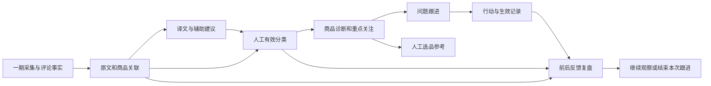
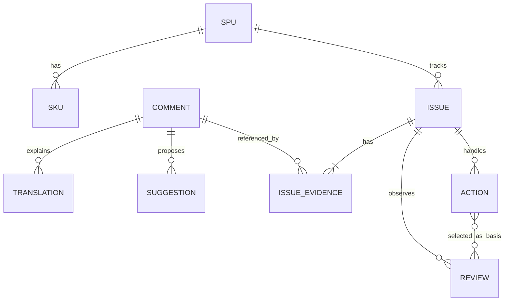
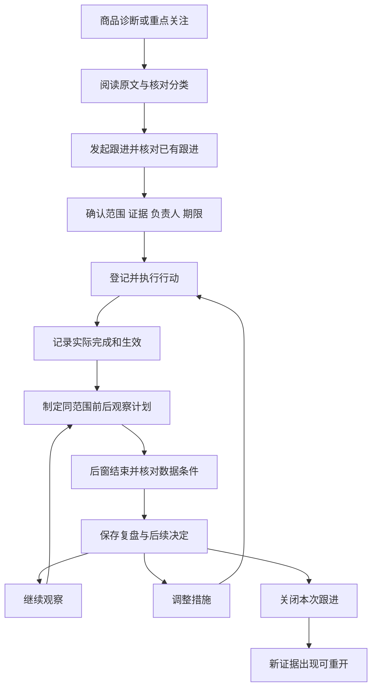

# 商品反馈管理二期完整产品设计方案

版本：V1.1，D21～D28 业务规则确认稿

日期：2026-10-24（Asia/Shanghai）

所属系统：商品中心系统（PCS）／商品反馈管理

主题：评论分析提效、商品问题跟进与改善复盘

状态：业务与产品对抗式审查已通过；用户于2026-10-24回复“1～8全部采用”，D21～D28已逐项确认并纳入本版设计基准。本次授权仅为更新文档，二期尚未实施；不修改产品代码、不变更现有数据、不发布。

审查附件：[业务与产品对抗式审查记录](商品反馈管理二期业务与产品对抗式审查-2026-10-24.md)。首轮问题、交叉质疑、修订位置及最终结论均在附件中保留。

## 1. 设计依据、目标和交付边界

### 1.1 依据与事实身份

| 依据 | 本方案如何使用 |
| --- | --- |
| [一期 V1.3 完整方案](商品反馈管理一期完整方案-2026-10-23.md) | 继承已确认的采集、人员考核、身份、评分和分类规则，不重新定义一期制度。 |
| 一期发布基线 `122ce19391becb61f2657d0f796c2e380136e77e` | 一期已发布五页及本地 Mock；五页现状以该版本为基线。原一期设计文档“尚未实施”的表述属于当时的历史状态。 |
| [一期第二轮业务与产品审查](../prototype-review-records/2026-10-24-product-feedback-business-review.md) | 复用已发现的分母、撤回历史、原文版本、保存回读、下钻返回和简洁 UI 约束。 |
| 用户认可的二期方向 | 分析提效、商品问题诊断、问题跟进、改善复盘、重点关注与待办；只新增一个二级菜单“问题跟进”。 |
| 用户确认的二期业务规则（2026-10-24） | 用户针对D21～D28的八项解释回复“1～8全部采用”；第23节及其引用的正文规则均按已确认设计基准执行。本次仍只更新文档，不构成代码实施或发布授权。 |
| 用户本次要求 | 完整 Markdown 产品设计，明确五类架构、UI、页面、字段、流程和统计；输出前做业务与产品对抗式审查，不改代码。 |
| 项目 `AGENTS.md` | 原型不分角色权限；复用既有组件和共享档案；Mock 打开即用；默认两页；业务真实接入与本地演示分别验收。 |

本次未重新研究真实平台 API、采购新 AI 服务或写入测试数据库。不把既有截图中的字段、方案目标或 Mock 来源描述为已经接通的真实能力。

### 1.2 二期业务目标

1. 分析人员能更快读懂印尼语评论、找到相同表达和不同表达中的同类问题，保留原文与人工判断。
2. 能确定问题集中在哪个款式、规格、颜色、尺码、店铺或链接，并查到支撑它的具体评论。
3. 值得处理的问题有唯一跟进记录、明确负责人、处理措施、完成时间和过程记录。
4. 措施完成与后续反馈变化分别表达；能复盘但不把相关变化直接包装成因果改善。
5. 打开模块即可找到待复核、待处理、逾期行动和到期复盘，保留一期采集考核的独立性。

### 1.3 范围与优先级

| 工作包 | 二期交付 | 边界 |
| --- | --- | --- |
| P2-A 商品问题诊断 | 商品诊断抽屉、规格/颜色/尺码分布、明确分母、固定对象比较、证据下钻 | 不自动判断工厂责任，不由当前商品主档倒推历史购买规格。 |
| P2-B 问题跟进 | 唯一新增二级页面、证据关联、行动、负责人、期限、进度、关闭/重开和历史 | 不建立审批、罚款、奖金、跨部门自动派单或生产变更单。 |
| P2-C 改善复盘 | 生效时间、前后窗、同范围检查、反馈变化、人工复盘记录及后续决定 | 只支持评论发生时间观察；无订单/生产版本证据时不宣称买家购买了改进后的商品。 |
| P2-D 分析提效 | 原文/中文对照、译文修订、辅助主题建议、相似表达聚合、逐条人工确认 | 相似度不改变身份与去重；不自动确认分类，不预建通用 AI 平台。 |
| P2-E 重点关注与待办 | 分析中的关注候选、问题跟进中的实际待办、现有工作台的快捷入口 | 候选不是事故判定；站内展示，不新增邮件/短信/外部群通知。 |
| P2-F 选品参考 | 在商品诊断中提供“优点、问题、样本与待核实事项”参考摘要，可导出 | 不新增选品菜单、自动选品、自动淘汰或商品综合评分。 |

实施推荐顺序为 A+B → C → D+E，F 作为 A 的轻量结果。每个包都有完整可用场景，不把“只有列表、不能处理”的半流程作为交付。

### 1.4 本期不纳入

- 退货单、退款、退货率和售后处理；评论提到退货仍只作为原文证据。
- Shopee 首批任务或模拟店铺；有真实映射和来源后另行配置启用，不占当前考核分母。
- 重建爬虫、扩展或本地清洗程序；真实接入见 §22 的独立落地核对。
- 角色切换、假权限、主管演示、自动处罚、任务免采、采集任务临时改派、评论身份待核验。
- 外部 AI 供应商选择、模型训练、向量数据库、自动重试队列、后端鉴权与通用工单平台。
- 自动修改商品、面料或生产资料；自动创建采购/工厂整改单；跨 SPU 的一张问题总单。

### 1.5 必须继承的一期规则

| 主题 | 继续有效的规则 |
| --- | --- |
| 首批采集 | 九家 TikTok，每天含周末；九店默认负责人均为一个完整姓名“小羊.高阳.kiko”。 |
| 时间 | Asia/Jakarta；每日18:00交付截止；昨日核心，合计最近7个完整自然日；历史补采单列。 |
| 评分 | 所有星级均采；1～2星差评、3星中评、4～5星好评；未知评分不按0星。 |
| 身份 | 继承原生评论ID或固定作用域组合指纹；所有评论有来源评论者；不人工合并/拆分评论身份。 |
| 分类 | 八个一级主题，信息量枚举、正向/问题/中性、人工确认生效；草稿/建议不直接计入主题。 |
| 小样本 | 有效评分少于20只提示；不隐藏对象、不改指标、不自动判定好坏。20条也不证明统计可靠。 |
| 完成 | 原始范围与持久处理满足才完成；译文、分类、跟进未完成不影响采集完成和人员成绩。 |
| 原始事实 | 分析不能编辑原文、评分、评论发生时间或原采集责任。 |

## 2. 产品架构

### 2.1 产品组成与职责



| 层次 | 业务职责 | 拥有的事实 |
| --- | --- | --- |
| 来源层 | 继承一期渠道店铺、链接、SPU/SKU、评论和采集证据 | 原始身份、内容、时间、来源与历史关联。 |
| 理解层 | 原文/译文、辅助建议、相似表达、人工分类 | 译文记录、建议记录、人工确认与撤回。 |
| 诊断层 | 聚合商品反馈、定位问题、比较和关注候选 | 动态查询结果；只有人工保存的观察才成为记录。 |
| 跟进层 | 建立问题、关联证据、安排和完成行动 | 问题、证据引用、行动、责任变更、操作历史。 |
| 复盘层 | 固定比较条件、核查证据条件、登记观察和后续决定 | 复盘计划、保存时样本及结果、人工结论。 |

### 2.2 使用者与责任

岗位只是任务分工，所有页面和操作在原型中直接展示。

- 运营分析人员：读评论、核对译文、确认主题、发现值得处理的问题。
- 商品人员：核对商品与规格问题，登记处理措施和生效事实。
- 问题负责人：协调本条跟进、检查行动和期限、组织复盘。
- 行动负责人：完成一项具体措施，登记实际结果；可以与问题负责人相同。
- 复盘记录人：核对范围和样本，保存观察及下一步。

问题负责人和行动负责人都从现有人员选项选择。Mock 默认沿用“小羊.高阳.kiko”，不虚构额外员工。问题负责人变更是跟进记录的责任变化，保留前后值及原因，绝不改动一期采集任务的原主责。

### 2.3 共享事实与独立事实

| 事实 | 所有者 | 二期允许的操作 |
| --- | --- | --- |
| 商品、规格、店铺、链接映射 | 既有共享档案/一期关联记录 | 只引用；需要修正仍从一期已存在的关联修正流程处理。 |
| 评论原文与星级 | 一期评论事实 | 只读；新来源内容更新仍按一期处理，不由二期构造更新。 |
| 有效分类 | 一期分类事实 | 复用确认/撤回；辅助建议作为候选输入。 |
| 译文与建议 | 二期理解记录 | 基于明确原文版本新增、修订、废止，不参与身份指纹。 |
| 问题/行动/复盘 | 二期跟进事实 | 各自保存并记录操作；不反写采集状态或生产库存。 |
| 关注候选 | 查询推导 | 查看、发起跟进；不持久复制成新评论或默认工单。 |

## 3. 功能架构

| 编号 | 功能组 | 入口 | 必须具备的动作/结果 |
| --- | --- | --- | --- |
| F21 | 原文理解 | 评论详情 | 原文与中文对照、来源、编辑译文、确认读过、历史、原文变化提示。 |
| F22 | 辅助分类 | 评论列表与详情 | 获取建议、查看原句、选入草稿、预览差异、人工确认/撤回。 |
| F23 | 相似表达 | 评论页内视图 | 成组阅读、逐条展开、跨页选择；成员仍是独立评论。 |
| F24 | 商品诊断 | 商品汇总/分析 | 指定对象/期间、主题分布、SKU/颜色/尺码定位、同范围下钻。 |
| F25 | 关注候选 | 反馈分析“重点关注” | 按明确规则推导、展示触发依据、同类跟进提示、发起跟进。 |
| F26 | 问题跟进 | 新增二级页面 | 草稿、创建、证据核对、负责人/期限、行动、时间线。 |
| F27 | 行动管理 | 跟进详情 | 新增行动、开始、记录进展、完成、取消、改期及恢复处理。 |
| F28 | 比较计划 | 跟进详情“复盘” | 生效锚点、观察对象、前后窗、影响因素、结果预览。 |
| F29 | 复盘记录 | 跟进详情/分析 | 保存数值与证据条件、观察结论、后续决定、重算新版本。 |
| F30 | 工作待办 | 问题跟进与工作台快捷入口 | 待处理、逾期行动、待到期/到期复盘、证据变化。 |
| F31 | 选品参考 | 商品诊断 | 引用正负反馈形成参考卡、人工备注与导出。 |
| F32 | 通用列表与导出 | 六页 | 同条件查询/统计/分页/导出、列设置、跨页返回、失败保留输入。 |

## 4. 信息架构

### 4.1 菜单与路由

```text
商品中心系统
  商品&物料档案
  商品反馈管理
    采集工作台        沿用：店铺任务 / 人员考核 / 采集安排
    采集记录          沿用
    评论明细          增强：全部评论 / 相似表达
    商品评价汇总      增强：五种统计维度 + 商品诊断
    反馈分析          增强：评分概览 / 问题反馈 / 正向反馈 / 重点关注 / 数据待完善
    问题跟进          新增：全部跟进 / 我的待办（人员条件快捷入口，无身份切换）
  系统设置
```

“我的待办”应以实际操作人对应的人员为默认条件；原型没有可靠当前人员时，显示“人员待办”，不虚构登录身份，人员条件可直接选择。默认完整结果不因人员条件隐藏功能。

| 页面/对象 | 路由建议 | 刷新与返回 |
| --- | --- | --- |
| 一期五页 | 保留 `/pcs/product-feedback/{collection,batches,comments,products,analysis}` | 原路由、页签和深链接继续可用。 |
| 问题跟进列表 | `/pcs/product-feedback/issues` | 条件、排序、页码在地址中可恢复，列偏好按路由保存。 |
| 问题详情 | `/pcs/product-feedback/issues/:issueId` | 完整工作区；从列表进入后返回保留条件、页码、滚动。 |
| 新建跟进 | 列表或来源页内抽屉，保存后进入问题详情 | 取消返回来源；来源筛选和选中项保留。 |
| 商品诊断 | 商品汇总/分析页内抽屉，地址带对象类型、对象ID和诊断Tab | 关闭恢复来源；刷新可重开同对象。 |
| 评论详情 | 沿用一期地址参数 | 从诊断/跟进打开时保留来源上下文。 |
| 行动/复盘 | 问题详情的页内抽屉或Tab，地址带 `actionId` / `reviewId` | 不新增侧栏菜单；深链接独立读取所属问题。 |

上述新增路由为设计目标，本次未创建。问题详情是新增页面的详情工作区，不另算一个二级菜单。

### 4.2 业务对象关系



| 概念 | 定义与唯一性 |
| --- | --- |
| 评论 | 仍使用一期唯一评论身份；译文、建议、相似组、问题数量都不会增加评论数。 |
| 相似表达组 | 当前查询内便于阅读的分组，不是新商品、评论或问题身份。 |
| 问题跟进 | 一个 SPU、一个主要问题主题、一个明确规格与链接范围、一次处理目标。 |
| 问题证据 | 某评论在关联时的内容、关联、分类及引用片段；同问题同评论只建立一次有效引用。 |
| 行动 | 为一条问题采取的一项具体措施；负责人、期限、实际完成、生效事实分别记录。 |
| 复盘 | 针对该问题固定范围及选定措施，保存一次前后观察与人工决定。 |

同评论可以支撑两个不同主题的问题，例如“尺码偏小”和“拉链卡顿”；商品问题评论合计按评论ID去重，不把两个问题记录当成两条评论。跨 SPU 共性可以在分析中并列查看，但必须分别跟进，二期不建跨款总单。

### 4.3 通用范围对象

每次诊断、关注候选、问题和复盘都明确：SPU、SKU选择方式、店铺、链接、日期类型、起止日、全星级基础范围、主题观察条件、查询时点。

- 分析可用“当前符合条件的对象”动态查询；新建跟进后必须保存明确的店铺/链接/SKU集合。
- 范围模式明确为“SPU固定范围”或“指定SKU”。前者在建单时展开为当时既有SKU集合，并单独保存是否“包含SKU未确定项”；默认包含且在预览中明示。后者保存指定SKU集合，不能包含未确定项。后续新增SKU不自动进入已建跟进和已保存复盘。
- SKU 未确定记录只在允许包含它的SPU固定范围单列，不分摊到任意规格。冻结的是对象集合与未知项纳入规则，不是永久冻结评论清单；符合相同范围的新评论仍可进入实时诊断和新复盘。
- 颜色/尺码按评论购买时的可靠关联分组；未知项单列；不靠字符串截取猜测。
- SKU集合与链接集合采用交集条件；不能因所选SKU出现在另一链接就把该链接静默加入。
- 列表默认动态当前结果，保存的跟进证据和复盘快照保持保存时身份；更新见 §16。
- 关联修正使评论进入/离开当前范围时，实时C可以变化，但必须列出变动评论及原因。未核对变化前，不将其作为可比下降/上升；旧证据和旧复盘不移动。

## 5. 字段字典与数据职责

字段名为业务设计，不是本次数据库变更。必填分为保存草稿、正式创建、具体动作时必填；缺失不靠伪造默认值补齐。

### 5.1 沿用字段

评论ID、原文内容版本、原评分、原文语言、平台评论时间与可信性、购买规格、当前/历史关联、有效分类及其版本、来源批次、首次入库、实际采集人，均引用一期事实。店铺与商品ID/订单号按字符串保留。

### 5.2 中文译文记录

| 字段 | 必填/生成方式 | 含义与校验 |
| --- | --- | --- |
| 译文记录ID、评论ID | 系统 | 一条记录只属于一条评论。 |
| 依据内容版本 | 系统 | 固定本次翻译原文，不写入原文。 |
| 来源语言、目标语言 | 系统/人工 | 原语言未确定允许人工选定；目标中文。 |
| 中文译文 | 保存必填 | 可为空的“未取得”状态不算成功；不能用另一评论的译文补位。 |
| 来源 | 保存必填 | 人工录入、现有工具、辅助生成；来源名称进入详情，列表只展示简短状态。 |
| 核对状态 | 系统/人工 | 待核对、已核对、原文已变化；核对人和时间另存。 |
| 修改原因 | 改已有译文必填 | 首次录入可不填；修订保留旧译文。 |
| 记录人/时间、修订序号 | 系统 | 来源身份和操作可追溯，不放在正常列表页头。 |

“已核对”表示人工读过并认可该版本译文，不等于平台原文或正式分类已改变。译文核对不改变一期分类完成率。

### 5.3 辅助分类建议

| 字段 | 必填/生成方式 | 含义与校验 |
| --- | --- | --- |
| 建议ID、评论ID、内容版本 | 系统 | 生成、选入草稿、确认时均核对当前版本。 |
| 依据译文ID/修订 | 条件必填 | 使用译文时记录；只有原文分析时留空。 |
| 建议信息量 | 候选 | 沿用一期枚举，不扩展同义类别。 |
| 建议标签集合 | 候选 | 八主题、正向/问题/中性；一条原文可同时有正向和问题。 |
| 每项证据 | 每个具体主题必填 | 原文片段、对应中文解释或真实来源图片；不能只有模型理由。 |
| 来源与规则标识 | 系统 | 后台可追溯，产品主界面仅显示“辅助建议”。 |
| 处理结果 | 系统 | 待核对、已选入草稿、已忽略、原文/译文已变化；“选入”不等于确认。 |
| 人工处理人/时间、忽略原因 | 系统/人工 | 忽略原因可选；纠正具体标签要记录差异。 |

不展示无校准依据的“准确率98%”或“置信度99%”。建议失败不改变旧建议、旧分类或当前输入；用户可以手工重试，不建设自动后台重试。

### 5.4 问题跟进主记录

| 字段 | 必填阶段 | 规则 |
| --- | --- | --- |
| 跟进单号 | 正式创建生成 | 推荐显示 `FB-日期-流水号`，技术ID不作主要标题。 |
| 问题标题 | 草稿可空，创建必填 | 例如“SPU-GC-1001 黑色款面料偏薄”；不自动写“工厂质量不合格”。 |
| SPU | 创建必填 | 一条跟进只选一个已存在SPU。 |
| 主要主题 | 创建必填 | 八主题之一；用于范围、候选和复盘，不自行增加一级字典。 |
| 问题描述 | 创建必填 | 描述买家反馈和需要核对什么，区别于已证实根因。 |
| 范围模式、SKU/店铺/链接集合、是否含SKU未确定 | 创建必填 | 按§4.3预览展开集合及未知项规则，冻结作为本次范围，不冻结未来评论。 |
| 初始发现期间 | 创建必填 | 来自来源查询；用于发现背景，不等于复盘前后窗。 |
| 评论证据 | 创建至少1条 | 必须满足 §12.2 当前可用证据；无正文低星单独关注，不虚构主题。 |
| 负责人 | 创建必填 | 现有人员；与采集主责独立。 |
| 优先级 | 创建必填 | 普通、优先、紧急；默认普通，由人决定，不自动定损失或扣罚。 |
| 本轮计划处理日 | 创建必填 | 完成本轮措施并进入复盘的目标日，雅加达业务日期含当日；与复盘计划日分开，变更留原因。 |
| 跟进状态 | 系统/动作 | 草稿、待处理、处理中、待复盘、已关闭、已作废。 |
| 当前处理轮次 | 系统 | 首次创建为首轮，关闭后重开增加一轮；不新建总/子单。页面显示“本轮处理”，历史显示各轮起止。 |
| 创建人/时点、当前版本 | 系统 | 所有更新核对版本；不在列表暴露版本号。 |
| 关闭结论/原因、关闭人/时间 | 关闭必填 | 结束本次跟进，不代表问题消失；见 §13。 |
| 作废原因、作废人/时间 | 作废必填 | 保留单号、来源和已发生行动，不删除事实。 |

### 5.5 评论证据引用

| 字段 | 规则 |
| --- | --- |
| 跟进ID+评论ID | 同一跟进仅一个有效引用，可追加多个片段。 |
| 引用内容/分类/关联版本 | 保存时固定，保留原评分、原文片段、店铺/链接/购买规格；实际依赖译文时额外记录译文ID及修订。 |
| 关联说明 | 本评论为何支撑本问题；具体主题须有原文或图片依据。 |
| 引用人/时间 | 保留首次关联和后续核对。 |
| 当前提示 | 未变化、原文已变化、分类已变化、商品关联已变化、已解除引用。 |
| 核对结果 | 仍支持、需调整范围、不再支持；涉及有效证据集合时预览差异并记录原因。 |

“已解除引用”保留历史；不能因原文变化自动删除历史证据，也不能继续把旧证据冒充当前有效。

### 5.6 行动记录

| 字段 | 必填阶段 | 规则 |
| --- | --- | --- |
| 行动ID/所属跟进/处理轮次 | 系统 | 只属于一条跟进的一轮处理；不以复制行动代替两个问题间的关系。 |
| 行动类型 | 新建必填 | 商品核查、规格/版型调整、图片/描述调整、包装/发货核查、其他；仅任务描述，不自动改其他模块。 |
| 行动内容、负责人、计划完成日 | 新建必填 | 一项可明确完成的工作，避免“持续优化”作为唯一内容。 |
| 状态 | 动作 | 未开始、进行中、已完成、已取消。 |
| 实际完成时间、实际结果 | 完成必填 | 不晚于当前时点；与执行开始/记录时序一致。 |
| 生效情况 | 完成必填 | 无需观察、已生效、生效时间未确认；不要自动取完成日。 |
| 实际生效时间与依据 | 已生效必填 | 不早于可证明的实际实施时点；允许先完成核查、以后才生效。 |
| 取消/改期/更换负责人原因 | 对应动作必填 | 原值及实际行动事实保留。 |
| 附件 | 可选 | 简单证据图片/文件，保存原文件及业务归属；不建设图片处理平台。 |

行动完成量、按时完成量和商品反馈改善分别统计，不按完成行动数计算人员绩效总分。

### 5.7 复盘计划和记录

| 字段 | 必填阶段 | 规则 |
| --- | --- | --- |
| 计划ID、跟进ID、处理轮次、计划修订 | 系统 | 修订不覆盖已保存复盘；每单每轮最多一个当前正式计划和一个编辑草稿。 |
| 复盘类型、选定行动 | 计划必填 | 反馈变化/核查结论二选一；行动须属于当前轮并已完成。 |
| 主锚点、生效时点、证据说明 | 仅反馈变化复盘必填 | 从已完成且已生效行动选择；多措施说明原因；没有实际生效不生成前后判断。核查型不提供这些输入。 |
| 观察对象集合 | 计划必填 | 从问题范围选择子集，固定店铺/链接/SKU；不能含问题范围外对象。 |
| 前期、后期、排除日 | 仅反馈变化复盘必填 | 同时区、同长度完整自然日；默认14天；生效当日排除。核查型不提供。 |
| 观察主题/子问题描述 | 计划必填 | 主要主题固定；例如“偏小”是本次关注描述，未经受控二级分类不能算精确子原因率。 |
| 计划复盘日 | 系统建议/人工 | 反馈变化型不早于后期结束，默认结束次日；核查型不早于本轮最后一项有效核查行动完成日。 |
| 覆盖、分类、样本、对象/构成核对 | 反馈变化型保存时必填 | 由事实计算并逐项展示，不用一个勾选框伪造充分证据；核查型改为核查事项/依据/结果。 |
| 两期数值及样本清单 | 仅反馈变化型保存生成 | 固定评论ID、内容/分类/关联版本和计算口径；核查型不生成空白或虚构两期结果。 |
| 观察记录/核查结论、影响因素 | 保存复盘必填 | 对应所选类型；记录发生了什么及不能解释什么，不自动因果归责。 |
| 后续决定 | 保存复盘必填 | 继续观察、调整措施、结束本次跟进。 |
| 引用评论及行动依据 | 保存必填 | 至少一项真实引用；无评论时可引用覆盖/行动证据，仍可保存“暂无评论”。 |
| 记录人/时间、版本 | 系统 | 新回填或原文更新只产生可重算提示，不改旧记录。 |
| 关单依据依赖 | 系统 | 保存当前轮、范围、判定说明、行动集合/结果/生效及样本版本；变化后该复盘只作历史，不再直接作为本轮关单依据。 |

## 6. 交互架构与共用约束

### 6.1 发现到复盘的主流程



### 6.2 页面上下文

列表、统计、图、导出共用已提交查询。输入未查询时不改变原结果；日期无效保留输入和旧结果，显示字段级提示。快捷卡点击同步筛选；批量动作明确选中数量和对象，不默认扩展为全部筛选结果。

跨页/抽屉进入评论后，“返回商品诊断”“返回跟进”等按钮恢复原条件、Tab、页码、滚动。弹窗只嵌套一层：从问题详情开评论时暂时收起行动表单，保留内存输入；返回恢复，不堆叠多个遮罩。

### 6.3 保存、取消、冲突

- 草稿可以保存未完成信息；正式动作只在最终确认处核对对象、数量和影响，不重复弹同义确认。
- 保存期间禁重复提交；成功须事务完成且独立回读成立。失败保留输入和旧数据，不显示成功。
- 两标签页基于旧版本保存时提示“内容已更新，请重新读取后核对”，保留本次输入供对照，禁止静默覆盖。
- 未保存输入离开、取消或Escape时，只在有修改时询问是否放弃；取消询问后留在原表单。
- 新建/编辑普通表单用抽屉；原文、图片、详细历史按需查看；业务页没有迁移、备份、清库或模拟权限入口。

### 6.4 事件对统计的影响

| 动作 | 会改变什么 | 绝不改变什么 |
| --- | --- | --- |
| 修改/核对译文 | 当前有效译文和依赖建议状态 | 原文、评分、采集考核、已确认分类。 |
| 获取/选入辅助建议 | 待核对记录或草稿 | 正式主题指标和分类完成率。 |
| 人工确认/撤回 | 当前有效分类和实时主题指标 | 原始评分与评论身份；旧保存复盘。 |
| 建立/关闭跟进 | 跟进、待办及引用数量 | 评论数、差评率、采集完成。 |
| 完成行动 | 行动进度与生效记录 | 商品已经改善的判定、库存或商品主档。 |
| 保存复盘 | 固定本次观察样本与决定 | 旧复盘、原评论与历史采集责任。 |
| 新评论/迟到数据/关联修正 | 实时查询和复盘更新提示 | 保存时已固定的历史结果。 |

## 7. UI 设计规范

### 7.1 基础布局与视觉

- 沿用现有 PCS 外壳，菜单“商品反馈管理”仍位于“系统设置”之前，当前父菜单可手动收起。
- 管理页验收尺寸1366×768和1280×720；内容区边距24px，卡片间距16px，内部间距16px，基础正文14px，辅助文字12px，标题20px。优先复用现有组件，不另建视觉系统。
- 标题左侧，主操作与次操作在右侧相邻排列，间距8px，不使用将按钮平均推满整行的布局。
- 常用筛选使用等宽网格：1366及1280视口均优先4列，字段宽度不足180px时降为3列；按钮区域靠右，更多条件入口在同一查询卡片内左下。展开内容放在其下。
- 统计卡通常4或5张等宽；超过5张分两行，不出现“4张小卡+1张整行大卡”。主值和标签分层，必要分子分母同卡展示。
- 表格容器横向滚动，页面主体不横向溢出；默认仅冻结必要对象列，操作列在右，冻结宽度不得挤掉所有可读数据列。
- 默认每页20条，可选10/20；演示/验收数据总量最多40条。产品上限不以演示规模限制，导出仍覆盖全部筛选结果。
- 蓝色主操作/选中，绿色完成，橙色待办/风险，红色阻断/逾期。状态同时有文字，不能只靠颜色。

### 7.2 列表与详情规范

| 组件 | 设计 |
| --- | --- |
| 标题区 | 页面名；刷新等次操作；仅在有明确业务需求时展示新建。 |
| 查询卡 | 常用字段、高级条件、查询/重置/导出；日期含义在字段标签上表达。 |
| 列表卡 | 名称、筛选后总数；右侧批量操作/列设置；表格和分页同卡。 |
| 普通抽屉 | 宽度680～760px，上限为视口减48px；固定标题/底部动作，内部滚动。 |
| 商品诊断抽屉 | 目标宽1000px，上限为视口减48px；样本条、诊断Tab、图表与证据。 |
| 问题详情 | 独立主内容工作区，首行单号/标题/状态及操作；不用窄抽屉塞进整个跟进闭环。 |
| 证据对照 | 宽屏原文/中文并列；窄于可用宽度时上下排列。评分在原文旁固定显示。 |
| 行动表单 | 行动目标、人员/期限、结果/生效按阶段展开；不在未开始阶段要求完成字段。 |
| 复盘 | 前后期指标两列，下面为核对项、评论证据和观察记录；不足条件显示在相关行。 |

### 7.3 产品文案与必要提示

主界面不放时区版本串、MD5、内部ID、算法参数、数据时点长段说明或“大段分母解释”。业务信息优先放短字段名与就近提示，详细口径在“指标说明”中按需查看；保存复盘时的来源/时点在详情历史及导出中保留。

| 场景 | 展示文案 |
| --- | --- |
| 译文未核对 | “待核对” |
| 原文更新 | “原文已变化，请重新核对” |
| 建议未确认 | “辅助建议，尚未生效” |
| 少于20个有效评分 | “小样本” |
| 两期覆盖不齐 | “采集范围未齐，暂不能比较”及“查看缺口” |
| 无评论 | “本期暂无评论”，评分显示“—”，不显示0分。 |
| 关闭跟进 | “关闭本次跟进”，确认区显示尚无充分效果证据时的实际情况。 |
| 下钻 | “查看12条评论”“返回商品诊断”，保留业务范围。 |
| 保存失败 | “保存失败，输入已保留”，仅提供实际可用的重试。 |

### 7.4 低保真页面骨架

问题跟进列表：

```text
问题跟进                                      [新建跟进] [刷新]
[全部跟进] [人员待办]
┌ 查询：状态 / 负责人 / SPU或单号 / 计划处理日期 ──────────────┐
│ 更多条件                    [查询] [重置] [导出]          │
└────────────────────────────────────────────────────────┘
[待处理 3] [处理中 4] [逾期行动 2] [到期复盘 1] [证据变化 1]
┌ 跟进列表 · 12条                               [列设置] ┐
│ 单号与问题 | 商品与范围 | 负责人 | 状态 | 期限 | 查看     │
│ ...                                                    │
│                           每页20 / 共12 / 第1页          │
└────────────────────────────────────────────────────────┘
```

问题详情：

```text
← 返回问题跟进
FB-...  黑色款面料偏薄       [处理中]       [编辑] [更多]
商品 / 主主题 / 负责人 / 计划日 / 选定规格与链接
[概览] [评论证据] [处理行动] [复盘] [操作历史]
┌ 问题描述与发现背景 ────────┐ ┌ 处理进度 ───────────────┐
│ 来自哪些评论、需要核查什么 │ │ 行动1/2、最近进展、下步 │
└──────────────────────────┘ └─────────────────────────┘
当前Tab的结果或表单                           固定局部动作区
```

商品诊断与复盘见 §10、§14 的对应骨架。字段解释放本方案，实际产品只显示完成任务所需的短提示。

## 8. 页面一、二：采集工作台与采集记录

### 8.1 采集工作台

一期的店铺任务、人员考核、采集安排、历史补采、覆盖核查与重新判定保持原规则和入口。

| 区域 | 二期设计 |
| --- | --- |
| 查询与原统计卡 | 沿用一期；9/4等指标只表达采集任务，不混入问题跟进、分类或行动数量。 |
| 店铺任务行 | 可从“评论”进入该任务评论；没有新跟进动作直接改变任务状态。 |
| 人员考核 | 分母、来源执行、按时交付和完成继续分开；不加入“翻译量”“关单量”作为成绩。 |
| 分析与跟进入口 | 在原任务列表下提供一行“待复核评论 / 逾期行动 / 到期复盘”，显示当前数量并链接到所属页面；标签说明对象类型，不另造一套完成率。 |
| 人员条件 | 作用于原采集责任时仅筛采集任务；跟进快捷入口若沿用人员则明确传递为跟进/行动负责人，不能以采集主责推断问题责任。 |

采集范围不齐时，分析/复盘可以回到任务“覆盖与缺口”查看来源。此时不提供“忽略缺口并认定改善”的快捷按钮。

### 8.2 采集记录

| 区域 | 二期设计 |
| --- | --- |
| 原列表与回执 | 日期、店铺、采集人、处理结果、数量守恒、来源记录和历史继续沿用。 |
| 新增关联提示 | 批次详情“关联评论”可显示其中被多少条问题跟进引用，按不同问题ID去重，不能冒充新增评论数。 |
| 行操作 | 原“查看回执/执行范围/本批评论”保留；从评论进入分类或跟进，不在批次页复制编辑表单。 |
| 异常回查 | 原未解决处理失败与覆盖缺口仍独立保留；辅助翻译失败不能成为采集批次失败。 |

本页不新增二期专用批次，不把机器建议、译文修改或跟进保存伪装成采集上报。

## 9. 页面三：评论明细与分析提效

### 9.1 全部评论视图

| 区域 | 字段/行为 |
| --- | --- |
| 默认查询 | 沿用最近30天首次入库；分析下钻继承可信平台时间及来源条件。 |
| 常用条件 | 日期类型/起止、店铺、商品/评论关键词、星级。 |
| 更多条件 | 渠道、SPU、SKU、链接、主题、信息量、分类状态、译文状态、是否已有跟进、批次、关联/时间待完善。 |
| 原统计卡 | 当前评论、有效评分、仅评分、有正文/有图、未分类/SKU未确定；范围仍沿用一期。 |
| 默认列 | 勾选、店铺/渠道、商品/购买规格、评论人/订单、原文摘要、评分、已确认主题、关联跟进、操作。 |
| 可选列 | 中文译文、译文核对状态、辅助建议状态、评论发生时间、入库时间、来源批次。 |
| 行操作 | 查看/标注、阅读原文、修正关联；新增长“发起跟进”放详情内，列表不堆五六个按钮。 |
| 批量操作 | 沿用批量标签/提交复核；新增“获取建议”“查看相似表达”“发起跟进”。不得批量一键正式确认。 |

中文译文默认不挤占列表主要空间；原文与中文对照放详情。关键评分和已确认主题直接显示，不藏在说明折叠区。

### 9.2 评论详情

沿用“评论内容、来源与关联、分类历史、内容版本”结构；评论内容区分为三块：

1. 原始事实：评分、原文、原始图片与购买规格，均只读。
2. 中文理解：有效译文、简短来源、待核对/已核对；“编辑译文”“核对译文”。
3. 分类判断：当前有效人工结果、辅助建议、可编辑草稿、预览确认；并显示关联跟进。

原文与中文并列时每段对应；原文超过6行可“展开全文”。在确认分类时必须能直接看到完整原文或相关图片，不要求先关闭表单。

### 9.3 翻译流程

1. 打开评论，已有当前内容版本的译文则直接显示，没有则显示“暂无中文译文”和“获取译文/手工录入”。
2. 获取时基于当前原文版本；没有正文的仅评分评论显示“仅评分，无需翻译”，不制造空译文。
3. 得到结果后显示“待核对”；用户修订译文时保存新的修订记录，原文不变。
4. 点击“已核对”记录核对人/时间；不会自动确认主题，也不计人工分类完成。
5. 原文变化后旧译文保留在历史，当前区显示“原文已变化，请重新核对”。
6. 正在编辑时收到新原文，最终保存阻断，保留输入及旧原文，用户重新核对后再提交。

原型用与具体原文一一对应的固定中文结果覆盖正常场景，点击即进入常规业务流程；没有“加载Mock”“切换模型演示”等按钮。真实自动翻译来源另行核实；来源不可用时保留手工录入和已有译文，不伪装成功。

### 9.4 辅助分类流程

1. 获取当前版本建议，展示“建议信息量、主题、倾向、原句依据”；具体主题缺依据不允许选入草稿。
2. 原句是“漂亮，但洗后缩水”时，可同时建议“颜色与外观—正向”和“面料与穿着—问题”，不得因五星忽略问题。
3. 用户逐项勾选“选入草稿”；已有人工确认保持有效，草稿与它的新增/移除差异可见。
4. 草稿仍可修改；“预览确认”展示评论数、原文版本、旧新分类差异。
5. “确认分类”复用一期合法性、原文版本、并发及事务要求；成功后才改变主题分析。
6. 批量获取仅对明确选中集合生成候选；某条失败保持其旧记录，结果逐条显示；批量选入草稿的保存按一个明确选中批次原子提交，发生版本冲突整批不写并指出冲突项。

机器建议与人工修订用独立记录；译文修订会使依赖该译文的未确认建议提示重新核对，不能悄悄改人工确认。人工确认如发现依据错误，仍由人修订或撤回，旧结果不因译文变化自动消失。

### 9.5 相似表达视图

入口是当前筛选结果上的“相似表达”，不新建侧栏页面。

| 项目 | 规则 |
| --- | --- |
| 组标题 | 确认主题或“候选表达：面料偏薄”；后者标“待核对”，不能冒充已确认主题统计。 |
| 分组依据 | 同SPU内，使用可解释的原句/词组及当前主题建议；可跨店铺/链接，显示构成。原型使用固定可解释匹配，不建设不透明相似度平台。 |
| 成员 | 保持独立评论ID、店铺/链接、原星级、原文、译文、分类状态、已有跟进。 |
| 数量 | 组内按评论ID去重；同评论可在多个表达组出现，所有组之和不作为评论总数。 |
| 未匹配 | 放“其他评论”逐条显示，不能因未分组而漏掉原查询结果。 |
| 来源变化 | 原文/关联变更后重新计算当前组；旧跟进证据仍保留其保存时引用。 |
| 选择 | 分组选择明确展开为评论ID；跨页选择有数量，取消筛选变化时提示是否清除原选择。 |
| 动作 | 逐条标注、追加建议、选择证据发起跟进；不会把四条相似评论合成一条。 |

不存在“相似即重复”“合并评论”“将整组自动确认”为一个问题的动作。

## 10. 页面四：商品评价汇总与商品诊断

### 10.1 商品汇总列表

保留店铺商品链接、SPU、内部SKU、店铺、渠道五维。原评分及已采样本指标继续使用一期公式。

| 项目 | 二期增强 |
| --- | --- |
| 新增可选筛选 | 问题主题、是否有进行中跟进、是否有关注候选。主题是观察条件，基础全星级评分分母不能被静默缩小。 |
| 默认显示 | 商品身份、已采/有效评分、均分、差评数/率、问题评论数、分类完成率、进行中跟进数、查看诊断。过宽字段在容器横滚，不整页溢出。 |
| 行操作 | 按下表分维度提供合法入口，不能给多款集合直接放单商品诊断或商品档案。 |
| 汇总下钻 | 数量点开对应唯一评论集合；进行中跟进数点开关联问题，不跳评论。 |

“问题评论数”是当前有效人工确认问题标签的唯一评论数；“进行中跟进数”按不同问题ID，不能放在同一个“问题数量”字段。

| 当前维度行 | 主操作及去向 | 商品档案/建单 |
| --- | --- | --- |
| SPU | 商品诊断，带入该款和当前条件 | 可打开该款档案、在诊断发起跟进。 |
| 已可靠归属的SKU | 商品诊断，带入所属SPU及指定SKU | 可打开对应规格/款式档案，建单仍一个SPU。 |
| 已可靠归属的店铺商品链接 | 商品诊断，带入所属SPU及该链接 | 可打开对应档案；历史关联差异在诊断显示。 |
| 店铺/渠道 | “查看商品”，切到SPU汇总并保留店铺/渠道条件，再选款诊断 | 不直接显示单商品档案或发起单款跟进。 |
| SKU未确定等跨款集合 | 先按SPU展开；关联不足则进入核查 | 不猜测SPU建单。 |

### 10.2 商品诊断抽屉

```text
商品诊断 · SPU... · 对应商品图                 [发起跟进] [关闭]
店铺/链接/规格集合    期间    [查看范围]
[有效评分31] [均分3.52] [差评9/29.0%] [问题评论5] [分类完成...]
[反馈概况] [规格分布] [店铺与链接] [跟进与复盘] [选品参考]
┌ 图表/分布表 ──────────────┐ ┌ 对应原文证据 ───────────┐
│ 主题 / 命中数 / 分母 / 比例 │ │ 原文、译文、星级、规格  │
└──────────────────────────┘ └────────────────────────┘
```

| Tab | 字段和行为 |
| --- | --- |
| 反馈概况 | 八主题正向/问题分开；原评分分布；趋势；分类完成和覆盖状态；点击主题显示同范围评论。 |
| 规格分布 | SKU、购买颜色、购买尺码三个切换；每行评论/有效评分/差评率/已识别主题数，未知规格单列。 |
| 店铺与链接 | 店铺/链接构成、对应样本和主题；一SKU多链接保持独立行，总计评论ID去重。 |
| 跟进与复盘 | 属于该SPU且范围相交的问题、当前状态、负责人、措施及最近复盘；查看问题详情。 |
| 选品参考 | 正向证据、主要问题、使用场景（仅有证据时）、样本局限、人工备注和导出。 |

例如“面料与穿着—问题”可以同时包含过薄、过厚或不透气。诊断只能称“面料与穿着问题”，不能据此自动生成“偏薄发生率”。精确跟进某种表达采用 §15.3 的本次问题证据核对。

### 10.3 选品参考卡

只从本次范围的有效人工分类和原句形成“已识别优点/问题”，不自动生成适用人群、畅销预测或利润结论。没有具体场景原文时显示“暂无明确场景反馈”。

导出包含商品、范围、样本量、正负主题及评论ID、人工备注、生成时间；不把辅助建议当已确认卖点，也不把参考卡变成选品审批。

## 11. 页面五：反馈分析、重点关注与待办

### 11.1 原视图增强

| 视图 | 内容 | 主要动作 |
| --- | --- | --- |
| 评分概览 | 原全星级评分分布/趋势；同范围对比及样本/覆盖并列 | 查看评论、进入商品诊断。 |
| 问题反馈 | 八主题已确认问题，增加SPU/规格/店铺链接切换 | 查看原文、发起跟进、查看已有跟进。 |
| 正向反馈 | 确认优点及证据，原星级保留 | 查看评论、选品参考。 |
| 重点关注 | 下述关注候选，默认最近7个完整日及前7日 | 查看触发依据、核对分类、诊断、关联/发起跟进。 |
| 数据待完善 | 原未分类/关联/时间问题，增加建议待核对、译文待核对；对象和分母分别命名 | 打开具体待处理记录，不混成采集失败。 |

默认主卡仍显示“全星级有效评分/均分/差评数率”，主题观察结果就近显示“本次观察命中X条”。若页面无法清楚呈现两个范围，则在观察局部不再重复展示差评率。

### 11.2 关注候选规则（已确认默认，D26）

关注候选只是查阅入口，不自动建单、不改变问题优先级、不认定商品事故。

进入“重点关注”时查询卡明确切换为“最近7个完整日”；店铺/SPU等对象条件可沿用，星级观察和主题子筛选不作用于全星级差评比较。原视图的条件在返回时恢复，不把原近30日字段留在界面却暗中按7日计算。候选比较保存本次计算的明确对象集合；新增/缺失链接不静默交集剔除。

| 候选类型 | 明确计算条件 | 显示与动作 |
| --- | --- | --- |
| 低星待复核 | 最近7个完整日内，1～2星且当前有效分类不存在 | 每SPU一行，显示去重评论数及星级；先读原文/复核，不能猜测具体原因。 |
| 同类问题集中 | 同SPU、同一级主题，在全星级范围内当前已确认“问题”评论至少3条 | 主题名、评论数、相关规格/链接、样本；不自动把同主题不同原因称同根因。 |
| 差评比例变化 | 当前/前7个完整日的有效评分均≥20；差评率增加≥5个百分点，且差评数增加≥3 | 同时显示两期L/V；仅表示值得查看。覆盖未齐或对象集合不一致时显示缺口，不生成该比较候选。 |
| 已有跟进新证据 | 当前问题处于待处理/处理中/待复盘，在本次7日评论集合且问题固定范围内出现尚未引用的、同主题已确认问题评论 | “可补充X条证据”；由人选择引用，不自动扩展规格和链接。 |
| 已关闭跟进可核对新评论 | 本次7日评论集合中，可信平台评论时间晚于该单最近关闭时点，仍在原固定范围，且同主主题已确认问题、尚未引用 | “可核对新评论X条”；先阅读具体表达，再打开原单重开或说明另建，不能称再次发生同一根因。 |

20条在此仅是减少自动关注噪声的候选门槛，不是评分指标的展示门槛或可靠性证明；所有小样本仍可查询、诊断，并在具备证据时手工发起跟进。

候选按固定对象键去重：低星为SPU；同类为SPU+主题；比例变化为SPU+固定两期+规则；两类新证据分别为候选类型+跟进ID。同一商品可能有多种候选，卡片分别计数，不能相加称“异常商品总数”。可选“涉及商品数”按SPU再去重。

二期没有人工收藏/持续关注记录，不能承诺“手工关注”按钮。低星确认成仅评分后会退出“低星待复核”，仍可通过低星/仅评分条件查询；不会丢评论。已关闭候选只表示关闭后的新发生评论；旧发生日的迟到或修正数据走§16的复盘更新提示，不伪装为关闭后发生。

候选不设置“忽略后不再采集”或“自动关闭问题”。已有同主题范围相交的跟进时显示入口，发起新单按 §12.3 核对。

### 11.3 关注列表与待办区别

关注表列：商品、关注类型与实际依据、样本/时间、涉及规格/店铺、已有跟进、查看。默认按类型、最新评论时间、SPU编号稳定排序，不设计不透明风险总分。

实际待办来自人工业务事实：问题待开始、行动未完成且逾期、已到复盘日但未登记新复盘、关联证据发生变化。没有负责人/期限的候选不能伪装成逾期任务。

## 12. 新增页面六：问题跟进列表与建单

### 12.1 列表

| 区域 | 字段/规则 |
| --- | --- |
| 默认范围 | 全部非草稿、非作废问题，不预筛近30天；已关闭可查，防止历史单从默认结果中消失。 |
| 常用条件 | 状态、负责人、SPU/单号/标题、计划处理日范围。 |
| 更多条件 | 主主题、优先级、SKU、店铺/链接、创建日、逾期行动、到期复盘、证据变化、含草稿/作废。 |
| 统计卡 | 待处理、处理中、逾期行动、到期复盘、证据变化；每张标清问题/行动单位，点击同步条件。 |
| 默认列 | 单号/标题、商品/主主题、范围摘要、负责人、优先级、状态、计划处理日、行动进度、最近更新、查看。 |
| 可选列 | 创建人/时间、关闭时间、证据数、最近复盘决定。 |
| 主操作 | 新建跟进。 |
| 行操作 | 查看；草稿可编辑/取消草稿；正式单作废/关闭/重开在详情处理。 |
| 导出 | 全部筛选问题清单；需要行动/复盘明细时明确选择导出类型，不只导当前页。 |

卡片在已提交的基础筛选范围计算，状态卡是其子集。点击“逾期行动2项”进入按问题筛选的列表时，列表标题显示“涉及2条跟进/2项行动”等实际两个数量，不把行动数当问题行数。

### 12.2 从评论/诊断建单

1. 来源页选择评论或主题，打开“发起跟进”抽屉；带入SPU、主要主题、发现期间、选中评论。
2. 预览实际SKU/店铺/链接范围。跨SPU时阻止合成一个问题，显示按SPU分组；用户逐组创建，不能一次无提示生成多单。
3. 正式创建至少有一条当前原文、关联和人工确认分类均有效、且包含本主主题“问题”标签的证据。仅评分低星仍可按低星/仅评分查询，不能凭空填写“拉链损坏”。
4. 选中评论未满足时，允许保存草稿和在当前流程中逐条标注；返回原表单保留输入，确认后重新核对证据。
5. 填标题、描述、负责人、优先级、计划处理日；查看已有相关跟进。
6. 最终按钮“创建跟进”，同屏显示商品、范围、证据条数和负责人；成功后进入新详情。

从列表直接新建时先选SPU及范围，再检索该范围评论作为证据；创建前规则相同。不能通过另一个入口绕过证据要求。

### 12.3 重复跟进与范围变更

- 正在处理的问题包括待处理、处理中、待复盘；同SPU、同主主题，SKU与链接集合均有交集时提示已有跟进。
- 可以“打开已有跟进”“补充证据”；确需分开时填写区别，例如不同子问题或不同措施目标，并预览交集后创建。不要因同属面料主题就强制合并过薄与过厚问题。
- 已关闭问题出现新反馈时可“重开原跟进”或说明新一轮处理目标后建新跟进；记录两者关系，不自动复活。
- 正式创建后SPU和主要主题不直接更换；确实建错时保留历史并作废，再新建正确单。
- 规格/店铺/链接集合可有原因地修订，新增范围必须仍属于该SPU；展示新增/移除证据和对活动复盘计划的影响。已有完成行动和保存复盘保留原范围。
- 正在编辑的复盘若所依据范围已变化，保存阻断；需要基于新范围另存计划，不改旧记录。

### 12.4 评论证据变化处理

问题“评论证据”Tab按“当前支持、待重新核对、不再支持”区分，历史引用始终可查。

- 原文、分类或商品关联变化：当前证据提示“需重新核对”，不自动移除；停止把它计入“当前有效证据数”。
- 人工核对仍支持：引用新版本并说明，且仍须满足§12.2当前主主题问题分类及商品范围条件；分类已撤回或改为其他主题时，先通过一期流程重新确认，不能直接用“核对支持”绕过。否则解除当前支持关系但保留旧引用。
- 关联改到另一SPU：不能继续核对为本问题当前有效证据；可保存历史发现背景，由人决定范围或后续。
- 全部当前证据失效：问题仍在，出现“当前无有效证据”；可以继续核查、补证、作废，不自动关闭，不把原有行动删除。
- 新增证据不得静默扩大问题范围；必须先正式修订范围或选择范围内证据。

## 13. 问题详情、行动与状态

### 13.1 详情页面组成

| Tab | 字段与主要动作 |
| --- | --- |
| 概览 | 单号、状态、商品范围、问题描述、负责人、期限、发现期间、当前证据数、下一项行动、最新复盘。编辑、开始处理、变更负责人/期限。 |
| 评论证据 | 原文/译文、星级、购买规格、引用理由、当前有效性；添加/解除引用、打开评论、重新核对。 |
| 处理行动 | 行动列表、负责人、计划日、状态、结果和生效；新增、开始、进展、完成、取消。 |
| 复盘 | 当前计划、到期情况、前后样本、证据条件、保存的历次复盘；制定计划、记录复盘、重算新观察。 |
| 操作历史 | 创建、范围/责任/期限变更、证据、行动、复盘、关闭、作废、重开；按操作时间倒序。 |

正文只显示当前事实；技术版本细节和完整引用放按需历史。关键逾期、证据变化或保存失败就近显示一行，不用大幅黄色说明占满页面。

### 13.2 跟进状态与动作表

| 当前状态 | 动作 | 前置条件和目标状态 |
| --- | --- | --- |
| 草稿 | 创建 | §12字段和证据齐全→待处理；不生成行动/绩效。 |
| 草稿 | 取消草稿 | 确认放弃；只删除本草稿，不删除来源评论和附件共享引用。 |
| 待处理 | 开始处理 | 记录人/时间→处理中；同时可以创建第一项行动。 |
| 处理中 | 进入复盘 | 本轮至少一项已完成的非取消行动，其余本轮未取消行动均完成；已登记可用复盘计划或核查型复盘说明→待复盘。 |
| 待复盘 | 继续处理 | 说明原因并核对新的本轮计划处理日→处理中；原行动及复盘保留，可新增措施。 |
| 待复盘 | 关闭本次跟进 | 当前轮存在正式保存、后续决定为“结束本次跟进”、依赖仍与当前事实一致的复盘；本轮无未完成行动→已关闭。不能使用上一轮或新增措施前的旧复盘。 |
| 已关闭 | 重开 | 填新一轮目标、负责人、计划处理日和重开原因，选择原/新证据→处理中；系统新增处理轮次，原关闭/行动/复盘仍属上一轮。 |
| 待处理/处理中/待复盘 | 作废 | 明确建错/重复等原因，列出进行中行动；最终确认同时取消未完成行动并记录原因→已作废。已完成行动与复盘保留。 |
| 已作废 | 查看 | 终态；不能直接复活，确需继续新建并引用原单。 |

“已关闭”只说明本次跟进结束。列表不得显示“质量问题已解决”或自动计为改善成功。若措施无需观察，可保存核查型复盘；若需观察但样本不足，可以登记“暂无法判断”及明确后续决定，见 §14.5，不能伪造改善结论。

状态不会因修改一个预计日期自动前进。改期不抹掉旧逾期经历；当前是否逾期按新期限判断，历史记录保留原截止及更改时点。

已关闭问题的范围、判定说明、责任/期限、行动和复盘等业务字段均只读；编辑入口提示“需先重开”并提供真实重开入口，不能靠角色权限解锁。已作废为整单终态，只读且没有重开入口；确需继续只能新建并引用原单。新增本轮行动或恢复处理会使旧的结束复盘失去关单资格，必须按新事实再复盘。

### 13.3 行动流程与生效

1. 新增行动时填具体内容、人员和计划日；“开始”进入进行中；可以追加进展文字和证据。
2. “完成行动”填实际完成时间、实际结果和生效情况；成功后显示已完成。
3. 核查类行动可选择“无需观察”，必须写核查结论；不能用它替代未完成的实际调整。
4. 调整已完成但生效未确认时，可完成行动并显示“生效时间未确认”；此时不能生成效果前后窗口。
5. 生效已确认时记录实际时间和依据；例如图片上架实际时间，不自动等同人员点击完成的时间。
6. 取消行动必填原因；取消项不计有效行动完成率，但保留行及已发生进展。
7. 已完成行动结果写错需要“修正完成记录”，保留修正前后及原因；已关联复盘标记依据变化，旧复盘不覆写。确需恢复执行用“恢复处理”，不能悄悄清空完成时间。

多措施不同生效日不自动视作一个实验。复盘人明确选择本次要观察的措施及锚点，其他同期措施列为影响因素。

行动状态补充约束：

| 动作 | 允许来源 | 目标及与问题联动 |
| --- | --- | --- |
| 新增/开始/编辑未完成行动 | 问题待处理或处理中 | 新增为未开始；开始行动同时将待处理问题变为处理中。 |
| 在待复盘问题新增措施 | 待复盘 | 同屏确认“新增行动并继续处理”，同时更新问题为处理中及本轮计划处理日。 |
| 完成 | 行动未开始/进行中，问题待处理/处理中 | 核对实际结果后已完成；若待处理须同时记录开始/实际时序，不能晚于完成；不自动跳到待复盘。 |
| 取消 | 行动未开始/进行中 | 已取消，原因必填。已完成行动不能用取消来消除已发生事实。 |
| 恢复已取消行动 | 已取消，问题未关闭/未作废 | 有原因恢复为未开始；若问题待复盘，同事务转处理中并核对处理日。原取消事实保留。 |
| 恢复已完成行动处理 | 已完成，问题未关闭/未作废 | 有原因进入进行中并核对本轮计划处理日，保留旧完成事实；若问题待复盘，同事务转处理中，旧结束复盘失去关单资格。 |
| 修正已完成结果/生效 | 已完成，问题未关闭/未作废 | 状态仍已完成，旧值保留；相关计划/关单依据需重新核对。 |

取消/恢复/修正不能跨处理轮次改变历史行动；上一轮动作只读，需要处理同一事项就在新轮新增行动并引用旧行动。新轮进度不能用上一轮的已完成项充数。

## 14. 改善复盘的页面与操作

### 14.1 两类复盘

| 类型 | 适用场景 | 可保存内容 |
| --- | --- | --- |
| 反馈变化复盘 | 已有实际生效措施，需要看后续评论变化 | 生效依据、固定范围和前后窗、问题逐条核对、数值、证据条件、人工观察和下一步。 |
| 核查结论复盘 | 所有有效行动均明确为无需观察，例如核对后发现原文误解或描述无需调整 | 核查内容、证据、判断和后续决定；不填写虚构前后均分或“改善有效”。 |

需要效果观察但生效未确认的，不能改选核查型来掩盖缺口。页面显示“生效时间未确认”，可以保存说明和继续处理；不能生成正式前后比较。

### 14.2 前后窗计划

已确认默认N=14个完整自然日，可改为其他正整数日长，两期保持相同长度。窗口长度属于观察计划，不是采集任务回看规则。

每轮只保留一个“当前正式计划”。可以编辑新草稿；正式替换需说明原因并把前一未执行计划标为已替换，不能同时制造两个到期待办。保存一次复盘后该计划标为已记录；继续观察建立新计划修订，旧计划不再计到期待办。

| 计划状态 | 进入方式 | 是否计到期待办 |
| --- | --- | --- |
| 草稿 | 保存未完成编辑 | 否，原当前正式计划仍保留。 |
| 待观察 | 正式保存计划，成为本轮唯一当前计划 | 问题待复盘且到计划日才计。 |
| 已记录 | 正式复盘与本计划共同保存成功 | 否。 |
| 已替换 | 同轮正式保存新计划，说明替换原因 | 否，保留原范围和期限。 |
| 已取消 | 问题作废或恢复处理/调整措施时取消尚未执行计划，记录原因 | 否；再次进入复盘须正式保存新计划。 |

“继续观察”正式保存原复盘、将原计划标已记录、建立下一计划为同一业务提交；缺新计划目标/日期时保留表单不提交。“调整措施”正式保存原复盘并转处理中、确认处理目标日；未执行旧计划一并取消。不能出现结果保存了却同时保留两项活动待办。

设实际生效所在雅加达日期为D0：

- 前期：D0−N 至 D0−1，含首尾日期。
- 后期：D0+1 至 D0+N，含首尾日期。
- D0整日作为实施过渡日排除；实际生效发生于白天时尤其不能把当日全部评论视为改进后。
- 默认计划复盘日为后期结束次日；保存正式复盘前后期都应已经完整结束。
- 如另设观察滞后天数，必须显式修改后期起点、展示被排除的过渡区间和原因；前期长度仍为N，后期长度仍为N，不自动补齐数据。

例：D0=2026-10-16，N=7；前期10月9～15日，后期10月17～23日；10月16日排除，10月24日可开始复盘。查询边界分别为雅加达10月9日00时至16日00时不含、17日00时至24日00时不含。

### 14.3 复盘界面

```text
复盘 · 面料偏薄                         [保存草稿] [保存复盘]
措施：详情图片调整  实际生效：10/16 14:00  [查看依据]
范围：指定SPU / 2个SKU / 2家店 / 3条链接   [查看范围]
前期 10/09～10/15             后期 10/17～10/23
评论数       20              评论数       20
有效评分     20              有效评分     20
差评       6/20              差评       4/20
本次问题   5/20              本次问题   2/20
待核对/信息不足 0/0          待核对/信息不足 0/0
核对：覆盖 / 问题证据 / 商品构成 / 同期措施
[前期评论] [后期评论] [观察记录]
逐条：原文、译文、评分、购买规格、支持/不支持/信息不足
观察记录：......     影响因素：......
后续决定：[继续观察 / 调整措施 / 结束本次跟进]
```

展示“已识别问题占比下降15个百分点”等数值，只表达两个样本集合的观察结果；不自动生成“改图使投诉下降50%”。

切换为“核查结论复盘”时，表单只显示本轮核查行动、核查事项与真实依据、核查结论、影响/局限、后续决定、记录日期。不显示生效时点、前后窗、两期评分或Y/N/U/R；禁止为了通过必填校验填造日期和零值。只有本轮全部有效行动均明确无需观察时才能使用该类型。

### 14.4 证据条件检查

| 检查 | 产品处理 |
| --- | --- |
| 后期尚未结束 | 展示截至当前的暂存数值；仅保存草稿，不能保存正式前后复盘；计划日保留。 |
| 两期时区、长度、日期类型不同 | 字段阻断；修正后重新预览，保留其他输入。 |
| 对象集合不同/出现前期不存在的链接 | 展示差异；本次只能保存“不可比的观察记录”，不能显示可比下降/上升。可明确另建固定共同子集计划，不静默剔除对象。 |
| 采集范围或已知处理缺口未齐 | 保留数值并显示缺口；只作为暂存观察，正式记录可保存“数据条件不足”，不能得出改善方向。 |
| 评论发生时间未知 | 仍在独立存量，不能塞入前后窗；保存记录注明排除存量，不强行补日期。 |
| 任一有效评分少于20 | 就近提示“小样本”；不隐藏数值，不阻止保存或关闭，不自动认定可靠或不可靠。 |
| 本次问题证据尚未逐条核对 | 展示已识别数和待核对数；允许保存“数据条件不足”，不把未核对项当不支持。 |
| 存在信息不足评论 | 计入评论基础分母，单独显示；结论限定“已识别”反馈，不能声称实际问题发生率。 |
| 店铺/链接/SKU样本构成变化 | 并列显示数量和占比；要求记录人填写影响因素，可下钻分组观察，不自动消除构成影响。 |
| 多措施/促销/价格/新旧购买批次混杂 | 用可选核对项记录已知事实，不能由系统自动猜测；无购买/批次证据时仅称评论发生时间对比。 |

完整采集覆盖只能说明现有来源范围证据齐备，不能据此保证平台全部真实交易或所有买家反馈均已取得。

覆盖检查具体使用一期核验过的执行范围、店铺、入口/链接、结束依据和已知处理缺口，按“前/后两个区间×固定店铺/链接”求覆盖区间联合：每一个目标区间都被覆盖且无已知未解决真实评论保存缺口才称齐备；全店入口证据只有在能证明涵盖目标链接时可复用。某个日任务完成、最后成功采集时间较新，或单次七日窗口均不能替代14日目标覆盖。结果逐项链接到原执行/回执，不要求新增采集系统。

### 14.5 保存与后续决定

1. 复盘草稿可分次保存问题核对进度，记录内容版本；刷新恢复。
2. 正式保存时核对计划、行动、范围、评论、实际依赖译文及有效分类版本，并在事务内重新求完整匹配评论集合；预览后新增/移出匹配评论也属于变化，不能只校验旧清单。任何依赖变化均阻断旧预览提交并保留输入。
3. 前后窗已结束但有缺口时，可以保存明确的“数据条件不足”记录，记录缺口和后续决定；不生成改善方向或改善成功数。
4. 数值条件齐备时记录已识别变化和已知影响因素，选择“继续观察”“调整措施”“结束本次跟进”。系统不替人选择。
5. “继续观察”要填写下一次观察目标和复盘日，形成新计划修订；旧复盘保留。
6. “调整措施”填写原因并返回行动；新增行动不篡改上一轮完成/生效。
7. “结束本次跟进”可作为关单依据。若数据不足，必须明确“暂无足够效果证据”及结束原因、后续安排（继续由其他已有跟进承接，或本次不再继续观察并说明原因），不能标“问题已解决”。
8. 后窗未结束只能保存草稿；如果任务本身建错或取消，走作废，不以提前保存复盘绕过时间边界。

关单时再次核对该复盘所属当前轮、问题范围/判定说明及行动集合和生效事实。如果保存复盘后恢复了行动、增加了措施、改了锚点或关键结果，即使旧记录写“结束本次跟进”，也必须重新预览并保存当前轮的新复盘才能关闭。

一次正式保存产生不可静默覆盖的复盘记录；可以在同单再次复盘。关单不是“复盘后立即自动关闭”，用户仍查看实际行动和后续决定后执行最终动作。

## 15. 统计口径与算例

### 15.1 查询范围与时间

- 普通评论查询保留一期默认“近30天首次入库”；普通商品汇总/分析保留可信平台评论时间，允许查看当前未结束日期但明确截至当前。
- 关注比较和正式前后复盘只使用可信平台评论时间、完整自然日、全星级基础集合；不能切成入库时间后继续称改善。
- 每个查询时点T形成当前有效评论和分类；主题、评分、关联采用T时有效版本。未知时间存量按一期独立展示。
- 最近7个完整日为D−7～D−1，上一期为D−14～D−8；人员考核仍按任务日期，不被二期观察期覆盖。
- 店铺/链接/规格观察筛选是基础范围；星级/主题作为观察子集时不改变原全星级评分基数。

### 15.2 全局评分、主题与诊断

设C为当前固定对象/期间内按一期规则去重的评论集合；V为其中1～5星；L为其中1～2星；K为当前内容版本具有有效人工确认分类的评论；P为K中至少一个“问题”标签的评论；P(t)为其中命中主题t的评论。

| 指标 | 公式/规则 |
| --- | --- |
| 已采评论 | `数量(C)`，不由行数、相似组数或引用次数代替。 |
| 有效评分/均分 | `数量(V)`；均分为评分总和/`数量(V)`，分母0显示“—”。 |
| 差评数/率 | `数量(L)`及`数量(L)/数量(V)`；不把未评分按0星。 |
| 问题评论数/已识别问题占比 | `数量(P)`及`数量(P)/数量(C)`；同时展示`数量(K)/数量(C)`分类完成率。 |
| 某主题问题提及率 | `数量(P(t))/数量(C)`；各主题可交叉，不相加当总问题数。 |
| 差评主题提及率 | `数量(P(t)∩L)/数量(L)`；仅评分和未分类差评仍在分母。 |
| 正向反馈 | K中含正向标签的唯一评论；同评论可以同时计正向和问题。 |
| SKU/颜色/尺码分布 | 按可靠购买关联分桶；未知另列；每桶独立计算分子分母，不平均桶均分/比例。 |
| 相似表达数量 | 组内不同评论ID数；组总和不作为C。候选表达不自动进入P(t)。 |
| 关联跟进数 | 与该对象范围相交的不同问题ID数；多条证据引用同一单只计1。 |
| 译文核对数量 | 当前原文版本的有效已核对译文数；不是评论分类完成数。 |

SPU、SKU、链接等总计先取唯一评论集合再计算；不将不同链接的均分做简单平均。平台累计销量/评论/评分仍按一期带来源快照并列，未接入显示“未取得”；不推导SKU销量、评论占销量比或售后发生率。

### 15.3 本次具体问题的证据核对

八主题不能精确表达“过薄/过厚”“偏小/偏大”等相反子问题。因此一条跟进定义一个清晰的“本次问题判定说明”，例如“买家明确提及布料过薄/透，与本款预期不符”。该说明与复盘范围一同保存，修改后产生新修订，不重用旧逐条判断。

对观察期C内每条评论记录：

| 结果 | 条件 | 统计 |
| --- | --- | --- |
| 支持本次问题Y | 原文/真实图片明确支持，保存片段；不以低星或泛面料标签代替 | 计入本次已识别问题数。 |
| 不支持N | 已阅读，该条没有支撑本次具体问题，例如只称柔软或明确讨论过厚 | 不计Y，但仍在C。 |
| 信息不足U | 已阅读但仅评分、语义含糊或无法判断 | 不计Y，仍在C并单列。 |
| 待核对R | 尚未完成判断、来源内容/关联/判定说明已变化 | 不计Y，仍在C并提示。 |

问题核对记录字段：跟进/轮次/计划修订、判定说明修订、评论ID、内容与关联版本、依据分类版本（若使用）、实际依赖译文ID/修订（可空）、判断依据（原文/图片/中文译文）、Y/N/U、片段/说明、判断人/时间。R由无有效记录或依据变化推导，不伪造“已判断”。

- 必须满足 `数量(C)=Y+N+U+R`；“核对完成率”=`(Y+N+U)/数量(C)`，分母0为不适用。
- “本次已识别问题占比”=`Y/数量(C)`，不是`Y/(Y+N)`，不能剔除信息不足和未核对项抬高或降低结果。
- Y/N/U判断属于本次问题的分析，不自动改变一期信息量/主题；若发现一期分类错误，另走修订确认。
- 来源或依赖版本变化后旧判断保留为历史、当前转R；同一评论同一计划只取一个当前有效判断。
- 仅当判断实际依赖某译文时，该译文修订使判断转R；直接读懂原文/核对图片的判断可明确不依赖译文。不会因此自动撤销一期人工分类，仍须由人修订/撤回。
- 没有全量逐条核对时，仍显示Y、U、R及分母；不得把R当N。保存的数据不足记录不提供改善方向。
- 同一评论可以在两个不同问题中各有独立判断；跨问题合计问题评论仍按评论ID去重。

### 15.4 前后差值

| 指标 | 公式/解释 |
| --- | --- |
| 数量变化 | 后期数量−前期数量，同时给出两期C、有效评分和核对数。 |
| 均分变化 | 后期有效均分−前期有效均分，任一期V=0则不适用。 |
| 差评率变化 | `后期L/V−前期L/V`，单位“百分点”；0分母不补0。 |
| 本次问题占比变化 | `后期Y/C−前期Y/C`，单位“百分点”；两期Y/C原值可查。 |
| 相对降幅 | 二期主界面不默认展示，避免和百分点混用；需要导出时前期占比必须>0并明确公式及名称。 |
| 没有评论 | C=0不是“零问题、改善100%”；数值比例和变化不适用，记录“暂无评论”。 |

两期同样的计算式并不能消除采集、核对、店铺/规格构成和购买批次影响。可比检查结果为“基础范围一致”“存在影响因素”“数据条件不足”；其结果与原数值并存，不添加“改善成功率”或因果效果分。

### 15.5 跟进与行动数量

| 指标 | 规则 |
| --- | --- |
| 正在跟进问题 | 状态为待处理/处理中/待复盘的不同问题ID；不含草稿/关闭/作废。 |
| 当前有效证据条数 | 未解除引用且依据未变化/已重新核对支持的不同评论ID；历史引用可另查，不直接相加。 |
| 本轮行动进度 | 当前处理轮次已完成的非取消行动数/本轮全部非取消行动数；0项显示“本轮尚无行动”。历史累计另查，不计本轮进度。 |
| 当前逾期行动 | 非完成/非取消且当前时点超过计划完成日雅加达次日00时的行动。完成逾期另记历史，不继续算待办。 |
| 本轮处理逾期问题 | 待处理/处理中，且超过本轮计划处理日次日00时；进入待复盘后不继续计处理逾期，由复盘日独立判断。历史逾期事实保留。 |
| 到期复盘 | 当前待复盘问题的当前轮正式计划尚未记录/替换/取消，且当前日期≥计划复盘日；每问题最多一个。按计划计，涉及问题数另计。 |
| 待重新核对证据 | 未解除引用但依据已变化、尚未重新确认的引用数，按问题+评论计；不计当前有效证据，避免同一引用同时称有效和失效。 |
| 关闭数量 | 按实际关闭事件及期间统计；重开后的当前状态另列。不能把关闭数量当解决质量问题数。 |

列表创建日期筛选不限制其下行动完成事件的真实时间；按行动完成期间统计时使用行动日期字段，不能和问题创建期间混用。同一问题两次关闭事件若做活动统计称“关闭次数”，当前已关闭问题数只按ID一次。

### 15.6 三组必须通过的算例

**例一：全局主题与具体问题分开。** 前后期各20条评论、20个有效评分；前期差评6、所有主题问题8、明确偏薄Y=5，后期差评4、所有主题问题7、明确偏薄Y=2，均已逐条核对。

- 差评率30%→20%，变化−10个百分点。
- 全主题问题占比40%→35%，变化−5个百分点。
- 本次偏薄已识别占比25%→10%，变化−15个百分点。
- 三者名称及数值分别呈现；不能用全主题问题数代表偏薄。即使范围检查通过，也只记录观察变化，不自动认定措施造成下降。

**例二：未核对不能当改善。** 前期20条中Y=5、N=15；后期10条中Y=1、N=4、U=0、R=5。后期已识别占比为1/10=10%，核对完成率50%；不能改算1/5=20%，也不能把问题5→1称改善有效。显示小样本、待核对5，保存“数据条件不足”并继续观察。

**例三：一条评论多次被引用。** 评论A五星，人工确认两个问题主题，关联两个跟进，每单只引用一次；全局问题评论总数增加1、两个主题各增加1、跟进数增加2、采集评论数不变。撤回其当前分类后全局P相应减少，历史引用仍在并提示变化，旧复盘不重写。

## 16. 版本变化、历史与重算

| 变化 | 实时页面 | 已保存记录 |
| --- | --- | --- |
| 原文/评分新版本 | 评分按一期当前规则；译文/建议和相关本次问题判断需重核；人工分类按一期失效规则处理 | 旧证据及复盘保留原版本，显示“来源已有更新”。 |
| 实际依赖译文修订 | 依赖它的建议、问题证据和Y/N/U判断提示重核；不依赖它的判断不变；不自动撤销人工分类 | 历史引用保留所用译文修订，旧复盘只提示依据变化。 |
| 人工分类确认/撤回 | 全局主题即时变化；依赖该分类的证据/判断待重核 | 旧复盘不改数；可“查看保存时结果”或新建重算版本。 |
| SKU/链接关联修正 | 当前桶和诊断变化，相关跟进证据提示 | 旧范围和历史购买关联保留，不把旧单移动到新SPU。 |
| 迟到评论或失败后补入 | 对应发生期实时样本变化；不能把入库日当发生日 | 提示“有新增资料可重新观察”，不覆盖旧报告。 |
| 新增SKU/链接 | 动态商品诊断可以纳入 | 固定跟进/复盘集合不自动扩张，修订后另算。 |
| 行动生效或问题判定说明修正 | 当前计划失效，需新修订 | 已存复盘仍按旧依据显示，并提示依据已修正。 |

保存复盘应保留最小足够样本事实：评论身份、内容/评分、关联与分类版本、问题判断、来源时间、核对条件、实际数值、范围及保存时点。不能只存一条动态URL，否则以后打开会变成另一份结果。

“重算”展示旧新范围、增减评论、数值和依据差异；保存为新复盘，原记录只读。二期不建设任意时点全仓历史回放，历史能力仅覆盖明确保存的证据/复盘记录。

## 17. 导出、图片和附件

### 17.1 导出规格

| 导出 | 必须字段 |
| --- | --- |
| 评论 | 原一期字段、有效译文及来源/核对状态、有效人工分类、关联跟进单号；辅助建议独立列明未确认。 |
| 商品诊断 | 对象与固定筛选、C/V/L/K/P、主题分子分母、未知规格/时间存量、关联跟进；不导操作列。 |
| 重点关注 | 候选类型、触发期间、实际分子分母、涉及SPU/规格/链接、已有跟进；不叫质量事故清单。 |
| 跟进清单 | 单号、商品与范围、主题、描述、负责人、优先级、期限、状态、证据数、行动进度、最近复盘决定。 |
| 行动明细 | 所属单号、行动、负责人、计划/实际完成、生效情况、结果、取消或修正原因。 |
| 单次复盘 | 保存时对象与窗口、生效依据、两期原始分子分母、Y/N/U/R、覆盖和构成、人工观察、决定、样本ID与保存时间。 |

所有列表导出全部筛选结果，不限当前页；批量选中导出若提供，必须另名“导出选中X条”，不能混淆。长ID按文本保留，CSV公式字符按安全文本导出，原始业务内容不因显示需要被改写。

导出复盘使用保存时快照，不请求最新结果覆盖；实时分析导出在动作开始时冻结当前范围和版本，冲突时提示重新导出。日期、范围、时点与口径在文件的概要区一次表达，正文列用业务名称。

### 17.2 图片与附件

- 商品识别图继续使用共享商品真实对应素材；买家评论图片只用该评论的来源图片，不能用商品参考图假扮。
- 原图支持点击放大、关闭、遮罩和Escape；缺图有失败提示，不替换为其他对象图片。
- 行动附件为可选佐证，建议支持PNG/JPEG/WebP/PDF，单文件≤10MB、单行动最多5个；作为推荐产品限制，可在实施时依实际组件确认，不引入复杂转换或压缩。
- 保存原文件及业务归属；预览不等于保存成功；附件与引用共同保存。取消/失败不能留下无业务归属孤立文件。
- 删除附件引用保留操作事实；实体只有在无其他有效或历史引用时才能回收。关闭/作废跟进不删除历史佐证。

## 18. 持久保存、失败恢复与实现边界

本节是后续实现契约，本次不改变数据结构或执行清理。

1. 复用一期反馈业务库和共同事务边界，新增译文、建议、跟进、引用、行动、复盘等按记录保存；不把业务快照放localStorage。
2. 共同成功的主记录、证据引用、必要附件引用和操作记录同事务提交；事务complete后独立回读才提示成功。
3. 动作前可准备文本/候选计算；事务内核对当前原文、分类、实际依赖译文、关联、计划/轮次与问题版本、完整匹配集合、对象归属及重复操作。不能基于陈旧预览提交，也不能遗漏预览后新增的匹配评论。
4. 同一操作原样重复返回既有结果；同操作身份但载荷改变阻断。新一轮复盘/行动是真实新动作，不借重试覆盖旧记录。
5. 新功能与规则变更时，按STORE-04登记定向重建目标、旧写入口关闭和一次性完成标记；在业务页面外执行。只处理已授权演示数据，真实资料和用户指定保留数据不清理。
6. 原型首次打开直接读取固定结果，不要求导入、种子加载或维护操作。普通刷新不再次清理/重建，不复活已取消草稿或作废记录。
7. 原型不宣称多人共享、跨设备自动同步或真实权限控制；本次不设计通用服务端、AI密钥配置、备份恢复面板。
8. 翻译/建议来源不可用时保留原文、已有结果与手工编辑；错误仅影响该操作，不把它升级为采集失败或阻断其他问题跟进。

## 19. 异常、边界与必要文案

| 场景 | 行为/文案 |
| --- | --- |
| 无查询结果 | “没有符合条件的记录”，提供重置；不显示空白卡或假0分。 |
| 只有低星、没有具体内容 | 可查询/阅读、确认仅评分/信息不足；发起具体主题问题时要求补充真实证据，不承诺人工收藏功能。 |
| 建议不符原文 | 可忽略/修改草稿，人工分类不被自动覆盖。 |
| 建议生成时原文变了 | “原文已变化，请重新核对”；旧输入可对照，不覆盖新版本。 |
| 问题范围内没有某SKU评论 | 显示“暂无评论”，不推导该SKU无问题。 |
| 全部证据失效 | 保留问题和行动，“当前无有效证据”；允许补证/核查/作废。 |
| 行动截止日在今天 | 今日仍可完成；跨入次日00时才为当前逾期。 |
| 措施已完成，生效未知 | 分别显示两种事实，不能开始正式效果比较。 |
| 已关闭后又有新评论 | 符合§11.2条件时显示“可核对新评论”，允许人工重开或说明另建，不自动改状态；迟到旧发生日数据按§16提示。 |
| 同问题重复引用评论 | 阻断重复引用，定位既有行；可追加说明，不重复计数。 |
| 同一评论支持不同问题 | 允许独立引用与判断；全局数量不重复。 |
| 保存失败/超限/事务中止 | 明确失败、保留输入和旧数据；不得转存业务快照到localStorage。 |
| 两标签页冲突 | 显示“内容已更新”，允许重新读取并核对本次输入，不最后写入者覆盖。 |
| 找不到深链接对象 | “记录不存在或当前资料不可读”，区分真实读取失败；可返回所属列表，不自动创建空对象。 |
| 点击外部商品/来源链接 | 原样指向已存在有效对象；不伪造平台可访问性；新窗口不丢未保存表单。 |

## 20. Mock 场景计划

本节定义将来实施所需数据；本次不生成或改动任何Mock。所有正常评论有来源评论者，全部关联和素材来源合法。默认列表20条，最多两页。

### 20.1 数据总量与组织

- 核心评论最多40条，来自共享SPU/SKU/店铺/链接；覆盖同SKU多链接、所有评分、仅评分、正负并存、已确认/草稿/待复核、未知规格/时间等场景。
- 问题跟进约10～12条、行动不超过20条、正式复盘不超过10条，含各合法状态和必要历史。
- 九家店铺安排及一期日常/历史任务继续小规模展示，采集分母不因为二期跟进增加而变化。
- 需要两期各20条、特殊时间未知等互相占用样本时，使用隔离小型夹具变体，不能把所有变体叠加到日常页面。纯算例100条等只用于内存数学反例，不在浏览器造大库。
- 静态状态须有合法创建、证据、行动和时序，不只填写最终“已关闭”伪造过程。各存储失败作为操作阻断测试，不保存非法业务记录。

### 20.2 场景索引

| 编号 | 场景 | 必须证明 |
| --- | --- | --- |
| M01 | 五星“漂亮但缩水” | 原五星不变，正向和问题可并存。 |
| M02 | 四条相似原文来自不同链接 | 四个独立身份不合并，组内/全局计数正确。 |
| M03 | 原文更新、译文/建议仍旧 | 提示失效；人工确认按一期规则失效，历史可读。 |
| M04 | 待复核建议与已有确认共存 | 建议不覆盖确认，不提前计正式主题。 |
| M05 | 一评论两个主题、两个问题 | 全局问题评论只计1，各问题独立引用。 |
| M06 | 未分类低星发起跟进 | 可保存草稿，正式创建具体问题受证据条件阻断。 |
| M07 | 范围重叠但实际过薄/过厚 | 提示已有跟进，说明不同目标后可分开。 |
| M08 | SKU/链接范围修订 | 已存行动/复盘不改；当前编辑预览失效。 |
| M09 | 行动完成，生效未知 | 进度完成但不能生成正式前后比较。 |
| M10 | 取消行动/作废问题 | 原已完成事实和附件仍可追溯。 |
| M11 | 各20条的完整前后窗 | 与§15.6例一独立对账，绝不自动因果结论。 |
| M12 | 后期10条且5条待核对 | 显示1/10和50%进度，不误判改善。 |
| M13 | 后期0评论/未知评分 | 不显示0分或改善100%。 |
| M14 | 覆盖缺口或新链接混入 | 缺口和集合差异可追溯，不输出可比改善方向。 |
| M15 | 原文/分类更新、迟到评论 | 实时变化，已存复盘不重写，可保存新观察。 |
| M16 | 关闭后新证据、人工重开 | 原关闭记录保留，不改变一期成绩。 |
| M17 | 翻译来源失败、保存冲突/中止 | 旧结果/输入保留，没有假成功。 |
| M18 | 两期各20评分、差评3→6 | 增加15个百分点且+3触发关注候选；不足20仍展示指标但不自动触发该候选。 |
| M19 | 仅核查、无需观察 | 核查型复盘不构造虚拟效果。 |
| M20 | 独立深链接、返回和分页 | 列表/详情回读、来源筛选页码滚动一致；第二页导出完整结果。 |

## 21. 验收矩阵与交付顺序

所有状态在本文件交付时均为“设计要求，未实施验证”。不能把文档审查结论填成这些实现验收已通过。

| 编号 | 需求/验收点 | 对应功能 | 实施时证据 |
| --- | --- | --- | --- |
| A21 | 原菜单五页保留，仅新增问题跟进及其详情 | §4、§8～13 | 六页导航、原深链接及菜单收起实际操作。 |
| A22 | 原文/译文/建议/分类四类事实独立 | §5、§9 | M01～04、内容变化及保存回读。 |
| A23 | 辅助建议必须人工确认，不受星级误导 | §9 | 预览/确认/撤回实际对账。 |
| A24 | 相似组不改变身份，正负/多主题去重 | §9、§15 | M02/M05，独立评论ID集合核对。 |
| A25 | 五维及购买规格诊断、未知项不丢 | §10、§15 | 切换、分布总计、下钻与原评论一致。 |
| A26 | 问题正式创建、范围重叠、草稿回读 | §12 | M06～08，所有创建入口同规则。 |
| A27 | 行动完成、生效、复盘与关单分离 | §13～14 | M09/M10/M16/M19，完整实际动作。 |
| A28 | 具体问题Y/N/U/R与全局主题不混 | §15.3 | 三算例及两期逐条核对。 |
| A29 | 固定等长完整窗口、同范围与覆盖 | §14～15 | M11～14，日期/时区/集合反例。 |
| A30 | 原文、分类、范围、行动更新不覆写旧复盘 | §16 | M15，保存时快照与新观察差异。 |
| A31 | 关注规则与小样本、待办数量清楚 | §11、§15 | M18，边界19/20、2/3、4.9/5个百分点。 |
| A32 | 同事务、冲突、重复操作、失败输入保留 | §18 | 故障注入和独立持久回读，不以函数返回自证。 |
| A33 | 附件取消/失败/共享历史引用 | §17 | 原文件实体及引用一致，取消和关闭不误删。 |
| A34 | 所有导出与筛选/保存时结果一致 | §17 | 第二页及各类文件独立解析分子分母/ID。 |
| A35 | UI短文案、两视口、真实图片、键盘/滚动 | §7、§19 | 真实截图及命名动作，不只DOM宽度。 |
| A36 | 加载/查询/保存/导出完整响应≤1秒 | AGENTS PERF-01 | 两页规模，等价家族各5有效样本；保存包含持久回读。 |
| A37 | 一期采集、人员、评分、去重不回归 | §1.5、§8 | 既有受影响契约及任务4→3→4等直接回归。 |
| A38 | 原型与真实对接分别说明 | §22 | 本地Mock与真实来源分开验，不代填真实业务接受。 |

实施时先写最小业务契约，再按A+B、C、D+E分包完成；出现数量/状态问题先复现反例再修复。每包覆盖直接上下游、适用存储回读及页面，不默认全站重测。文档阶段仅核内容、链接与条款一致，不运行业务构建、页面测试或版本收据。

## 22. 真实工具接入的独立落地核对

二期原型仍为浏览器本地 Mock。真实采集投入考核前，独立确认以下已有工具/服务能力，不在本次预建后台：

| 核对对象 | 必须明确的事实 | 不满足时 |
| --- | --- | --- |
| 浏览器拓展 | 正确渠道/店铺、全评分/仅评分、执行开始结束、范围与翻页终结证据 | 不能自动认定完整采集，保留一期覆盖待核验。 |
| 本地应用/数据服务 | 真实执行人与提交人、批次、去重、持久回执、处理修复、评论来源时间 | 不用Mock成绩冒充实际人员考核。 |
| 历史评论 | 来源、店铺/链接/SPU/SKU映射、现有指纹、评论时间可信性 | 不按入库时间回填历史采集人，不擅自清理/重算真实数据。 |
| 翻译/建议来源 | 是否已有能力、支持字段、费用、失败/版本行为、原文证据 | 原型仅用固定对应结果与手工输入，不声明自动真实生成已接通。 |
| 改进暴露范围 | 能否知道订单/商品/生产版本实际生效和购买时间 | 无依据只能做评论发生时间前后观察，不认定购买了新版本。 |
| 跨人共享 | 既有统一数据服务的实际保存及并发事实 | 本地原型不证明多人协作，另行实施验收。 |

Shopee、退货、外部通知、自动选品、工厂责任认定均需后续明确授权及数据依据，不作为二期原型的隐含完成条件。

## 23. 已确认业务规则与确认结果

确认日期：2026-10-24。用户在逐项阅读D21～D28的推荐方案和实际业务影响后，明确回复：“1～8全部采用，把确认结果更新到二期方案中，暂时不要改代码。”

八项均已采用，不再作为待用户选择事项。具体字段、操作、统计和边界按下表引用的正文执行。

| 编号 | 确认事项 | 已确认规则 | 实际业务影响与正文依据 | 状态 |
| --- | --- | --- | --- | --- |
| D21 | 问题单粒度 | 一条跟进对应一个SPU、一个主要问题主题和明确SKU/店铺/链接范围；同款多店可一起处理，不同具体问题说明区别后可分单，跨SPU分开。 | 范围按§4.3固定；同评论可支撑不同问题，但评论合计仍去重；不按相似表达合并评论身份。建单与范围变更见§12。 | 已采用 |
| D22 | 正式建单证据 | 至少1条当前原文、商品关联和人工确认分类均有效的本主题问题评论；1条即可，无须等到3条或20条，不足可保存草稿。 | 五星中的明确问题可建单；仅评分低星仍可查询/核查，不能猜测具体原因。全部创建入口遵守§12.2。 | 已采用 |
| D23 | 责任与期限 | 问题、本轮行动分别有负责人和计划日，复盘另有计划日；可以说明原因后变更，保留原值和历史，不改一期采集原主责。 | 本轮计划处理日是完成措施、进入复盘的目标；进入待复盘后按复盘日判断，不继续计处理逾期。岗位不转为权限或自动处罚。见§5、§13、§15.5。 | 已采用 |
| D24 | 关单含义 | 本轮有效行动完成且已有符合当前依据的正式复盘，决定结束后才关闭；无充分效果证据时可明示不足、结束原因和后续安排，不标改善成功。 | 后窗未结束只能保存草稿；核查型不用填造生效/前后指标。重开进入新处理轮次，不能用旧行动/复盘直接再次关单。见§13～14。 | 已采用 |
| D25 | 默认观察窗 | 以措施实际生效日为界，生效当天排除，前后各14个完整自然日；可调整为其他等长窗口，保持同一时区和明确对象范围。 | 实际完成与生效分开；后窗结束且核对资料后正式复盘；只表达评论变化，不自动认定因果改善，不改变一期七日采集制度。见§14.2～14.5。 | 已采用 |
| D26 | 自动关注候选 | 默认最近7个完整日；同SPU同主题已确认问题评论至少3条。差评变化需与前7日比较，两期有效评分均至少20条、差评率增加至少5个百分点且差评数至少增加3条，范围一致、覆盖齐备。 | 仅生成核对入口，不自动建单/提优先级/定事故/处罚；20条不是指标展示或可靠性门槛，小样本仍可查询并在具备证据时建单。其余候选按§11.2。 | 已采用 |
| D27 | 辅助分析生效 | 译文和建议辅助阅读，人工确认主题后才进入正式统计；具体问题逐条区分支持、不支持、信息不足、待核对。已识别占比用支持数除以同范围全部评论数。 | 未核对不当作不支持；信息不足/未核对保留分母。原文或实际依赖译文变化时重核，不自动改原评分、去重或已有人工分类。见§9、§15.3、§16。 | 已采用 |
| D28 | 初始交付形态 | 继续实现页面、交互、完整业务流程和合法Mock，保留五页并新增问题跟进；真实采集、数据服务、翻译或AI来源接入独立确定。 | 演示/常规验收默认两页，不限制产品正常分页和完整筛选导出；原型演示不等于真实接入或跨人共享。本次尚不启动实施。见§1.3、§20～22。 | 已采用 |

确认的是二期设计规则，不表示这些规则已在产品运行中生效。本次不会改变一期运行规则、代码、数据或线上菜单；后续实施仍须用户另行明确授权。

## 24. 设计阶段交付、审查与后续边界

- 本文件为二期产品设计主体；对抗式审查独立记录问题、触发例子、双方回应、修订章节和最终结论。
- 设计审查覆盖需求/架构/字段/状态/流程/统计/交互/UI/场景及链接；本次V1.1仅同步八项业务确认及相应状态表述。没有二期实现，因此不声明二期浏览器验证、性能通过、真实工具接通或原型接受。
- D21～D28已获用户确认。本次授权只更新文档；用户另行明确要求实施后，才按§21进入二期代码工作和直接验证，不把业务确认或设计审查当作实现通过证据。
- 保留一期方案及审查的历史身份；本文件只定义二期增量和必要关联，不重写一期历史记录。
- 主工作区无关质检差异保持原状；本次只更新本方案及审查记录的确认状态，不提交、推送或部署。

| 文档版本 | 变更 | 状态 |
| --- | --- | --- |
| V1.0 | 完成二期设计及业务/产品对抗式审查，PP01～PP07关闭。 | 当时D21～D28为待用户确认的推荐规则。 |
| V1.1 | 按用户“1～8全部采用”落实D21～D28，统一正文及审查记录的确认状态，未改变已审查的规则内容。 | 业务规则已确认，二期未实施。 |
