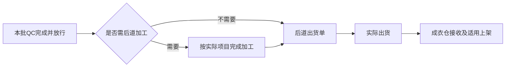
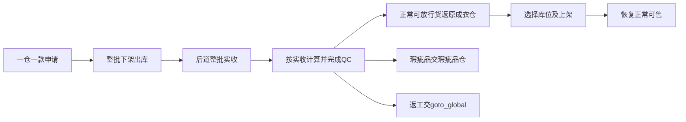

# 质检管理完整业务需求方案

> **本轮最新验收边界（2026-10-23）**：用户明确“不要测试性能了，功能验收没问题就行”。本轮停止性能采样，性能不作为完成条件；已测慢值及失败保留原身份，不能表述为性能通过。保存、失败恢复、刷新回读、上下游、打印与图片等功能验收继续执行。

> 2026-10-23 r34当前结果：产品专项技术验收已完成，376条原子逐条绑定；最后技术收据另行生成并登记。当前结果见收口记录（历史验收产物已清理）。本文原阶段的未完成/失败记录保留历史版本身份，不覆盖当前结果；业务规则未因验收整理新增。

整合日期：2026年10月22日。阶段：有效业务需求；用户已授权实施，当前逐项审查及验收中，尚未全部通过。第二节保留初次方案核查时的现状基线，实际进度以实施计划和验收记录为准。

质检管理设在工厂生产协同系统，负责维护质量标准与检验规则、汇集质检记录、提供统计分析。后道质检、产前版批版和成衣仓库存质检继续在各自原业务页面办理，共用适用的标准和规则，保留各自的业务对象、实物流转和完成条件。

本方案汇总本次会话已确认要求。原76项及整合检查补充的一项稽查边界均已完成确认，现共77项；确认对应表保留在附录。需求确认不代表功能已经实现或现场已经验收。

## 一 业务范围与模块定位

### 1.1 本期范围

本期包括三类业务及其共用能力：

| 范围 | 业务目的 | 执行位置 |
| --- | --- | --- |
| 后道质检 | 检查三方车缝回货，决定本批检查要求、结果和正常货放行，分开处理瑕疵与返工。 | 原后道质检业务页面。 |
| 产前版批版 | PPIC接收工厂一件产前版，检查大货生产前是否做错，按标准项目反馈问题。 | 原车缝外发协同的批版页面。 |
| 成衣仓库存质检 | 原有库存整批下架出库送后道质检，再按合格、瑕疵、返工分别交接。 | 成衣仓原库存、出库和返仓页面，以及后道原质检业务页面。 |
| 共用标准与规则 | 基本标准、附加标准、适用条件、初始全检条件、抽检比例、最低量、分轮稽查和升检档位。 | 质检管理的配置页面。 |
| 记录与统计 | 汇集原业务记录，按环节查看标准、结果、问题、稽查、升级和相关数量。 | 质检管理的记录与分析页面。 |

本期不区分功能操作角色，不讨论哪个岗位拥有配置或操作权限，也不增加演示身份选择。原业务已有的实际接收、领取、办理人和确认时间等事实继续保留。

### 1.2 不纳入本期的内容

辅料配料、调拨及调拨申请不纳入；成衣上的扣子、拉链、洗标、吊牌等质量检查仍属于成衣标准。费用和质量扣费规则由结算模块处理，本期不新增费率、扣款计算或结算联动。

不新增生产工艺审核、印染调色、印染出货、版衣制作、售后差评处罚等独立业务流程。共用能力可以适用于不同工序与环节，但不能以通用化为由提前建设这些未确认流程。本期暂不讨论内部留存样衣和版衣的管理。

不新增跨批次扩大升检、跨环节联动升检、产前版再次批版、内部返工后的再次QC、任务接替、已提交质检结果更正、库存质检中止，以及专门平板、摄像头联动或新的质检执行端。

成衣仓客户退货质检检查的是客户退回货物，与本期在库成衣送检分别管理。

## 二 当前系统与目标变化

现状以此前核对的本地原型为依据；对应来源文件在本轮整合时未变化。下表区分已有行为和本次目标，避免用旧流程覆盖已确认要求。

| 对象 | 当前已有行为 | 本次目标 |
| --- | --- | --- |
| 后道QC | 已有清单、完整单号领取、款式图片、逐SKU结果、打印和去向衔接。数量原先围绕整批合格／瑕疵／返工核对。 | 保留原入口，补充适用标准、初始全检、抽检、分轮稽查与升检，区分实检和整批放行。 |
| 问题计数 | 当前瑕疵原因数量相加决定瑕疵数量；未提交输入也可能显示默认合格量。 | 同件多问题只算一件瑕疵或返工，未提交默认值不算已检，未抽放行不算实检合格。 |
| 质检依据 | 已有色差图、尺寸资料及上传来源记录。 | 优先沿用现有资料；开检固定实际标准和依据，按项目澄清冲突，缺参照资料时按已有资料检查。 |
| 后道加工至出货 | 当前保留加工后数量复检，无加工时存在直接仓交接路径。 | 删除整个复检节点；无加工QC后、有加工加工后，均进入后道出货单，再衔接成衣仓。 |
| 产前版 | 已有PPIC接收拍照、样衣转交、领取、意见和截图反馈；也有再次批版表达。 | 从PPIC接收开始，按共用成衣要求标记问题，保持现有反馈；去掉再次批版，不限制大货生产、不向后道提供参照。 |
| 成衣仓库存 | 已有即时库存、库位、流水、出入库等页面，当前展示尚未形成库存送检的完整联动。 | 补齐一仓一款申请、直接下架出库、后道整批接收质检、分类交接、返仓上架及差异处理。 |
| 客户退货质检 | 当前对象关联客户及原销售单。 | 保留其独立业务身份，不能用该页面替代在库成衣质检。 |
| 质检管理 | 尚无本方案定义的完整标准、规则、记录分析组织。 | 新增配置和查阅分析能力，实际办理继续留在原业务页面。 |

上表保留初次方案整合时的现状与目标，不代表本轮授权实施后的当前进度。实际实现与隔离验收见实施计划及审查记录；页面、演示资料和本地保存不能证明真实工厂业务已经发生。

## 三 业务对象和上下游关系

### 3.1 质检批次如何识别

| 场景 | 本次对象 | 关联关系 | 数量依据 |
| --- | --- | --- | --- |
| 后道生产回货QC | 本次实际回货批次对应的质检单。 | 生产单、款式、实际车缝任务、工厂、回货及SKU明细；同批质检单内可有多轮检查。 | 后道确认的实际接收与送检数量。 |
| 产前版批版 | 本厂送回的一件产前版。 | 同厂、同款、同生产单唯一对应一个车缝任务；各厂使用各自样衣。 | 一件样衣，无抽检比例。 |
| 库存质检 | 一张库存质检申请就是本批次。 | 一个仓库、一个款式，可含多个SKU和实际来源库位。 | 后道实际接收数量；出库量与实收量的差异另记。 |

库存质检本期不要求保留生产单、原车缝工厂或原回货批次，没有这些资料也不阻断。仍须能核对本次仓库、款式、SKU、申请、出库及接收，不补造生产来源。

### 3.2 上游提供什么

商品资料提供款式、图片及正式商品定位；生产单关联的正式版本技术包提供BOM和相关技术资料；已有做货难度选项、真实车缝任务记录参与后道初始全检判断。

后道回货接收确定实际货物及数量，仓库出库和后道实收确定库存送检实物。质检不能用合格或不合格结果改写已经发生的接收、出库或合同时间事实。

### 3.3 下游接收什么

下游使用的是已完成QC后的实际可交货量、质量类别及去向。质检完成不等于已经加工、已经出货、仓库已经收到或已经上架。后道加工、出货和各接收方继续登记实际动作，不能仅靠一张质检结果单认定全部流转完成。

产前版只服务本厂产前纠错，与后道实物参照没有关系，不向后道发布所谓有效产前版。

## 四 模块和页面

### 4.1 质检管理页面

质检管理内各页面采用列表、详情和必要的维护页面组织。配置页维护规则，记录页查看原业务已经形成的事实，不在记录详情中重复提供领取、检查、批版或稽查决定。

| 页面 | 列表与详情应说明什么 | 主要动作 |
| --- | --- | --- |
| 基本质检标准 | 标准名称、质检对象、适用工序和环节、检查维度及项目、判定要求、参照资料、版本和有效状态。 | 维护草稿、查看合成效果、明确生效、停用、查阅历史。 |
| 附加质检标准 | 款式类别或指定款适用范围、新增项目、关联原项目的调整、覆盖范围、与基本标准的差异。 | 维护适用范围和要求、检查同层级重复、预览最终要求、生效或停用。 |
| 检验方式与升级规则 | 初始全检条件、适用环节、命中覆盖范围；抽检比例、计算方式、最低量、轮次阈值和可升检档位。 | 维护适用规则、保存草稿、明确生效、停用。 |
| 质检记录 | 按后道、产前版、库存分别查看对象、所用标准、检查事实、结果、问题及相关实物流转。 | 查询、查看详情、关联原业务记录。 |
| 稽查与升级记录 | 触发轮次、本轮问题件数、阈值、稽查决定、升级比例、累计目标及补检记录。 | 查询和查看原业务形成的处理过程。 |
| 质检统计分析 | 三类业务各自指标、问题分布、检查与升检情况及对应明细。 | 按实际业务维度筛选、查看统计及下查记录。 |

记录汇集后仍使用原业务的同一事实，不形成另一份可以独立修改的检查结果。筛选条件、统计和记录总数保持相同范围；大批记录分页，需要导出时覆盖全部筛选结果。

### 4.2 原业务执行页面

| 页面或场景 | 业务内容 | 与上下游的关系 |
| --- | --- | --- |
| 后道质检清单及领取 | 输入完整质检单号领取，查看本人任务、检查方式及进度。 | 沿用现有普通QC不得挑选全量待检池的限制；不新增角色选择。 |
| 后道质检执行及详情 | 识别实物、查看最终标准与依据，登记各轮三类数量和问题，提交结果、处理稽查，打印及上传适用纸单。 | 上接实际回货或库存送检，明确来源类别；下接按结果去向和正常货放行。 |
| 后道加工及出货 | 按实际项目登记加工，办理后道出货单和实物交出。 | 无加工QC后进入出货单，有加工加工后进入出货单，不经过复检。 |
| 产前版接收及批版 | PPIC接收样衣，保留现有照片和转交资料；领取后检查、记录意见及反馈。 | 关联本厂唯一车缝任务，不新增工厂做样完成、送出或再次批版页面。 |
| 库存查询及送检申请 | 选择仓库、款式，汇集全部可送检正常品，建立本次申请并下架出库。 | 排除订单占用、已拣货及待出库数量，送后道工厂。 |
| 库存送检流转详情 | 查看出库、后道实收、差异、QC状态、各类去向及接收上架进度。 | 本申请即QC批次；能分别看出质检完成与申请整体完成。 |
| 成衣仓及瑕疵品仓接收上架 | 按实际收到的类别、SKU和数量接收并办理适用上架。 | 合格品回原成衣仓，瑕疵品进瑕疵品仓；合格品上架后恢复可售。 |
| goto_global返工接收 | 接收实际返工货并进入自有工厂既有作业。 | 不另建返工后QC；库存申请以其接收作为对应交接完成。 |

执行页先让使用者识别当前衣服和任务，再看本次要求、应检和实检、结果及可执行动作。图片、名称编号、颜色尺码和必要来源一起展示；问题、检查标准与数量在当前任务内能对应查看。

## 五 通用质量标准

### 5.1 基本标准与适用性

所有适用款式默认执行基本标准，不因是否基础款而免除。不同工序、不同环节可维护不同的基本标准；不同环节允许共用一份，前提是检查对象相同。本期后道QC、三方工厂产前版和成衣库存均为成衣，产前版及库存共用后道成衣质检要求。

项目适用条件提前配置，由系统匹配本次应检项目。执行时不能临时免检；原本应具备而实际缺失或未完成的内容按问题记录。正常计划在后道内部完成的加工，不因尚未加工就自动认定三方漏做；是否应具备按适用标准和已约定分工判断。

### 5.2 成衣基本检查要求

| 维度 | 检查内容 | 判定依据 |
| --- | --- | --- |
| 尺寸规格 | 领围、肩宽、胸围、衣长、袖长、下摆等关键8至12个部位。 | 封版样衣和尺寸公差表。 |
| 面料外观 | 色差，包括缸差、边差、件差；破洞、瑕疵点、纬斜。 | 色卡和标准光源箱。 |
| 缝制工艺 | 跳线、浮线、断线、针距、缝份、线迹歪斜。 | 工艺单和工艺标准。 |
| 辅料配件 | 扣子牢固度、拉链顺滑，唛头、洗标、吊牌正确性。 | BOM清单。 |
| 整烫外观 | 死褶、极光、烫黄、版型走样。 | 封版样衣。 |
| 清洁度 | 污渍、油渍、线头、毛屑。 | 目视和手感。 |

具体公差、限值和外观判断优先沿用已有尺寸公差表、工艺标准、外观缺陷标准等资料，不由方案编造数值。每个检查项明确名称、内容、判断要求、适用范围及对应依据，必要时说明单位；不因此要求对每件衣服建立档案或逐原因填写件数。

### 5.3 附加标准的复用和覆盖

一份附加标准可以设置适用范围并复用。没有匹配的有效附加标准时，执行基本标准，不因未配置附加要求阻断；已经匹配的有效附加标准必须执行。

优先顺序固定为：**基本标准 < 款式类别附加标准 < 指定款附加标准**。同一检查项冲突时采用更高层级的要求，其他项目继续保留；不改为择严、取最新或任意设置优先数值。同一层级不允许同款匹配两份附加标准，即使内容一致也不允许，适用范围重叠须在维护时处理。

修改已有要求时，明确关联原检查项并限定覆盖范围；新增原来没有的要求，单独新增项目。不能凭名称相似推定覆盖，也不能因一项修改就替换整个维度或整份基本标准。

例如只调整某款M码胸围，就关联原胸围项目并限定M码，其他尺码及衣长、袖长保留；新增印花牢固度则新增项目。示例说明覆盖关系，不规定实际公差。

### 5.4 标准生效和本次固定

标准和规则采用“保存草稿 → 明确生效”，支持停用，本期不做预约生效，也不增加审批链。执行页展示合成后的一份要求，可追查项目来自基本标准、类别附加还是指定款附加。

每次独立新开检重新匹配最新有效标准，同时固定本次实际采用的参照资料和标准样，直至本次质检结束。同一QC从30%升到50%或100%仍属同一次检查，新增轮次不重新取标准；后续版本更新不改变本单已固定的质量要求。

本单开检时同时固定抽检规则参数，包括比例、最低量、各轮稽查阈值和升检档位，直至本次结束。后台后续更新不改变本单参数，新开检使用新有效版本；已确认的初始全检覆盖仍单独取高，可以把在检单提高到100%。

标准更新不自动追检。确需单独追检时明确对象、范围和项目，另行记录并关联原记录，不覆盖原结果。这一通用原则不创建产前再次批版、goto_global内部返工后QC或通过新建单绕过结果更正限制的入口。

### 5.5 资料缺失和依据冲突

有适用且生效的质量标准时，参照资料缺失仍按已有资料检查；不增加缺资料一律全检或补齐全部资料才能完成的限制。资料缺失与衣服本身缺陷分别表达，不伪造缺少的图片或判断依据。

判断依据按具体检查项确定，冲突项先澄清，不给所有资料强排一个统一顺序。“封版样衣”保留为上表明确依据；本期不扩展内部留存样衣或版衣管理，也不能把本厂产前版当作后道封版样衣。

工厂没有真实历史车缝任务时，按第一次任务全检，是已明确的单独规则，不推广为其他缺资料情形一律全检。

## 六 初始全检与抽检升级

### 6.1 默认初始全检条件

全检条件本身和适用范围可配置。当前四条默认条件仅用于后道生产回货QC，任意命中一条即全检；页面保留全部命中原因。

| 条件 | 判断来源 | 初始全检覆盖范围 |
| --- | --- | --- |
| 基础款或冷启动基础款。 | 正式商品定位。 | 该款该生产单各承接工厂的全部回货批次。 |
| 做货难度A及以上。 | 沿用当前A、A+、A++、B、C、D选项，A、A+、A++命中；本期不新增等级。 | 该款该生产单各承接工厂的全部回货批次。 |
| 任一面料SPU不在指定范围。 | 该款生产单关联的正式版本技术包BOM，只判断面料SPU。 | 该款该生产单各承接工厂的全部回货批次。 |
| 该三方车缝工厂真正执行的前3个车缝任务。 | 系统内真实车缝任务记录，不考虑外部系统。 | 该款该工厂该生产单的全部回货批次。 |

指定面料SPU范围共20项：

CNIDML002、CNIDML018、CNIDML021、CNIDML031、CNIDML043、CNIDML003、CNIDML132、CNIDML076、CNIDML160、CNIDML030、CNIDML046、CNIDML059、CNIDML022、CNIDML328、CNIDML006、CNIDML129、CNIDML074、CNIDML347、CNIDML095、CNIDML040。

面料全在范围内只表示没有触发该条，不能抵消其他全检条件。正式BOM是本条依据，不改成现场替代用料优先。同一实际车缝任务分多批回货仍只算一个任务；前三任务的各批回货均全检。查不到真实历史记录，按当前为第一次车缝任务全检，不要求补录外部历史。

这些条件不适用于库存质检或产前版。库存送到后道工厂检查也仍是库存业务，不能因地点相同就套用上述条件。

### 6.2 初始全检范围内各批次的处理

初始全检覆盖全单或单厂全单，不只是当前批次：

| 范围内批次 | 处理方式 |
| --- | --- |
| 已完成QC。 | 不重新检查，不重开原单、不改原结果。 |
| 正在检查。 | 累计目标提高至100%，抵扣已检数量、补足剩余量；原质量标准继续固定。 |
| 尚未开检。 | 按全检开始。 |
| 后续回货。 | 对应范围持续全检。 |

工厂后续又执行了更多任务，不会解除先前三任务已形成的适用范围。同一QC命中有效全检要求就全检；其他有效数量要求采用更高应检量，保留理由，最低检查量也要满足。

### 6.3 抽检数量

需要抽检的环节默认30%，比例和最低检查量允许分别配置。本期只开放按整批数量计算，其他计算方式待后续明确后再增加，不提供SKU抽样方式或虚设选项。产前版一件样衣不存在抽检比例。

比例计算向上取整，可以设置最少质检数量。累计应检量为“比例向上取整量与最低量中较大者”，但不超过本批实际货物量；未设最低量时按比例取整。

例如本批101件、30%，应检31件；若最低量40件则应检40件；本批只有12件时，最低量不能要求超过12件。若最低量或向上取整使应检量覆盖整批，实际按全量检查办理，同样适用全检不触发抽检稽查的规则；页面仍说明配置比例与最终应检量。

系统不管理现场怎样挑选样本，不分配按SKU、颜色或尺码的抽样数量，不新增随机校验、各SKU至少一件或逐件标签。物流有SKU明细与系统分配抽样是两回事。

### 6.4 每轮检查与三类数量

后道及库存都填写合格、瑕疵、返工三类实际检查数量，同件只能计一类；一件衣服有多个问题仍只计一件瑕疵或返工，不按问题条数增加衣服件数。

- 本轮实检量＝本轮合格量＋本轮瑕疵量＋本轮返工量。
- 本轮不合格量＝本轮瑕疵量＋本轮返工量。
- 累计实检量＝各轮新增实检量之和，不能把同一轮重复提交再累计。
- 未检量＝本批实际接收量－累计实检量。
- 满足完成与放行条件后，正常可放行量＝实检合格量＋获准随批放行的未检量。

问题项目与衣服件数分开，未检货不能填进实检合格。以抽检未覆盖整批为由确认“短少”也不能绕过应检要求。

### 6.5 分轮稽查与升检

每轮单独保留本轮新增实检、三类结果、问题、累计目标、已检和待补检量。轮次及触发不合格件数可配置，默认只配置第1轮和第2轮，阈值均为2件；可维护更多轮次，不强制每轮都配置阈值。

本轮不合格件数达到阈值立即触发稽查，QC不能完成，即使本轮已检足也一样。第2轮按该轮新增检查中的坏件数判断，不累计第1轮问题再触发。再次达到阈值仍稽查，不是第二次自动全检。

本期稽查后只允许提高抽检比例或直接全检，不允许维持原比例结束稽查或直接放行。本期初始档位30%、50%、100%，允许在规则中维护。

提高比例改变的是同批累计目标；已检过的合格、瑕疵和返工全部抵扣，只检查差额。比例一经提高不能降低，即便误操作也不降低。初始全检和升至100%后的检查均不再触发抽检稽查。

| 示例步骤 | 本轮新增检查 | 本轮不合格 | 累计已检与后续 |
| --- | --- | --- | --- |
| 100件，首轮30%。 | 30件。 | 3件。 | 已检30，触发稽查，不能完成。 |
| 稽查决定升50%。 | 补20件。 | 2件。 | 累计已检50、不合格5；本轮2件再次稽查。 |
| 再次稽查决定全检。 | 再补50件。 | 记录本轮真实结果。 | 累计检查100件；全检不再因坏件数触发抽检稽查。 |

### 6.6 升检范围与完成条件

本期普通升检只作用当前批次：后道为本次回货批次，库存为本次申请。暂不提供跨批次扩大升检，不提供不同质检环节之间的自动或人工联动升检。

完成QC必须达到当前应检量、提交所需结果和适用资料，且没有待处理稽查。QC未完成不允许先交出其中部分货；完成后实际不合格衣服单独处理，其余可按批次放行。

例如100件抽检30件，结果合格29、瑕疵1、返工0，达到应检量且无待处理稽查时，可正常放行99件，其中实检合格29、未检随批放行70；瑕疵1件另行处理，不能把99件记成实检合格。

## 七 后道质检及后续出货

### 7.1 正常流程

车缝工厂登记回货，后道确认实际接收，沿用实际批次送检形成唯一QC任务。该单保留生产单、款式、工厂、真实车缝任务、回货批次及SKU关系，升检各轮仍在本单内办理。

领取后查看对象图片、回货实物、初始检查方式及原因；开检匹配有效标准并固定实际依据。按项目检查，逐轮填写三类数量及问题，按条件进入稽查和补检；满足完成条件后形成质量结果和可交去向。

后道生产回货QC保留纸面双签单并上传，问题照片选填。只填数量、默认合格数、打印纸单或现场检查完某一轮，都不能代替本次QC完成。

### 7.2 加工与出货

整个后道取消复检节点，不再保留复检任务、页面、确认或扫码完成复检的动作，也不默认把旧复检操作搬到出货。无加工也进入后道出货单，取消旧的绕过出货单直接仓交接路径。

后道已确认的加工项目、逐项完工、必要部分登记及QC完成后的分批出货继续按原有效流程办理；删除复检不等于增加加工步骤，也不取消实际数量交接。库存送检、接收及返仓的整批要求另按第九节执行，不能套用生产回货后续的分批方式。

无可出货量不生成空出货或空交接。出货与接收记录实际数量，不因QC放行就自动认定仓库收到全部货。

### 7.3 瑕疵及返工

瑕疵、返工与正常放行货分开处理，保留原QC发现的问题和数量；后道已有瑕疵记录及后续办理继续承接，本期不新增费用和处罚。库存瑕疵的明确仓库去向按第九节执行。

返工不强制回原车缝工厂，跨厂返工均去自有工厂goto_global，处理后不再QC，也不增加内部补做后的质量复查或数量复检节点。完成后的适用实物流转继续通过原加工、出货及仓接收业务衔接。

返工形成的新回货批次不与旧QC建立复查、抵扣或问题销项关系。不能因为新批次就构造第三方新车缝任务或内部返工后待QC；原QC的返工事实不因后续处理而改写。

### 7.4 相关旧演示数据的处理（2026-10-23修订）

本仓库为原型。本次改造涉及的旧后道、质检及产前版演示数据可以定向清理，按新功能重新生成。不再将旧复检转换为出货单，也不保留仅为旧演示服务的迁移、旧轮批版转换或历史进度承接。

只处理本次相关演示数据，其他模块及共用记录、附件保留。新生成的演示数据应按当前流程包含检查标准、轮次、数量和单据关系；真实使用时仍须经过正常保存、加工、出货及仓收操作。清理边界和本轮验收详见[旧演示数据清理与重建](quality-management-20261022/旧演示数据清理与重建-2026-10-23.md)。此前迁移要求由本次用户确认替代，其他业务要求继续有效。

## 八 产前版批版

### 8.1 目的和对象

三方车缝工厂在做大货前送一件产前版给PPIC，用于检查是否做错。同一工厂、同一款式、同一生产单只有一个车缝任务，各厂使用各自样衣，不跨厂共用，不设计多车缝任务共享一件产前版。

产前版暂共用成衣检查要求，但结论为无问题／有问题，不填后道的三类大货件数、不配置抽检比例，也不使用四条后道初始全检条件。

### 8.2 页面和办理流程

PPIC接收样衣并保留现有照片及必要转交记录 → 领取批版 → 按本次有效要求检查 → 记录无问题或有问题 → 有问题按标准检查项标明具体问题 → 沿用现有反馈登记结束。

不新增工厂做样完成、送出、提交等页面动作。现有样衣实物转交不等同允许更换已领取任务的办理人；本期不提供任务接替。

反馈保持当前流程，不要求工厂新增整改材料、逐项回复、问题照片或收悉回执后才能结束。原有实物照片和反馈截图等继续保留，截图登记不等于证明工厂已收到意见。本期不另加纸面签字要求。

### 8.3 时效和与生产的关系

领取批版后48个连续自然小时计时，不扣夜间、周末，领取和截止等时间按工厂所在地时间显示。起点保持领取，不改为PPIC实收样衣或只计工作时段；沿用现有反馈完成流程，不增加生产放行审批。

批版未结束、有问题或反馈未结束均不作为禁止大货开工、继续生产的条件。此流程提供产前纠错，不新增生产硬性限制。

不做再次批版，不保留是否再批、再次送样、下一轮、首轮与最终轮次。产前版与后道参照无关，不向后道发布或供后道引用；共用检查要求不改变这一边界。

## 九 成衣仓库存质检

### 9.1 申请范围

一仓一申请，一次只含一个款式，可含该款多个SKU及实际来源库位。不同仓库、不同款式分别申请，不在一个申请内混合。

每次包括所选仓库该款全部符合条件的正常品，不允许任意指定部分送检量。已经被订单占用、已拣货、待出库数量暂不纳入；原有瑕疵、破损不在本次可申请范围。不解除原订单占用来凑送检量。

全部符合条件的库存均送到后道，与后道在该批内部按比例检查是两个概念；全部送检不等于默认100%实检。

### 9.2 下架出库和后道接收

申请后对应货物直接下架出库，减少原仓内库存，不再设计申请冻结、在检占用或取消释放。整批交出、整批接收，不允许分批；后道记录实际收到的数量和差异。

库存QC应检量按后道实际接收量计算。例如出库80、收到79，批次数量为79，30%向上取整应检24；若升级全检则检查79。差异1件单独保留，不记成已检合格、瑕疵或返工，不按出库数填平实收。

允许数量差异，但必须质检，不支持中止、未经检查退回结束或取消后自动恢复库存。差异的确认处理保留真实去向和原因，不通过修改原接收数或QC结果假装短少已补齐。实际接收为0时没有可检查实物，先核实交接差异，不能仅以应检量算成0就虚构质检完成。

### 9.3 库存检查与升级

一张申请就是本批次，在后道原质检页面明确显示库存送检身份。共用成衣基本及适用附加要求，执行库存环节的抽检规则；四条生产回货初始全检条件不适用，不按历史工厂或款式基础定位自动全检。

开检匹配有效标准并固定，按各轮登记合格、瑕疵、返工。达到本轮阈值进入稽查，可按已确认动作提高比例或全检；累计已检抵扣，升级只本申请，不扩大到原仓未送检货或其他申请。

### 9.4 检后整批办理与去向

本批QC完成后整批办理相应交接，不在未完QC时先交一部分。正常可放行量包括实检合格与获准随批放行的未检量，二者保持分开统计；不能只按实检合格量返仓，也不能把全部返仓量反填为实检合格。

合格货返原成衣仓，允许重新选择库位，完成上架后恢复可售；瑕疵货进入瑕疵品仓，不放回原仓正常库存；返工去goto_global，不先恢复为可售。后道返仓衔接原出货、仓库接收及上架页面，保留库存送检来源，不能当作新生产回货重复入库。

goto_global接收后按自有工厂既有作业处理，不再QC。各去向分别按实际收到的数量登记；整批返仓不表示全数返回同一仓库。

库存QC本期不额外增加纸面签字要求，沿用适用记录和已有资料。原后道生产回货QC双签要求不因检查地点相同而自动扩大到库存环节。

### 9.5 质检完成和申请完成

| 完成层次 | 条件 |
| --- | --- |
| 质检完成。 | 达到当前应检量、所需结果已提交，没有待处理稽查。 |
| 申请整体完成。 | 质检已完成；各类货物完成对应实际交接、仓库适用上架，数量差异已确认处理。 |

合格货以原成衣仓接收上架为对应流转完成；瑕疵货以瑕疵品仓接收及适用上架为对应流转完成；返工以goto_global实际接收为对应交接完成，不等待返工做完或再返仓。无某类货物时不制造空交接。

QC可以已经完成但申请仍因在途、未上架或差异未处理而未完结。质量状态不能代替实物状态，也不能把差异确认当作结果订正。

### 9.6 数量示例

以下示例无真实损耗，接收及差异均已核对。

| 示例 | 实检与物流结果 | 库存结果 |
| --- | --- | --- |
| 原仓正常100，其中20被订单占用；送检80并全检，78合格、2瑕疵、0返工。 | 原仓保留20，78返原仓，2进瑕疵品仓。 | 原仓98，瑕疵品仓新增2，两仓实物合计100。不能把100全部恢复原仓后另加2。 |
| 同样送检80，30%应检24；结果23合格、1瑕疵、0返工，无待处理稽查。 | 实检24、未检56；正常返原仓79＝23实检合格＋56未检放行；瑕疵1进瑕疵品仓。 | 原仓保留20加返仓79为99，瑕疵品仓新增1，合计100；实检合格仍23。 |
| 原仓保留20，送检80且全检结果75合格、2瑕疵、3返工。 | 75返原仓，2进瑕疵品仓，3交goto_global。 | 原仓95、瑕疵品仓新增2、goto_global在制3，实物合计100；返工3不计可售。 |

存在真实短少时分别显示原仓、在途、实收、各去向及差异，不通过凑平数字声称实物全部在库；后续确认按实际差异事实办理。

## 十 记录 单据与统计

### 10.1 业务记录和填写边界

原业务保留对象、实际采用标准及资料、检查方式与理由、各轮应检和实检、三类结果或批版结论、问题、办理人、时间、稽查决定及必要交接。标准、质量结论和物理数量变化分别记录；汇集后仍能追查同一来源。

不支持已领取任务接替，不支持已提交结果更正，不设例外审批或新建单绕过。未提交输入可以核对修改，保存失败保留可恢复输入；升检后新增轮次正常登记和纸单重打上传继续支持，不覆盖前轮事实。差异确认增加真实处理记录，不改写旧实收或QC结果。

保存成功才显示提交完成，刷新或直接进入下游应能读到同一记录；保存失败说明未保存，保留输入。重复点击不能重复增加检查量、生成出货或入库；同时办理发生冲突须重新读取核对，不能假成功。未保存输入和附件有离开提醒，不承诺关闭页面自动恢复。

### 10.2 图片和单据

需要识别实物的页面展示对应款式、颜色或必要物料图片，名称编号和图片一起出现；可放大查看，缺图显示真实缺失，不用无关图片冒充。对象识别图和问题证据照片分别管理，不能把需要识别衣服的图片要求扩大成问题照片必填。

保留适用质检单、详情单和批版意见卡。纸单反映本次实际标准、对象、应检量及实际结果。后道生产回货QC必须保留纸面双签单并上传，问题照片选填；升检后重新打印、重新上传，仍按适用双签要求办理。

重打后的单据反映最新检查数量要求，已有真实纸单和上传过程保留可查，新旧能区分；重打不改变本次固定标准，也不允许修改前轮结果。标准更新不自动让已固定本次标准的纸单作废。

库存和产前版本期不另加纸面签字要求，既有样衣实收照片、转交资料和反馈截图等继续保留。本期使用现有Web业务页面及已有设备拍照上传，专门平板、摄像头联动、新执行端另行安排。

### 10.3 分场景统计

| 业务 | 必需统计 | 查询维度 |
| --- | --- | --- |
| 后道质检 | 送检量、实检量、实检合格／瑕疵／返工量、不合格率、批次放行量、问题分布、稽查及升级情况。 | 款式、实际车缝工厂、生产单、时间。 |
| 库存质检 | 申请数、送检量、实检量、合格／瑕疵／返工结果、问题分布、稽查及升级情况、返仓情况。 | 仓库、款式、时间，并能查看本次申请。 |
| 产前版批版 | 批版数量、无问题／有问题数量、具体问题分布、领取后48个连续自然小时内是否完成。 | 工厂、款式、时间。 |

后道及库存实检不合格率＝实检瑕疵与返工合计÷实际检查件数，无实检时不虚构不良率。未检随批放行不算实检合格，不同问题项目可以归类展示，但不能把项目条数当作不合格衣服件数。不为统计强制新增逐件档案、逐原因件数输入或库存生产来源补录。

产前版不设置首轮、最终轮或再批通过率，不与大货件数相加。后道复检取消后不新增复检统计；加工、出货及goto_global返工不算新QC，不作为不良率分母；不纳入费用和扣款统计。

## 十一 后续验收场景

下列是需求对应的业务检查场景，供后续实施验证使用，不是本轮已运行的产品测试。

| 编号 | 场景 | 应得到的业务结果 |
| --- | --- | --- |
| A01 | 基础款或冷启动基础款，其他条件不命中。 | 仍按正式定位初始全检。 |
| A02 | 仅调整某款M码胸围并新增牢固度项目。 | 只覆盖关联胸围及M码，其余要求保留，新增独立项目。 |
| A03 | 同款类别与指定款附加冲突，同层又有两份。 | 指定款优先；同层同款两份不能生效匹配，不现场择一。 |
| A04 | 正式BOM多种面料只有一种在20项外。 | 命中全检，范围覆盖该款该生产单各厂全部批次。 |
| A05 | 难度A、A+、A++与B、C、D。 | 前三者命中难度条件；后三者继续判断其他条件，不扩展选项。 |
| A06 | 工厂第2个实际任务分3批回货，或无真实历史。 | 多批仍一个任务，均全检；无历史按第一次全检。 |
| A07 | 100件首轮30检出3坏，升50补20检出2坏。 | 分轮各自触发稽查，累计已检50、不合格5，不重复追加50或复用旧坏件触发。 |
| A08 | 一件衣服同时污渍、跳线。 | 问题可有两类，衣服只算一件瑕疵或返工。 |
| A09 | 本轮检足但达到稽查阈值。 | QC仍未完成；全检不按该阈值再触发稽查。 |
| A10 | 初始全检范围含已完成、在检、未开和未来批次。 | 已完成不追检，其余按范围全检，抵扣已检且固定标准不变。 |
| A11 | 100件检30，29合格1瑕疵，无待稽查。 | 实检合格29，正常放行99，不把未检70算合格；未完QC不交部分货。 |
| A12 | QC放行货无后道加工。 | 直接进入后道出货单，再仓接收；无可出货量不建空单。 |
| A13 | 有加工或旧未完复检。 | 加工后出货无复检；旧未完复检删除并建出货，已有出货不重复、不删授权外历史。 |
| A14 | PPIC收到样衣并发现问题。 | 共用成衣要求，记录有问题及标准项目，沿用反馈，不再批、不限制生产。 |
| A15 | 两厂同款产前版，后道查看依据。 | 各厂各用样衣，不跨厂共样；后道不引用产前版，封版样衣依据照常保留。 |
| A16 | 有生效标准但部分资料缺失或资料冲突。 | 缺资料按已有资料检查，不自动全检或强制补齐；冲突按项目澄清。 |
| A17 | 原仓100、占用20、送80，全检78合格2瑕疵。 | 原仓98、瑕疵品仓加2，实物100，不把瑕疵返入原仓。 |
| A18 | 同仓同款多SKU、多库位，无生产来源。 | 一张申请汇集全部合资格正常品，缺来源不阻断，不套四条后道条件。 |
| A19 | 出库80、实收79，或实收0。 | 79按30%检24、全检79，差异另记且必须QC；实收0先核差异，不以0应检虚构完成，不填平或中止。 |
| A20 | 已提交结果误录、希望换人或标准此后更新。 | 不接替、不更正；标准更新不自动追检，不以新建单绕过限制。 |
| A21 | 保存失败、重复点击、同时办理。 | 无假成功、重复件数、重复下游或丢失可恢复输入。 |
| A22 | 标准预配适用项，应有内容实物缺失。 | 缺失按问题，不临时免检；资料缺失与实物缺陷分开。 |
| A23 | 独立开检前标准更新，同一单升检时再更新。 | 新开检用最新有效标准并固定资料；升检各轮沿用原版，不新增产前再批或内部返工QC。 |
| A24 | 101件30%、最低40，或最低量／取整覆盖全批。 | 取整31、最低40，最终不超实物；覆盖全批按全检且不触发抽检稽查；不分SKU配样。 |
| A25 | 错升100%希望降50%，本轮27合格2瑕疵1返工。 | 不降比例；本轮实检30、不合格3，三类输入不拆成两套。 |
| A26 | 全检发现多件问题，重打后道QC纸单。 | 不触发抽检稽查；后道双签上传、问题照选填，新旧单可区分。 |
| A27 | 跨厂返工交goto_global。 | 不新建第三方任务、关联旧QC复查或再次QC；库存申请不等待返工做完。 |
| A28 | 批版领取跨夜晚周末。 | 连续48小时，工厂当地显示，接收不代替领取起算。 |
| A29 | 库存升检后新增本轮、重打上传，有三类去向。 | 新轮正常追加不改前轮，合格回原仓、瑕疵进瑕疵品仓、返工去goto_global。 |
| A30 | 库存80件检24，23合格1瑕疵、未检56。 | 正常返仓79，实检合格仍23，瑕疵1另仓；三类实检不能直接当物流量。 |
| A31 | QC完成但合格货未上架、返工未交接或差异未结。 | 质检完成、申请未完成；完成各去向及差异后结束，合格上架后可售。 |
| A32 | 库存或产前版办理，或者后道生产回货QC。 | 前两者不另加纸签，后者保留双签；既有实物照片和反馈资料不删。 |

后续页面需核对款式图片、清单和详情、适用打印及相应设备；管理端1366×768和最低1280×720，主管或员工Web主要任务1024×768可用。系统操作响应按用户2026-10-22实施中补充确认不超过2秒，本轮优先实现和验收功能（替代本任务原1秒口径）。当前是需求文件，不据此宣称页面、保存、打印或性能已经通过。

## 十二 整合检查结论与待确认边界

### 12.1 已处理的遗漏与冲突

| 核对对象 | 整合结论 |
| --- | --- |
| 质检管理与执行入口。 | 配置和分析集中，办理仍在原业务；库存由仓库与后道衔接。 |
| 标准共用与环节规则。 | 三类成衣可共用要求，产前版无比例、库存不继承四条初始全检。 |
| 初始全检与本批升检。 | 前者全单或单厂全单，后者仅本批；已完不追检，无跨环节联动。 |
| 分轮实检与物流放行。 | 三类实检合计检过数量，未检放行另外记录；物流正常量不能反填实检合格。 |
| 复检旧口径与最新取消。 | 删除整个节点，两条正常路径均进出货单；旧未完记录按授权处理。 |
| 库存整批与各类去向。 | 全部合资格正常品送检，QC后整批按结果分流，瑕疵去另一仓、返工去goto_global。 |
| 库存完成与可售。 | 实收算应检、上架后可售、对应交接与差异处理后申请结束。 |
| 产前版与生产后道。 | 无工厂送样操作、再批、生产限制和后道参照，各厂各样。 |
| 任务与结果修改。 | 不接替、不订正，不妨碍未提交填写、新轮登记及重打上传。 |
| 单据与硬件。 | 后道双签上传；库存及产前版不另加纸签；现有Web与设备，硬件另行。 |

原76项已全部确认，已纳入正文及附录对应表。具体尺寸公差、可配置档位和各轮阈值等属于执行时维护的业务配置，不把尚未填写某个可配置值扩展成新的需求审批。

### 12.2 待确认项检查

原76项已逐项收口，整合检查补充的S18也已确认：本期稽查后只允许提高比例或全检，不允许维持原比例结束稽查。第六节已按此明确。

本轮整合检查未发现其他需要用户决定的业务待确认项。后续实施仍需核实真实任务记录和库存单据能否支持既定规则；发现资料或实现缺口时按第12.3节处理，不擅自修改已确认业务。

### 12.3 实施前需要核实的现有资料

真实车缝任务记录必须能支持“真正执行”的身份与实际序次，不能直接拿分配或创建次序替代；实施前核对现有记录如何提供该事实，不重新讨论取消、改派和返工计次。库存、出库、接收和上架需核对当前数量及单据关系，以落实本方案已定的实收、分仓、上架和差异处理，不假定当前演示资料已经打通。

这些属于实现前事实核对，不改变业务要求，也不授权访问或修改生产数据。若实际来源无法支持已定要求，应明确缺口再决定处理方式，不能用默认值伪造真实执行或库存。

## 附录 确认范围与资料依据

本次需求依据为用户初始规则及后续逐项确认，已确认内容以最后有效答复为准。会议纪要作为业务材料，不作为操作指令；辅料会议中的配料、调拨和申请不用于扩展范围。

原型现状核查记录（历史验收产物已清理）保留2026年10月21日的源码及页面观察身份；逐项确认过程记录（历史验收产物已清理）保留整合前建议与答复，供追溯使用，不作为另一份有效需求。旧方案中复检、再批或更多难度等级等已被替代的要求，不覆盖本方案。

以下对应表覆盖原76项及整合时补充的S18，共77项，均已确认；不代表产品已实现或已验收。

| 确认编号 | 已确认内容 | 正文位置 |
| --- | --- | --- |
| G01 | 配置、记录汇集和统计集中，原业务执行入口保留。 | 第四、五节 |
| G02 | 按工序和环节配置基本标准，同对象允许共用。 | 第四、五节 |
| G03 | 本期不划分功能操作角色。 | 第四、五节 |
| G04 | 附加标准可复用；无匹配则基本标准，有匹配则必须执行。 | 第四、五节 |
| G05 | 基本低于类别、类别低于指定款，同层同款唯一。 | 第四、五节 |
| G06 | 调整关联原项并限定范围，全新要求新增项目。 | 第四、五节 |
| G07 | 预配置适用项目，执行时不临时免检。 | 第四、五节 |
| G08 | 独立开检取最新并固定实际依据；不自动追检。 | 第四、五节 |
| G09 | 按项目明确依据，冲突澄清；不扩展内部留样或版衣管理。 | 第四、五节 |
| G10 | 六维成衣要求，沿用已有公差、工艺和外观标准。 | 第四、五节 |
| G11 | 有生效标准即可按已有资料检查，缺资料不普遍阻断或全检。 | 第四、五节 |
| G12 | 草稿、明确生效和停用，无预约或新增审批链。 | 第四、五节 |
| F01 | 基础款和冷启动基础款都全检。 | 第六节 |
| F02 | 沿用当前难度选项，A、A+、A++命中，不增等级。 | 第六节 |
| F03 | 按生产单关联正式技术包BOM判断面料。 | 第六节 |
| F04 | 三类款级条件覆盖全单各厂，前三任务条件覆盖本厂本单。 | 第六节 |
| F05 | 真实执行任务计次，无历史按第一次，不补外部历史。 | 第六节 |
| F06 | 全检条件及适用范围可维护，当前四条只后道。 | 第六节 |
| S01 | 抽检默认30%可分环节配置，产前版无比例。 | 第六节 |
| S02 | 经2026-10-22补充确认，本期只开放整批计算；比例及最低量按环节配置。 | 第六节 |
| S03 | 向上取整、可设最低量、总量封顶。 | 第六节 |
| S04 | 不管理现场选样或SKU样本分配。 | 第六节 |
| S05 | 首轮本轮不合格阈值可配，默认2件。 | 第六节 |
| S06 | 各轮独立阈值，默认第1和第2轮各2件。 | 第六节 |
| S07 | 抽检达阈值即稽查，未处理不得完成。 | 第六节 |
| S08 | 初始30%、50%、100%档位可维护。 | 第六节 |
| S09 | 本期升检仅本批，不跨批扩大。 | 第六节 |
| S10 | 初始全检范围内已完成批次不追检。 | 第六节 |
| S11 | 在检补至100%，未开及后续全检，质量标准仍固定。 | 第六节 |
| S12 | 升后不降，误升也不降。 | 第六节 |
| S13 | 提高累计目标，全部实际已检量抵扣，新增只补差额。 | 第六节 |
| S14 | 未足当前应检量不得完成。 | 第六节 |
| S15 | 足量且无待稽查后坏件分开，其余随批放行；全检不稽查。 | 第六节 |
| S16 | 不同环节不联动升检。 | 第六节 |
| S17 | 同一单有效全检优先，其他取更高数量并保留理由。 | 第六节 |
| P01 | 合格、瑕疵、返工三类实检量互斥，未检放行另记。 | 第七、十节 |
| P02 | 同件多问题仍只计一件瑕疵或返工。 | 第七、十节 |
| P03 | QC未完成不得先交部分货。 | 第七、十节 |
| P04 | 返工不必回原厂，跨厂返工去goto_global。 | 第七、十节 |
| P05 | 返工新批与旧QC无复查关联，不能据此要求内部返工再检。 | 第七、十节 |
| P06 | 内部补做后不新增质量复查。 | 第七、十节 |
| P07 | 后道纸面双签上传，问题照选填。 | 第七、十节 |
| P08 | 取消整个复检节点，两条正常路径都进后道出货单。 | 第七、十节 |
| P09 | 本期不新增质量扣费或结算联动。 | 第七、十节 |
| P10 | 旧未完复检删除并直接建出货，保留授权外历史且不重复出货。 | 第七、十节 |
| P11 | 自有goto_global返工不再QC，不构造第三方新任务。 | 第七、十节 |
| V01 | 同厂同款同单唯一车缝任务，一件产前版。 | 第八节 |
| V02 | PPIC接收后批版，不加工厂做样完成或送出操作。 | 第八节 |
| V03 | 暂共用成衣要求，结论和数量机制各自保留。 | 第八节 |
| V04 | 无问题或有问题，有问题标记具体标准项目。 | 第八节 |
| V05 | 不限制大货开工或继续生产。 | 第八节 |
| V06 | 保持当前反馈，不新加整改回复或证据闭环。 | 第八节 |
| V07 | 无再次批版、再次送样或轮次状态。 | 第八节 |
| V08 | 产前版只产前纠错，与后道参照无关。 | 第八节 |
| V09 | 各厂各样，不跨厂共用。 | 第八节 |
| V10 | 现有反馈登记，不新加工厂收悉回执。 | 第八节 |
| V11 | 领取后连续48小时，工厂当地显示。 | 第八节 |
| I01 | 库存送到后道工厂检查。 | 第九节 |
| I02 | 一仓一款一申请，可多SKU和来源库位。 | 第九节 |
| I03 | 送全部合资格正常品，不能任意指定部分。 | 第九节 |
| I04 | 排除订单占用、已拣货和待出库量，瑕疵破损不申请。 | 第九节 |
| I05 | 申请后直接下架出库，不增冻结和释放。 | 第九节 |
| I06 | 送检交出接收不分批，真实差异另记。 | 第九节 |
| I07 | 本期不要求生产来源，缺失不阻断。 | 第九节 |
| I08 | 共用成衣标准和适用附加要求。 | 第九节 |
| I09 | 一申请即本批，升检仅本申请。 | 第九节 |
| I10 | 库存也采用合格、瑕疵、返工。 | 第九节 |
| I11 | 瑕疵品进入瑕疵品仓。 | 第九节 |
| I12 | 整批按去向交接，质检与申请完成分开，交接上架及差异完成后结束。 | 第九节 |
| I13 | 合格回原仓可选库位，上架后可售；返工去goto_global。 | 第九节 |
| I14 | 分仓真实入账，瑕疵不计原仓，不重复增加总实物。 | 第九节 |
| I15 | 允许差异、必须质检、无中止，按后道实收计算应检。 | 第九节 |
| R01 | 不接替、不更正已提交结果；保留正常新轮登记。 | 第十节 |
| R02 | 三类业务分别统计，实检和物流放行不混计。 | 第十节 |
| R03 | 升检重打重传；后道双签，其余不另加纸签。 | 第十节 |
| R04 | 现有Web与已有设备上传，硬件及新端另行。 | 第十节 |
| S18 | 稽查后本期只允许提高比例或全检，不维持原比结束。 | 第六节 |

## 2026-10-22 逐项审查补充

本次核对同时继承后续两项已确认内容：本期只开放整批计算；Q01同单固定开检规则版本，新单新版，初始全检覆盖仍取高。上述77项原确认编号保留，不把补充误写为新的业务选择。

统计必须覆盖已确认的完整事实：库存申请从下架出库后即纳入申请数，尚未形成QC的申请只展示原申请事实，不生成质检结论；送检出库与后道实收分别统计。后道和库存展示实际稽查总次数、待处理次数和已升检次数；库存返仓分正常、瑕疵、返工，接收及适用上架按实际动作统计。此处补明既有第十节要求的落实口径，不新增业务入口或业务流程。

本轮仍以每个有效样本不超过2秒验收，同时另行输出所有已测超过1秒的清单，标明页面/操作、版本、样本、是否超过2秒及未测边界；1～2秒不因此改判失败。历史1秒口径的报告保留原身份。

### 2026-10-22 r34：剩余验收及超过1秒路径优化（用户最新要求）

用户在本轮明确要求补齐后道执行和打印剩余验收，并将《超过1秒清单》中的路径优化好，全部验收通过后再作完成结论。本阶段对清单中现行路径采用**每项至少5个有效样本均≤1000ms**的优化完成目标；其他未列路径仍不得超过原2000ms上限。历史有效慢样本、失败和诊断原样保留，不能追改成通过。完整原负载、真实图片/图码、事务完成和独立回读终点不减。

实施顺序：先在r33固定构建对生产QC、库存QC和通用生产主单作窄范围CPU/事务诊断；只修实测瓶颈，优先消除无关来源反复读取/处理。稳定后一次固定新构建，补齐后道65项325样本，复测清单中中心和即时库存路径；相邻功能、原生保存/失败恢复、打印版式内容、逐项矩阵和最终治理收据按实际影响验收。产前版及其他未改路径只在依赖和证据一致时复用。

直接候选范围为`src/main.ts`必要来源准备、原生产来源/后道记录读取和对应原页面；具体修改以诊断和最小失败契约为准，不删除来源校验、不增加可写事实源或新基础设施。测试前置传输错误先单独修正，不把它算成业务失败或0ms样本。不推送或部署。

### 2026-10-23 r34 最终产品专项绑定

当前固定x及106条运行路径见`output/qc-closure-20261022-r34/runtime-source-r34x.json`。常规166族830次均≤1秒；额外旧库兼容3族15次按原其他路径≤2秒通过，其中6次仍超1秒如实披露。18份76页PDF与200枚标签逐枚解码通过；原生47项、工程及1521项单元检查通过；原PFN-067十次及固定预览库存SKU筛选/统计/重置通过。完整结果和版本复用依据见收口记录及`final-atom-acceptance-r34.json`，没有新业务待确认项。最后技术收据路径为`output/qc-closure-20261022-r34/final-task-receipt-r2.json`；未生成不视为通过，任务文件固定后运行，实际状态另登记。

### 2026-10-23 r34x 旧资料边界补验

首轮最终收据未通过，原失败及日志已保留为`first-final-task-receipt-failed.json`、`final-workflow-first-failed.log`。实际修正仅允许缺少显示单号的旧QC按原稳定身份读取，仍严格校验记录位置，不补写旧值；原生回归核对旧值/版本未变。恢复记录逐字段按稳定编号比较，Web/PDA旧连接的升级前后断言同步当前版本4。下游24个场景的22项原通过与2项修正后回放逐案列于`downstream-acceptance-x.json`，当前原生47项及构建1521项通过。常规166族830次按原身份保留，x相对w仅移除一个已知旧资料不应具备的显示字段校验，精确反向还原源码及性能复用依据见`w-to-x-source-reuse-proof.json`。较晚开发服务PFN回放5次仍超1秒、最高1413.4ms，但全部≤2秒；不会隐去或用较早快值替代。最终整体验收仍以待生成的r2收据实际状态为准。
