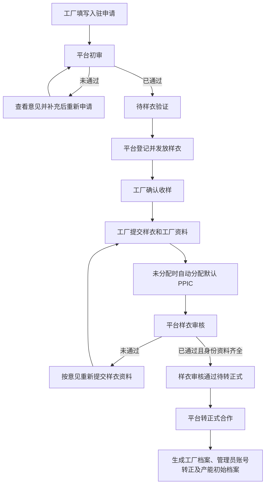

# 工厂入驻现行需求

## 范围与继承

本文件汇集工厂入驻 P0/P1/P2、Step1～6、Step8～11 及最终口径中仍有效的要求。用户后续确认的工厂简称、手机号、两种审核结果、扩展样衣资料和 PPIC 分配覆盖同一事项的旧表述；本次仅整理文档，不改变产品代码、历史记录或验收状态。

入驻申请、样衣验证、正式工厂档案、管理员账号和产能档案各有独立归属。平台初审通过和样衣审核通过都不自动生成正式工厂。

## 1. 完整业务流程与状态

有效状态：草稿、待平台审核、平台审核退回、待样衣验证、待工厂确认收样、待工厂提交样衣审核、待平台审核样衣、样衣审核退回、样衣审核通过待转正式、已转正式合作。平台与样衣审核均只有已通过、未通过，未通过允许补充后再次提交，不执行旧“拒绝且禁止再次申请”的锁定规则。

## 2. 表单、账号与唯一性

工厂简称必填，去除首尾空格后不能为空。简称作为登录账号，保存草稿与提交时自动维护管理员账号；页面不展示独立账号/密码填写区或明文密码。

简称在所有入驻申请和正式工厂档案中全局唯一，当前申请编辑排除自身；正式工厂缺少简称时以工厂名称兜底比对。缺失提示“请填写工厂简称”，重复提示“工厂简称已存在，请更换”。

基础资料包括申请人、身份号码与文件、工厂/公司名称、简称、地址、手机号、来源和收到通知的 PPIC 姓名；能力资料包括机器总量、有效工人数量、可开始合作时间、工序工艺能力和机器明细。身份、联系、机器与流程记录仍分别归属原对象。

手机号是工厂入驻、平台管理及正式档案的展示字段；旧手机号/WhatsApp 字段只用于历史读取。管理员姓名取申请人，角色为工厂管理员，入驻期为临时账号。转正式后明确工厂身份、来源申请和转正时间。

## 3. 工序工艺、机器、完整性与类型

工序工艺来自现有工序工艺字典，先选工序再选具体工艺；至少选择一项，不允许只选工序。页面显示中文名称，已选项可移除。

每台机器维护名称、数量、状态及关联工序和工艺。关联只能取已选接单能力；删除能力后，受影响机器重新校验，不静默保留失效关联。缺工序、缺工艺和未在能力中选择均阻断相应提交。

完整性按实际资料项计算，草稿允许不完整；原 P2 提交门槛为至少 80 分。等级仍为 0～59 不完整、60～79 基本完整、80～94 完整、95～100 高完整。

**保留的目标与现状差异：** 原 P2 的七项权重合计 100 分；当前 `calculateOnboardingCompleteness` 的七项为身份15、工厂基础25、人员10、机器15、能力15、机器关联10、合作日期5，合计95分。旧账号与 WhatsApp 评分表不能直接当当前界面说明，本次不修改评分，也不把权重差异宣称已解决；后续涉及评分时须同时核对原目标和当前实现。

按能力匹配裁床、印花、染色、后道、特殊工艺及车缝工厂；命中三类及以上，主类型为全能力工厂，同时保留全部命中类型及依据。机器关联和能力不能被类型标签替代。

## 4. 样衣发放、确认收样与提交

平台初审通过进入待样衣验证。登记发样创建独立样衣验证记录，保存样衣身份、发放时间、预计提交时间，并写入“平台登记并发放样衣”动作。申请关联样衣验证身份，不生成正式工厂或开放业务。

确认收样时间、收样人必填，收样人默认当前管理员姓名，备注可选；记录确认时间、人员、备注、动作次数及日志。样衣与申请同步进入待工厂提交样衣审核，申请仍处样衣验证阶段。

提交必填样衣照片、样衣视频、工艺说明、工厂照片和工厂视频；问题说明、备注、补充文件以及老板身份资料在工厂端可选。照片支持 jpg/jpeg/png/webp，视频支持 mp4/mov，可多文件；补充文件沿用已有支持类型。

保存提交人、提交时间、资料、提交轮次及动作，样衣和申请同步进入待平台审核样衣。平台能查看收样信息和每轮实际提交资料，不用后续修改覆盖审核时快照。

## 5. 审核、身份兜底与流程记录

平台初审已通过只进入待样衣验证；未通过进入平台审核退回，展示意见和需要补充的字段，允许重新提交。

样衣审核已通过只进入样衣审核通过待转正式；未通过进入样衣审核退回，明确需重新提交内容，允许新轮次提交。审核留存轮次、结果、意见、人员、时间、前后状态和节点、关联提交轮次、质量结论、能力结论及备注。

样衣审核选择已通过，老板身份号码与文件必须齐全。工厂已提交的资料只读展示；缺失部分由平台补录，记录工厂提交/平台补录/两者共同来源、补齐人员与时间及审核时快照。未通过不强制先补齐身份资料。

节点进行中耗时为当前时间减进入时间，完成节点为离开时间减进入时间，未开始显示“-”，终止显示已终止。动作次数按同一节点实际动作记录累计，多轮审核继续累积。退回记录关联审核轮次、原因、要求字段、实际补充字段、提交人、时间及状态；重新提交闭合上一补充节点并进入对应审核节点。

## 6. PPIC 与正式转档

首次提交样衣资料后未分配时使用统一默认 PPIC；已分配保持原值，不重复写默认分配记录。平台可更换启用 PPIC，记录时间、人员、原值、新值与原因。列表显示 PPIC，并支持全部、未分配和启用 PPIC 筛选。

仅样衣审核通过待转正式且关联样衣验证已通过的申请可转正式；已有正式档案不能重复转档。管理员账号、能力、机器或必需身份资料不足时阻断。

转档映射工厂/申请人/简称/手机号/地址/来源/通知 PPIC/身份/规模/合作日期/能力/机器/样衣验证/来源申请；已分配 PPIC 的身份、姓名、电话同时映射。生成正式工厂，管理员账号转正并关联正式工厂，创建产能初始档案，保存转档事实。

产能初始档案保留来源申请、工厂类型、人员和机器规模、能力、机器及时间。计算字段不足时默认日可供给产值为0、状态为待补充产能字段，不能凭机器数量估算产值、自动制造班次、当前产能状态或周供给能力。

## 7. 准入与边界验收

登录入口 `/fcs/pda/auth/login`，入驻入口 `/fcs/pda/auth/onboarding`。未登录回登录；未正式合作回入驻；已转正式但仍持旧入驻会话要求正式账号登录。只有正式工厂进入执行、交接、仓管、结算与派单候选。

正常：申请、两次审核、发样收样、PPIC分配和正式转档完整执行。边界：简称重复、机器关联失效、审核未通过后重新提交、通过前身份缺失、重复转档及未合作访问业务均按规则阻断或恢复。

最终检查脚本：`scripts/check-factory-onboarding-final-flow.ts`；分步检查仍按相应 Step8～11 规则执行。Playwright 覆盖：`tests/factory-onboarding-final-flow.spec.ts`。本次文档整理仅重跑相关文档/业务契约，不冒充新一轮全流程页面验收。

## 8. 来源与替代边界

整理前的 P0/P1/P2、Step1～6、Step8～11 与最终口径见[完整原文版本](https://github.com/laoertongxue/higoods/tree/e45ceac841b15aad352fbc0fda9274a35c44e01c/docs)。账号/联系取 Step8，审核结果取 Step9，样衣及身份兜底取 Step10，PPIC取Step11，正式流程取最终口径；未被覆盖的能力、机器、节点记录、类型与产能约束继续继承。旧锁定、三种审核结果、初审即转档、独立账号表单及 WhatsApp 展示不作为现行要求。
